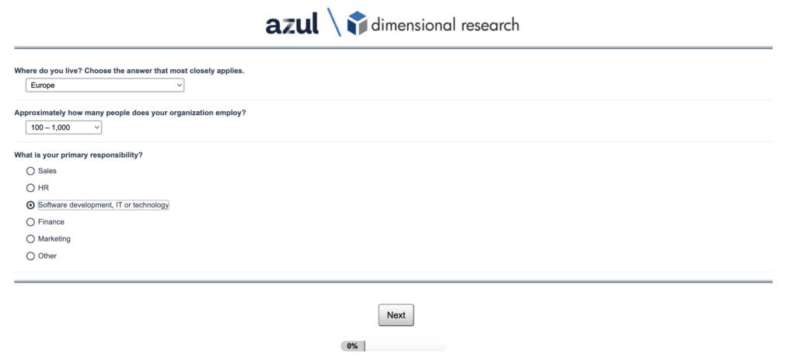
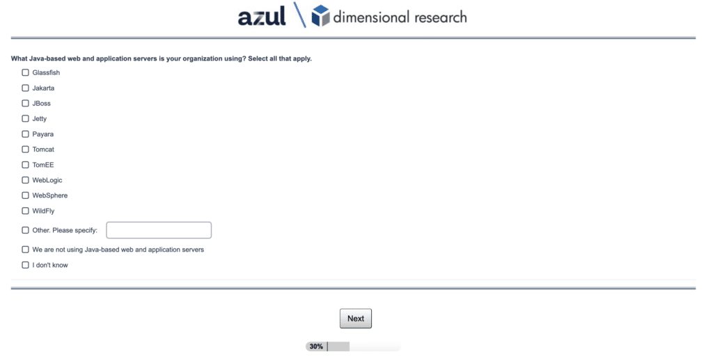
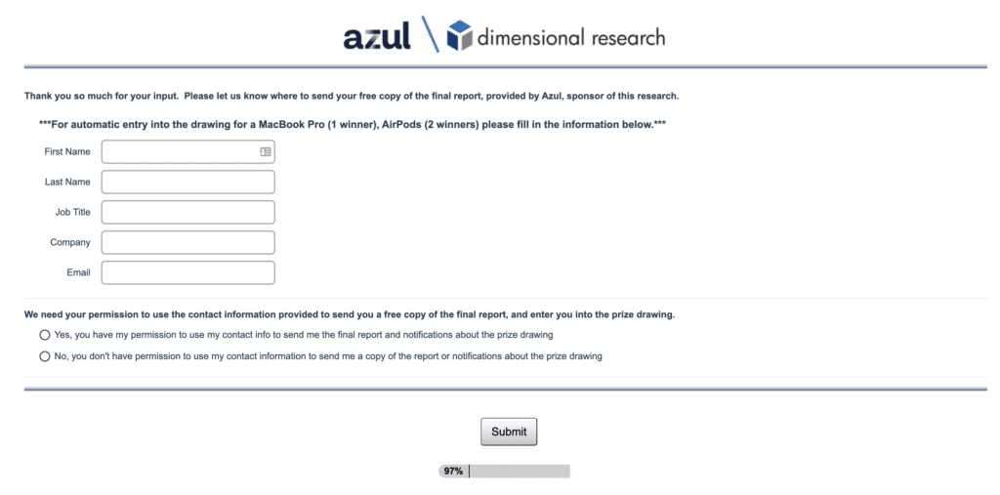

Do you ever wonder what OpenJDK distributions and what Java versions your peers are using? Java-based infrastructures and languages? How many are running Java applications in public clouds?

**THE SURVEY DESCRIBED BELOW IS NOW COMPLETE, NO MORE RESPONSES CAN BE ACCEPTED.**

Azul has been gathering all that data from a survey of Java users, running until 6:30pm CT on June 15, 2023. If you want to participate, the survey takes about 10 minutes, and we'll hook you up with the report after the survey is complete. Plus you'll be helping to add to our collective knowledge. Plus you'll be entered into a drawing to win prizes like an Apple MacBook Pro laptop or a set of AirPods.

Here's an example of the kinds of questions you'll be getting during the survey and how it wraps up.
  
