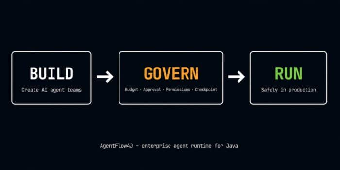

*A JVM-native runtime for building, governing and operating AI agents on existing Spring infrastructure.*

Every time a Spring team decides to add AI agents to a production system, the story tends to follow the same arc. A few prototypes are built, several frameworks are evaluated, and then a new reality emerges: the project is no longer just about adding agents. It is about operating a new platform.

With that new runtime come new deployment pipelines, new monitoring mechanisms, additional security reviews, and new operational responsibilities.

The question is not whether those frameworks are good. Many of them are.

The real question is this: when an organization already operates a mature Spring platform, does it actually need to introduce a second runtime?

For most Spring teams, the challenge is not infrastructure. They already have security, observability, persistence, configuration management, and operational tooling running in production.

What is missing is not a new platform. It is a runtime that connects agent execution directly to the operational capabilities Spring teams already use every day.

## What agents actually need in production

Forget the demos. In production, an agent system needs to answer six questions:

1. **Who is allowed to trigger this agent?** (authorization)
2. **What tools can it call?** (tool policy)
3. **How much can it spend per run?** (budget)
4. **What happens when it fails?** (retry + classification)
5. **Does a human need to approve before a high-stakes action?** (approval gate)
6. **Where does execution state go if the server restarts?** (checkpoint)

Most agent runtimes introduce their own operational model for these concerns. A Spring team already has answers to most of them through Spring Security, Micrometer, Spring Data, and Spring Boot Actuator.

What is missing is a runtime that connects those existing capabilities directly to agent execution.

## What Spring already gives you

|  Production concern   | Existing Spring capability |
|-----------------------|----------------------------|
| Authorization         | Spring Security            |
| Metrics               | Micrometer                 |
| Persistence           | Spring Data JPA            |
| Health and operations | Spring Boot Actuator       |
| Configuration         | `application.yml`          |

**Spring Security** already knows which users have which roles. In a governed agent system, that translates directly: only a user with `ROLE_PAYMENT_AGENT` should be able to trigger an agent that touches payment data. You don't rebuild that logic. You reuse it.

**Micrometer** already instruments your application. An agent graph that emits token counts, cost estimates, and node latencies through Micrometer means your AI workflows appear in the same Grafana dashboards as the rest of your system. No new monitoring stack.

**Spring Data JPA** already manages your datasource. A `CheckpointStore` backed by that datasource means your agent's execution state survives a restart without exotic infrastructure.

**Spring Boot Actuator** already exposes health and metrics endpoints. An agent runtime that plugs into Actuator means your ops team monitors AI workflows the same way they monitor everything else.

None of this requires a second operational stack. What it requires is a runtime that can build, govern and operate agents using the capabilities Spring teams already have.

## BUILD: Create agent teams

[AgentFlow4J](https://github.com/datallmhub/agentflow4j) is that runtime. It gives you the building blocks to create agents and compose them into multi-agent systems.

An `ExecutorAgent` is a Spring bean backed by a `ChatClient`. A `CoordinatorAgent` routes tasks to the right specialist. A `ParallelAgent` fans out to multiple agents and aggregates results. An `AgentGraph` wires them together with explicit nodes and edges.

```
// Three specialized agents
Agent triage     = ExecutorAgent.builder()
    .chatClient(chatClient)
    .systemPrompt("Classify this support request: billing, technical, or other.")
    .build();

Agent billing    = ExecutorAgent.builder()
    .chatClient(chatClient)
    .systemPrompt("Resolve billing issues. You have access to the CRM and invoice system.")
    .build();

Agent technical  = ExecutorAgent.builder()
    .chatClient(chatClient)
    .systemPrompt("Resolve technical issues. You have access to the knowledge base.")
    .build();

// A coordinator that routes dynamically
CoordinatorAgent coordinator = CoordinatorAgent.builder()
    .executors(Map.of("billing", billing, "technical", technical))
    .routingStrategy(RoutingStrategy.llmDriven(chatClient))
    .build();

// A graph that composes them
AgentGraph graph = AgentGraph.builder()
    .addNode("triage",      triage)
    .addNode("coordinator", coordinator)
    .addEdge("triage",      "coordinator")
    .build();
```

Three agents, dynamic routing, typed state shared across nodes. Each agent is a standard Spring bean.

## GOVERN: Budget, approvals, permissions, checkpoints

Agents are not implicitly trusted. AgentFlow4J lets you define exactly what each agent can call, what it can spend, when a human must approve, and how execution state is preserved across restarts.

```
// the policy governs the tools registered on the agent:
// analyst can call crm.lookup and order.fetch, and nothing else
Agent analyst = ExecutorAgent.builder()
    .chatClient(chatClient)
    .systemPrompt("Analyse this refund request.")
    .tools(crmLookup, orderFetch)
    .toolPolicy(ToolPolicy.allowList("crm.lookup", "order.fetch"))
    .build();

// on the existing datasource: the agent_checkpoint table comes from your own migrations
JdbcCheckpointStore checkpoints = new JdbcCheckpointStore(jdbcTemplate, txManager, codec);

// one graph per run: the budget counters live on the policy instance
AgentGraph refundGraph() {
    return AgentGraph.builder()
        .addNode("analyse",  analyst)
        .addNode("process",  processor)
        .addEdge("analyse",  "process")
        // refuse a node once the spend recorded so far plus its estimate passes $0.50
        .budgetPolicy(BudgetPolicy.hierarchical(BudgetLimits.run(0.50), estimator, meter))
        // pause before process, a human must approve
        .approvalGate(ApprovalGate.requireFor("process"))
        // checkpoint after every node
        .checkpointStore(checkpoints)
        .build();
}

// the run id is what makes the run checkpointed: this call stops at the approval gate
AgentGraph graph = refundGraph();
AgentResult paused = graph.invoke(
    AgentContext.of("Refund order 4521"), RunOptions.ofRunId("refund-4521"));

// later, once a human has approved: the same graph keeps the spend counted so far
AgentResult done = graph.resume("refund-4521", ResumeOptions.ofApproval("process"));
```

The `processor` agent cannot run until a human approves: the first call returns an interrupt, and `resume` continues from the last checkpoint. After a restart, the same `resume` call on a newly built graph does the same. A run is only checkpointed when it is started with a run id, so a plain `invoke(ctx)` leaves nothing to resume from.

The store does not create its table. Add it to your Flyway or Liquibase migrations, like any other table of the application. On PostgreSQL:

```
CREATE TABLE agent_checkpoint (
    run_id             VARCHAR(128) PRIMARY KEY,
    payload            TEXT NOT NULL,
    checkpoint_version INT NOT NULL,
    created_at         TIMESTAMP NOT NULL,
    updated_at         TIMESTAMP NOT NULL
);
```

`JdbcCheckpointStore.createTableIfMissing()` creates the same table for you, with a `CLOB` payload: it works on H2 and on the other databases that have that type, and fails on PostgreSQL, which does not.

The tool policy covers the tools registered on the agent. Tools registered on the `ChatClient` itself, for example with `defaultToolCallbacks`, bypass it, so a sensitive tool such as `payment.refund` must stay off a client the analyst shares.

The budget is checked before each node attempt, against an estimate: once the spend recorded so far plus the next estimate passes $0.50, the run is interrupted. Three limits follow. A node that calls the model several times, for example through tools, is checked once, before its first call. A node that costs more than its estimate is recorded after the fact, so a run can end above the limit, and it is the next attempt that is refused. And the spend of a failed attempt is not recorded, so the cost of a retried node is undercounted.

The counters are held in memory on the policy instance, not in the checkpoint. That is why the graph is built once per run, and why the resume above goes through the same graph. After a restart, the run resumes on a new graph that counts from zero again: a limit that must hold across restarts needs a `BudgetPolicy` implementation that stores its counters.

No Python. No YAML DSL. No new infrastructure. The datasource is the one your Spring Boot application already configures.

## OPERATE: Observe, recover and run safely

### Retry that understands cost

One common failure mode: a retry policy that cannot tell the difference between a transient network error and an over-budget condition will keep retrying an expensive call until the budget runs out.

AgentFlow4J's `FailureClassifier` solves this with three outcomes:

```
// Your own rule first; anything it does not recognise falls through to the defaults
FailureClassifier domain = cause ->
    cause instanceof InvalidOrderException
        ? FailureClassification.permanent("order rejected by a business rule")
        : null;

RetryPolicy policy = RetryPolicy.exponential(3, Duration.ofSeconds(2))
    .withClassifier(domain.orElse(FailureClassifier.defaults()));
```

`TRANSIENT` means retry with backoff. `PERMANENT` means fail fast. `OVER_BUDGET` means stop and hand the run back as an interrupt, so the caller can pause, raise the limit and resume instead of paying for another attempt. The defaults already treat I/O errors, timeouts, HTTP 5xx and 429 as transient, and a `BudgetExceededException` as over budget. The retry policy is no longer blind to cost.

### Operational sovereignty

There is another dimension becoming increasingly relevant, particularly in Europe: operational sovereignty.

Operational sovereignty is not only about where models run. It is also about how many platforms an organization must secure, monitor, audit, and operate. Every additional runtime introduces another operational dependency.

A JVM-native agent runtime lets organizations build governed agent systems without introducing a second execution platform. Spring AI supports Ollama for local inference, so the agent layer does not need to reach outside the perimeter. The security controls, observability stack, and deployment model already in place stay as the single source of operational truth.

## One stack, one runtime

There is no second runtime to deploy, no second security model to audit, no second monitoring stack to maintain. AgentFlow4J integrates natively into an ecosystem millions of developers already operate, not as a Spring abstraction layer, but as a dedicated JVM-native runtime for governed agent execution.

AgentFlow4J is not a Spring plugin. It is a governed execution runtime for multi-agent systems on the JVM. Spring AI provides model access. AgentFlow4J provides the building blocks and runtime to build, govern and run multi-agent systems.

Production AI systems rarely fail because they lack orchestration.  

They fail because they lack governance, operational controls, and clear ownership.  

Spring already provides much of that foundation. AgentFlow4J brings agent execution into the same operational model.

If your organization already runs on Spring, the goal is not to introduce another platform. It is to extend the one you already trust.

If you are an architect or open-source contributor interested in what a production-grade JVM agent runtime looks like at the language level, the governance model, the checkpoint contract, the failure classification API, that conversation lives on [GitHub](https://github.com/datallmhub/agentflow4j).

## Getting started

AgentFlow4J is available on Maven Central, for Java 17+, tested against Spring AI 1.0, 1.1 and 2.1:

```
<dependency>
    <groupId>io.github.datallmhub</groupId>
    <artifactId>agentflow4j-starter</artifactId>
    <version>1.0.1</version>
</dependency>
<!-- JdbcCheckpointStore, used in the GOVERN example, is not part of the starter -->
<dependency>
    <groupId>io.github.datallmhub</groupId>
    <artifactId>agentflow4j-checkpoint</artifactId>
    <version>1.0.1</version>
</dependency>
```

* **[GitHub](https://github.com/datallmhub/agentflow4j)**: source, docs, samples
* **[Cookbook](https://github.com/datallmhub/agentflow4j-cookbook)**: eleven self-contained Maven recipes: RAG, ticket triage, web research, Slack bot, batch processing, cost-aware routing, governed MCP agent, self-correcting writer, LLM as a judge, parallel research squad, governed OpenHands workflow
* **[Tutorial](https://datallmhub.github.io/agentflow4j/tutorials/stop-your-agent-burning-money/)**: end-to-end walkthrough of the four governance gates
* **[Validation](https://datallmhub.github.io/agentflow4j/validation/)**: every guarantee, the test behind it, and what that test does not prove

Apache 2.0 (not an official Spring project).
