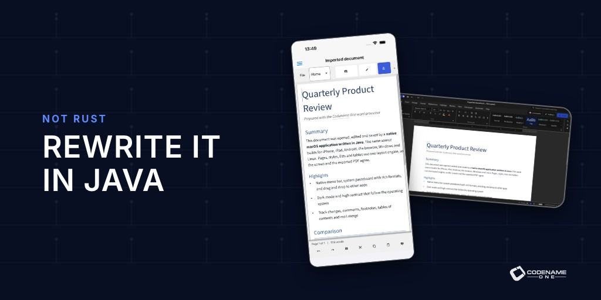

Rust is a great language for a kernel, a driver or a database engine. Code like that can't pause for a garbage collector and has to account for every byte, and Rust's ownership model pays for itself there. Somewhere along the way "rewrite it in Rust" turned into the default answer for everything, including desktop and mobile applications. For applications, I think that's the wrong trade. You pay more to write the code, more to review it and more to build it, and you don't get a better application in return.

<aside style="border-left: 4px solid #007aff; padding: 14px 18px; margin: 24px 0; border-radius: 4px; font-size: 0.95em;"><strong>What is Codename One?</strong> Codename One is an open-source framework for building native iOS, Android, desktop, and web apps from a single Java or Kotlin codebase. Learn more at <a href="https://www.codenameone.com/">codenameone.com</a>.</aside>

So we tested it instead of arguing about it. [Wordcraft](https://github.com/storytold/wordcraft) is an open-source word processor written in Rust with egui. It's a serious project with over 15,000 GitHub stars, a ribbon, styles, tables, track changes and mail merge, and it publishes a 502-row feature catalog, which makes it a fair target. We built [the same word processor in Java with Codename One](https://github.com/shai-almog/cn1-wordprocessor), implemented every catalog row Wordcraft implements, and measured both apps on the same GitHub runners in the same CI run.

The Java version is faster, smaller, uses less memory, has about two-thirds of the code and runs its tests several times cheaper. It also feels more native: it has a real macOS menu bar, copies formatted text into other apps, and lets you drag text and files between the document and the rest of the OS. And it ships to iPhone and Android from the same source. The details are below.

This is also the start of a busy week. A word processor makes the case with one app; the rest of the week is about what you can start with today. Three new full-stack templates join [Wayline](https://www.codenameone.com/blog/create-an-uber-clone-in-1-minute/): a real-time 3D strategy game, an end-to-end encrypted messenger and a food delivery service. Each one is an app and its server in one Java project that you can brand and ship.

## Coming This Week

Today is the Java against Rust story. Then one template a day, followed by the framework features those templates pushed into Codename One:

- **Saturday, October 24:** [Skirmish: A Multiplayer Strategy Game Template in Java](https://www.codenameone.com/blog/build-a-multiplayer-strategy-game-in-java/). A real-time strategy game in the style of Clash Royale, with a 3D arena, online matches, a level editor, in-app purchases, ads and a moderation console.
- **Sunday, October 25:** [Parley: A Private Messenger Template You Can Brand](https://www.codenameone.com/blog/launch-your-own-private-messenger/). An end-to-end encrypted messenger with groups, channels, voice notes, voice and video calls, linked devices and an admin console.
- **Monday, October 26:** [Savor: A Food Delivery Template for Restaurants and Local Fleets](https://www.codenameone.com/blog/launch-your-own-food-delivery-app/). Customer, restaurant, courier and admin roles in one app, with card holds, live tracking and payouts.
- **Tuesday, October 27:** [More of the Java API, and an Experiment With Unity Games](https://www.codenameone.com/blog/bring-your-java-code-everywhere/). A much bigger Java class library, an experiment that runs simple Unity 2D games as Codename One apps, a faster XML parser and runnable samples in the docs.
- **Wednesday, October 28:** [Native Menus, File Dialogs and 3D Models](https://www.codenameone.com/blog/desktop-dialogs-menus-3d-models/). Native open and save dialogs, native menu bars with standard commands, and animated 3D models.
- **Thursday, October 29:** [WebRTC Calls, Key Agreement and ORM Checks at Build Time](https://www.codenameone.com/blog/private-calls-and-safer-backends/). WebRTC calls, key agreement and HKDF everywhere, a backend client with mutual TLS, and ORM mistakes that fail the build.


skirmish-battle-e889d393bc.jpg | Skirmish, Saturday. | A Skirmish battle with towers, troops and a hand of cards
parley-chats-cf5acea888.png | Parley, Sunday. | The Parley chat list
savor-customer-home-1a637d2cf4.jpg | Savor, Monday. | The Savor home screen with food categories and restaurants


## The numbers

Every figure below comes from one CI run ([39825464193](https://github.com/shai-almog/cn1-wordprocessor/actions/runs/39825464193)) that builds both apps from source and runs them on the same machines against the same documents. The workflow is in the repository, so you can rerun it. Desktop values are macOS / Linux / Windows medians with a 1,000-paragraph document.

| What we measured | Java (Codename One) | Rust (Wordcraft) |
| --- | --- | --- |
| Startup to the first painted document | 370 / 231 / 288 ms | 821 / 246 / 455 ms |
| Type a character to painted frame | 8.9 / 10.7 / 12.4 ms | 51.9 / 14.9 / 24.9 ms |
| Idle RAM | 112 / 111 / 90 MiB | 145 / 187 / 106 MiB |
| Executable size | 34.7 / 37.7 / 32.5 MiB | 55.0 / 75.2 / 57.5 MiB |
| Feature catalog rows | 487 of 487 implementable | 487 implemented, 15 stubs |
| Application code | 76,275 lines | 118,659 lines |
| Tokens an AI agent reads to see all of it | 1,006,395 | 1,646,847 |
| Cold build and full test run | 97 s | 961 s |
| CI time per test | 86 ms | 500 ms |
| Platforms from one source | macOS, Linux, Windows, iPhone/iPad, Android, browser | macOS, Linux, Windows, FreeBSD, browser |

Java wins 38 of the 42 desktop measurements. The chart shows the gap on macOS as a ratio, so 2× means the Rust version needs twice as much of that resource:


The other four are close calls, and none of them is a win on every OS:

| Measurement | Where Rust was ahead | Where Java was ahead |
| --- | --- | --- |
| Startup with a one-paragraph document | Linux, by 4 ms (166 against 170 ms) | macOS (320 against 651 ms) and Windows (189 against 343 ms) |
| Save a DOCX | Linux, by 1.8 ms (5.9 against 7.7 ms) | macOS (7.7 against 12.0 ms) and Windows (7.4 against 10.3 ms) |
| Peak RAM during the workload | macOS by 7 MiB, Windows by 18 MiB | Linux (190 against 241 MiB) |

A 4 ms difference in launching a nearly empty document isn't something a person can notice, and the same measurement on the other two systems goes to Java by hundreds of milliseconds.

### It's faster

Typing latency is the number users feel. A character typed into the Java app reaches the screen in 8.9 ms on macOS; the Rust app takes 51.9 ms. At 60 Hz a frame lasts 16.7 ms, so one app stays inside a single frame and the other spends more than three. Undo is the same story, 8.9 ms against 52.3 ms.

Opening documents shows it too. Reopening the test DOCX takes 31.6 ms on macOS against Wordcraft's 132 ms, and 31.5 ms against 261 ms on Windows.

How does Java beat Rust here? Codename One compiles the app ahead of time through ParparVM, which translates the bytecode to C after dropping every class and method the app never reaches. The C compiler then inlines and optimizes across what's left. There's no JVM at run time. Garbage collection makes allocation cheap and reclaims memory on its own thread, so the application code has no ownership bookkeeping, no defensive clones and no reference counting. The UI runs on one thread while work such as saving runs in the background, and saving compresses large parts on several cores at once, without lifetimes or `Send` bounds to design around. We didn't use profile-guided optimization or special tuning for this benchmark. These are the defaults every Codename One app gets.

### It's smaller, and it scales better

"Garbage collection wastes memory" is the first thing people tell me when I say Java should be used for desktop and mobile apps. The measurements say otherwise. The executable is less than two-thirds the size on every OS, half on Linux. Idle memory is lower on all three, and the gap grows with the document:

| Idle RAM | 1 paragraph | 1,000 paragraphs | 10,000 paragraphs |
| --- | --- | --- | --- |
| macOS, Java / Rust | 96 / 106 MiB | 112 / 145 MiB | 220 / 364 MiB |
| Linux, Java / Rust | 94 / 164 MiB | 111 / 187 MiB | 198 / 387 MiB |
| Windows, Java / Rust | 71 / 82 MiB | 90 / 106 MiB | 169 / 308 MiB |

With a 10,000-paragraph document, the Rust version needs between 65% and 95% more memory. Startup with that document is 917 ms against 1,670 ms on macOS. Manual memory management doesn't make an app lean by itself. Data structures do, and a garbage collector frees you to pick good ones instead of the ones the borrow checker accepts.

### It costs less for AI and CI

The Java code base is about two-thirds of the lines and three fifths of the tokens. If you work with coding agents, tokens are the cost model: every task starts with the agent reading code, and every edit it proposes is code a human reviews. A smaller code base for the same feature catalog means less to read, a smaller context and smaller diffs.

The word processor itself was written that way. I started with Codex, then switched to Claude, and Codename One's built-in MCP server let the agents drive the running app and inspect it while they worked.

CI tells the same story. A cold build plus the full test suite takes 97 seconds for the Java app and 961 seconds for Wordcraft, on the same runner. The Java tests run on the JVM against the same code that ships natively, so a test run doesn't need a native toolchain. Rust compiles its whole dependency tree and its test binaries before it runs anything. The suites have different sizes (1,123 tests against 1,922), so per test it's 86 ms against 500 ms. About a quarter of Wordcraft's tests cover plumbing such as scroll viewports, popup placement and window state that Codename One provides as framework services and tests once.

### It's easier to review

Here is how the spell checker loads its 2 MB word list without slowing startup, from `Proofing.java`:

```java {class="cn1-no-try"}
public static synchronized void preload(final Runnable done) {
    if (preloading) return;
    preloading = true;
    new Thread(
            (Runnable) () -> {
              WordList.get();
              extra();
              done.run();
            },
            "proofing-load")
        .start();
}
```

Any Java developer can review that in seconds. A background thread fills a shared structure, and the garbage collector owns the memory. There are no lifetimes, no `Arc<Mutex<...>>` and no `Send` bounds.

Familiarity matters too. Far more developers read Java every day than Rust, so the person reviewing a change is more likely to know the idioms. Java also asks less of them. A reviewer checks what the code does, not whether ownership, borrowing, lifetimes and trait bounds were satisfied in a way that happens to compile. That lighter mental load is a real cost difference. When an agent writes 500 lines for you, how fast a human can review them decides how fast you move.

### It's more portable

The same source builds a native iPhone and iPad app, an Android app, a browser app and desktop apps for macOS, Linux, and Windows. CI builds every one of them on each run, with a screenshot from each. On a phone, the ribbon collapses into a tab picker, the page reflows to the screen width and a touch toolbar replaces the status bar. Wordcraft has no mobile target.

There's one platform Wordcraft supports that we don't: FreeBSD. Codename One doesn't target it today. If there's demand for FreeBSD support, we'll add it, so tell us in the comments.


wordprocessor-iphone-8c80a8da69.jpg | iPhone | The Java word processor on an iPhone
wordprocessor-android-252399a62c.jpg | Android | The Java word processor on Android



wordprocessor-web-1cb75816ae.jpg | The same app in a browser. | The Java word processor running in a browser


### It feels more native

This is the part I care about most, because users feel it before they ever see a benchmark. Portability usually means the lowest common denominator. Here it's the other way around: the Java app integrates with the operating system more deeply than the Rust one. On a Mac it has a real menu bar with the standard shortcuts, copies formatted text that Pages and Mail paste correctly, and lets you drag a selection out into another app or drop files and text in from the Finder:

| Feature | Java (Codename One) | Rust (Wordcraft) |
| --- | --- | --- |
| macOS menu bar | A native menu bar with about 40 commands and standard shortcuts | No menu bar, commands live only in the ribbon |
| Copy to other apps | HTML, RTF, Markdown and plain text, so Pages, Mail or a browser receive formatted text | Plain text only |
| Drag out to other apps | A selection drags out as rich text | No drag source |
| Drag in | Files and text, dropped at the caret | Files only |
| Paste in | HTML, RTF, Markdown, images and files | HTML, RTF and images |
| High contrast | Follows the OS setting live | Not supported |
| iPhone, iPad and Android | Native apps with touch selection handles | No mobile target |


native-menu-submenu-71146182bc.jpg | The native menu bar on macOS, with submenus. | The Java word processor's native File menu with an Export submenu on macOS



native-menu-app-roles-244a67e02c.jpg | About, Settings and Quit where a Mac user expects them. Wednesday's post shows how any app gets this. | The macOS application menu with About, Settings and Quit


### It looks at least as good

Wordcraft is on the left, the Java app on the right. Both are polished desktop apps, and both follow the OS dark mode live. Only one of them also looks right on a phone and follows the high contrast setting.


wordcraft-rust-15eeacca43.jpg | Wordcraft (Rust). Screenshot from its README. | Wordcraft, the Rust word processor, showing its built-in sample document
wordprocessor-editor-light-1db0ab6735.jpg | The Java version on macOS. | The Codename One word processor in light mode on macOS



wordprocessor-editor-dark-22f9e9def2.jpg | Dark mode, following the OS live. | The Codename One word processor in dark mode


### It's just as secure

Memory safety is the reason most people give for choosing Rust, and it's a good reason. Java has been memory safe since 1995. Bounds are checked, there are no dangling pointers and there's no manual `free`. To its credit, Wordcraft forbids `unsafe` in its own crates, so on memory safety the two apps are even.

The difference is in the supply chain. Wordcraft's `Cargo.lock` pulls in 534 external crates. The Java app depends on the Codename One framework and its own modules. Every dependency is code someone has to trust, update and audit, so a smaller dependency tree is a smaller attack surface.

### Can Rust catch up?

For size and speed, probably. It would take a lot of work and a deep rethink of memory layout and inlining, which means even more code and even slower builds. Matching Java here would mean rebuilding, inside Rust, what Java already provides. That's the cost I'm talking about.

A personal note. I use Firefox every day, and I love what the Rust work did for its speed and stability. But Firefox is a special case, and I think it proves my point. The parts Rust replaced are the low-level ones: the style engine, the renderer, media parsing. That's exactly where Rust belongs, and it works great there. The browser's user interface, the high-level part, is written in JavaScript, a JIT-compiled, garbage-collected language that gives the team flexibility. Firefox effectively reinvented the high-level side of Java for itself. A browser has to have both halves. Your application only has the second one.

## Why this matters now

When I wrote [Create an Uber Clone in 7 Days](https://www.amazon.com/Create-Uber-Clone-Days-mobile/dp/1983258784) in 2018, building an Uber-style app was the goal. Today it should be where you start. With coding agents, one developer can take on a scope that used to need a team. Hello world isn't a label on a screen anymore. It's a full application with a backend, an admin console, payments and push notifications, and your work begins from there.

At that scale, the language's overhead compounds. Every extra line is something an agent writes, a human reviews and CI builds, on every change, for the life of the product. Java was designed for big code bases maintained by many people, and it shows. It has a huge ecosystem, readable code, a fast compiler, fast tests and a garbage collector that takes memory management off your plate. Spending that budget on lifetimes in a settings screen doesn't buy your users anything.

That's the direction Codename One is taking: complete starting points, plus everything around the code that a real product needs.

Each template is a working application and its server in one Java project. The client and server share the API types, so a REST call or a WebSocket message is type checked on both ends. Growth and monetization are built into the framework instead of bolted on: invite-a-friend links, analytics, push notifications, ads and in-app purchases are all Codename One APIs that the templates already use. Commerce is the next piece we're working on. The template source is free under [MIT-0](https://github.com/codenameone/CodenameOne/blob/master/scripts/skirmish/LICENSE), with no royalties and no revenue share.

## More This Week

### A real-time 3D strategy game, royalty-free

For years I avoided pitching Codename One for games. That changed while we built these templates: a modern mobile game is mostly app. Sign-in, menus, a shop, friends, quests, push and a server, with the battle as a small part of the code. **Skirmish** is a real-time strategy game in the style of Clash Royale. Two players face each other across a 3D arena of animated glTF characters, each drawing troops and spells from a deck, and try to bring down the other's towers. Matches run online in lockstep over a WebSocket, with replays, progression, gem packs, a season pass, ads, and invites.

<video controls playsinline preload="metadata" poster="https://www.codenameone.com/blog/release-2026-10-23/skirmish-walkthrough-poster.jpg" style="width:100%;max-width:420px;height:auto;display:block;margin:0 auto" aria-label="A walkthrough of Skirmish: sign-in, the home screen, the guided training battle and a battle against a bot">
<source src="https://www.codenameone.com/blog/release-2026-10-23/skirmish-walkthrough.mp4" type="video/mp4">
<a href="https://www.codenameone.com/blog/release-2026-10-23/skirmish-walkthrough.mp4">Download the Skirmish walkthrough video</a>.
</video>

Every menu in that video is a regular Codename One component, laid out with layout managers and styled in CSS.


skirmish-home-42d6a61c8f.jpg | Home, chests and quests. | The Skirmish home screen
skirmish-online-battle-a93e5780d6.jpg | An online match. | An online Skirmish match
skirmish-shop-6ef75d2b70.png | The shop. | The Skirmish shop


The game is only half of what ships. **The Forge** is a level editor inside the game, where players and your designers build units, arenas, missions and whole campaigns and share them as packs. And an admin console runs the game like a live service: live matches, reports and flags, player history with audited moderation, queries over game data, engagement pipelines and promotions. It works on a phone and on the desktop.


skirmish-forge-editor-57849b79d6.png | The Forge, the level editor. | The Forge level editor in Skirmish
skirmish-forge-arena-4a18e78708.png | Designing an arena. | Designing an arena in the Forge
skirmish-admin-overview-d05b638f0b.png | The admin console. | The Skirmish admin console on a phone



skirmish-desktop-admin-overview-a2d82baf0f.png | Live operations on the desktop. | The Skirmish admin console on the desktop
skirmish-desktop-admin-pipelines-ddb15a8971.png | Engagement pipelines. | Engagement pipelines in the Skirmish admin console


Adding a unit to the game is one line in the shared rules module:

```java {class="cn1-no-try"}
add(new CardDef("squire", "Squire", CardDef.TROOP, 3)
        .hp(1450).damage(160).hitTicks(24).range(700).speed(45).radius(500));
```

No royalties, no per-install fees, no revenue share. Saturday's [Skirmish article](https://www.codenameone.com/blog/build-a-multiplayer-strategy-game-in-java/) walks through the arena, the multiplayer model and the monetization.

### A messenger your server can't read

Hospitals, companies and communities want their own messenger and can't use WhatsApp for it. **Parley** is that messenger: chats, groups, channels, voice notes, voice and video calls and linked devices, encrypted end to end with X3DH and the Double Ratchet, the design Signal uses. The server stores and forwards ciphertext, and calls go peer-to-peer.


parley-chats-cf5acea888.png | Chats, groups and channels. | The Parley chat list
parley-direct-chat-received-80f1b2db04.png | An encrypted conversation. | An encrypted Parley conversation
parley-call-connected-96ee59bd2a.png | Calls, peer-to-peer. | A Parley call
parley-admin-dashboard-7b35bbd91f.png | Moderation without reading messages. | The Parley admin dashboard


The crypto reads like ordinary Java because the primitives are now part of Codename One:

```java {class="cn1-no-try"}
KeyPair ephemeral = KeyGenerator.ec(256);
PrivateKey me = Identity.privateKey();
byte[] dh1 = KeyAgreement.ecdh(me, pub(signedKey));
byte[] dh2 = KeyAgreement.ecdh(ephemeral.getPrivateKey(), pub(identity));
byte[] dh3 = KeyAgreement.ecdh(ephemeral.getPrivateKey(), pub(signedKey));
```

Sunday's [Parley article](https://www.codenameone.com/blog/launch-your-own-private-messenger/) covers the protocol, moderation and how to brand it.

### Food delivery without the platform's cut

Delivery platforms often take between 15% and 30% of every order. **Savor** gives a restaurant, a chain or a local startup its own service: one app whose landing screen depends on the role (customer, restaurant, courier or admin), card holds captured on delivery, live tracking on a map with no API key bill, and order and delivery state machines that can't get confused when two people act at once.


savor-customer-home-1a637d2cf4.jpg | Customer | The Savor customer home screen
savor-merchant-queue-2894e16e41.png | Restaurant | The restaurant's order queue
savor-courier-offer-ba49408b34.jpg | Courier | A delivery offer for a courier
savor-admin-dashboard-a6bab235a1.png | Admin | The Savor admin dashboard


Monday's [Savor article](https://www.codenameone.com/blog/launch-your-own-food-delivery-app/) shows the flow and the ways to reshape it, from a single restaurant to groceries or flowers.

### More of Java, and a question about Unity

The class library gained 116 classes and interfaces, including `java.util.function`, streams, `Optional`, `java.time` and readers and writers. Existing Java code ports with fewer changes, and ParparVM and the obfuscator strip whatever your app doesn't call, so the overhead is minor. There's still no reflection and no class loading, on purpose.

We also tried something new to learn from what Unity does right: simple Unity 2D projects, C# scripts and all, now build and run as Codename One apps. Five open-source games run unmodified. It's a proof of concept, and you can't take any Unity game and run it.


unity-interop-fruitopia-457dc94f5a.png | Fruitopia | Fruitopia, an open-source Unity platformer, running on Codename One
unity-interop-sokoban-0d7074595d.png | Sokoban | An open-source Unity Sokoban game running on Codename One


Would that be useful to you? Tuesday's [Java and Unity article](https://www.codenameone.com/blog/bring-your-java-code-everywhere/) asks, and also covers a faster XML parser and a button in the API docs that runs each sample in your browser.

### Desktop apps that feel native

The word processor needed a real menu bar and real file dialogs to hold up next to a native app, so now every Codename One app has them. A `Command` goes into the native menu bar with one call, and standard commands land where each OS expects them, with its own shortcuts:

```java {class="cn1-no-try"}
Command settings = Command.createDesktopRole(Command.DESKTOP_ROLE_SETTINGS, e -> showSettings());
Command quit = Command.createDesktopRole(Command.DESKTOP_ROLE_QUIT, e -> quit());
```

That's "Settings…" with Cmd+, on a Mac, "Options" under Tools on Windows and "Preferences" under Edit on Linux. Open and save dialogs are the operating system's own, with filters, options and a preview where the platform supports them:


file-dialog-preview-option-f6cc1656b5.jpg | An open dialog with a preview and an option. | An open dialog with an image preview and a Remove location data option
native-menu-app-roles-244a67e02c.jpg | Standard commands in the macOS application menu. | The macOS application menu with About, Settings and Quit


Wednesday's [desktop article](https://www.codenameone.com/blog/desktop-dialogs-menus-3d-models/) has the details, plus the animated 3D models behind Skirmish.

### Calls, crypto and an ORM that fails the build

Voice and video calls are now a Codename One API, built on WebRTC on Android, iOS and the browser. Signaling stays yours, so the same code works with any server:

```java {class="cn1-no-try"}
WebRtc.openUserMedia(true, true, true).ready(media -> {
    pc = WebRtc.createPeerConnection(config, listener);
    pc.addTrack(media.getAudio());
    pc.addTrack(media.getVideo());
    pc.createOffer().ready(offer -> pc.setLocalDescription(offer)
            .ready(done -> signalling.send(offer)));
});
```

Turning a key agreement into an encryption key takes two lines, and works the same on every device and on the server:

```java {class="cn1-no-try"}
byte[] shared = KeyAgreement.ecdh(mine.getPrivateKey(), theirs.getPublicKey());
byte[] key = Hkdf.derive("SHA-256", null, shared, "chat message key v1".getBytes(), 32);
```

On the server, a partner API that wants a client certificate and HTTP/2 is one builder:

```java {class="cn1-no-try"}
WebClient partner = new WebClient()
        .setClientCertificate(ClientCertificate.pkcs12(archive, password))
        .setRequireHttp2(true)
        .setRequestTimeoutMillis(10000);
```

And with Hibernate and Spring, plenty of mapping mistakes compile fine and blow up when the app starts or on the first request that touches the entity. Codename One's ORM reads your entities at compile time, so these are build errors:

```
@Temporal requires a java.util.Date field: signedUp
Persistent fields must be writable: name
@Entity class com.example.Customer must declare a public no-arg constructor
```

Thursday's [calls and backends article](https://www.codenameone.com/blog/private-calls-and-safer-backends/) goes through each of these.

## Where is this going?

I don't want this read as "Rust is bad." If you're writing a kernel module, a codec, an embedded controller or anything with hard real-time limits, determinism matters more than throughput, and Rust is an excellent choice. A user-facing application has different constraints. It can trade determinism for throughput, for a smaller code base and for a team that moves faster.

For applications, Java is the better tool, and Codename One is turning into the place where you start with a whole product instead of a blank screen. The word processor is now on the [demos page](https://www.codenameone.com/demos/). Clone the [repository](https://github.com/shai-almog/cn1-wordprocessor), rerun the benchmark workflow and check my numbers. If you find a measurement I got wrong, open an issue there. And if you want to start a project today, the [Initializr](https://www.codenameone.com/initializr/) generates any of the templates in a minute.
