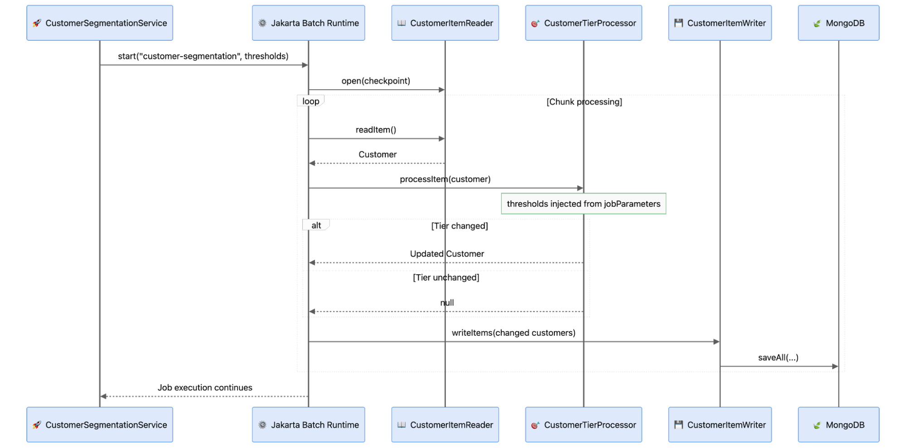

Batch processing addresses a common enterprise need: reliably applying business rules to large data sets without relying on individual user requests. Tasks such as recalculating customer segments, migrating records, reconciling transactions, updating prices, or processing millions of documents require more than a basic loop. Applications must control memory efficiently, handle failures, minimize unnecessary writes, and separate long-running processes away from interactive user experiences.

MongoDB and Jakarta Batch work well jointly to address these needs. In this article, we will develop a customer segmentation workflow that allows an administrator to adjust spending thresholds for Bronze, Silver, Gold, and Platinum customers, preview the impact, and initiate a batch job to reclassify only the necessary records. Our focus goes beyond batch APIs to designing a clear, scalable workflow that connects business decisions to controlled data processing.

This tutorial introduces the Batch pattern and demonstrates how to implement it with MongoDB.

In this tutorial, you'll:

- Model a customer segmentation system for an e-commerce application.
- Model and interact with MongoDB using Java.
- Build a batch workflow with Jakarta Faces Flow and Jakarta Batch to preview and apply customer reclassification rules.

You can find all the code presented in this tutorial in the GitHub repository:

```bash
git@github.com:soujava/mongodb-jakarta-batch.git
```

## Prerequisites

For this tutorial, you'll need:

- Java 21.
- Maven.
- A MongoDB cluster.
    - [MongoDB Atlas](https://www.mongodb.com/cloud/atlas/register?utm_campaign=devrel&utm_source=third-party-content&utm_medium=cta&utm_content=data_driven_test_dev&utm_term=otavio.santana) (Option 1)

Batch processing manages large sets of records as controlled workloads rather than single, lengthy requests. Instead of processing all data in one web request, the workload is divided into repeatable units. A typical batch pipeline reads items, applies business logic, groups results into chunks, and writes these chunks to the database. This approach delivers distinct points for handling checkpoints, failures, retries, filtering, and restartability, while also controlling memory usage and database writes.

In Jakarta EE, Jakarta Batch standardizes this model using jobs, steps, and chunk-oriented execution. A job consists of one or more steps, and a chunk step typically links an ItemReader, ItemProcessor, and ItemWriter. The reader supplies data, the processor applies business rules, and the writer persists the updated items. In our example, Jakarta Faces collects new customer segmentation thresholds, and Jakarta Batch manages the long-running task of reclassifying MongoDB customers independently of the HTTP request.

<div style="text-align:center">


</div>

This tutorial covers batch processing with Jakarta EE and MongoDB using a practical e-commerce scenario. We will show how Jakarta Batch manages operations across many records while maintaining a simple, responsive user experience. Specifically, we will build a customer dashboard that groups users into Bronze, Silver, Gold, and Platinum categories based on configurable spending thresholds.

From the dashboard, administrators can review customer distribution, adjust category thresholds, preview the impact of changes, and initiate the batch process. Jakarta Batch will then reclassify customers by reading data from MongoDB, applying the new rules, and updating only those whose category changes.

## Step 1: Generate the Project

The first step in this tutorial is to create the initial Maven structure. You can use the [Eclipse Starter for Jakarta EE](https://start.jakarta.ee/). For more details on this step, please refer to [the previous tutorial](https://foojay.io/today/building-ai-systems-with-mongodb-implementing-the-planning-pattern/).

We will include the MongoDB driver and PrimeFaces in the pom.xml. You can see the final result here:

```xml
<?xml version="1.0" encoding="UTF-8"?>
<project xmlns="http://maven.apache.org/POM/4.0.0"
         xmlns:xsi="http://www.w3.org/2001/XMLSchema-instance"
         xsi:schemaLocation="http://maven.apache.org/POM/4.0.0
                             https://maven.apache.org/xsd/maven-4.0.0.xsd">

    <modelVersion>4.0.0</modelVersion>

    <groupId>expert.os.demos</groupId>
    <artifactId>ecommerce-customer-segmentation</artifactId>
    <version>1.0.0-SNAPSHOT</version>
    <packaging>war</packaging>

    <name>E-Commerce Customer Segmentation</name>
    <description>
        E-commerce application that reclassifies customers into
        Bronze, Silver, Gold, and Platinum tiers based on configurable
        spending thresholds using Jakarta EE and MongoDB.
    </description>

    <properties>
        <project.build.sourceEncoding>UTF-8</project.build.sourceEncoding>
        <project.reporting.outputEncoding>UTF-8</project.reporting.outputEncoding>

        <maven.compiler.release>21</maven.compiler.release>

        <jakartaee-api.version>11.0.0</jakartaee-api.version>
        <jnosql.version>1.1.17</jnosql.version>
        <primefaces.version>16.0.0</primefaces.version>
        <junit.version>5.10.5</junit.version>
        <yasson.version>3.0.4</yasson.version>

        <compiler-plugin.version>3.15.0</compiler-plugin.version>
        <surefire-plugin.version>3.5.6</surefire-plugin.version>
        <war-plugin.version>3.5.1</war-plugin.version>

        <glassfish-plugin.version>8.0</glassfish-plugin.version>
        <glassfish.version>8.0.4</glassfish.version>
    </properties>

    <dependencies>

        <dependency>
            <groupId>jakarta.platform</groupId>
            <artifactId>jakarta.jakartaee-api</artifactId>
            <version>${jakartaee-api.version}</version>
            <scope>provided</scope>
        </dependency>

        <dependency>
            <groupId>org.eclipse.jnosql.databases</groupId>
            <artifactId>jnosql-mongodb</artifactId>
            <version>${jnosql.version}</version>
        </dependency>

        <dependency>
            <groupId>org.primefaces</groupId>
            <artifactId>primefaces</artifactId>
            <version>${primefaces.version}</version>
        </dependency>

        <dependency>
            <groupId>org.junit.jupiter</groupId>
            <artifactId>junit-jupiter</artifactId>
            <version>${junit.version}</version>
            <scope>test</scope>
        </dependency>

        <dependency>
            <groupId>org.eclipse</groupId>
            <artifactId>yasson</artifactId>
            <version>${yasson.version}</version>
            <scope>test</scope>
        </dependency>

    </dependencies>

    <build>
        <finalName>ecommerce-customer-segmentation</finalName>

        <plugins>

            <plugin>
                <groupId>org.apache.maven.plugins</groupId>
                <artifactId>maven-compiler-plugin</artifactId>
                <version>${compiler-plugin.version}</version>
            </plugin>

            <plugin>
                <groupId>org.apache.maven.plugins</groupId>
                <artifactId>maven-war-plugin</artifactId>
                <version>${war-plugin.version}</version>
            </plugin>

            <plugin>
                <groupId>org.apache.maven.plugins</groupId>
                <artifactId>maven-surefire-plugin</artifactId>
                <version>${surefire-plugin.version}</version>
            </plugin>

            <plugin>
                <groupId>org.glassfish.embedded</groupId>
                <artifactId>embedded-glassfish-maven-plugin</artifactId>
                <version>${glassfish-plugin.version}</version>

                <configuration>
                    <app>target/ecommerce-customer-segmentation.war</app>
                    <glassfish.version>${glassfish.version}</glassfish.version>
                    <contextRoot>/</contextRoot>
                    <port>8080</port>
                </configuration>
            </plugin>

        </plugins>
    </build>

</project>
```

The next step is updating the initial configuration in the database, where, in `src/main/resources/META-INF/microprofile-config.properties` you will include the database configuration and the properties.

```properties
jnosql.document.database=ecommerce
jnosql.mongodb.url=mongodb+srv://admin:<db_password>@cluster0.gblhb3d.mongodb.net/?appName=devrel-article-java-jnosql
jnosql.mongodb.application.name=devrel-article-java-jnosql
```

With the database configuration complete, we can now create the Customer entity. This entity will include the following attributes: id, name, totalSpent, and tier. The tier attribute will use an enumerator.

```java
@Entity
public class Customer {

    @Id
    private String id;

    @Column
    private String name;

    @Column
    private BigDecimal totalSpent;

    @Column
    private CustomerTier tier;
//builder
//getter and setter
}

public enum CustomerTier {
    BRONZE,
    SILVER,
    GOLD,
    PLATINUM
}
```

Java and MongoDB communicate using the Jakarta Data Repository, which provides a straightforward integration interface. No additional configuration is required.

```java
@Repository
public interface CustomerRepository extends BasicRepository<Customer, String> {
}
```

## Step 2: Create the Batch Structure

This tutorial explains the Jakarta Batch structure, execution model, and component responsibilities. Before starting a job, specify the information the batch process needs. In the customer-segmentation example, this refers to the spending thresholds that classify customers into Bronze, Silver, Gold, and Platinum tiers.

Each threshold consists of a minimum spending value and a customer tier. The segmentation policy groups these thresholds and can be serialized as JSON. This serialized policy is used as a job parameter, allowing the batch job to run with different business rules without changing the job implementation.

```java
public record SegmentationThreshold(
        BigDecimal minimumValue,
        CustomerTier tier) {
}

public record CustomerSegmentationPolicy(
        List<SegmentationThreshold> thresholds) {
}
```

After defining the policy, `CustomerSegmentationService` serves as the entry point for the batch operation. Its main role is to receive the selected policy, serialize it as a job parameter, and instruct the Jakarta Batch runtime to start the `customer-segmentation` job.

```java
package expert.os.demos.ecommerce.batch;

import jakarta.annotation.PostConstruct;
import jakarta.batch.operations.JobOperator;
import jakarta.batch.operations.NoSuchJobException;
import jakarta.batch.runtime.BatchRuntime;
import jakarta.batch.runtime.BatchStatus;
import jakarta.batch.runtime.JobExecution;
import jakarta.batch.runtime.JobInstance;
import jakarta.enterprise.context.ApplicationScoped;

import java.io.IOException;
import java.io.InputStream;
import java.io.UncheckedIOException;
import java.nio.charset.StandardCharsets;
import java.util.Comparator;
import java.util.List;
import java.util.Optional;
import java.util.Properties;

@ApplicationScoped
public class CustomerSegmentationService {

    public static final String JOB_NAME = "customer-segmentation";
    private static final String DEFAULT_THRESHOLDS = "/segmentation-thresholds.json";

    private volatile CustomerSegmentationPolicy currentPolicy;

    @PostConstruct
    void initialize() {
        currentPolicy = loadDefaultPolicy();
    }

    public CustomerSegmentationPolicy currentPolicy() {
        return currentPolicy;
    }

    public long start(CustomerSegmentationPolicy policy) {
        if (isRunning()) {
            throw new IllegalStateException("A customer segmentation batch is already running");
        }

        Properties parameters = new Properties();
        parameters.setProperty(CustomerSegmentationPolicy.JOB_PARAMETER, policy.toJson());

        long executionId = jobOperator().start(JOB_NAME, parameters);
        currentPolicy = policy;
        return executionId;
    }

    public Optional<BatchStatus> latestStatus() {
        JobOperator operator = jobOperator();

        try {
            List<JobInstance> instances = operator.getJobInstances(JOB_NAME, 0, 1);
            if (instances.isEmpty()) {
                return Optional.empty();
            }

            return operator.getJobExecutions(instances.getFirst()).stream()
                    .max(Comparator.comparing(JobExecution::getCreateTime))
                    .map(JobExecution::getBatchStatus);
        } catch (NoSuchJobException exception) {
            return Optional.empty();
        }
    }

    public boolean isRunning() {
        try {
            return !jobOperator().getRunningExecutions(JOB_NAME).isEmpty();
        } catch (NoSuchJobException exception) {
            return false;
        }
    }

    private CustomerSegmentationPolicy loadDefaultPolicy() {
        try (InputStream stream =
                     CustomerSegmentationService.class.getResourceAsStream(DEFAULT_THRESHOLDS)) {

            if (stream == null) {
                throw new IllegalStateException("Resource not found: " + DEFAULT_THRESHOLDS);
            }

            String json = new String(stream.readAllBytes(), StandardCharsets.UTF_8);
            return CustomerSegmentationPolicy.fromJson(json);
        } catch (IOException exception) {
            throw new UncheckedIOException(
                    "Unable to load default segmentation thresholds", exception);
        }
    }

    private JobOperator jobOperator() {
        return BatchRuntime.getJobOperator();
    }
}
```

After the job starts, the first batch artifact in chunk processing is the `ItemReader`. It supplies one item at a time to the batch runtime. In this application, `CustomerItemReader` retrieves customers from the repository, orders them by customer ID, and provides them sequentially using `readItem()`.

The reader also demonstrates checkpointing, a key Jakarta Batch concept. `checkpointInfo()` returns the current position, enabling the runtime to track progress at chunk boundaries and resume execution if needed. In this demonstration, the reader loads all customers into memory. For larger datasets, this approach can be adapted to use pagination or cursor-based access without changing the Reader -> Processor -> Writer model.

```java
package expert.os.demos.ecommerce.batch;

import expert.os.demos.ecommerce.Customer;
import expert.os.demos.ecommerce.CustomerRepository;
import jakarta.batch.api.chunk.AbstractItemReader;
import jakarta.enterprise.context.Dependent;
import jakarta.inject.Inject;
import jakarta.inject.Named;

import java.io.Serializable;
import java.util.Comparator;
import java.util.List;
import java.util.logging.Logger;
import java.util.stream.Stream;

@Named("customerItemReader")
@Dependent
public class CustomerItemReader extends AbstractItemReader {

    private static final Logger LOGGER = Logger.getLogger(CustomerItemReader.class.getName());

    @Inject
    private CustomerRepository customerRepository;

    private List<Customer> customers = List.of();
    private int nextIndex;

    @Override
    public void open(Serializable checkpoint) {
        try (Stream<Customer> customerStream = customerRepository.findAll()) {
            customers = customerStream
                    .sorted(Comparator.comparing(Customer::getId))
                    .toList();
        }

        nextIndex = checkpoint instanceof Integer index ? index : 0;

        if (nextIndex < 0 || nextIndex > customers.size()) {
            throw new IllegalArgumentException("Invalid customer reader checkpoint: " + nextIndex);
        }

        LOGGER.info(() -> "Customer reader opened: total=%d, nextIndex=%d"
                .formatted(customers.size(), nextIndex));
    }

    @Override
    public Customer readItem() {
        if (nextIndex >= customers.size()) {
            return null;
        }

        return customers.get(nextIndex++);
    }

    @Override
    public Serializable checkpointInfo() {
        return nextIndex;
    }
}
```

The `ItemProcessor` manages the business transformation. Jakarta Batch sends each customer from the reader to `CustomerTierProcessor`, which calculates the appropriate tier using the policy provided at job start. Jakarta Batch injects the policy via `@BatchProperty` as a serialized job parameter and reconstructs it during processor initialization. For each customer, the processor compares the calculated tier to the existing one. If the tier is unchanged, it returns null to filter out the item. If the tier has changed, it returns a new customer object with the updated classification.

```java
package expert.os.demos.ecommerce.batch;

import expert.os.demos.ecommerce.Customer;
import expert.os.demos.ecommerce.CustomerTier;
import jakarta.annotation.PostConstruct;
import jakarta.batch.api.BatchProperty;
import jakarta.batch.api.chunk.ItemProcessor;
import jakarta.enterprise.context.Dependent;
import jakarta.inject.Inject;
import jakarta.inject.Named;

import java.util.Objects;

@Named("customerTierProcessor")
@Dependent
public class CustomerTierProcessor implements ItemProcessor {

    @Inject
    @BatchProperty(name = CustomerSegmentationPolicy.JOB_PARAMETER)
    private String thresholdsJson;

    private CustomerSegmentationPolicy policy;

    public CustomerTierProcessor() {
    }

    CustomerTierProcessor(CustomerSegmentationPolicy policy) {
        this.policy = Objects.requireNonNull(policy);
    }

    @PostConstruct
    void initialize() {
        policy = CustomerSegmentationPolicy.fromJson(thresholdsJson);
    }

    @Override
    public Customer processItem(Object item) {
        if (!(item instanceof Customer customer)) {
            throw new IllegalArgumentException("Expected a Customer item");
        }

        CustomerTier calculatedTier = policy.tierFor(customer.getTotalSpent());
        if (calculatedTier == customer.getTier()) {
            return null;
        }

        return Customer.builder()
                .id(customer.getId())
                .name(customer.getName())
                .totalSpent(customer.getTotalSpent())
                .tier(calculatedTier)
                .build();
    }
}
```

The final component is the `ItemWriter`. Unlike the reader and processor, which handle individual items, the writer receives all items accumulated in the current chunk. In this application, these are only customers whose classification changed, since the processor filters out unchanged customers.

`CustomerItemWriter` delegates persistence to `CustomerRepository.saveAll()`, allowing changed customers to be written together. This keeps persistence concerns out of the processor and maintains the separation of responsibilities expected in the Jakarta Batch model.

```java
package expert.os.demos.ecommerce.batch;

import expert.os.demos.ecommerce.Customer;
import expert.os.demos.ecommerce.CustomerRepository;
import jakarta.batch.api.chunk.AbstractItemWriter;
import jakarta.enterprise.context.Dependent;
import jakarta.inject.Inject;
import jakarta.inject.Named;

import java.util.List;
import java.util.logging.Logger;

@Named("customerItemWriter")
@Dependent
public class CustomerItemWriter extends AbstractItemWriter {

    private static final Logger LOGGER = Logger.getLogger(CustomerItemWriter.class.getName());

    @Inject
    private CustomerRepository customerRepository;

    @Override
    public void writeItems(List<Object> items) {
        List<Customer> customers = items.stream()
                .map(this::toCustomer)
                .toList();

        customerRepository.saveAll(customers);
        LOGGER.info(() -> "Updated %d customer tiers".formatted(customers.size()));
    }

    private Customer toCustomer(Object item) {
        if (item instanceof Customer customer) {
            return customer;
        }

        throw new IllegalArgumentException("Expected a Customer item");
    }
}
```

The final element is the job definition. Jakarta Batch uses JSL XML to describe how batch artifacts are connected and how the runtime should execute them. In this example, the `customer-segmentation` job has a single step that processes customers in chunks of 20 items. The reader supplies customers, the processor applies the segmentation policy, and the writer persists the changed records. The job definition passes the thresholds to the processor, keeping the execution architecture declarative while the business logic remains in Java.

The XML that is at *resources/META-INF/batch-jobs/customer-segmentation.xml* serves as the orchestration layer for the batch pipeline. It does not contain the segmentation rules; instead, it connects the components and defines execution behavior. This results in a clear separation of responsibilities: Java classes implement the reading, processing, and writing logic, while the JSL file defines how those components participate in the job.

```xml
<?xml version="1.0" encoding="UTF-8"?>
<job id="customer-segmentation"
    xmlns="https://jakarta.ee/xml/ns/jakartaee"
    version="2.0">
    <step id="recalculate-customer-tiers">
        <chunk item-count="20">
            <reader ref="customerItemReader"/>
            <processor ref="customerTierProcessor">
                <properties>
                    <property name="thresholds" value="#{jobParameters['thresholds']}"/>
                </properties>
            </processor>
            <writer ref="customerItemWriter"/>
        </chunk>
    </step>
</job>
```

The diagram below shows the batch working and the process working:

- `CustomerSegmentationService` initiates the `customer-segmentation` job and provides the serialized thresholds as job parameters.
- Jakarta Batch loads the JSL definition and starts the `recalculate-customer-tiers` step.
- `CustomerItemReader` retrieves customers and supplies them individually to the batch runtime.
- `CustomerTierProcessor` processes each customer and determines the appropriate tier based on the configured thresholds.
- If the tier remains unchanged, the processor returns null, excluding that customer from the write phase.
- If the tier changes, the updated customer is included in the current chunk.
- The job is configured with `item-count="20"`, so Jakarta Batch processes and groups up to 20 changed items before invoking the writer for that chunk.
- `CustomerItemWriter` saves the changed customers to MongoDB during the write phase.
- Jakarta Batch repeats the read, process, and write cycle for each chunk until all customers are processed.

<div style="text-align:center">


</div>

## Step 3: Create the Bean

The next step is to connect the batch process to the web layer. The home page uses a `@ViewScoped` bean, as its state is only required while the dashboard view is active. `DashboardBean` initializes the dashboard state through `DashboardService`, exposes it to the page, and provides a `refresh()` method so the UI can retrieve the latest customer distribution and batch status without storing this state in the user session.

```java
package expert.os.demos.ecommerce.web;

import jakarta.annotation.PostConstruct;
import jakarta.faces.view.ViewScoped;
import jakarta.inject.Inject;
import jakarta.inject.Named;

import java.io.Serial;
import java.io.Serializable;

@Named
@ViewScoped
public class DashboardBean implements Serializable {

    @Serial
    private static final long serialVersionUID = 1L;

    @Inject
    private DashboardService dashboardService;

    private DashboardState state;

    @PostConstruct
    public void initialize() {
        state = dashboardService.initializeState();
    }

    public void refresh() {
        state = dashboardService.currentState();
    }

    public DashboardState getState() {
        return state;
    }
}
```

The segmentation wizard follows a different lifecycle. Jakarta Faces offers `@FlowScoped` for multi-step interactions where state must remain across several views but should be discarded once the user leaves the flow. Here, `CustomerSegmentationFlow` retains the threshold configuration and preview state as the administrator moves through **Configure, Preview, and Review**, and starts the batch only after final confirmation.

```java
package expert.os.demos.ecommerce.web;

import jakarta.annotation.PostConstruct;
import jakarta.faces.application.FacesMessage;
import jakarta.faces.context.FacesContext;
import jakarta.faces.flow.FlowScoped;
import jakarta.inject.Inject;
import jakarta.inject.Named;

import java.io.Serial;
import java.io.Serializable;
import java.util.Objects;

@Named
@FlowScoped("customer-segmentation")
public class CustomerSegmentationFlow implements Serializable {

    @Serial
    private static final long serialVersionUID = 1L;

    @Inject
    private CustomerSegmentationFlowService flowService;

    private CustomerSegmentationFlowState state;

    public CustomerSegmentationFlow() {
    }

    CustomerSegmentationFlow(CustomerSegmentationFlowService flowService) {
        this.flowService = Objects.requireNonNull(flowService);
    }

    @PostConstruct
    public void initialize() {
        state = flowService.initializeState();
    }

    public String preview() {
        try {
            flowService.preview(state);
            return "preview";
        } catch (IllegalArgumentException | IllegalStateException exception) {
            addMessage(
                    FacesMessage.SEVERITY_ERROR,
                    "Invalid thresholds",
                    exception.getMessage());
            return null;
        }
    }

    public String review() {
        return "review";
    }

    public String execute() {
        try {
            long executionId = flowService.start(state);

            addMessage(
                    FacesMessage.SEVERITY_INFO,
                    "Segmentation started",
                    "Batch execution %d started successfully".formatted(executionId),
                    true);

            return "home";
        } catch (IllegalArgumentException | IllegalStateException exception) {
            addMessage(
                    FacesMessage.SEVERITY_ERROR,
                    "Unable to start segmentation",
                    exception.getMessage());
            return null;
        }
    }

    public CustomerSegmentationFlowState getState() {
        return state;
    }

    private void addMessage(
            FacesMessage.Severity severity,
            String summary,
            String detail) {

        addMessage(severity, summary, detail, false);
    }

    private void addMessage(
            FacesMessage.Severity severity,
            String summary,
            String detail,
            boolean keepAfterRedirect) {

        FacesContext context = currentFacesContext();

        if (context != null) {
            if (keepAfterRedirect) {
                context.getExternalContext()
                        .getFlash()
                        .setKeepMessages(true);
            }

            context.addMessage(
                    null,
                    new FacesMessage(severity, summary, detail));
        }
    }

    FacesContext currentFacesContext() {
        return FacesContext.getCurrentInstance();
    }
}
```

The flow's defined in `src/main/webapp/customer-segmentation/customer-segmentation-flow.xml`. This file specifies the wizard's navigation: configure is the entry point, followed by preview and review. The home return node exits the flow and redirects to the dashboard.

```xml
<?xml version="1.0" encoding="UTF-8"?>
<faces-config xmlns="https://jakarta.ee/xml/ns/jakartaee"
              xmlns:xsi="http://www.w3.org/2001/XMLSchema-instance"
              xsi:schemaLocation="https://jakarta.ee/xml/ns/jakartaee
                                  https://jakarta.ee/xml/ns/jakartaee/web-facesconfig_4_1.xsd"
              version="4.1">

    <flow-definition id="customer-segmentation">

        <start-node>configure</start-node>

        <view id="configure">
            <vdl-document>
                /customer-segmentation/configure.xhtml
            </vdl-document>
        </view>

        <view id="preview">
            <vdl-document>
                /customer-segmentation/preview.xhtml
            </vdl-document>
        </view>

        <view id="review">
            <vdl-document>
                /customer-segmentation/review.xhtml
            </vdl-document>
        </view>

        <flow-return id="home">
            <from-outcome>/index?faces-redirect=true</from-outcome>
        </flow-return>

    </flow-definition>

</faces-config>
```

The key concept is the distinction between lifecycles:

- `@ViewScoped` keeps dashboard state for the current page.
- `@FlowScoped` keeps wizard state across several pages.
- Batch execution operates independently of both UI scopes.

This separation guarantees web interactions stay short-lived, while the batch job continues processing after the flow returns to the home page.

## Step 4: Start the Application and Use It

To run the application, start MongoDB locally or configure a MongoDB Atlas connection. Build and launch the Jakarta EE application using the provided Maven and GlassFish setup. Once the application starts, open the dashboard in your browser. If the customer collection is empty, sample data loads automatically, enabling you to test the segmentation flow immediately.

On the dashboard, select **Start Segmentation** and update the minimum spending values for each customer tier. Continue to the preview step to compare current and projected distributions. After reviewing the changes, confirm to start the Jakarta Batch job. The application returns to the dashboard while processing, and the refreshed dashboard shows the updated customer distribution when the job completes.

<div style="text-align:center">



</div>

## Conclusion

Batch processing delivers an organized approach to managing large-scale processes independently of individual requests or user engagements. By dividing workloads into smaller, manageable units and processing them predictably, the runtime can coordinate execution, monitor progress, and handle recovery. This approach is especially effective for recurring enterprise tasks such as reclassification, reconciliation, migration, and bulk updates.

Chunking represents an essential idea in batch processing. Rather than processing the entire dataset at once, work is divided into smaller units that can be processed and committed incrementally. The optimal chunk size varies based on data volume, processing cost, memory, and database performance. Batch processing provides a clear structure for balancing these trade-offs while maintaining a simple, controlled business workflow.

Ready to explore the benefits of MongoDB Atlas? Get started now by [trying MongoDB Atlas](https://www.mongodb.com/lp/cloud/atlas/try4-reg?utm_campaign=devrel&utm_source=third-party-content&utm_medium=cta&utm_content=data_driven_test_dev&utm_term=otavio.santana).

[Access the source code](https://github.com/soujava/mongodb-jakarta-batch) used in this tutorial.

Any questions? Come chat with us in the [MongoDB Community Forum](https://www.mongodb.com/community/forums/?utm_campaign=devrel&utm_source=third-party-content&utm_medium=cta&utm_content=data_driven_test_dev&utm_term=otavio.santana).

**References**:

- [Source code](https://github.com/soujava/mongodb-jakarta-batch)
