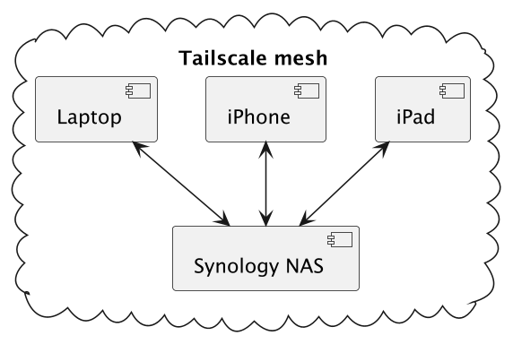
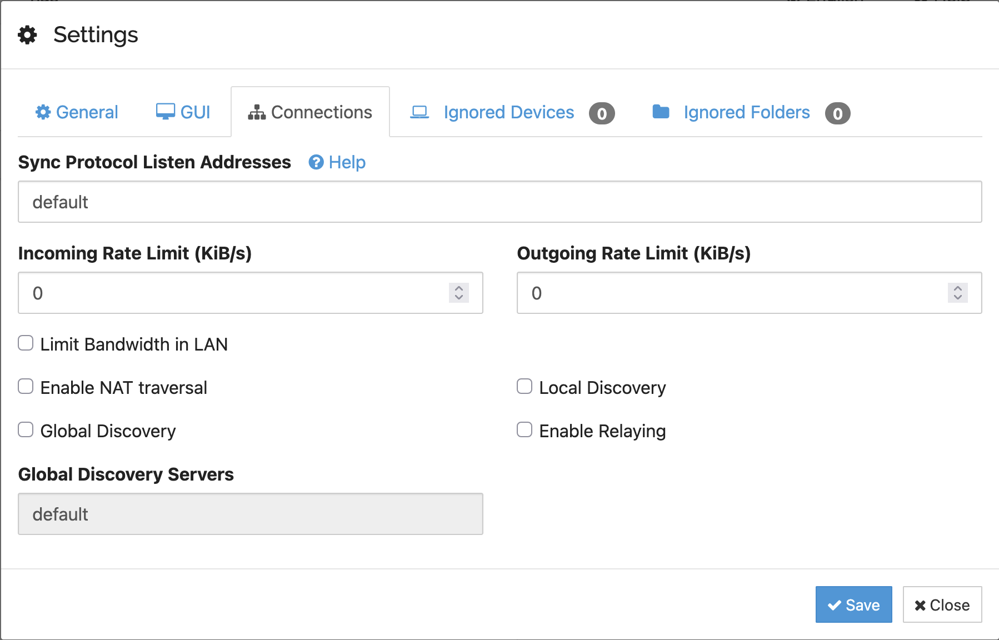
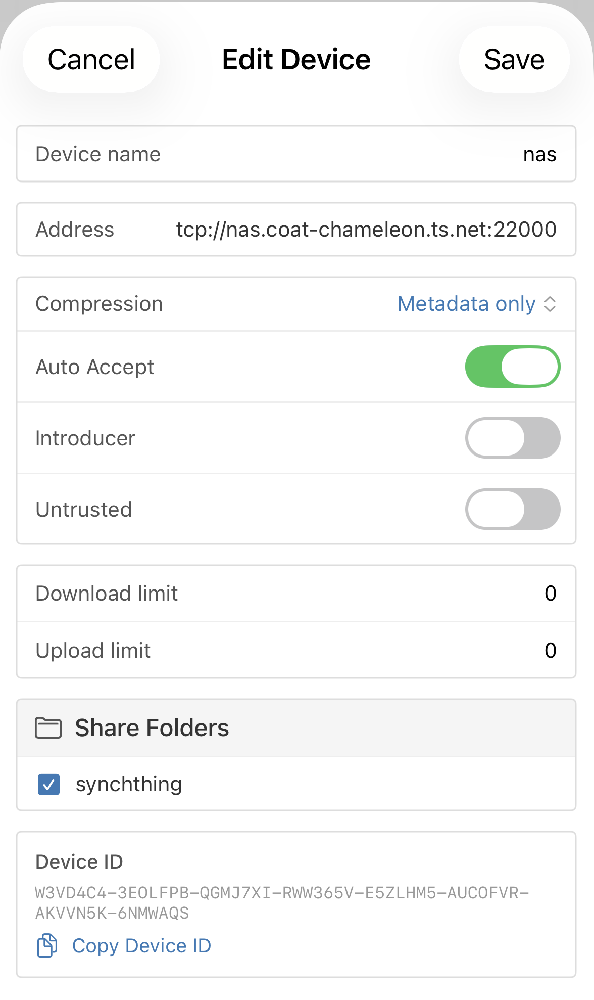

I used Dropbox for decades, then switched to Google Drive. Both worked for most of my files. One file never fit, though: my KeePass password database. It's the file I need on every device and the file I want to keep private the most. After one annoyance too many, I moved it to Syncthing over Tailscale. The rest stays on Google Drive, for now. This post describes why and how.

## The file that made me care

My password manager is KeePass-based. I use [KeePassXC](https://keepassxc.org/) on my laptop and [KeePassium](https://keepassium.com/) on my iPhone and iPad. Both open the same `.kdbx` file. The file is a single encrypted binary, written as a whole on every change and protected with a physical security key. I edit it on any device, sometimes offline. That's the worst case for any sync tool.

In my original setting, Google Drive was the proxy between my laptop and my phone. I bought the KeePassium premium tier for its Google Drive integration. The setup was dead easy, and it worked. However, now and then, the copy on my iPhone stopped following the one on my laptop. The likely culprit is how KeePassXC saves: it writes a temporary file, deletes the original, and renames the temporary file to the original name. Google Drive tracks files by identifier, not by name, so the renamed file is new. KeePassium kept pointing to the deleted one. Either I accepted a stale database, or I pointed KeePassium to the new file. Re-adding a database means unlocking it from scratch, and mine is protected by the physical security key. Fetching the key every few weeks got old. I had to find a solution.

> **Note:** Switching to another save method would have fixed the annoyance. Unfortunately, I learned about KeePassXC's [safe saves](https://keepassxc.org/docs/KeePassXC_UserGuide#_advanced_save_options) only while researching for this post. And I won't go back anyway, as I want to move away from Google and other US-based megacorps.

Drive also keeps every version of the file on Google's servers. For documents I edit with other people, it's a feature. For a file I'm the only one to edit, it's a history of my password database that lives on Google's servers. The underlying issue is not Google Drive per se.

For the record, moving away from Google also benefits [my privacy](https://blog.frankel.ch/pi-hole-tailscale/).

## Syncthing, and why Tailscale

[Syncthing](https://syncthing.net/) is a peer-to-peer file synchronization tool. Each device runs its own instance and has a unique identifier. You pair devices by exchanging identifiers. You then share folders with specific devices, one folder at a time. No server owns the data: every device holds a full copy of the folders it subscribes to. Nodes can be both send and receive, or receive only.

Syncthing works out of the box on the public Internet. To do that, it relies on infrastructure run by the Syncthing project: _global discovery_ servers, where each device announces its current IP address, and _relay_ servers, which forward encrypted traffic when two devices can't reach each other directly. **Traffic is encrypted end-to-end in both cases.** Still, a third party knows my devices' addresses, and my encrypted traffic may go through its relays.

I already have a private network between all my devices, thanks to Tailscale. I described the setup in [a previous post](https://blog.frankel.ch/cloudflare-zero-trust-tailscale/). Every device has a stable name and address on the mesh, wherever it is. With Tailscale, Syncthing needs neither discovery servers nor relays. I can switch them off and address the devices by name.

I'm fully aware that Tailscale is a third party too. Its coordination servers distribute the devices' public keys and know which device connects to which, and from where, though they never see the traffic.

However, Tailscale clients are Open Source, and [Headscale](https://headscale.net/) is a self-hosted implementation of the coordination server that the official macOS, iOS, and Synology clients can log into. If I ever want out, I can move my four devices in an afternoon. It's a real exit, albeit not a completely free one: every device gets a new key, a new address, and a new name, and relayed traffic still goes through Tailscale's servers unless I run my own. For now, convenience wins.



The topology is a star. The NAS is always on, so every other device pairs with it only. The laptop, the iPhone, and the iPad never talk to each other. It makes the configuration simpler, at the cost of a single point of failure. I'll get back to it. The NAS has no special role in the protocol. It's the hub only because it never sleeps.

## The setup

The following assumes Tailscale already runs on every device and that [MagicDNS](https://tailscale.com/kb/1081/magicdns) is enabled, so that each device has a name of the form `<device>.<tailnet>.ts.net`.

### Synology setup

Syncthing is available for Synology via [SynoCommunity](https://synocommunity.com/). In the Package Center, add `https://packages.synocommunity.com` as a package source, then install Syncthing. The package isn't verified by Synology, but it's expected. Once started, the web interface is at `http://nas.<tailnet>.ts.net:8384`. It has no password by default. Set one under **Actions > Settings > GUI**. The package runs under its own user; give it write access to the shared folder in Control Panel.

Open it, then go to **Actions > Settings > Connections**. Uncheck **Global Discovery**, **Enable Relaying**, and **Enable NAT traversal**.



Local discovery is harmless, but I unchecked it too. The NAS doesn't need to find any other devices; devices find it. With NAT traversal on, Syncthing asks the router to forward port 22000 from the Internet, and queries public STUN servers to learn its public address. My router ignores the request, so no port ever opens.

The phone still listed my public IP among the NAS's addresses: the discovery server fills it in from wherever the announcement came from. I unchecked the box anyway, so the NAS talks to neither the router nor the STUN servers.

Syncthing connections work in both directions, so it's enough for one side of each pair to know the other's address. On a Synology, the side is forced. The Tailscale package runs in userspace mode: the NAS accepts connections from the tailnet, but can't open any. So every device holds the NAS address, and the NAS keeps every device as `dynamic`. Without discovery, `dynamic` means the NAS never dials anybody.

Then, create the folder. Click **Add Folder** and choose the path on the NAS. Leave the **Sharing** tab empty for now. Devices come next, and they introduce themselves. In the **File Versioning** tab, choose **Simple File Versioning**. The NAS keeps the last few versions of each file in a `.stversions` folder. It's the only device that does.

### Mac OS setup

On macOS, Homebrew does the job:

```bash
brew install syncthing
brew services start syncthing
```

The web interface is at `http://127.0.0.1:8384`. Apply the same connection settings as on the NAS. Open **Actions > Show ID** on the NAS web interface, and on the laptop click **Add Remote Device**. Paste the NAS identifier and set its address to `tcp://nas.<tailnet>.ts.net:22000`. Within a minute, the NAS shows a banner: a new device wants to connect.

Accept it, leave its address as `dynamic`, and tick the folder in the **Sharing** tab. The laptop then shows the folder offer. Accept it and set the path to where you want to store your files. When it works, the NAS lists the laptop as connected, and the folder reads "Up to Date" on both sides. At home, Tailscale connects the two directly on the LAN, so the same address works everywhere.

> **Warning:** macOS refuses background processes access to Documents, Desktop, and Downloads **unless you grant it explicitly**. Syncthing runs as a background service, so a folder under Documents stops with "operation not permitted". Keep synced folders elsewhere, `~/Sync` for example.

### iOS setup

Syncthing has no official iOS client. I use [Sync Anything](https://apps.apple.com/us/app/sync-anything/id6776331289). It's freemium: the free version synchronizes to one single folder on one single device. If you want more, you know what to do.

On the phone, add the NAS by scanning the QR code from the NAS's **Actions > Show ID** screen. Tap **Edit** on the NAS entry and replace `dynamic` with `tcp://nas.<tailnet>.ts.net:22000`.



Accept the phone on the NAS and tick the folder, as for the laptop. Accept the folder on the phone. Sync Anything doesn't expose the connection switches, so the phone still announces itself to the discovery servers and may use a relay. With the NAS address set, it connects over Tailscale first. That's the leak I couldn't close.

One thing differs from the laptop: iOS doesn't allow apps to run permanently in the background. Sync happens while the app is open, and opportunistically otherwise. Note that Tailscale must be up on the phone too.

### KeePassium and KeePassXC setup

Nothing changes on the laptop: KeePassXC opens the `.kdbx` file from the synced folder. On the phone, open KeePassium, add a database, and browse the Files app to the Sync Anything location. KeePassium reads and writes a local file. No cloud connector, and no reason to re-add the database, so the security key stays in the drawer.

### What I sync

Syncthing shares folders, not a root. **Any folder**, **anywhere on the disk**, with **any subset of devices**. It's a great benefit compared to Dropbox and Google Drive, as they sync a single root folder, and the most you can do is pick which subfolders a device gets.

In practice, I don't use it yet. For now, I sync a single root folder with the NAS, which only contains the password database. Photos go through Synology Photos, which has its own app. Payslips are the next candidate, but I don't need them on my phone, and I seldom read them at all. That's a question of long-term storage rather than sync, and a design problem for another day.

## Trade-offs

The setup has trade-offs, however.

Four devices, no server, and a file written as a whole on every change: conflicts are possible. If I edit the database on the phone while offline, then on the laptop, Syncthing keeps both and renames one `.sync-conflict-*`. KeePassXC can merge two databases, so recovery is a matter of minutes. It didn't happen to me yet, but I know I'm covered in case.

Because of the iOS background restriction, the phone copy can lag. I need to open Sync Anything before KeePassium when I know I changed a password. It's a habit, not a solution.

Also, the star topology means that when the NAS is down, nothing syncs. The laptop and phone each keep their last copy and carry on. It's acceptable for me, since the NAS is the most reliable device in the house. Pairing the laptop directly with the phone would remove the issue, but Sync Anything's free tier allows a single remote device.

Finally, I don't run a database backup. It exists on four devices, but four copies that stay identical aren't a backup: a deletion or a corrupted save would propagate to all four within seconds. That's why the NAS keeps old versions. It covers potentially bad edits. The NAS itself isn't backed up; if it dies, three current copies survive, but the history goes with it. I accept that. RAID 5 covers a dead disk, and the history is a convenience, not a necessity.

## Conclusion

My password database forced me to question where my files live. The answer is on my machines, and only there. Syncthing does the synchronization, and Tailscale gives it a private network with stable names. I'm happy to move away from Google Drive, even if for one file.

Bit by bit, step by step. The next ones are files that I read often but don't write often, and archive files.

**To go further:**

* [Syncthing](https://syncthing.net/)
* [Syncthing documentation: Getting Started](https://docs.syncthing.net/intro/getting-started.html)
* [Syncthing documentation: Configuration](https://docs.syncthing.net/users/config.html)
* [SynoCommunity](https://synocommunity.com/)
* [Sync Anything](https://apps.apple.com/us/app/sync-anything/id6776331289)
* [Tailscale](https://tailscale.com/)
* [Headscale, a self-hosted Open Source Tailscale implementation](https://headscale.net/)
* [KeePassium](https://keepassium.com/)
* [KeePassXC](https://keepassxc.org/)

<hr>

_Originally published at [A Java Geek](https://blog.frankel.ch/google-drive-syncthing-tailscale/) on November 1<sup>st</sup>, 2026._
