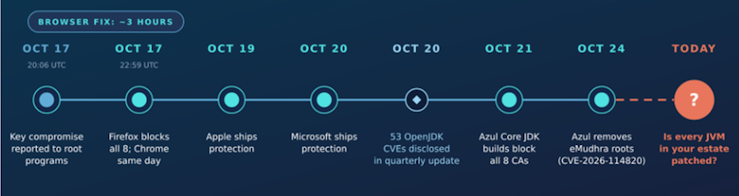
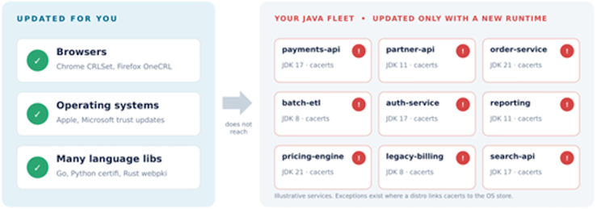
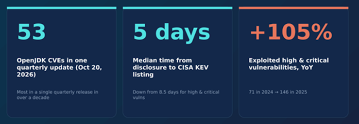
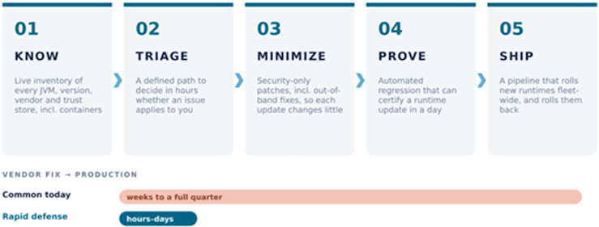

**The browser was patched in 3 hours. Is your Java estate patched?** 

On Friday evening, October 17, a researcher proved they controlled the private keys of eight eMudhra intermediate certificate authorities by signing the same short message with each one: *“We have a problem here.”* 

Mozilla received the report at 20:06 UTC and had Firefox blocking the certificates by 22:59 UTC. Chrome blocked them the same day. Apple followed on the 19th, Microsoft on the 20th. 

Browsers have an automated way to stop trusting a certificate authority, and they used it within hours, but **what about the thousands of Java applications running in your data centers and clouds?** 

*Timeline of the eMudhra CA compromise response, October 17–24, 2026* 

## How eMudhra affects Java

By default, Java doesn’t rely on the browser’s trust decisions, or on the operating system’s. Every JDK ships its own trust store (cacerts), and every container image that bundles a JDK carries its own copy. Patching the OS or restarting the browser doesn’t change them. 

Until each runtime is updated, a service making outbound TLS calls (to a payment processor, a partner API, a SaaS platform) can be tricked into trusting a forged certificate by anyone who can get between it and the destination.

And it landed in the same week as the October quarterly update: **53 OpenJDK CVEs**, the most in a single quarterly release in well over a decade. 

*A browser fix doesn’t reach your JVMs* 

## What I’m hearing from customers

I talk with enterprise Java teams across North America every week. Most can’t move a JDK update into production in less than weeks, and the biggest reason is *what’s inside the update*. 

A typical JDK release bundles the security fixes with bug fixes, performance changes, and behavior changes. Every one of those is a reason to re-test, so every update triggers a full regression cycle. Teams can’t take the fix they urgently need without everything that came with it. 

Around that, the same gaps come up again and again: 

- They can’t say with confidence where every JVM is running, which version and vendor, and who owns it. 
- Change windows are monthly or quarterly, and the “emergency” path is a bridge call and a lot of goodwill. 
- Container images only get rebuilt when the application team ships a feature. 

The result: a fix that exists within hours takes weeks, sometimes a full quarter, to reach production. **That gap is where the real risk lives.** 

## Then the first fix turned out not to be enough

On Saturday, October 24, a second critical vulnerability, **CVE-2026-114820** (CVSS 9.1), showed that the certificate blocklist the whole industry shipped on Wednesday, ours included, didn’t fully close the hole. The fix now removes the affected eMudhra-related root certificates from Java’s trust store entirely. **Every Java runtime needs to be updated again, including those that already took Wednesday’s update.** 

That’s two emergency runtime updates in four days, on top of a record quarterly release. For a team whose fastest path to production is measured in weeks, that isn’t a patch schedule. It’s a backlog.  

## The kind of patch decides how fast you can move

When an update contains only the security fixes, the change you have to validate is small. The testing cycle shrinks dramatically, and a patch can move from build to production in days instead of a quarter. 

It matters even more when the fix can’t wait for the next scheduled release. An incident like eMudhra needs an out-of-band, security-only update you can trust to change nothing else. 

## This is going to get faster, and more frequent

The numbers point one way. Rapid7’s 2026 Global Threat Landscape Report found that exploited high and critical vulnerabilities more than doubled year over year (up 105%), and the median time from disclosure to inclusion in CISA’s Known Exploited Vulnerabilities catalog dropped from 8.5 days to 5. And incidents like a CA compromise don’t wait for your next maintenance window. 

Quarterly patching used to be the plan. Now it’s the minimum. 

*The patch window is collapsing* 

## Building a rapid-defense approach

The teams that took this week in stride had five things in place before it started:

1.  **Know:** a live inventory of every JVM, version, vendor, and trust store, including inside containers.
2.  **Triage:** a defined path to decide within hours whether an issue applies to you and how urgent it is.
3.  **Minimize:** security-only patches, including out-of-band fixes, so each update changes as little as possible and testing stays focused.
4.  **Prove:** automated regression that can certify a runtime update in a day.
5.  **Ship:** a pipeline that can roll a new runtime (and its trust store) across the fleet, and roll it back.

None of this is exotic, but it has to exist *before* the incident. 

*Five capabilities that turn weeks into hours* 

This is the model we’ve built at Azul. On October 20, our security-only Critical Patch Updates fixed all 53 CVEs without unrelated code changes. On October 21, we shipped an out-of-band update blocking all eight eMudhra intermediates, less than 24 hours after disclosure. And on October 24, when CVE-2026-114820 showed that blocklist wasn’t enough, our team worked through the night: about 12 hours from the decision to respin to security-only builds in customers’ hands. Because each update carries only the security fix, our customers’ testing burden is a fraction of a full JDK upgrade. 

The rest, inventory, triage and the pipeline, is the conversation I most want to have with Java teams right now. 

So, a question for you: **if a certificate authority you trust were compromised tomorrow morning, how long until every Java service in your estate stopped trusting it?** 

## Sources

- [eMudhra Certificate Authority Compromise Triggers Emergency Action Across Browsers (Cybersecurity News)](https://cybersecuritynews.com/emudhra-security-compromise/) 
- [8 eMudhra certificates are compromised. Here’s what you need to know (Cloudflare)](https://blog.cloudflare.com/emudhra-certificate-compromise) 
- [Protecting Chrome and Android users from compromised eMudhra intermediate CA certificates (Google)](https://blog.google/security/protecting-chrome-and-android-users-from-compromised-emudhra-intermediate-ca-certificates/) 
- [OpenJDK Vulnerability Advisory: 2026/10/20](https://openjdk.org/groups/vulnerability/advisories/2026-10-20) 
- [Rapid7 2026 Global Threat Landscape Report](https://www.rapid7.com/about/press-releases/rapid7-2026-global-threat-landscape-report-shows-exploited-high-and-critical-severity-vulnerabilities-surged-105-as-attack-timelines-collapsed) 
- [CVE-2026-114820 (CVE.org)](https://www.cve.org/CVERecord?id=CVE-2026-114820) 
- [Azul Core release notes](https://docs.azul.com/core/release-notes) 

## FAQ

**1. If browsers blocked the compromised eMudhra CAs within hours, why are Java applications still at risk?**\
A JVM makes its own trust decisions. It reads the certificates bundled with the JDK (the `cacerts` file) and ignores what the browser or the operating system has just blocked. Until a runtime is updated, its outbound TLS connections keep accepting the compromised CAs.

**2. Why does Java patching take weeks or a full quarter, and what makes security-only patches faster?**\
Regular JDK releases mix security fixes with other changes, so each one needs a full regression cycle before it can go to production. A security-only update leaves everything else untouched, which leaves far less to test and lets a fix reach production in days. That is what an out-of-band response like eMudhra requires.

**3. What does an enterprise need in place to respond to a Java security incident in hours?**\
Five things, set up before the incident: a live JVM inventory, a fast triage path, security-only patches, automated regression, and a pipeline that can roll a runtime out and back. The section "Building a rapid-defense approach" above describes each one.
