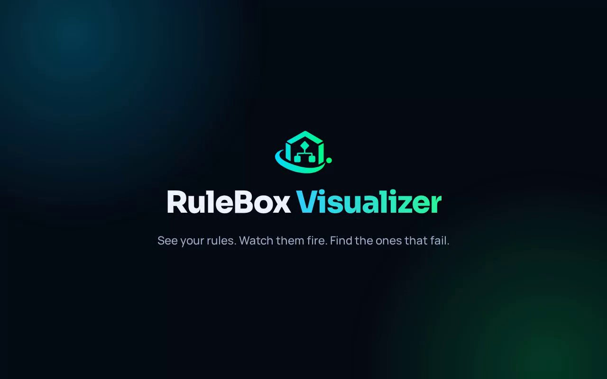

**Ortus Solutions today announces the general availability of [RuleBox 2.0.0](https://rulebox.coldbox.org), a modern, natural-language rules engine for BoxLang and ColdBox applications. It is a BoxLang-only rewrite, and it ships with rules as data, declared rulebooks, dry runs, an audit trail, and a built-in Rule Visualizer.**

Every application grows a pile of business decisions: who gets approved, which discount applies, what ships for free, when a promotion ends. They usually start as one clean `if` and end as a 300-line method nobody wants to touch. If you have been there, keep reading!

**RuleBox** turns that pile into **named rules you can read, test and audit**. Given some facts, when a condition holds, then act. In BoxLang, or as JSON/YAML/DB your team can change without a deploy.

```bash
box install rulebox
```

## BoxLang is why this is so small

A rules engine lives or dies on its developer experience. If writing a rule feels heavier than writing the `if`, nobody adopts it. That is exactly where [BoxLang](https://boxlang.io) shines as a software productivity platform:

- **Lambdas and closures are the DSL.** A rule's `when()` and `then()` are plain BoxLang functions. There is no separate rule language to learn, no parser to debug, and your IDE already understands every line.
- **Fluent by default.** Dynamic typing and method chaining let a rule read like the sentence your business analyst would write.
- **100% Java interop.** A rule can call any Java library, so your decision logic is never boxed in.
- **One language, top to bottom.** The same BoxLang runs your rule, your ColdBox handler, your service and your tests.
- **The Box ecosystem does the plumbing.** WireBox injects rulebooks, ColdBox registers the module and its helpers, CommandBox installs it, and TestBox tests it.

RuleBox 2.0 also ships an `AGENTS.md` and tons of [skills](https://skills.boxlang.io) so AI coding agents know how the module works before they write a line against it. Fewer wrong guesses, faster results.

## A rule in sixty seconds

A rulebook is a class that extends `rulebox.models.RuleBook`. Each rule is named, has a condition, and does something when it fires:

```js
class extends="rulebox.models.RuleBook" {

	function defineRules(){
		addRule(
			newRule( "declineLowScores" )
				.withPriority( 20 )
				.when( ( facts ) -> facts.creditScore < 580 )
				.then( ( facts, result ) -> {
    result.setValue( "DECLINED" )
    return false
} )
				.stop()
		)
		addRule(
			newRule( "autoApprove" )
				.when( ( facts ) -> facts.creditScore >= 680 )
				.except( ( facts ) -> facts.requestedAmount > 500000 )
				.then( ( facts, result ) -> {
    result.setValue( "APPROVED" )
    return false
} )
		)
	}

}
```

Run it from a handler, a service, or anywhere you can call `getInstance()`:

```js
getInstance( "LoanApproval" )
	.run( { creditScore : 720, requestedAmount : 250000 } )
	.getResult()
	.getValue() // "APPROVED"
```

Notice the `->` arrows. These rules need nothing outside their facts, so they are lambdas. If a rule needs to capture outside state, use a closure with `=>` instead.

## What's new in 2.0

### Rules as data

Keep logic that rarely changes in BoxLang. Move the thresholds that change often into JSON, YAML or a database table and load them with `loadRules()`:

```js
ruleBook.registerAction( "decide", ( facts, result, params ) -> result.setValue( params.decision ) )

ruleBook.loadRules( new rulebox.models.JSONRuleSource( "/path/to/loan.json" ) )
```

```json
[
	{
		"name": "autoApprove",
		"when": { "gte": [ "creditScore", 680 ] },
		"except": { "gt": [ "requestedAmount", 500000 ] },
		"then": [ { "action": "decide", "params": { "decision": "APPROVED" } } ]
	}
]
```

Conditions use a small declarative grammar (`eq`, `lt`, `gte`, `in`, `and`, `or`, `not` and friends) with **no `eval`**. A rule definition can only reference actions and predicates you registered, so a rules file or a database row can never run code you did not write. Definitions are validated at load time, so a malformed rule fails on startup instead of on the day a short-circuited branch is finally reached. Need to pick up an edit? Call `reloadRules()` when you decide it is time. Read more in the [External Rules guide](https://rulebox.coldbox.org/guides/external-rules/).

### Declared rulebooks

Name your rulebooks in config, or drop JSON and YAML files in a convention folder, then get them anywhere by name:

```js
moduleSettings = {
	rulebox = {
		rulebooks = {
			"credit" : "config/rules/creditscore.yaml"
		}
	}
}
```

```js
// in any handler, view or layout
ruleBook( "credit" ).run( { creditScore : 650 } ).getResult().getValue()
```

Or inject a provider into any class, including singletons. Each `get()` returns a fresh rulebook, so concurrent requests never share state:

```js
class singleton {

	property name="creditRules" inject="rulebook:credit";

	function decide( score ){
		return creditRules.get().run( { creditScore : score } ).getResult().getValue()
	}

}
```

### Dry runs and a full audit trail

Ask what would happen for a set of facts without running a single action:

```js
getInstance( "LoanApproval" ).dryRun( { creditScore : 540, requestedAmount : 1 } )
// [ { name : "declineLowScores", wouldExecute : true, wouldStop : true } ]
```

After a real run, `getRuleStatusMap()` tells you which rules were `EXECUTED`, `SKIPPED`, `STOPPED` or `FAILED`. 2.0 also tracks per-rule metrics across runs: evaluation counts, durations, error rates and the last error with its stack trace.

### Priorities, stops and time windows

`withPriority()` orders rules regardless of insertion order, `stop()` ends the chain, and the new `active()` turns a rule on for a season or a campaign and lets it expire on its own:

```js
newRule( "blackFridayPromo" )
	.active( from : "2026-11-27", until : "2026-11-30" )
	.then( ( facts, result ) -> result.setValue( "BLACK_FRIDAY" ) )
```

### Declared facts

A rulebook can now declare the facts it takes, with a type, a default, a description and an example. Call `enforceFacts()` and a bad run fails before any rule executes, with a message that lists every problem:

```js
function defineFacts(){
	enforceFacts()
	fact( "creditScore" ).type( "numeric" ).required().example( 680 )
}
```

```
RuleBox.InvalidFactsException: RuleBook [] was given invalid facts: Missing required fact [creditScore].
```

### Safer by design

RuleBox singleton services, such as `Builder@rulebox`, are now thread safe. Do not share a `RuleBook` across requests; obtain a fresh instance for each decision, as in the provider example above. A `then()` consumer that throws is recorded as `FAILED` in the audit trail before the exception reaches your code. The audit trail resets on every `run()`, so a rule your chain did not reach never reports a stale status. And `overwrite` on `given()` is finally honored.

## The Rule Visualizer

2.0 ships with a built-in admin UI. Turn it on with one setting:

```js
moduleSettings = {
	rulebox = {
		visualizer = { enabled = true }
	}
}
```

Then browse to `/rulebox-visualizer`. It is off by default, does zero extra work while disabled, and is not secured by RuleBox itself, so wrap it with cbSecurity or your own auth like any other admin screen.

### One-minute tour

[](https://rulebox.coldbox.org/assets/video/rulebox-visualizer-intro.mp4)

*Click the image to watch the video.*

### The Visualizer, screen by screen


dashboard.jpg | Dashboard: every rulebook, plus the rules that fail most and the slowest ones | The Visualizer dashboard listing every rulebook and its slowest and most failing rules
chain-fraudcheck.jpg | Chain view: rules in run order with durations, error rates and the last error | A rulebook's rules in run order, each with its duration and error rate
dryrun.jpg | Dry run: type facts and see which rules would fire | The dry run screen with a facts field and the rules that would fire
metrics.jpg | Metrics: completion and error rates, and every rule's health | The metrics screen with completion and error rates and a health row per rule
metrics-errors.jpg | Errors: each distinct error once, with a count, its cause and where it was thrown | The errors screen listing each distinct error with its count and cause
live.jpg | Live tracker: every evaluation as it happens, with failures expanded | The live tracker streaming rule evaluations with a failure expanded


## Learn it in ten short lessons

New to rules engines? The [Tutorial Course](https://rulebox.coldbox.org/course/) takes you from a single `if` statement to a loan decision with rules in a file, running inside ColdBox and showing up in the Visualizer. Ten short lessons, one running example.

## Migrating from 1.0.0

2.0.0 is a rewrite, so check these before you upgrade:

- **Run on BoxLang 1.18+.** Other engines are no longer supported.
- **Replace `NONE` with `REGISTERED`.** A rule that was added but not reached now has the state `REGISTERED`. Update any code that compares a status to `"NONE"`.
- **Do not rely on stale statuses.** `getRuleStatusMap()` is reset at the start of every `run()`.
- **Check `overwrite` on `given()` and `givenAll()`.** It used to be ignored. Now `overwrite = false` keeps existing facts.
- **Attach rules before calling `run()`.** Running a `Rule` that was never added to a `RuleBook` throws `RuleBox.RuleNotAttachedException`.

The 1.0.0 docs are kept in the [archive](https://rulebox.coldbox.org/versions/1.0.0/), and the full line-by-line history is in the [changelog](https://github.com/coldbox-modules/rulebox/blob/development/changelog.md).

## Get started

**Requirements:** BoxLang 1.18+ and ColdBox 8+.

```bash
box install rulebox
```

Two features need optional BoxLang modules that RuleBox does not install for you: `box install bx-yaml` for YAML rule files, and `box install bx-sqlite` for persistent Visualizer metrics. Installing `bx-sqlite` alone does not enable persistence; you must also configure `SQLiteMetricsStore@rulebox` and register its datasource. See the Visualizer persistence instructions in the RuleBox documentation for the full setup.

Save a rulebook as `models/HelloWorld.bx`, call `getInstance( "HelloWorld" ).run( { name : "World" } )`, and you are running rules. The full walkthrough is in the [Getting Started guide](https://rulebox.coldbox.org/getting-started/).

## Join in

RuleBox is open source under Apache 2.0. Star the repo on [GitHub](https://github.com/coldbox-modules/rulebox), open issues and pull requests, and tell us what you want to see next in the [Ortus Community Slack](https://www.ortussolutions.com/community/slack) or the [Community Forum](https://community.ortussolutions.com/).

## Resources

- **Website and docs:** [rulebox.coldbox.org](https://rulebox.coldbox.org)
- **Tutorial Course:** [rulebox.coldbox.org/course](https://rulebox.coldbox.org/course/)
- **Source:** [github.com/coldbox-modules/rulebox](https://github.com/coldbox-modules/rulebox) (Apache 2.0)
- **BoxLang:** [boxlang.io](https://boxlang.io) | [BoxLang docs](https://boxlang.ortusbooks.com)
- **ColdBox:** [coldbox.org](https://www.coldbox.org)
- **Professional support and consulting:** [ortussolutions.com/services](https://www.ortussolutions.com/services)

Stop burying business decisions in `if` blocks. Start writing rules.
