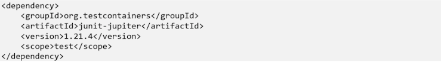
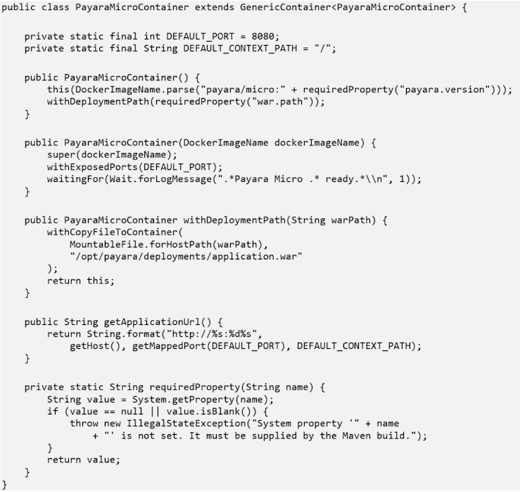
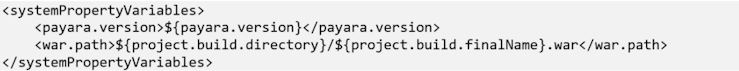
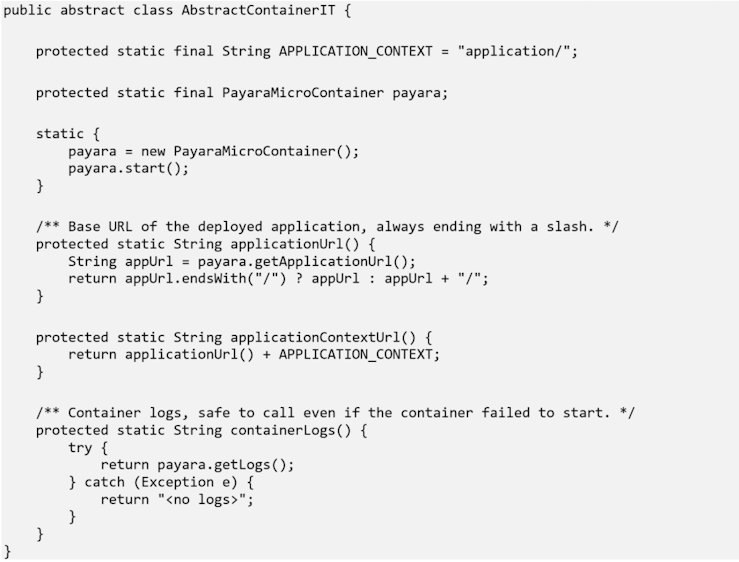
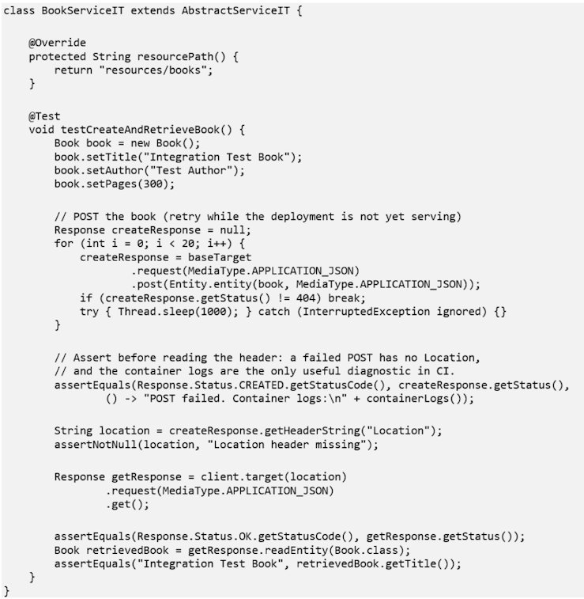
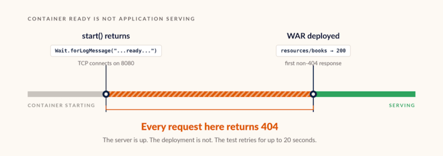
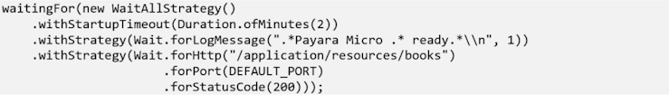
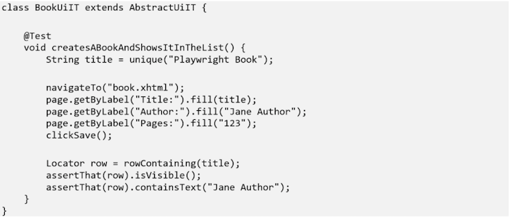

A blank librarianID field on a loan form silently persisted as an empty string instead of null. That broke a dropdown’s “has this been saved yet?” check on a different page entirely. The bug lived purely in the interaction between JSF’s string-to-property binding and a @PrePersist callback — which means no amount of mocked EntityManager unit testing was ever going to find it. It did not exist until a real browser submitted a real form to a deployed application.

That is the class of defect the middle tier of a test suite exists to catch, and [Testcontainers](https://java.testcontainers.org/) is how you get there. By the end of this post you will know how to run your actual built WAR on a real Azul Payara Micro instance from inside a JUnit test, and how to avoid the two mistakes that make these tests flaky.

## How it works

Testcontainers is a Java library that starts throwaway Docker containers as part of a test’s own lifecycle and tears them down when the run finishes — a database, a message broker, or in this project’s case an entire application server. The test talks to the container over a real network port, the same way a user or a load balancer would.

You get a GenericContainer, or a purpose-built subclass for common technologies like PostgreSQL or Kafka, wrapping a Docker image. You configure it — image name, exposed ports, files to copy in, and a [wait strategy](https://java.testcontainers.org/features/startup_and_waits/) that tells Testcontainers how to know the container is actually ready — then call start(). Testcontainers talks to the local Docker daemon, pulls the image if needed, starts the container, waits for the readiness condition, and hands back the host and mapped port you need to connect. A sidecar container called Ryuk runs alongside your build and reaps containers even if the JVM dies mid-test, so orphaned containers do not pile up on a CI runner. ([Ryuk can be disabled](https://java.testcontainers.org/features/configuration/), and on some locked-down CI setups it is — worth knowing before you assume clean-up is automatic.)

The library plugs into JUnit 5 through the [org.testcontainers:junit-jupiter module](https://java.testcontainers.org/test_framework_integration/junit_5/), which provides @Testcontainers and @Container. You can also [manage a container’s lifecycle by hand](https://java.testcontainers.org/test_framework_integration/manual_lifecycle_control/) — starting it once in a static initialiser, for instance — when those annotations do not fit your test topology. This project does exactly that, for a reason covered below.

## What you gain

The core advantage is deployment fidelity: you are testing the thing you are going to ship, not a stand-in for it. A container running the real payara/micro image with the real, Maven-built WAR deployed inside it will surface packaging problems, missing dependencies, and runtime-specific behaviour that no mock can.

A close second is reproducibility. The same container definition runs identically on a laptop and on a CI runner, because it is the same image either way. There is no “works on my machine” gap caused by one environment having a different locally installed database version than another.

It is also not tied to Jakarta EE, or to Java web servers at all. The identical pattern — start a real dependency in Docker, point the test at it, tear it down — applies to a PostgreSQL instance, a Kafka broker, a Redis cache or an application server. It is a general-purpose integration-testing skill that transfers across projects and stacks.

And because everything runs through Docker’s networking and file-copy primitives rather than a framework-specific deployment descriptor, the mental model stays unusually approachable. “Start a container, hit it over the network” is something most Java developers already understand from using Testcontainers elsewhere, even if they have never seen this particular project.

## What it costs you

The most immediate cost is the Docker dependency. If a CI environment or a contributor’s machine cannot run a container runtime, these tests cannot run there. It is worth checking early rather than discovering it during a release. The constraint is softer than it used to be — Testcontainers [works with Podman, Colima and other rootless runtimes](https://java.testcontainers.org/supported_docker_environment/) as well as Docker Desktop, and Testcontainers Cloud exists for environments that cannot run containers locally at all — but it is still a hard dependency, and @EnabledIfDockerAvailable is the graceful way to skip rather than fail when it is missing.

Speed is next. Booting a real application server inside a container is measured in seconds, not the milliseconds a WeldInitiator-based unit test takes. That is exactly why Testcontainers belongs in the integration and end-to-end layers, where a slower feedback loop is an acceptable price, and not in the layer developers run on every save.

These tests are also flakier by nature than pure unit tests, simply because more moving parts are involved: a slow image pull, a container that takes longer to become ready than the wait strategy expected, a port that takes a moment to bind. Good wait strategies and bounded retries manage this well, but the risk of failing for a reason unrelated to the feature under test never goes to zero.

Finally, Testcontainers only gets you to the boundary of the container. It proves the deployed application responds correctly to real HTTP requests and real browser interactions from the outside; it gives you no hook to inspect container-managed state directly the way an in-container framework such as Arquillian does. For most functional and regression testing the outside view is exactly what you want — but it is a real limit, and it is the reason this project keeps an Arquillian path alongside the Testcontainers one. That is the subject of the next post in this series.

## The tests it enables

Testcontainers gives you integration and end-to-end tests with no shared test environment to maintain. In practice that covers three patterns:

- Full-stack integration tests that exercise a REST API over real HTTP against a deployed application, rather than calling a resource method directly in-process.
- Browser-driven end-to-end tests, where a headless browser drives the actual rendered UI against the container — catching bugs that live purely in the interaction between the view layer and the server.
- Integration tests against any external dependency a real deployment needs — the application server itself, or a database, queue, or cache it talks to — without a shared staging environment that somebody has to keep patched and in sync.

## How it is used in testcontainers-example

The [project’s integration layer](https://github.com/payara/Payara-Examples/tree/main/ecosystem/testcontainers-example) runs a real, Dockerised Azul Payara Micro instance. The dependency is a standard, test-scoped addition to pom.xml:

The container definition lives in [PayaraMicroContainer](https://github.com/payara/Payara-Examples/blob/main/ecosystem/testcontainers-example/src/test/java/fish/payara/examples/testcontainers/PayaraMicroContainer.java), a GenericContainer subclass configured to pull the payara/micro image at the version the project builds against, copy in the WAR the build just produced, and wait for Payara’s own “ready” log line before considering itself started:

Note requiredProperty. The payara.version and war.path system properties are not hardcoded, and the container fails loudly with a useful message if they are missing — which they will be if someone runs the tests from an IDE instead of through Maven. The build supplies them via the Failsafe plugin’s systemPropertyVariables:

war.path points at the WAR Maven produces during the package phase, so the container always deploys the artifact this build just made rather than a stale one.

## One container for the whole run: the singleton pattern

Container management lives in [AbstractContainerIT](https://github.com/payara/Payara-Examples/blob/main/ecosystem/testcontainers-example/src/test/java/fish/payara/examples/testcontainers/AbstractContainerIT.java), the shared base class for every integration test in the project:

Starting the container in a static initialiser rather than through JUnit 5’s @Testcontainers/@Container lifecycle is deliberate. It is the documented [singleton container pattern](https://java.testcontainers.org/test_framework_integration/manual_lifecycle_control/#singleton-containers), and the reason it is needed here is specific: the JUnit extension manages a static @Container field with a per-class beforeAll/afterAll. Put that field in a base class shared by many test classes and the first class to finish will stop the container in its afterAll, leaving every class that runs afterwards pointed at a dead container. A static initialiser sidesteps the extension entirely — one Azul Payara Micro instance boots once, for the entire run, and every integration test class shares it. Clean-up falls to Ryuk and JVM shutdown rather than to JUnit.

The trade-off is worth stating plainly: a shared container means shared state. Nothing resets between tests, so tests have to be written not to collide. More on that below.

## Two kinds of test against one container

[AbstractServiceIT](https://github.com/payara/Payara-Examples/blob/main/ecosystem/testcontainers-example/src/test/java/fish/payara/examples/service/AbstractServiceIT.java) extends AbstractContainerIT and sets up a Jakarta REST Client around it, so classes like BookServiceIT can hit the deployed API directly:

That is a real POST over HTTP to a Jakarta REST resource, persisted through the runtime’s own datasource. Worth being precise about what “the database” is here: the application uses Azul Payara Micro’s [built-in embedded H2 datasource](https://docs.payara.fish/community/docs/Technical%20Documentation/Application%20Development/Configuring%20the%20Java%20Persistence%20Provider.html), jdbc/\_\_default, running inside the same container. There is no separate database container. That is fine for exercising the persistence layer, but it is not the database production runs — and closing that last gap is a one-line change, since adding a [PostgreSQLContainer](https://java.testcontainers.org/modules/databases/postgres/) and pointing the deployment at it is exactly the kind of thing Testcontainers is for.

## The startup race, and how to stop leaking it into tests

The retry loop around that POST deserves a full explanation, because it is the single most important thing to understand about testing a deployed application this way.

PayaraMicroContainer waits for the log line Payara Micro … ready, and start() returns as soon as Testcontainers sees it. But that line means the server is up and listening on 8080. It says nothing about whether the WAR copied into /opt/payara/deployments has finished deploying and registered its Jakarta REST resources. There is a short window in which the container is “ready” by the wait strategy’s definition, the TCP connection succeeds, and Payara answers 404 because resources/books does not exist yet.

A 404 in that window is indistinguishable from a genuine routing bug if you assert on the first response — so the test retries for up to twenty seconds and treats only a non-404 status as the real answer. In the project as it stands this tolerance appears in more than one test class, which is the tell that it belongs somewhere else.

The cleaner fix is to move the tolerance into the container definition: chain an HTTP wait strategy on an application endpoint after the log-message one, so start() does not return until the deployment itself responds.

Set the overall startup timeout explicitly — WaitAllStrategy applies one budget across all its strategies, and a slow first image pull will eat it. The cost of this approach is coupling the container definition to a known application path; the benefit is that the startup race is handled in one place instead of being rediscovered in every new test class. Either way the underlying point stands: with Testcontainers, “the container started” and “the application is serving” are two different events, and tests that conflate them will be flaky at startup.

## Driving the browser against the same container

[AbstractUiIT](https://github.com/payara/Payara-Examples/blob/main/ecosystem/testcontainers-example/src/test/java/fish/payara/examples/ui/AbstractUiIT.java) extends the same AbstractContainerIT but drives a headless Chromium browser through Playwright against the container’s JSF pages instead of calling the REST API:

One thing to watch in that snippet: assertThat here is PlaywrightAssertions.assertThat, not JUnit’s or AssertJ’s. [Playwright’s version](https://playwright.dev/java/docs/test-assertions) retries the assertion until it passes or times out, which is what makes UI assertions stable against asynchronous rendering — and if a static import collides with a different assertThat, you lose that retry behaviour without any compile error to warn you.

This is the layer that found the librarianID bug from the top of this post.

Because the container’s Payara instance and its H2 database live for the entire run rather than resetting between tests, AbstractUiIT provides a unique(prefix) helper that suffixes test data with a random id, so tests stay independent of what other tests already wrote without needing a fresh container each time. And a TestWatcher-based FailureDiagnostics extension dumps a screenshot, the page’s HTML, its URL and the container’s logs to target/playwright-failures/ on any failure — so a failing UI test is debuggable straight from CI output, with no need to reproduce it interactively on a laptop that happens to have both Docker and a browser installed.

That last detail is worth copying even if you take nothing else from this project. The main practical objection to browser-level tests is that they are miserable to debug when they fail on someone else’s machine. A screenshot and the server log, written automatically on failure, removes most of that objection.

## Where it fits

Testcontainers lets you test features in their intended environment, in a contained and portable way. There is no server to maintain: the container starts from a pinned image, sets up the same environment every time, and runs the tests against the WAR the build just produced. The costs are a hard dependency on a container runtime and a startup measured in seconds rather than milliseconds — which is precisely why this belongs to the integration and end-to-end layers, above the fast CDI unit tests covered in part one of this series.

[Part one of this series covers that fast CDI unit layer](https://www.azul.com/blog/cdi-unit-testing-without-an-application-server-weldinitiator-in-practice/), and [part three compares all three tools — WeldInitiator, Arquillian, and Testcontainers — side by side](https://www.azul.com/blog/jakarta-ee-testing-tools-compared-weldinitiator-arquillian-and-testcontainers/), including the case Testcontainers cannot reach from outside the container.

If your Jakarta EE applications run on [Azul Payara Micro](https://www.azul.com/products/payara-micro/) or [Azul Payara Server](https://www.azul.com/products/payara-server/), this layer is worth building against the runtime you actually ship rather than a lookalike.

If you take one line into your next test-strategy conversation, take this: a passing test against a mock proves your code is consistent with your assumptions, and a passing test against a real container proves it is consistent with production.

## Frequently Asked Questions

### What is Testcontainers used for in Java testing?

Testcontainers is a Java library that starts throwaway Docker containers inside a test’s own lifecycle and tears them down afterwards, so integration tests run against real dependencies instead of mocks — a database, a message broker, or a full application server. For Jakarta EE work it can run the actual Maven-built WAR on a real runtime such as Azul Payara Micro, exposed over a real network port, which surfaces packaging and deployment problems that in-process tests cannot see.

### How do you run integration tests against a real application server?

Wrap the server’s Docker image in a Testcontainers GenericContainer, copy the built WAR into the image’s deployment directory, declare a wait strategy for readiness, and call start(). The test then receives the mapped host and port and drives the application over HTTP exactly as a client would. With Azul Payara Micro that means pulling the payara/micro image at a pinned version and copying the WAR to /opt/payara/deployments, with the version and WAR path supplied by the Maven build rather than hardcoded.

### Why do Testcontainers tests return 404 right after the container starts?

Because “the container is ready” and “the application is deployed and serving” are two different events. A wait strategy watching for the server’s startup log line returns as soon as the server is listening, which can be several seconds before the WAR has finished deploying and registered its endpoints — and requests in that window get a 404 that looks exactly like a routing bug. The fix is to chain an HTTP wait strategy on a known application endpoint so start() does not return until the deployment actually answers, rather than scattering retry loops through individual tests.

### What is the singleton container pattern and when do you need it?

It means starting one container in a static initialiser and sharing it across every test class in the run, instead of letting the JUnit 5 @Testcontainers extension manage a container per class. It is needed whenever a static container field lives in a shared base class: the extension’s per-class afterAll will stop the container when the first test class finishes, leaving later classes pointed at a dead one. The trade-off is that nothing resets between tests, so test data has to be made unique rather than assumed clean.

### Do I still need unit tests if I have Testcontainers integration tests?

Yes. Integration tests take seconds because they boot a real runtime in Docker, so they cannot run on every save, and they only observe the application from outside the container. Fast CDI unit tests — a real Weld SE container in the test JVM, in milliseconds — answer whether a bean’s wiring and business logic are correct, and belong in every build. Teams shipping to Azul Payara Micro or Azul Payara Server typically run all three layers: CDI unit tests on every save, Testcontainers integration and browser tests in CI, and in-container tests where internal state has to be inspected directly.
