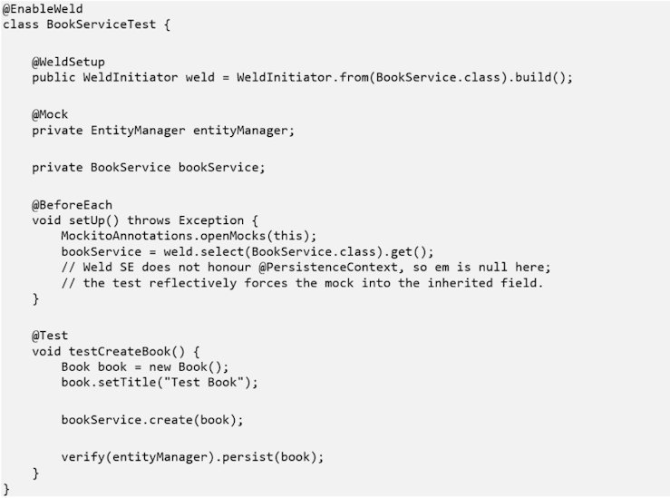
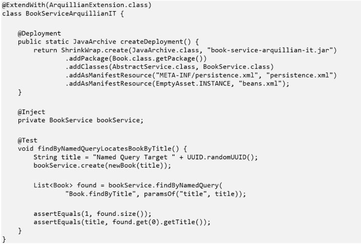
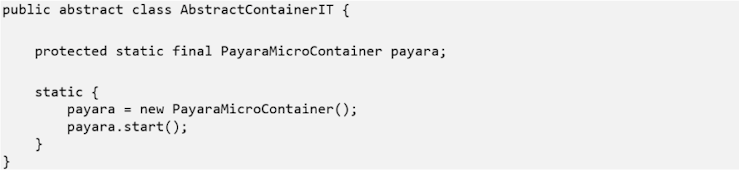
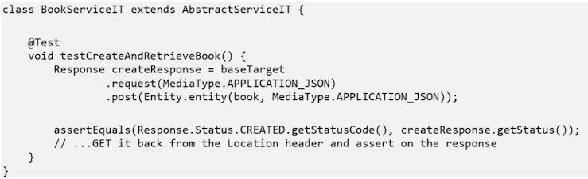
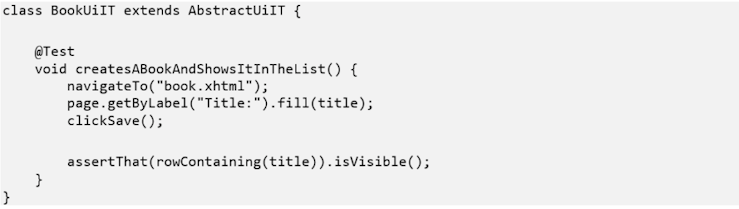

The [example project](https://github.com/payara/Payara-Examples/tree/main/ecosystem/testcontainers-example) in this series declares fourteen @NamedQuery annotations across its domain classes. Until recently, not one of them was called by anything — no REST resource, no JSF backing bean, no test. Nothing had ever confirmed that their JPQL compiles, let alone returns the right rows. The same was true of count() and findRange() on the shared service base class.

That gap did not exist because anyone was careless. It existed because the project had unit tests and it had deployed end-to-end tests, and this particular code was reachable by neither. Closing it took a third tool. This article compares all three — WeldInitiator, Arquillian, and Testcontainers — on the same codebase, so you can tell which question each one answers and which gaps that leaves.

Testing a Jakarta EE application is awkward for a specific reason: the behaviour you care about often does not exist until a container assembles it. Mock everything and you get tests that pass while proving very little. Deploy everything and you get slow, elaborate scenarios that nobody runs during development. The three tools here sit at three different distances from the code, and the useful question is not which is best but which distance a given test needs.

The example is [testcontainers-example](https://github.com/payara/Payara-Examples/tree/main/ecosystem/testcontainers-example), a small library management system generated with [Payara Starter](https://start.payara.fish/) and running on Azul Payara Micro. Its tests are written to avoid redundancy, so each tool covers what the others cannot.

## Three tools, three questions

WeldInitiator is the unit-testing tool: does this bean’s own logic and CDI wiring work, in isolation, with no container and no external dependency? Arquillian is the in-container integration tool: does this code behave correctly while executing inside a real container’s JVM, against the actual persistence provider? Testcontainers covers integration and end-to-end: does the fully built, deployed application work from the outside, whether that means calling its REST API or driving its UI in a real browser?

This is the final part of Testing Jakarta EE: Three Layers, Three Tools. [Part one covers WeldInitiator and the CDI unit layer](https://www.azul.com/blog/cdi-unit-testing-without-an-application-server-weldinitiator-in-practice/); [part two covers Testcontainers and the deployed layer](https://www.azul.com/blog/testcontainers-integration-testing-running-your-real-war-in-docker/). This article puts all three next to each other.

## WeldInitiator: does the CDI wiring and business logic work in isolation?

WeldInitiator, from the weld-junit5 module, boots a Weld SE container inside the test JVM. You specify which beans to bring into the container, Weld resolves and injects their CDI dependencies, and the whole cycle completes in milliseconds.

Every [\*ServiceTest](https://github.com/payara/Payara-Examples/tree/main/ecosystem/testcontainers-example/src/test/java/fish/payara/examples/service) class in the project — BookServiceTest, PatronServiceTest, LibrarianServiceTest, LoanServiceTest — is built this way:

Advantages. This is the fastest layer by a wide margin: no container to boot, no network, no Docker. Because weld.select(BookService.class).get() returns a container-managed instance, the test catches a wiring regression — a broken @Inject point, a changed scope — the way production would, unlike a hand-instantiated new BookService(). Scoping WeldInitiator.from(…) to the bean under test keeps failures narrow and easy to diagnose.

Limitations. It proves that CDI wiring and business logic are correct, and nothing beyond that. A Weld SE container is not a Jakarta EE container: it does not inject @PersistenceContext and it does not apply the container’s @Transactional interceptors, so the mocked EntityManager leaves JPA mappings, generated SQL, real transaction behaviour, and named queries entirely unverified. The project’s own [Arquillian test](https://github.com/payara/Payara-Examples/blob/main/ecosystem/testcontainers-example/src/test/java/fish/payara/examples/arquillian/BookServiceArquillianIT.java) says so in its class comment: none of AbstractService’s count(), findRange() or named-query methods is exercised by any \*ServiceTest, because there is no real persistence provider behind the mock to run them against.

Field injection through @PersistenceContext also leaves no clean seam for Mockito. The em field on AbstractService is private, with no setter and no constructor parameter, so there is no public entry point through which a test can hand in a mock — exactly what @InjectMocks or constructor injection would normally use. Lacking that seam, the test reaches around the encapsulation: after Weld builds the bean, it looks up the private field by reflection and forces the mock in. It works, but it bypasses the class’s API rather than using it. Registering a mock bean with .addBeans(MockBean.of(…)) is the cleaner alternative where the collaborator can be produced as a CDI bean.

Best suited for: fast, TDD-friendly verification of CDI-managed bean logic, and regression tests for dependency injection itself.

## Arquillian: does this slice of container-managed behaviour work, from inside the container’s own JVM?

Arquillian inverts the approach of the other two. Instead of testing from outside as a black box, it brings the @Test method into the container. You describe a deployment with ShrinkWrap, Arquillian deploys it to a real container, and through bytecode enrichment the test method executes inside that container’s JVM — with real CDI beans, enterprise beans and JTA resources injected directly into the test.

This project uses Arquillian deliberately narrowly, in exactly one class: [BookServiceArquillianIT](https://github.com/payara/Payara-Examples/blob/main/ecosystem/testcontainers-example/src/test/java/fish/payara/examples/arquillian/BookServiceArquillianIT.java). It covers the corner of AbstractService that neither [BookServiceTest](https://github.com/payara/Payara-Examples/blob/main/ecosystem/testcontainers-example/src/test/java/fish/payara/examples/service/BookServiceTest.java) nor [BookServiceIT](https://github.com/payara/Payara-Examples/blob/main/ecosystem/testcontainers-example/src/test/java/fish/payara/examples/service/BookServiceIT.java) can reach: count(), findRange(), and the named-query methods, none of which any REST resource, JSF bean, or other test calls.

About that deployment: it is a minimal JavaArchive holding only the domain classes, [AbstractService](https://github.com/payara/Payara-Examples/blob/main/ecosystem/testcontainers-example/src/main/java/fish/payara/examples/service/AbstractService.java) and [BookService](https://github.com/payara/Payara-Examples/blob/main/ecosystem/testcontainers-example/src/main/java/fish/payara/examples/service/BookService.java), the real [persistence.xml](https://github.com/payara/Payara-Examples/blob/main/ecosystem/testcontainers-example/src/main/resources/META-INF/persistence.xml), and an empty beans.xml — not the full WAR Testcontainers deploys, because this test needs only that BookService be injectable against a working persistence unit, not the Jakarta REST or JSF layers.

The Payara Micro Managed adapter (fish.payara.arquillian:arquillian-payara-micro-managed) launches Azul Payara Micro as a plain OS process, independently of the Docker image Testcontainers pulls for the same version. [arquillian.xml](https://github.com/payara/Payara-Examples/blob/main/ecosystem/testcontainers-example/src/test/resources/arquillian.xml) configures how it runs — a random HTTP port, auto-binding, and a 180-second startup timeout — while the path to the Payara Micro JAR itself arrives as the payara.microJar system property from the Maven build.

Advantages. Arquillian is the only one of the three that can @Inject a real bean straight into the test method and exercise it against a real persistence provider, with no REST or UI layer in between. In this project that fills a genuine hole, because count(), findRange() and the named queries have no other caller in the codebase to exercise them. ShrinkWrap deployments can also be scoped tightly to just the classes a test needs, which keeps the failure surface narrow even inside a full container.

Limitations. The @Deployment method is a second, hand-maintained description of packaging, and nothing enforces that it matches what the real WAR contains — the exact drift Testcontainers avoids by deploying the build artifact itself. Startup costs seconds, because a real application server has to boot. And Arquillian asks more of the reader than the other two: ShrinkWrap archive-building plus arquillian.xml container configuration is effectively a dedicated DSL layered on top of Jakarta EE, which is why this project confines it to one class rather than adopting it as a general strategy.

Three practical caveats are worth knowing before you copy this setup:

- The adapter version in this project is 4.0.alpha4. It works, but it is an alpha — pin it deliberately and expect to revisit it.
- The pom excludes org.jboss.weld and org.jboss.weld.se from the adapter’s dependencies. Without those exclusions the adapter’s Weld drags a second CDI implementation onto a test classpath that already has weld-junit5, and the two testing stacks collide. If you run WeldInitiator and Arquillian in the same module, expect to manage this.
- The Payara Micro JAR the Managed adapter launches is copied into target/ by the install-deps Maven profile. Run the Arquillian test without that profile having run and it fails on a missing file rather than anything to do with your code — the same profile that installs the Playwright browsers.

A Remote adapter is the alternative: point Arquillian at an [Azul Payara Micro](https://www.azul.com/products/payara-micro/) or [Azul Payara Server](https://www.azul.com/products/payara-server/) instance you start and stop yourself. That trades per-run startup time for setup and teardown you own. Either way, these tests run in seconds, not milliseconds.

Best suited for: in-container assertions on behaviour no other layer exercises — the test you write once you have identified a gap between the unit tests and the deployed ones.

## Testcontainers: does the deployed application actually work?

Testcontainers starts Docker containers as part of the test lifecycle — here, a payara/micro image with the Maven-built WAR deployed inside it. Nothing is mocked; the test talks to a genuinely running application over the network, the way a user or a REST client would.

[PayaraMicroContainer](https://github.com/payara/Payara-Examples/blob/main/ecosystem/testcontainers-example/src/test/java/fish/payara/examples/testcontainers/PayaraMicroContainer.java) wraps the image, and [AbstractContainerIT](https://github.com/payara/Payara-Examples/blob/main/ecosystem/testcontainers-example/src/test/java/fish/payara/examples/testcontainers/AbstractContainerIT.java) starts it exactly once in a static initialiser, shared across every integration test class:

Two categories of test share that container. [BookServiceIT](https://github.com/payara/Payara-Examples/blob/main/ecosystem/testcontainers-example/src/test/java/fish/payara/examples/service/BookServiceIT.java) exercises the deployed REST API over HTTP:

And [BookUiIT](https://github.com/payara/Payara-Examples/blob/main/ecosystem/testcontainers-example/src/test/java/fish/payara/examples/ui/BookUiIT.java) drives the JSF pages with a headless Chromium browser through Playwright:

That assertThat is PlaywrightAssertions.assertThat, which retries until the assertion passes or times out — the thing that makes UI assertions stable against asynchronous rendering. A static import from JUnit or AssertJ compiles just as happily and silently loses that behaviour.

Advantages. Deployment fidelity is the main benefit: war.path in the Failsafe plugin’s systemPropertyVariables points at the WAR the package phase just produced, so there is no separate hand-maintained archive that can drift from what ships. The pattern is also not Jakarta EE-specific — the same approach starts a PostgreSQL instance or a Kafka broker.

Limitations. It requires a container runtime, without exception. Execution is measured in seconds, because a real application server has to boot. And it observes only from the outside: it confirms the deployed application responds correctly to HTTP and browser interaction, but offers no way to inspect container-managed state directly.

Best suited for: integration tests over HTTP against the deployed REST API, and end-to-end browser tests against the fully deployed application.

## Why these are not interchangeable: one concrete case

The clearest illustration in the whole project is a pair of tests about a single method, findOrEmpty(), which converts JPA’s NoResultException into an Optional.empty().

The WeldInitiator unit test stubs the mocked EntityManager to throw NoResultException, then asserts that findOrEmpty() returns an empty Optional. That test passes. It proves the error handling is correct — given that a NoResultException arrives.

The Arquillian test runs a real named query, against a real persistence provider, for an ISBN that does not exist, and asserts the same empty Optional. That test proves something the unit test cannot: that a genuinely missed query actually produces a NoResultException in the first place, rather than an empty list, a null, or a different exception type entirely.

One test verifies your handling of an assumption. The other verifies the assumption. Both pass, both are worth having, and neither substitutes for the other. That is the whole argument for treating these tools as layers rather than alternatives.

The project’s findRange() test makes a related point about writing honest assertions at this layer. AbstractService#findRange builds its CriteriaQuery with no explicit ORDER BY, so which rows land on which page is not guaranteed by the JPA specification — only that paging neither duplicates nor drops rows. The test asserts disjointness between pages rather than page contents, which is the difference between a test that documents real behaviour and one that passes on your machine because H2 happened to return rows in insertion order.

## Side by side

|   | **WeldInitiator** | **Arquillian** | **Testcontainers** |
|----|----|----|----|
| **Test category** | Unit test | Integration test (in-container) | Integration and end-to-end test |
| **What it proves** | CDI wiring and business logic, in isolation | Behaviour of code executing inside a live container’s JVM, against a real persistence provider | The built WAR behaves correctly over HTTP and in a browser |
| **Requires Docker?** | No | No — needs an Azul Payara Micro or Server instance | Yes |
| **Deployment description** | None — just the bean(s) under test | A hand-written ShrinkWrap archive | The build artifact itself |
| **Speed** | Milliseconds | Seconds — the application server has to start | Seconds — the container has to start |
| **Used here for** | \*ServiceTest — every service’s CRUD logic against a mocked EntityManager | BookServiceArquillianIT — count(), findRange() and the named queries | \*ServiceIT (REST) and \*UiIT (Playwright) against the deployed app |
| **Watch out for** | @PersistenceContext and @Transactional are not honoured in Weld SE | Alpha adapter, Weld classpath exclusions, install-deps profile required | Container-ready and app-serving are two different events |

## Choosing between them

In practice the decision is close to mechanical. If the question is about a bean’s own logic or its CDI wiring, use WeldInitiator and keep it in the milliseconds. If the question is whether the deployed application behaves correctly from outside — a REST contract, a form submission, a rendered page — use Testcontainers. Reach for Arquillian in the narrow case where behaviour matters, has no caller that either other layer can reach, and needs a real container service such as a persistence provider to be meaningful at all.

Read in the other direction, that same rule is a coverage audit. Code that no unit test can reach because it needs a real provider, and that no deployed test can reach because nothing calls it, is invisible to both layers — which is exactly how fourteen named queries go unverified in a project that looks well tested.

The line to carry into your next test-strategy conversation: a passing test against a mock proves your code matches your assumptions; only a real container proves the assumptions match reality.

## Frequently Asked Questions

### What is the difference between Arquillian and Testcontainers?

Arquillian runs the test method inside the container’s own JVM, using bytecode enrichment, so real CDI beans, enterprise beans, and JTA resources can be injected straight into the test and internal state inspected directly. Testcontainers runs the application in a Docker container and tests it from the outside over the network, against the actual build artifact. Arquillian needs a hand-written ShrinkWrap deployment that can drift from the real packaging; Testcontainers deploys the WAR the build just produced but cannot see inside the container. On Azul Payara Micro both are available, and most projects need both.

### Which testing tool should I use for a Jakarta EE application?

It depends on the question the test has to answer. For a bean’s own logic and CDI wiring, WeldInitiator with weld-junit5 runs a real CDI container in the test JVM in milliseconds. For whether the deployed application works over HTTP or in a browser, Testcontainers runs the built WAR on a real runtime such as Azul Payara Micro. For behaviour that needs a real container service and has no caller either of those layers can reach — pagination, counts, named queries — Arquillian injects the bean directly inside the container. They are complementary layers, not competing choices.

### Can you test JPA named queries without deploying the whole application?

Yes, with an in-container test and a tightly scoped deployment. Arquillian’s ShrinkWrap can build an archive containing only the entity classes, the service class, and the real persistence.xml, then deploy that to Azul Payara Micro and inject the service into the test — enough for the named query to run against a real persistence provider without the Jakarta REST or JSF layers. A mocked EntityManager cannot do this: it never executes the JPQL, so a query that does not compile still passes its unit test.

### Why do my tests pass with a mocked EntityManager but fail in production?

Because a mock returns what you told it to return. A unit test that stubs an EntityManager to throw NoResultException proves your error handling is correct given that exception; it never proves the real query produces that exception rather than an empty list or a different failure. Anything that depends on the persistence provider actually executing — JPQL validity, mappings, generated SQL, transaction boundaries, pagination — needs a real provider. In a Jakarta EE project that means an in-container test with Arquillian or a deployed test on a runtime such as Azul Payara Micro.

### How much slower are integration tests than unit tests in Java?

Roughly three orders of magnitude. A CDI unit test in a Weld SE container inside the test JVM completes in milliseconds; an Arquillian or Testcontainers test has to start an application server and is measured in seconds — the example project allows a 180-second startup timeout for its managed Azul Payara Micro instance. That difference is why the layers have different homes: unit tests on every save, integration, and end-to-end tests in CI.
