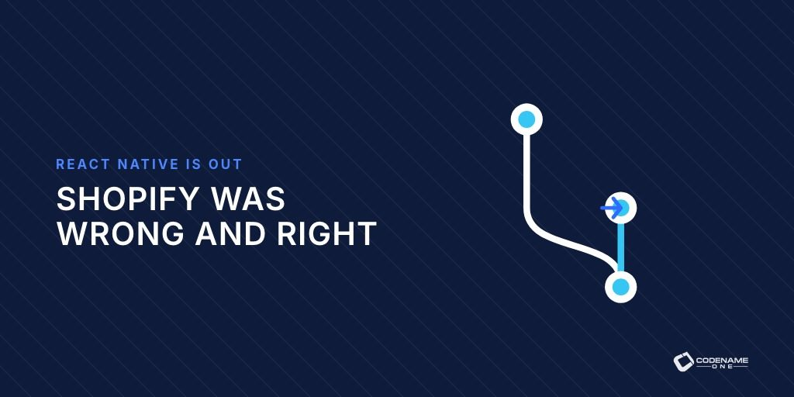
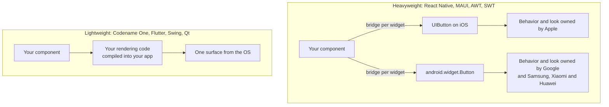
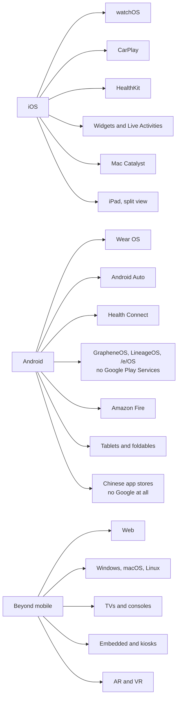
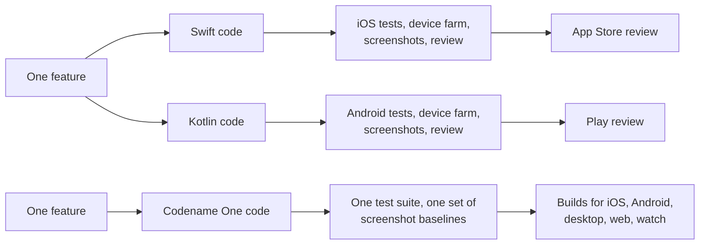

In September Shopify announced it's [moving every mobile app off React Native](https://shopify.engineering/back-to-native) and rewriting them in Swift and Kotlin. Their reasoning fits in one sentence from the post: "building the same feature in Swift and Kotlin no longer carries the cost it used to." Agents write the second copy, so why share code at all?

<aside style="border-left: 4px solid #007aff; padding: 14px 18px; margin: 24px 0; border-radius: 4px; font-size: 0.95em;"><strong>What is Codename One?</strong> Codename One is an open-source framework for building native iOS, Android, desktop, and web apps from a single Java or Kotlin codebase. Learn more at <a href="https://www.codenameone.com/">codenameone.com</a>.</aside>

React Native deserved to die. It's a heavyweight toolkit, and every heavyweight toolkit, from AWT to Xamarin.Forms, was eventually replaced by a lightweight one or by native code. Replacing it with two native codebases is wrong, because it takes the most expensive part of React Native, a separate platform per target, and doubles it. Code was never the cost. Platforms, testing and store churn are, and AI makes every one of them worse.

This isn't a post against AI. I use LLMs every day, and in the right setting they're superb. But they can't hold a Samsung phone, they don't know what Apple will announce next June, and they can't sign off on a release. Shopify's plan needs them to do all three.

## TL;DR

- **[React Native was designed to fail at the one thing you adopted it for.](#react-native-was-built-to-fail-at-write-once-run-anywhere)** Its creators rejected write once, run anywhere in the launch announcement. In writing.
- **[Your buttons belong to Samsung.](#heavyweight-and-lightweight)** Heavyweight toolkits hand your UI to the OS and the vendor skin, which is why Samsung's keyboard can hang your text field.
- **[Not looking 100% native is a feature, and here's why.](#lightweight-is-the-architecture-that-works)** Lightweight toolkits ship the pixels you tested, and still embed a native map or web view when you need one.
- **[Shopify's own post explains why its plan fails.](#two-codebases-is-the-same-mistake-twice)** Agents write code in seconds and need minutes to test it. Two codebases double the slow part.
- **["iOS and Android" is a lie.](#there-are-no-two-platforms)** The web, the desktop, tablets, foldables, the watch, the car, TVs, consoles and embedded devices are all platforms too, and your developers end up as meat proxies between users and an LLM.
- **[Meta gave up on a native WhatsApp desktop app. You have fewer engineers than Meta.](#the-web-and-the-desktop-are-the-product-now)**
- **[Testing is the real bill, and AI makes it bigger.](#testing-is-the-bill)**
- **[Apple broke apps with UIScene. Ours didn't notice.](#the-stores-change-the-rules-every-year)**
- **[A framework should beat the OS, not wrap it.](#a-platform-should-give-you-more-than-the-os)** Gantt charts, commerce with no commission, records as entities, every protection a bank app needs, built once, and a Base64 encoder nearly three times faster than Apple's.
- **[One codebase pays double when it includes the server.](#the-full-stack-is-where-one-codebase-pays-twice)** Plus my generous offer of a PHP port.

## Last Week on the Codename One Blog

Before we proceed, here's a recap of last week on the blog:

- **Saturday, November 14:** [Calendars, Gantt Charts and Booking Apps Without Writing a Calendar](https://www.codenameone.com/blog/scheduler-gantt-and-material-pickers/). A scheduler, a Gantt chart with critical paths and resource leveling, Material 3 pickers and Slate, our appointment booking template.
- **Sunday, November 15:** [Subscriptions, Paywalls and a Customer Center, and We Don't Take a Cut](https://www.codenameone.com/blog/subscriptions-and-paywalls-without-a-revenue-cut/). Offerings, experiments, refunds and invites across five stores.
- **Monday, November 16:** [Kafka Listeners, Mail and Live Streams in Your Backend, With Records as Entities](https://www.codenameone.com/blog/kafka-mail-and-records-in-your-java-backend/). Spring-style messaging, transactional email, server-sent events, and an ORM that's ahead of JPA.
- **Tuesday, November 17:** [Ship Your Game on Steam, and Why the Art Matters More Than the Engine](https://www.codenameone.com/blog/ship-your-java-game-on-steam/). Splat, a team paintball shooter, and the lesson it taught us.
- **Wednesday, November 18:** [Windows Kiosks and Command Line Tools, Built From Java](https://www.codenameone.com/blog/windows-kiosks-and-command-line-apps/). Windows IoT Enterprise as a target, and a console API for real terminal tools.
- **Thursday, November 19:** [Run an LLM and Whisper on the Phone, With No Server Bill](https://www.codenameone.com/blog/run-an-llm-on-the-phone/). Local models through the same API as the cloud ones, so moving a feature onto the phone is a one line change.



gantt-critical-path-acf04493e0.png | Gantt with the critical path | A Gantt chart with the critical path highlighted
slate-book-slots-6b4e28f424.jpg | Booking in Slate | Slate showing free appointment times
splat-in-game-511a95ee57.jpg | Splat, in a match | A first-person view of a Splat capture the flag match



## React Native was built to fail at write once, run anywhere

Nobody should be surprised that React Native didn't deliver one codebase. It never tried. When Facebook [announced it in 2015](https://legacy.reactjs.org/blog/2015/03/26/introducing-react-native.html) they wrote: "we're not chasing 'write once, run anywhere.'" They rejected it on purpose, and built a toolkit where platform code is part of the design. Then a decade of teams adopted it believing they'd get one codebase, and spent that decade writing platform code.

The reason is architectural. React Native is a **heavyweight** UI toolkit.

### Heavyweight and lightweight

UI toolkits come in two families, and the split is older than smartphones.

A **heavyweight** toolkit maps each of your components to a widget the operating system owns. Your button is a `UIButton` on iOS and an `android.widget.Button` on Android. Java's AWT worked this way in 1995. So did SWT. Xamarin.Forms, .NET MAUI and React Native repeat it today.

A **lightweight** toolkit asks the OS for a surface and draws every pixel itself. Swing replaced AWT this way. Qt, Flutter and Codename One all draw their own UI.





Heavyweight has exactly one selling point: the widgets are the platform's, so they look the part for free. Everything else is a bill.

- **Many implementations of every widget.** A text field on Android and a text field on iOS are different programs with different bugs, and it doesn't stop at two. Apple alone made everyone move from `UIWebView` to `WKWebView`, with different APIs and different behavior, and Android has gone through several generations of its own widgets. Each new target multiplies it again: a TV, a watch or a desktop brings its own set. The abstraction exposes only what all of them agree on, so anything interesting drops to platform code.
- **A bridge on every interaction.** Layout, events and state cross from your code into the widget and back, on every frame.
- **Behavior you can't test in one place.** The widget runs inside the OS, so it behaves according to the OS version, the vendor skin and whatever keyboard the user installed. A font that's a pixel taller on one vendor's build clips the bottom of your label. A minor OS update on one device family delivers focus and text events in a slightly different order, and a race that never happened before starts corrupting input on those phones only.

That last one is where the money burns. A controlled `TextInput` [hangs on Samsung phones when the Samsung keyboard's Grammarly integration is on](https://github.com/facebook/react-native/issues/35590). Setting state on a controlled `TextInput` [can duplicate its value](https://github.com/facebook/react-native/issues/20361). These are races between JavaScript, the bridge and a keyboard Samsung ships. You find them when a user with that phone and that keyboard complains, and you can't reproduce them on anything else.

Then the OS moves under you. When Apple shipped Liquid Glass, every app built with the new SDK got the redesigned system controls whether the team wanted them or not. Apple's escape hatch, the `UIDesignRequiresCompatibility` key, comes with a promise that it will be removed. And you have to know that key exists. Nobody tells you. With a heavyweight UI you don't just work for your boss. You work for Apple and Google too, reading their release notes and following their instructions every year to keep your own app looking like your own app.

Shopify's own numbers show what that bridge cost them. [InfoQ reports](https://www.infoq.com/news/2026/09/shopify-drops-react-native/) cold start dropped 23% on iOS and 50% on Android after the rewrite, and crash-free sessions went from 99.5% to 99.95%. Those numbers are the price of heavyweight, finally itemized.

### Lightweight is the architecture that works

A lightweight toolkit compiles the UI into your app. The pixels you tested are the pixels that ship, on every phone and every OS version, next year as well as today.

- **One implementation of each component.** A bug fixed once is fixed everywhere.
- **No bridge.** Drawing your own button needs no round trip into the OS.
- **Deterministic rendering.** A screenshot test on a CI runner means something. Codename One's CI compares hundreds of screenshots on every commit across iOS, Android, desktop and the web.
- **Stability.** An OS update can't restyle your app. A buggy vendor skin draws your app the way it draws any other surface.
- **Native where you want it.** A lightweight UI can still mix in any native component as a peer. Google Maps, a platform web view, a camera preview, a payment sheet or a third party SDK's widget sits inside your layout like any other component. You choose native per component, instead of inheriting it for everything.

"It doesn't look 100% native." Correct. That's a feature. It's my app, not Apple's. Our [Material 3 date picker](https://www.codenameone.com/blog/scheduler-gantt-and-material-pickers/) is better than most native pickers I've used, and when I want it different I change CSS instead of waiting a year for a vendor to add a parameter.

Accessibility is the real question for any lightweight toolkit, because the OS can't read a button it didn't draw. A lightweight toolkit has to publish its components to VoiceOver and TalkBack itself. Codename One does, and [keeps improving it](https://www.codenameone.com/blog/ios-density-scroll-and-accessibility/). Ask every lightweight framework how it handles this. The answer separates the serious ones from the rest.

That last point deserves emphasis, because it's the answer to every "but I need the real thing" objection. In Codename One a `PeerComponent` places a native view inside the lightweight UI: Google Maps, an ad network's banner, a vendor's video player or chat widget, anything with a native view. It lays out, scrolls and layers with the surrounding components. Native becomes the escape hatch for the few components that need it. Heavyweight gets this backwards: native is the default, and consistency is what you claw back.

The old joke about Java was "write once, debug everywhere." It was coined when Java's UI was AWT, a heavyweight toolkit, and that's exactly what it described. Swing fixed it. The joke still describes every heavyweight toolkit: you pay for a platform per target, test per target, debug per target, and still have an abstraction in the way. Shopify paid native costs for a decade and got none of native's control. Now it will pay them twice.

## Two codebases is the same mistake, twice

Shopify's own post explains why their cure fails:

> "Agents can make code changes in seconds, but it takes them several minutes to test the output."

Writing code was never the expensive part, and AI made that obvious. Everything after the code is the cost, and a second codebase doubles all of it.

### There are no "two platforms"

"iOS and Android" is a fiction. Start with the big ones: the web and the desktop, which the next section covers. Then the iPad, Android tablets and foldables, which need layouts that adapt instead of a stretched phone UI. A serious commerce app is also expected on the watch, in widgets, in Siri and in the car. Each is a platform with its own lifecycle and its own review rules, and each needs its own code in a native project.

Then there's everything beyond the phone, where the interesting products are being built: [TVs](https://www.codenameone.com/blog/apple-tv-and-android-tv/), [consoles](https://www.codenameone.com/blog/codename-one-on-xbox/), [embedded devices and kiosks](https://www.codenameone.com/blog/embedded-linux-ui-in-18-mb/), [AR and VR](https://www.codenameone.com/blog/ar-vr-support-simulation/), and real-time systems on a factory floor. Two native mobile codebases reach none of them.





Every box has rules a model has to know and keep current. A GrapheneOS user reports that sign-in fails. Someone has to know that Google Play Services aren't there, find the library that assumed they were, test the fix on a phone they don't own, and feed all of it back to the agent. The agent writes the patch. The developer becomes a meat proxy between users and an LLM, and with two codebases they do it twice.

Skipping the niche platforms is a mistake too. People on GrapheneOS, a Linux desktop or an Amazon tablet have few choices. Show up for them early and they remember, and they tell everyone. They're the early adopters who carry a product across the chasm, and the chasm is where products die. That's why we [support de-Googled Android officially](https://www.codenameone.com/blog/android-apps-everywhere-even-without-google/).

### The web and the desktop are the product now

WhatsApp belongs to Meta, one of the largest engineering organizations on earth. For years WhatsApp Web needed your phone online, because it was a mirror of the phone app. In 2025 Meta replaced the native Windows client with a wrapped web version. Meta couldn't keep a desktop client in step with its phone apps. Two native codebases won't either.

Picture a competitor with one codebase. They finish a feature and it ships on the phone, the tablet, the desktop, the web and the watch that same day. You finished the same feature in Swift, and you're still waiting for the Kotlin version, and when it lands it doesn't behave quite like the Swift one. The desktop and the web haven't started.

### Testing is the bill

Shopify describes its review process for each change in the rewrite: tests, a visual comparison against the running app, two adversarial AI reviewers and a human approval. Per platform. Two codebases mean two test suites, two sets of screenshot baselines, two device farms and two release trains, and every native widget adds behavior only a physical device can verify.





Agents make the top half worse, not better. They produce more code per day, and every line of it lands in two pipelines that need devices and humans to sign off. The throughput limit was never typing. It's verification, and Shopify chose to verify everything twice.

### The stores change the rules every year

The App Store and Play are where mobile projects lose weeks. Apple made UIScene lifecycle support mandatory and broke third-party plugins that hooked the app delegate. Codename One users got it as a build default: we [turned `ios.uiscene=true` on by default](https://www.codenameone.com/blog/uiscene-on-by-default-ios-performance/) after a month of testing, and nobody noticed. Same with the Xcode 26 migration, Google Play's 16 KB page requirement and every new target API level.

LLMs are trained on the past. Store requirements are announced for the future. The model writing your Swift today doesn't know next spring's privacy rule. A framework team that tracks those changes full-time and fixes them once for everyone matters more in the agent era.

## A platform should give you more than the OS

A framework that wraps the OS hands you the lowest common denominator. A lightweight framework can ship what the OS doesn't have at all. Most of this week's release is exactly that:

- **A [scheduler and a Gantt chart](https://www.codenameone.com/blog/scheduler-gantt-and-material-pickers/) with resource leveling**, plus Material 3 date and time pickers. Neither iOS nor Android ships a Gantt chart.
- **[Subscriptions, paywalls and a customer center](https://www.codenameone.com/blog/subscriptions-and-paywalls-without-a-revenue-cut/)** across Apple, Google, Amazon, Stripe and Paddle. We never touch your money, so there's no commission.
- **[Crypto wallets](https://www.codenameone.com/blog/bastion-hardened-bank-template/)** for Ethereum, Bitcoin and Solana in the core.
- **An ORM that maps [Java records](https://www.codenameone.com/blog/kafka-mail-and-records-in-your-java-backend/)** as entities, which JPA still forbids.

Performance belongs here too. Codename One's `Base64` on iOS uses a portable SIMD API we built into ParparVM, our ahead-of-time compiler, and it [beats Apple's own implementation](https://www.codenameone.com/blog/ios-density-scroll-and-accessibility/): 379 ms to encode against Apple's 1078 ms, 365 ms to decode against 713 ms.


simd-base64-performance-f9349b5154.jpg | Base64 performance on iOS: native encode 1078 ms, Codename One SIMD 379 ms; native decode 713 ms, Codename One SIMD 365 ms


Security is where this matters most. A financial app needs certificate pinning, passkeys, device keys, signed requests, screens hidden from screenshots and the app switcher, jailbreak and root detection, and obfuscation with string encryption. Each has a different pitfall on each platform, and most fail silently: the app works, it isn't protected. Two codebases means getting every one of them right twice. We built them once, and our [Bastion bank template](https://www.codenameone.com/blog/bastion-hardened-bank-template/) uses all of them in a working bank and exchange. Its Security Center shows which protections are live on that device and build, and a test fails the build if the screen ever claims more than the build delivers.



bastion-security-center-d2a60e80a8.png | Bastion's Security Center | The Bastion Security Center listing active protections
bastion-sign-in-flow-f77343297b.jpg | Sign-in with passkeys and TOTP | The Bastion sign-in flow with passkeys and TOTP



## The full stack is where one codebase pays twice

Shopify's server is a separate world with separate teams. (If Ruby is what it takes to win them over, I'll consider a Ruby port. Probably.)

For everyone else, the phone app, the desktop app, the web app and the server in one Java project means one set of entity classes, one debugger session that follows a request from a tap to the database, and a compile error instead of a production incident when someone renames a field. When the system changes every week, seeing all of its state in one place is the difference between moving fast and guessing. Shopify now has three codebases that have to agree on every field.

```java
// shared module: used by the app AND the server
@Entity
public class Order {
    @Id public long id;
    public String customer;
    public long totalCents;
}

// backend
@RestController
public class Orders {
    @PostMapping("/orders")
    public Order place(@RequestBody Order order) {
        return repository.save(order);
    }
}
```

## More This Week

### Calendars, Gantt charts and a booking app

Neither iOS nor Android ships a calendar view or a Gantt chart, so every business app ends up writing one. Codename One now has a `Scheduler` with day, week, month, agenda and per-resource views:

```java
DefaultScheduleModel model = new DefaultScheduleModel();
model.addItem(new ScheduleItem("review", "Design review",
        TimeMath.at(today, 13 * 60, zone), TimeMath.at(today, 14 * 60 + 30, zone))
        .setDetail("Room 2"));
Scheduler scheduler = new Scheduler(model);
scheduler.setView(Scheduler.View.WEEK);
```

And a `Gantt` with dependencies, baselines, the critical path and resource leveling that tells you what moving people around costs before you apply it:

```java
if (!ResourceLeveler.findOverallocations(project).isEmpty()) {
    LevelingResult proposal = ResourceLeveler.level(project);
    if (proposal.isChanged()) {
        proposal.apply();
    }
}
```



scheduler-week-0fdf212d8f.png | The week view | The scheduler's week view
gantt-critical-path-acf04493e0.png | The critical path | A Gantt chart with the critical path highlighted
gantt-leveled-f3f556319d.png | After resource leveling | A Gantt chart after resource leveling
picker-material-date-d5334110d1.png | The Material 3 date picker | The Material 3 date picker



Slate, our booking template, is the same idea as a full product: clients, providers and an owner, with a slot engine that weighs rooms, buffers and travel time.


<video controls playsinline preload="metadata" poster="https://www.codenameone.com/blog/release-2026-11-13/slate-desktop-demo-poster.jpg" width="1280" height="746" style="width:100%;height:auto;display:block;margin:16px auto" aria-label="Booking an appointment in Slate on the desktop"><source src="https://www.codenameone.com/blog/release-2026-11-13/slate-desktop-demo.mp4" type="video/mp4"><a href="https://www.codenameone.com/blog/release-2026-11-13/slate-desktop-demo.mp4">Download the Slate video</a>.</video>


Saturday's [article](https://www.codenameone.com/blog/scheduler-gantt-and-material-pickers/) covers both.

### Commerce with no commission

Subscription platforms take a percentage of your revenue on top of what Apple and Google take. We never touch your money, so there's no commission. `CommerceManager` gives you entitlements, offerings, paywalls, experiments and a customer center across the App Store, Google Play, Amazon, Stripe and Paddle:

```java
CommerceManager cm = CommerceManager.getInstance();
if (!cm.isEntitled("pro")) {
    Offering current = cm.getOfferings().getCurrent();
    Paywall.show(current, null);
}
```


commerce-14925472ec.jpg | The Commerce console


Sunday's [commerce article](https://www.codenameone.com/blog/subscriptions-and-paywalls-without-a-revenue-cut/) has refunds, retention offers, experiments, and invites.

### Records as entities, Kafka and mail

JPA still forbids records as entities. Codename One's ORM maps them on the phone and the server, and generates a builder for each:

```java
@Entity
public record Note(@Id long id, String title, int score, @Version long version) {}

Note saved = notes.save(NoteBuilder.create().title("Groceries").score(3).build());
Note changed = notes.save(NoteBuilder.of(saved).score(5).build());
```

The backend now talks to Kafka, RabbitMQ, Redis Streams, SQS and Pub/Sub through one API. Spring's `@KafkaListener` and `@RabbitListener` work as written, and a message sent inside a transaction goes out only after the commit:

```java
@MessageListener(value = "orders.placed", group = "shipping", concurrency = 4)
public void placed(Order order) {
    // ship it
}
```

Mail goes out through SMTP or SES from the same transactional outbox, and server-sent events stream with resume support. Monday's [backend article](https://www.codenameone.com/blog/kafka-mail-and-records-in-your-java-backend/) walks through it.

### Splat, and shipping games on Steam


<video controls playsinline preload="metadata" poster="https://www.codenameone.com/blog/release-2026-11-13/splat-desktop-demo-poster.jpg" width="960" height="564" style="width:100%;height:auto;display:block;margin:16px auto" aria-label="Splat gameplay on the desktop"><source src="https://www.codenameone.com/blog/release-2026-11-13/splat-desktop-demo.mp4" type="video/mp4"><a href="https://www.codenameone.com/blog/release-2026-11-13/splat-desktop-demo.mp4">Download the Splat video</a>.</video>


Splat is a first-person team paintball shooter: four against four, refereed by its own server, with fog, PBR materials, shadows and post processing on every GPU backend. It taught us that the art makes the game, not the engine.



splat-in-game-511a95ee57.jpg | Capture the flag | A first-person view of a Splat capture the flag match
splat-match-overhead-79af0df54d.jpg | The field from above | An overhead view of a Splat match
splat-mission-editor-eeb8ccf4eb.jpg | The mission builder | The Splat mission editor



Games now ship to Steam from the build cloud, and Steam features come from portable code that does nothing on other platforms:

```java
if (GameServices.isAvailable()) {             // true on Steam
    GameServices.unlockAchievement("FIRST_WIN");
    GameServices.writeSave("slot1", saveBytes);
}
```

Tuesday's [article](https://www.codenameone.com/blog/ship-your-java-game-on-steam/) has all four videos, including the mission builder on the phone.

### Windows kiosks and command line tools

One build hint turns an app into a locked down kiosk for Windows 10 and 11 IoT Enterprise, and `mvn cn1:deploy-device` installs it over SSH. Receipt printers and scales are a serial port away:

```java
SerialPort printer = Hardware.getInstance()
        .openSerial("COM3", 9600, 8, SerialPort.PARITY_NONE, 1);
```

At the other end, the console API builds command line tools that compile to a native executable with no JVM:

```java
Console.print(new Table("Service", "Status", "Replicas")
        .addRow("api", Console.style("running", Console.Style.GREEN), 3)
        .render());
String env = Prompt.select("Environment", Arrays.asList("staging", "production"));
```



cli-console-output-c7832aadb8.png | Tables, progress and spinners | A table, a progress bar and a spinner in the terminal
cli-console-select-435abebddc.png | Interactive prompts | An arrow key selection prompt



Wednesday's [article](https://www.codenameone.com/blog/windows-kiosks-and-command-line-apps/) has both.

### An LLM on the phone

`LlmClient.local` runs a GGUF model through llama.cpp on the device, behind the same API as the cloud clients. JSON output is enforced with a grammar, so it always parses:

```java
LlmClient client = LocalLlmClient.isSupported()
        ? LlmClient.local(modelPath)
        : LlmClient.ollama();          // desktop development
client.chat(ChatRequest.builder()
        .addMessage(ChatMessage.user("Name three primes"))
        .build()).ready(r -> Log.p(r.getText()));
```

A whisper cn1lib turns speech into text offline, so a voice memo becomes a summary without leaving the phone. Thursday's [article](https://www.codenameone.com/blog/run-an-llm-on-the-phone/) shows how.

## Fix the abstraction. Don't delete it.

React Native is a heavyweight toolkit, and heavyweight toolkits deserve to die. Shopify answered a bad abstraction with no abstraction, and signed up to pay for every platform, every test suite and every store rule twice, forever, on the theory that typing was the bottleneck. It never was.

If I were a Shopify competitor, I'd jump on this. When the leader zags, you zig. Pick up Codename One, KMP, Flutter or any other decent platform with one codebase, and put an agent to work on it. Every hour the agent spends goes into one product that ships everywhere, not into keeping two copies in step. By the time Shopify notices, you'll be so far ahead that catching up will take them years.

The answer to a bad abstraction is a good one: a lightweight UI you own, compiled to a native app, from one codebase, on every screen your users have.
