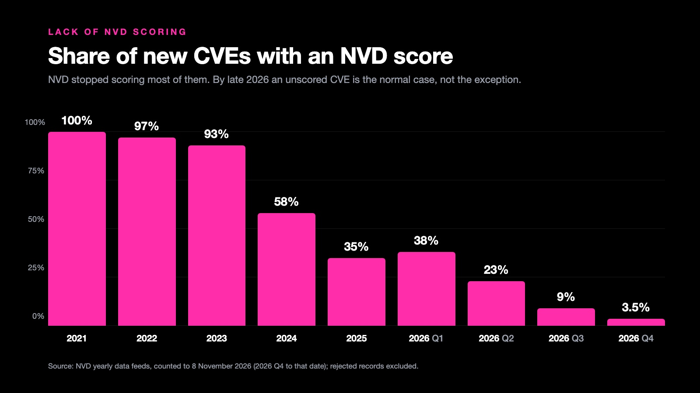

Java4Shell went public on 17 November 2026. It's a timely, if unwanted, example of things to come.

Every team running Java should be  asking the same question: are we exposed? I want to work through that question properly, because the answer turns out (as always) to be harder than it looks. Then I want to step back and look at what this tells us about future vulnerabilities.

If it's not clear, Java4Shell is one of the new hybrid AI-assisted vulnerability discoveries. I've been writing about how the world of software supply chain security was going to change — well, it's here, and Java4Shell is a canonical example of both the type of problem and how our existing processes are struggling to adapt.


## A Little Background

AI vulnerability discovery at scale is with us. Whether it's full AI discovery or AI-assisted, the outcome is pretty much the same. The number of reported vulnerabilities is set to grow by orders of magnitude. It's too early to say by how many, but even one order is too much.

This CVE is one of the new breed. Calif pointed OpenAI Codex at the internals of OpenJDK's HotSpot JVM and found this little nasty. All for about 200 dollars of tokens.

## The CVE

[CVE-2026-114938](https://www.cve.org/CVERecord?id=CVE-2026-114938) is a memory corruption bug in HotSpot's accelerated Base64 decoder. Oracle and the [OpenJDK project](https://openjdk.org/groups/vulnerability/advisories/2026-11-17) shipped fixes on 17 November. So don't panic — a fix already exists.

Malformed Base64 input can overwrite neighbouring heap memory. With enough effort, that becomes a remote code execution (RCE), the golden snitch of the bad guys' efforts.

The interesting part is everything that has to line up:

- **The runtime.** OpenJDK 17.0.6 and later are affected, which takes in the 21, 25 and 27 versions. Temurin, Corretto, Zulu and Red Hat OpenJDK are all in scope. Plain OpenJDK 8 and 11 are not, though Oracle lists some of its own commercial 8 and 11 builds as affected. If you run Oracle's builds, check Oracle's advisory.
- **The hardware.** The vulnerable code only runs on x86-64 CPUs with AVX-512 VBMI and BW. Other CPUs take a decode path without the defect. ARM64 isn't affected at all.
- **The application.** Attacker-controlled data has to reach `java.util.Base64.Decoder`. Basic auth headers, SAML artifacts, tokens and file uploads all qualify.

Remember this is a memory corruption bug. Researchers broadly agree that crashing an affected JVM is easy and full RCE is hard.

## Are We Vulnerable?

It sounds like a yes-or-no question, and ultimately it is. In practice the work to get there is significant. You can cut down the candidates quite a long way, but the final question is hard to answer.

There are four steps, and each needs finer evidence than the one before:

1. Is a Java runtime present, and which build?
2. Is the vulnerable code included in it?
3. Does the JVM pick the vulnerable CPU path on this hardware?
4. Can the application reach that code?

The usual SCA Scanners answer the first one or two. Then the tool trail ends, and you might not spot that it has. After that it's hand-crafted analysis.

I wanted to see exactly where that handover happens. So I built two near-identical container images, pointed three scanners at them, then went digging by hand. Everything here was run on a clean machine with Docker, a JDK, Syft, Trivy and Grype.

## Why Your SCA or SBOM Barely Knows the JVM Exists

Your `pom.xml` or `build.gradle` declares your libraries, and SCA and SBOM tools read them well. The JVM sits outside that space — it's 'just' an application. Whether your SCA sees it depends on the SCA. You may have other asset management tools that can spot what applications are installed on an employee's machine — like Word or Slack. Those probably see your installed Java.

Here, though, it's baked into the container image, so a flaw in the runtime never appears in your normal dependency tree and may or may not show up in any image audit tools.

That matters, because for this vulnerability [CISA's advice](https://www.cisa.gov/news-events/alerts/2026/11/17/critical-java-vulnerability-requires-immediate-patching) starts with reviewing your software inventory for JDKs and Java runtimes.

Good advice. The difficulty is in the detail. There are immediate caveats on whether you even have tools that can find a natively installed Java instance; and, as we travel down the deployment chain and watch applications and JVMs alike get packaged and repackaged, detail gets lost and the items become less visible to regular tooling.

## Two Images, One Difference

I built two images that differ in one way only: how the JVM is packaged. The program is irrelevant, so I used the smallest thing that compiles (and turns out to be useful later). 

```java
public class Hello {
    public static void main(String[] args) {
        System.out.println(System.getProperty("java.runtime.version"));
    }
}
```

We'll have a multi-stage Dockerfile that copies a full Temurin JDK onto a slim Debian base:

```dockerfile
FROM eclipse-temurin:21.0.1_12-jdk AS build
WORKDIR /app
COPY Hello.java .
RUN javac Hello.java

FROM debian:12-slim
COPY --from=build /opt/java/openjdk /opt/java/openjdk
COPY --from=build /app/Hello.class /app/Hello.class
ENTRYPOINT ["/opt/java/openjdk/bin/java", "-cp", "/app", "Hello"]
```

And a variation that builds a custom runtime using `jlink` holding only the one module the app needs (and which may have the base64 vulnerability).  

```dockerfile
FROM eclipse-temurin:21.0.1_12-jdk AS build
WORKDIR /app
COPY Hello.java .
RUN javac Hello.java
RUN "$JAVA_HOME/bin/jlink" \
      --add-modules java.base \
      --strip-debug --no-header-files --no-man-pages --compress=zip-6 \
      --output /opt/myruntime

FROM debian:12-slim
COPY --from=build /opt/myruntime /opt/myruntime
COPY --from=build /app/Hello.class /app/Hello.class
ENTRYPOINT ["/opt/myruntime/bin/java", "-cp", "/app", "Hello"]
```

Building and running both gives me the same output

```bash
21.0.1+12-LTS
```

## How Far Does the Scanner Get?

In theory your organisation already runs scanners on its images. Let's do it by hand with three free, open-source tools. All three are Apache 2.0 licensed.
- Syft and Grype come from Anchore: Syft builds an SBOM from an image or filesystem, and Grype matches that inventory against vulnerability data. 
- Trivy comes from Aqua Security and scans images, filesystems and repos for CVEs, misconfigurations and secrets. 

### Syft Finds the Runtime but Loses the Build

Syft produces a JSON-formatted result, so we'll skip over the `jq` work to pull out the "openjdk" entries. We're looking for version information and a thing called a 'purl' — a package URL, meant to uniquely identify a software asset, hence the pURL name. It is a standard; its *usage*, as we're about to see, is not.

Here's the output 

|Image| JDK Version | PURL |
|--|--|--|
|JDK|21.0.1+12-LTS|pkg:generic/oracle/openjdk@21.0.1%2B12-LTS?repository_url=https%3A%2F%2Fgithub.com%2Fadoptium%2Fjdk21u.git|
|JLINK|21.0.1|pkg:generic/oracle/openjdk@21.0.1|


Syft reads the runtime's own metadata. The full JDK gives `21.0.1+12-LTS` and the Adoptium repository. The `jlink` runtime gives a bare `21.0.1`. The build number and the vendor have gone. It's still clearly Java 21, though, and nothing here rules the image out.

Already you might get the sense that the PURL element is `flexible`.

### Trivy Only Sees What the OS Installed

Running `trivy`, we have more options on output, but it's still JSON. Here's the full script, because the output is perhaps not what you might expect.

```bash
trivy image --quiet rt-jdk:demo -f cyclonedx \
  | jq -r '.components[].name' | grep -iE 'jdk|jre|openjdk' || echo "no JVM component"
```

The result is "no JVM component". Trivy doesn't spot the JDK because we didn't install it via a package manager — we just copied it into a folder. Running against the other jlink image gives the same result.


We can ask Trivy to produce a summary and, as you can see, it does find a lot of vulnerabilities, but only in the OS.

```
┌────────────────────────────┬────────┬─────────────────┬─────────┐
│           Target           │  Type  │ Vulnerabilities │ Secrets │
├────────────────────────────┼────────┼─────────────────┼─────────┤
│ rt-jdk:demo (debian 12.15) │ debian │       226       │    -    │
└────────────────────────────┴────────┴─────────────────┴─────────┘
```

Don't take this as if Trivy is a poor tool choice. Trivy is good at Java *libraries*. It looks deeper than other tools - It opens JARs and reads their Maven coordinates for example. The JVM though itself has no Maven coordinates, so the only way Trivy can pin a CVE on the runtime is through the OS package database. Install `openjdk-21-jdk` with `apt` and Trivy will list it like any other os package. Copy in a Temurin tarball or build with `jlink`, and there's nothing to match.

Already you can see that the scanning tools we use are often eco-system focused  and sometime naive. Developers often make install choices that hide away dependencies and tools that will one day need to be found urgently. Our automated trail could have gone cold at this point, and no doubt there are organisations searching for affected Java runtimes who are breathing a sigh of relief because their tools reported false negatives.

### Grype - searching for CVEs

Grype doesn't find the JDK itself: it runs Syft's catalogers under the covers, as we did earlier. The intent here is to find the content and match it against public CVE databases. Here's a simple example of output if we run against either image 

```bash
grype rt-jlink:demo | grep -i openjdk | head
```
```
NAME     INSTALLED  FIXED IN             TYPE    VULNERABILITY   SEVERITY
openjdk  21.0.1     ..., *21.0.8, ...    binary  CVE-2025-30749  High
openjdk  21.0.1     ..., *21.0.4, ...    binary  CVE-2024-21147  High
openjdk  21.0.1     ..., *21.0.10, ...   binary  CVE-2026-21945  High
openjdk  21.0.1     ..., *21.0.2         binary  CVE-2024-20918  High
```

This does prove the jlink process hasn't lost all the vital information — the version is still there — though only on the full JDK do we see the complete `21.0.1+12-LTS`. Using jlink we've still lost potentially important information like vendor and build info. Not relevant today, but likely to be at another time.

### So Where Is CVE-2026-114938?

When I first ran this, on 18 November, it wasn't in that list. If I was an org that ran grype the instant the CVE was announced, I'd be another org thinking they were ok when they weren't. If you run this scenario today it shows up. What's going on?

### The Axis We Hadn't Accounted For: Time

CVE.org has the CVE record, but grype doesn't read it directly. What grype reads is Anchore's own database — NVD data *plus Anchore's corrections* — and that distinction turns out to matter a lot, so hold on to it. The NVD is where *enrichment* happens: analysts attach the machine-readable details a scanner needs — above all the **CPE configuration**, the list of affected products and version ranges a tool matches your software against — and, historically, a CVSS severity score. Until that happens, there is little for anyone downstream to match on. On the 18th the NVD record's status was *Received* — NVD's label for a CVE it has taken in but not yet analysed. There were no CPE configurations yet: no `cpe:2.3:a:oracle:openjdk` entries, no version ranges. Grype had nothing to match, and found nothing.

Remember that status. It's going to be a big problem for all of us.

### Two Days Later, Grype Finds It — but Not Because of NVD

I went back on 20 November, and grype now matched the Temurin image:

```bash
grype registry:eclipse-temurin:21.0.1_12-jdk | grep 114938
```
```
openjdk  21.0.1+12-LTS  *21.0.13.1, ...  binary  CVE-2026-114938  High
```

It matched the `jlink` runtime's bare `21.0.1` too. Trivy still saw nothing, because nothing had changed about how the runtime got into the image.

Here's the twist. When I ran that, NVD's own record *still couldn't have told you this*. NVD had done its first analysis the day before, but the CPE configurations it wrote were Oracle's commercial `jdk` and `jre` at the exact builds Oracle had named — 21.0.13.0.3 and friends — plus GraalVM, a Corretto 27 range, some Red Hat products and Siemens. There was no `oracle:openjdk` entry at all. A tool matching purely on NVD data would have gone looking for Oracle JDK 21.0.13.0.3, never seen my Temurin 21.0.1, and said nothing. NVD didn't add an `oracle:openjdk` range until that afternoon, hours after my run.

So where did grype's match come from? Remember that grype reads Anchore's database — NVD data *plus Anchore's own corrections*. The range it matched on, OpenJDK from version 12 up to each fixed build, is Anchore's, not NVD's. Grype had the OpenJDK family right about ten hours before NVD did. The tool was ahead of the authority it's meant to derive from.

And the severity is still Oracle's. The only CVSS figure on the record is Oracle's own, 8.1 (High), which NVD lists as a *secondary* score — supplied by Oracle as the CNA. NVD still hasn't scored it itself. So the *match* you'd act on came from your scanner's vendor, and the *severity* you'd act on came from the software's vendor. NVD, the thing both are meant to lean on, supplied neither. For a CVE with no CNA score and no scanner-vendor correction, you'd have had nothing at all.

### The Match Is Luck, and It Cuts Both Ways

That independence is doing a lot of work, and it isn't free. Grype's OpenJDK range starts at version 12, so it also flags 17.0.0 to 17.0.5 — which Calif says aren't affected. False positives to go with the false negatives. It lists Oracle's own 8 and 11 builds as ranges, too, where NVD lists only the single exact `8u511` performance-pack build.

And look at who *isn't* named. Across the whole enriched record there is no entry for Eclipse Temurin or Azul Zulu, two of the most widely deployed OpenJDK builds there are. Corretto appears only at 27.x. My Temurin image is caught at all only because Syft labels it `pkg:generic/oracle/openjdk@21.0.1+12-LTS` and grype maps that to the `oracle:openjdk` product. Change how your SBOM tool names the same binary and the match can evaporate. Whether you're flagged comes down to which distribution you run and whose data your scanner trusts — Anchore's correction, or NVD's literal transcription of Oracle's build list.

### Two days?

Two days is the *good* case, and it's good because of whose name is on the CVE. Even then, NVD took three days and several re-analyses to describe the OpenJDK versions correctly, and it still hasn't scored the thing.

Since April 2026, NIST, the owners of the NVD database, have reduced their scoring efforts to routinely enrich only software the US government uses, software designated critical, and CISA's known-exploited list. Oracle Java ticks those boxes. Oracle is also its own CVE Numbering Authority, so the record arrived on patch day with Oracle's score and affected versions. Add a CISA alert, vendor advisories and plenty of press, and scanner vendors had every reason to move fast.

The scale of that retreat is easy to miss until you plot it:



That isn't a dip, it's the floor falling away. By late 2026 an unscored CVE is the normal case, not the exception. Java4Shell — scored by its CNA, enriched, on the priority list — is the lucky exception that proves it.

Now picture the same bug in a small library with two maintainers, or an end-of-life one with none. No priority list, no vendor CNA to champion it, no CISA alert. That CVE waits in *Received*, and your scanner stays silent.


## So Where Does That Leave Us?

Notice what the scanners never said, for the two days that mattered most: **Java4Shell**. On the 18th grype listed 91 Java CVEs for that image and CVE-2026-114938 wasn't one of them.

What the tools gave us is the runtime's identity: "a Java 21.0.1 runtime is here." Turning that into "and it's in the affected range" was *our* step. We read the advisory and compared it to the version Syft reported.

- **Is a Java runtime present, and which build?** Yes, 21.0.1, straight from the SBOM.
- **Is the vulnerable code included in it?** Yes — but on day one we matched the version by hand, and the scanner that eventually caught it, on day two, did so from Anchore's correction, not NVD's record.

## Now We're in Custom Script Mode

The tools have taken us as far as they can, and there is a really good chance they are going to be doing less well in the future. We already confused one of the tools by the way we installed Java, but the real kicker is that the NVD is no longer scoring CVEs as a matter of course. I'll talk more about that later, but just let the consequences percolate.

Now we're off the beaten track; from here it's our own scripts and grep. The goal is shrinking the list of images that might be exposed, so the expensive final questions only get asked where they matter.

### What Does the Image Say About Itself?

Luckily a JDK usually writes a `release` file with its vendor and build:

```bash
docker run --rm --entrypoint cat rt-jdk:demo   /opt/java/openjdk/release
```

```
IMPLEMENTOR="Eclipse Adoptium"
IMPLEMENTOR_VERSION="Temurin-21.0.1+12"
JAVA_VERSION="21.0.1"
OS_ARCH="aarch64"
```

```bash
docker run --rm --entrypoint cat rt-jlink:demo /opt/myruntime/release
```

```
# JAVA_VERSION="21.0.1"
# MODULES="java.base"
```

The `jlink` runtime gives you almost nothing. The vendor, the build and even the architecture have gone.
Well, we can ask the image directly:

```bash
docker inspect rt-jlink:demo --format 'arch={{.Architecture}} os={{.Os}}'
```
```
arch=arm64 os=linux
```

I built the demo on a Mac, so the architecture is ARM and my image is safe from this CVE. Losing the vendor still hurts, though. Whose fix are you waiting for?

If we'd seen `amd64`, it's a different story. The architecture can't tell you whether the CPU supports AVX-512 VBMI, you need to do more work.

### Look for Mitigations Baked In

Since we're at the limit of detection by version, we need to look at other ways to reduce our list of candidates.
In this particular case we can look for images where the mitigation — the fix we might just turn on rather than upgrade — is already configured.

Two JVM flags stop the memory overflow. [VulnCheck](https://www.vulncheck.com/blog/java4shell) verified either one on OpenJDK 17, 21 and 25. The second switches off AVX-512 more broadly, so expect a performance cost if you decide to go down that route.

We're looking for either `-XX:+UnlockDiagnosticVMOptions -XX:-UseBASE64Intrinsics` being used, or just `-XX:UseAVX=2`.

Remember we're only removing false positives, and only tentatively: a runtime `-e JAVA_TOOL_OPTIONS` can override whatever the image declares, so image flags narrow the list but never clear a container on their own — confirm the effective flags on the running thing (the Kubernetes checks below). Any image that has a target JDK in it that doesn't match is still a candidate. At this point we're looking for launch scripts or equivalent. In the off chance that the image directly launches the JVM, we're going to explore the ENTRYPOINT itself and any environment variables.

```bash
docker inspect rt-jlink:demo \
  --format 'ENTRYPOINT={{.Config.Entrypoint}}{{"\n"}}ENV={{.Config.Env}}'
```
```
ENTRYPOINT=[/opt/myruntime/bin/java -cp /app Hello]
ENV=[PATH=...]
```

Look at the entrypoint for hard-coded flags, and at `ENV` for `JAVA_TOOL_OPTIONS` and its equivalents. Of course, if you're using a custom script to launch the JVM then your searching scope is going to be different. Good luck.

Whatever search mechanism we use, we need to be sure that it really does find the correct launcher. Otherwise we've just struck an image off the list that is potentially vulnerable. We're still shrinking the false positives, which is a good thing. But we're running out of runway.

## Some Answers Only Exist on a Running Host

The CPU support question (does this CPU support avx512)  isn't a property of the image. The JVM gets it when it starts on a particular host. The same `amd64` image can be exposed on one node and safe on the next.

The host's real CPU features come from the kernel, and we can ask it — note that this is a per-instance check.

```bash
docker run --rm --entrypoint sh rt-jdk:demo -c \
  "grep -o -w -E 'avx512f|avx512bw|avx512vbmi' /proc/cpuinfo | sort -u"
```

No `avx512vbmi`, no vulnerable path. On x86-64 that one check will help reduce the vulnerable environment pool — it doesn't discount the image.

We can even ask HotSpot what it chooses at startup in the same environment:

```bash
docker run --rm --entrypoint /opt/java/openjdk/bin/java rt-jdk:demo \
  -XX:+PrintFlagsFinal -version | grep -E 'UseBASE64Intrinsics|UseAVX '
```

Warning. On my arm64 machine `UseBASE64Intrinsics` comes back `true`, yet there's no `UseAVX` line at all. The intrinsic is on, but the AVX-512 version of it doesn't exist there. On x86-64 you need the intrinsic enabled *and* `UseAVX` at `3` *and* the VBMI feature present.

Calif has also published a [proof of concept](https://calif.io/java4shell/) that only checks whether a given JDK and CPU combination reproduces the corruption. Treat it like any exploit code  and run it somewhere safe.

For something already running in Kubernetes, you could go to the pod and check the  launch flags and environment 

```bash
kubectl exec <pod> -- java -XX:+PrintFlagsFinal -version | grep -E 'UseBASE64Intrinsics|UseAVX '
kubectl exec <pod> -- cat /proc/1/cmdline | tr '\0' ' '
kubectl exec <pod> -- sh -c 'grep -o -w avx512vbmi /proc/cpuinfo | head -1'
```

That first command launches a *new* JVM, so it shows what HotSpot picks on that node's CPU — not necessarily what the running app uses, since its launcher may have set or cleared flags before it started. For the app's own effective flags, read its `cmdline` (above) or, where attach is allowed, `jcmd <pid> VM.flags -all`. So maybe you can short-circuit the problem that way.

## Can the application reach the code?

Nothing so far answers that. Whether your app feeds attacker-controlled Base64 into the decoder isn't written down anywhere, static or runtime. You need call-graph analysis, a code search for `Base64.getDecoder()` and friends, or a test against the running service. Your frameworks decode Base64 too, so your own code is only part of the story.


## What we've learnt so far

1: The data and the tools we might rely on to detect vulnerable images are not as robust as we'd hope. There are many ways a build packaging step can inadvertently hide important content. In this example we just copied a directory. We can hide packages, tools and dependencies in many other ways. Some because we short-cut the process — `curl | bash` being a common example — some because we didn't even understand that installing a particular component might drag in other hidden ones too. Running things like `apt install` can have known side-effects that you just weren't aware of.
2: That timing matters — a negative search result today may turn into a positive one tomorrow.


## What else Java4Shell Tells Us About How the World Is Changing

Java4Shell isn't a one-off. Everything that made "are we exposed?" awkward to answer is a symptom of something bigger. Here are the changes I think matter most. I'll have a lot more to say in an upcoming analysis and report.

### Discovery Is Cheap and Getting Cheaper

Monthly CVE disclosures went from about 5,000 in January 2026 to over 10,700 in August. Some of that is reporting change, but not much. Mozilla shipped 271 security fixes in one Firefox release after a single AI evaluation pass. Someone swept the whole FreeBSD kernel, all 35,000 files, with a cheap model for under 100 dollars.

Exploits are getting cheap too. Given only the patch commit, a research agent reproduced 56 of 100 real Linux kernel flaws at about 2.50 dollars and 12 minutes each. Calif say their first working Java4Shell exploit took about three hours with AI help.

### Maintainers Are Pulling Up the Drawbridge

If discovery is scaling, the people who fix things aren't. More discovery does not mean more maintainers!

Google's open source reward programme stopped taking product submissions in October 2026, after a flood of invalid automated reports. curl ended its paid bug bounty in January and paused vulnerability handling for a month over the summer. Cal.com took its production code closed source, citing security.

Even the best-run programme shows the gap. Anthropic's Project Glasswing reports its models found nearly 38,000 issues. About 5,000 reached maintainers, and 629 had a released fix after seven months. That's roughly one reported finding in eight. AI is much better at finding bugs than fixing them, and validation falls on the people with the least spare time.

### OpenJDK Is the Lucky Case

For all the awkwardness, Java4Shell had a happy ending available on day one. OpenJDK has maintainers and a vulnerability group for every supported release. Fixes for 17, 21, 25 and 27 shipped the day the details went public. Temurin, Corretto, Zulu and the rest followed.

### So what else in your build has no maintainer?

The numbers were worrying before AI. Only 11% of 1.2 million open source projects are actively maintained. 93% of commercial codebases contain components with no development in two years. An end-of-life container image picks up more than 400 known vulnerabilities a year. Those stats can only get worse with the disparity between detection and remediation.


## Can AI help?

AI as a remediation agent is not there yet. There are promising signs, but the consequences of the AI-generated fixes still outweigh the benefit — often producing solutions that are not complete or have significant side-effects.
That's not to say this is all wasted effort. The AIs are improving, and maybe one day you'll be able to have an AI review and fix any security exposure in your new code.

## What to do next

Even in the simple case, knowing what you have is hard enough. Having to do this sort of handcrafted discovery at scale will be completely disruptive.

The next steps are simple to explain.

1 - Build and maintain an asset management database of all the software components in use. Everything. From OS to application, from compiler to test framework.
2 - Examine all your build/install scripts for how assets get added. Every handcrafted copy or download needs to be removed in favour of something your SCA tools analyse. That may mean building some test cases to see what they find and what they miss.
3 - For every asset in your database, take some time to decide what you need and what you can remove. Look to update to the latest version you can take, and for every component that's not on an actively maintained version, take a second look at why it's there.
4 - Add gates to prevent new software entering the system without similar checks. AI is known to select EOL software and/or components with actively exploited CVEs.

This doesn't remove all the hard work needed, but it's a start and it'll get your org and config into the right shape.

## What to explore 

With that list you can start to plan how to deal with software that's reaching EOL. You will already have components like that, and that's OK. Knowing is the first step.

Upgrading and keeping to near-latest is the safest free solution for open source projects, but there are other options. Removing the component is the next, and the third is to seek commercial security patch support.

I work for [HeroDevs](https://www.herodevs.com/?utm_source=devrel&utm_medium=referral&utm_campaign=foojay-java4shell), a company that provides secure patches for EOL software across many packages and ecosystems. Sometimes all you need is a small fix to a small component because the upgrade risk is too high. That you can get pretty quickly. However, it's worth exploring other options and looking for support before the CVE occurs. That's something HeroDevs can help with too.

Whatever you do, you can't decide about what you can't see. So build that list, scan it for CVEs, and use HeroDevs' free [End-of-Life Dataset](https://www.herodevs.com/eol-dataset?utm_source=devrel&utm_medium=referral&utm_campaign=foojay-java4shell) to check your list against our lifecycle data of 12 million+ package versions. Has a version gone officially EOL, or been quietly abandoned?

All it takes is a simple scan or SBOM upload.

```bash
npx @herodevs/cli@beta scan eol
```


## Machine-Speed Vulnerabilities, Human-Speed Fixes

Put it all together. Discovery is cheap and getting cheaper. Maintainers are stretched and pulling back. Much of what we run has no maintainer at all. The scoring we triaged by has mostly gone, and the inventories we rely on don't agree with each other. AI is adding code, models and text faster than we track them.

We can't control how fast flaws are found, but we can control how ready we are to respond.

So, for Java4Shell: patch to a fixed build first. For everything else, know what you ship, keep it updatable, and work the chain where you can't.

## Further Reading

- [OpenJDK vulnerability advisory, 17 November 2026](https://openjdk.org/groups/vulnerability/advisories/2026-11-17)
- [Calif's Java4Shell write-up](https://calif.io/java4shell)
- [Oracle Critical Security Patch Update, November 2026](https://www.oracle.com/security-alerts/cspunov2026.html)
- [VulnCheck: Java4Shell analysis and mitigation testing](https://www.vulncheck.com/blog/java4shell)
- [CISA alert on CVE-2026-114938](https://www.cisa.gov/news-events/alerts/2026/11/17/critical-java-vulnerability-requires-immediate-patching)

## Sources

- **Monthly CVEs:** 5,045 (January 2026) to 10,740 (August 2026), The Record, using Google data.
- **Firefox:** 271 security fixes in one release after an AI evaluation pass, Mozilla.
- **FreeBSD sweep:** 35,000 files for under $100, AISLE.
- **Patch-to-PoC:** 56 of 100 Linux kernel flaws reproduced, average $2.49 and 12 minutes, UC Riverside (arXiv 2602.07287).
- **Java4Shell exploit time:** about three hours, Help Net Security reporting on Calif.
- **Maintainer pull-backs:** Google OSS VRP, curl and Cal.com, from Help Net Security, Open Resource and Cal.com.
- **Project Glasswing:** 37,966 found, 5,087 reported, 629 patched upstream, Anthropic coordinated disclosure dashboard, 2 November 2026 (self-reported).
- **Maintenance:** 11% of 1.2 million projects actively maintained, Sonatype 2023.
- **Stale components:** 93% of codebases, Black Duck OSSRA 2026.
- **End-of-life images:** 400+ vulnerabilities a year, Chainguard 2024 (vendor research).
- **NVD scoring:** share of new CVEs with their own NVD score by year — 100% (2021), 97% (2022), 93% (2023), 58% (2024), 35% (2025), then 38%, 23%, 9% and 3.5% across 2026 Q1–Q4. Counted from NVD yearly data feeds on 8 November 2026 (2026 Q4 to that date), rejected records excluded.
- **Unscored CVEs:** about 65% of open source CVEs, Sonatype State of the Software Supply Chain 2026.
- **Java4Shell record history (times UTC):** Received from Oracle (CNA) 17 November 22:18, with CVSS 3.1 8.1 (High) and Oracle's exact affected builds (8u511-perf, 17.0.21.0.3, 21.0.13.0.3, 25.0.5.0.3, 27.0.1.0.3); CISA added CWE-122 and SSVC the same minute; references added through 18 November. NVD initial analysis 19 November 11:47 (Oracle `jdk`/`jre` as exact versions, GraalVM, a Corretto 27 range, Red Hat products, Siemens — no `oracle:openjdk`); Siemens update 19 November 21:17 (why the status read *Modified* on 20 November). `oracle:openjdk` lines first added in the modified analysis 20 November 16:54; reanalysis 20 November 19:18 narrowed the 17 line to start at 17.0.6. As of 23 November the status is *Analyzed*, 40 CPE match entries, the only metric still a *secondary* CVSS 3.1 of 8.1 from Oracle (`secalert_us@oracle.com`), no NVD/primary score. NVD API queried 20 November 11:13 and 23 November.
- **Grype matching:** Grype 0.122.1. Database built 20 November 06:21 UTC matched Temurin 21.0.1 via `oracle:openjdk` ranges (version 12 up to each fixed build: 17.0.21.1, 21.0.13.1, 25.0.5.1, 27.0.1.1) — about ten hours before NVD added any `oracle:openjdk` configuration. Database built 23 November 06:28 UTC, same ranges. The 18 November run (database not recorded) returned no match. The exact first-match date is not recoverable: Anchore publishes only the latest database.
- **Package hallucination:** 19.7% of 2.23 million references, Spracklen et al., USENIX Security 2025.
- **Malicious models:** about 100 found on Hugging Face, JFrog Security Research, 2024.
- **GitHub breach:** about 3,800 internal repositories via a poisoned editor extension, Dark Reading, May 2026.
