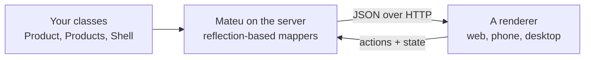

Most business applications end up as two applications. The backend holds the model, the rules and the validation. The frontend repeats the model, repeats the validation, and adds its own build, its own framework and often its own team. For an internal back office with forty screens, that second application is most of the work, and most of it is the same work every time: a listing, a search box, a few filters, a form, "this field is required".

[Mateu](https://mateu.io) is an open-source (Apache 2.0) attempt to remove that second application. You declare what a screen contains (its fields, rules and actions) and Mateu derives the screen. Version 3.0.0 came out on 15 November 2026 and is the first release with a stable public API.

A disclosure before we start: I am the author of Mateu. This article is not a feature list; it builds one real screen step by step, shows what happens under the hood, and is honest about where the approach does not fit. All the code below compiles and runs against `io.mateu:*:3.0.0` from Maven Central.

## What we are going to build

A product catalogue for a back office:

- a listing at `/products` with a free-text search, filters by price range, status and date, sorting and paging;
- a create form, a record page and an editor;
- validation in the browser while the user types and again on the server before anything is saved;
- delete with row selection, and deep links that survive a reload.

We will write five small Java files and no HTML, CSS, JavaScript or TypeScript.

## Step 1: the project

You can generate a project from IntelliJ IDEA (*File › New › Project › Mateu*), from VS Code (*Mateu: New Project…*) or with the Maven archetype:

```bash
mvn archetype:generate -DarchetypeGroupId=io.mateu \
    -DarchetypeArtifactId=mateu-archetype -DarchetypeVersion=3.0.0 \
    -DgroupId=com.example -DartifactId=my-shop
```

If you prefer to add Mateu to an existing Spring Boot (MVC) application, you need three dependencies and an annotation processor:

```xml
<dependency>
    <groupId>io.mateu</groupId>
    <artifactId>mateu-mvc</artifactId>       <!-- the Spring MVC adapter -->
    <version>3.0.0</version>
</dependency>
<dependency>
    <groupId>io.mateu</groupId>
    <artifactId>mateu-vaadin</artifactId>    <!-- the web renderer, served as static assets -->
    <version>3.0.0</version>
</dependency>
<dependency>
    <groupId>io.mateu</groupId>
    <artifactId>mateu-test</artifactId>      <!-- optional: UI tests without a browser -->
    <version>3.0.0</version>
    <scope>test</scope>
</dependency>
```

```xml
<plugin>
    <groupId>org.apache.maven.plugins</groupId>
    <artifactId>maven-compiler-plugin</artifactId>
    <configuration>
        <annotationProcessorPaths>
            <path>
                <groupId>io.mateu</groupId>
                <artifactId>mateu-annotation-processor-mvc</artifactId>
                <version>3.0.0</version>
            </path>
            <!-- list Lombok here too if you use it: once annotationProcessorPaths
                 is set, nothing else on the classpath runs as a processor -->
        </annotationProcessorPaths>
    </configuration>
</plugin>
```

The annotation processor generates one controller per UI class at compile time, so there is no classpath scanning at startup. The same model runs on Spring WebFlux, Quarkus, Micronaut and Helidon MP: on Quarkus, for example, you swap `mateu-mvc` for `mateu-quarkus` and the processor for `mateu-annotation-processor-quarkus` (and keep `quarkus-rest-jackson`). The [Quarkus starter](https://github.com/miguelperezcolom/mateu/tree/master/starters/quarkus) in the repository is a complete example. Everything from step 2 onwards is identical on every runtime.

## Step 2: the model

The model is a record, annotated with Bean Validation and a few Mateu hints:

```java
package com.example.app;

import io.mateu.uidl.annotations.EditableOnlyWhenCreating;
import io.mateu.uidl.annotations.RangeFilter;
import io.mateu.uidl.annotations.Stereotype;
import io.mateu.uidl.data.FieldStereotype;
import io.mateu.uidl.interfaces.Identifiable;
import jakarta.validation.constraints.Min;
import jakarta.validation.constraints.NotEmpty;
import jakarta.validation.constraints.NotNull;
import jakarta.validation.constraints.Size;
import java.time.LocalDate;

public record Product(
    @EditableOnlyWhenCreating @NotEmpty String id,
    @NotEmpty @Size(max = 60) String name,
    @Min(0) @RangeFilter @Stereotype(FieldStereotype.money) double price,
    @NotNull ProductStatus status,
    LocalDate added)
    implements Identifiable {

  @Override
  public String toString() {
    return name != null && !name.isBlank() ? name : "New product";
  }
}
```

```java
package com.example.app;

public enum ProductStatus {
  Available,
  OutOfStock,
  Discontinued
}
```

A few things are worth pointing out:

- `Identifiable` tells Mateu which field is the id (`id`, here).
- `@EditableOnlyWhenCreating` lets the user type the id on *New* and keeps it read-only afterwards.
- `@Stereotype(FieldStereotype.money)` shows the price as an amount, formatted in the user's locale.
- `@RangeFilter` turns the price filter into a min–max range instead of a single value.
- `toString()` becomes the record page's title ("Coffee grinder") and what the free-text search matches against.
- Enum constants are humanised: `OutOfStock` is shown as "Out of stock", with no `@Label` on each constant.

## Step 3: the data access port

Mateu does not talk to your database. A CRUD reads and writes through `CrudStore<T>`, an interface with four methods that you implement however you like. For the tutorial it is an in-memory map:

```java
package com.example.app;

import io.mateu.uidl.interfaces.CrudStore;
import java.time.LocalDate;
import java.util.List;
import java.util.Map;
import java.util.Optional;
import java.util.concurrent.ConcurrentHashMap;

public class ProductStore implements CrudStore<Product> {

  public static final ProductStore INSTANCE = new ProductStore();

  private final Map<String, Product> db = new ConcurrentHashMap<>();

  private ProductStore() {
    save(new Product("P-001", "Espresso machine", 249.0, ProductStatus.Available, LocalDate.of(2026, 1, 12)));
    save(new Product("P-002", "Coffee grinder", 89.5, ProductStatus.Available, LocalDate.of(2026, 1, 12)));
    save(new Product("P-003", "Milk frother", 39.9, ProductStatus.OutOfStock, LocalDate.of(2026, 3, 2)));
    save(new Product("P-004", "Pour-over kettle", 59.0, ProductStatus.Discontinued, LocalDate.of(2025, 11, 20)));
  }

  @Override
  public Optional<Product> findById(String id) {
    return Optional.ofNullable(db.get(id));
  }

  @Override
  public String save(Product product) {
    db.put(product.id(), product);
    return product.id();
  }

  @Override
  public List<Product> findAll() {
    return db.values().stream().sorted((a, b) -> a.id().compareTo(b.id())).toList();
  }

  @Override
  public void deleteAllById(List<String> ids) {
    ids.forEach(db::remove);
  }
}
```

Search, filtering, sorting and paging all go through one more method, `find(...)`, which has a default implementation that does the work in memory over `findAll()`. That is fine for a tutorial and for small reference tables; for a real table you override it, which we will come back to below.

## Step 4: the CRUD and the app shell

The screen itself is a class that says "this is a CRUD over `Product`":

```java
package com.example.app;

import io.mateu.core.infra.declarative.orchestrators.crud.AutoCrud;
import io.mateu.uidl.annotations.Title;
import io.mateu.uidl.interfaces.CrudStore;

@Title("Products")
public class Products extends AutoCrud<Product> {

  @Override
  public CrudStore<Product> store() {
    return ProductStore.INSTANCE;
  }
}
```

And the app shell, mounted at the root of the application, names it in its menu:

```java
package com.example.app;

import io.mateu.uidl.annotations.Menu;
import io.mateu.uidl.annotations.Title;
import io.mateu.uidl.annotations.UI;

@UI("")
@Title("My shop")
public class Shell {

  @Menu Products products;
}
```

`@UI("")` mounts the app at `/`; each `@Menu` field is an entry in the menu and a route (`/products`). With no explicit home page, the app opens on the first menu entry.

That is the whole application. Run it with `mvn spring-boot:run` and open `http://localhost:8080`.

## What you get

The listing has a single search field. Typing and pressing Enter searches the text; clicking it opens a *Filter by* panel with one filter per field of the record:


products-filters-panel.jpg | The Products listing in the browser, with the Filter by panel open listing Id, Name, Price, Status and Added


Each filter gets a widget that matches its type: a text input for strings, a multi-select for the enum (any of the picked values), a from–to range for the `LocalDate` (dates are ranges by default, because equality on an exact day is rarely what a user wants) and a min–max range for the price, because we asked for it with `@RangeFilter`. Every applied condition becomes a chip, and the URL carries it, so a filtered listing is a link you can share or bookmark:


products-filtered.jpg | The Products listing filtered to a price between 50 and 150 and status Available or Discontinued, showing two rows: Coffee grinder and Pour-over kettle


That screen is `/products?price_from=50&price_to=150&status=Available,Discontinued`, and opening the URL in a new tab restores exactly that state.

*New* opens `/products/new`. Pressing *Save* on an empty form marks the invalid fields, moves the focus to the first of them, and saves nothing:


products-validation.jpg | The New product form after pressing Save with empty fields: Id, Name and Status show "Cannot be empty" and an error toast lists the validation errors


Clicking a row opens the record page at `/products/{id}`, with an *Edit* button leading to `/products/{id}/edit`. Selecting rows enables *Delete*. All of these are real routes: reload the page and you land where you were.

## How it works: one model, wire JSON, renderers

Nothing in this project is a frontend, so where does the UI come from? There are three layers:



1. **The model** is your Java classes. They are ordinary objects: no base class for the record, no generated code you have to touch.
2. **The server** turns them into a description of the screen. Every interaction is a `POST /mateu/v3/sync/{route}` carrying the action (`""` for "load this route", `search`, `save`, and so on) and the current state of the form. Mateu creates a fresh instance of your class for each request, fills it from that state, runs the action and answers with a JSON document of *fragments* (the components to draw), *commands* (navigate, set the window title…) and *messages* (toasts).
3. **A renderer** draws that JSON. The default one, `mateu-vaadin`, uses web components and is served as static files by your app.

Here is a fragment of what the server answers for `/products/new`. The name field:

```json
{
  "type": "FormField",
  "fieldId": "name",
  "dataType": "string",
  "label": "Name",
  "required": true
}
```

and the validation rules derived from the annotations:

```json
{"fieldId": "name", "message": "Cannot be empty",
 "condition": "state['name'] != null && state['name'] !== '' && (state['name'].length === undefined || state['name'].length > 0)"}
{"fieldId": "name", "message": "Size must be between 0 and 60",
 "condition": "state['name'] == null || state['name'] === '' || state['name'].length === undefined || state['name'].length <= 60"}
{"fieldId": "price", "message": "Must be at least 0",
 "condition": "state['price'] == null || state['price'] === '' || state['price'] >= 0"}
```

The renderer evaluates those conditions in a small sandboxed expression evaluator while the user types. That is only for feedback: before the `save` action runs, the server checks the same constraints against the same annotations and refuses the request if they fail. The browser never decides whether data is valid.

Two consequences of this design matter in practice:

- **The server is the only source of truth.** A field your user may not see is not hidden by the renderer; it is never sent. An action the screen did not declare is refused with a 403, whatever the client asks for.
- **The renderer is replaceable.** Because the contract is JSON, the same screen can be drawn by other renderers. More on that below.

## Testing the screen without a browser

Because the UI is a function of server-side state, you can test it in plain JUnit. The `mateu-test` artifact (the optional test-scoped dependency from step 1) boots Mateu in the JVM, with no server and no browser, and lets a test use the screen like a user would. JUnit 5 comes from `spring-boot-starter-test`, which a Spring Boot project generated by start.spring.io already has (with `<scope>test</scope>` and no version, managed by the Boot parent). The test goes in `src/test/java/com/example/app/ProductsUiTest.java`:

```java
package com.example.app;

import static org.junit.jupiter.api.Assertions.assertEquals;
import static org.junit.jupiter.api.Assertions.assertTrue;

import io.mateu.test.MateuTest;
import java.util.List;
import org.junit.jupiter.api.AfterEach;
import org.junit.jupiter.api.BeforeEach;
import org.junit.jupiter.api.Test;

class ProductsUiTest {

  MateuTest mateu;

  @BeforeEach
  void start() {
    mateu = MateuTest.builder().scan("com.example.app").start();
  }

  @AfterEach
  void stop() {
    mateu.close();
  }

  @Test
  void theSearchBoxFindsAProduct() {
    var products = mateu.open("/products");
    products.listing().search("grinder");
    assertEquals(
        List.of("Coffee grinder"),
        products.listing().rows().stream().map(r -> r.get("name")).toList());
  }

  @Test
  void aProductWithoutANameIsRejected() {
    var form = mateu.open("/products").button("New").press();
    form.field("id").set("P-100");
    form.button("Save").press();

    assertTrue(form.lastMessage().isError());
    assertTrue(ProductStore.INSTANCE.findById("P-100").isEmpty());
  }
}
```

These tests run in milliseconds and exercise the same path a real request takes: route resolution, instance creation, validation and the wire model. The harness is marked `@Experimental` in 3.0, so its API may still change within 3.x.

## Moving to a real database

Two changes take this from a demo to something you can deploy.

First, a store backed by your database. A UI class like `Products` is instantiated by Mateu on every request, and its `@Autowired` (or `@Inject`) fields are injected from the container, so the store can be a normal Spring bean:

```java
@Title("Products")
public class Products extends AutoCrud<Product> {

  @Autowired JdbcProductStore store;

  @Override
  public CrudStore<Product> store() {
    return store;
  }
}
```

Do not annotate `Products` itself with `@Component` or `@Service`: a CRUD keeps per-request state (which of its views is showing), and a singleton would share it across users. Mateu detects a shared bean and builds a fresh instance anyway, with a warning, but a plain class is the intended pattern. The [execution model](https://mateu.io/java-user-manual/concepts/execution-model/) page explains why.

Second, push the search down. `CrudStore.find(String searchText, T filters, Pageable pageable)` returns a `Page<T>`; a second overload also receives the range and multi-select conditions as a `List<FilterCriterion>` (between, gte, lte, in). Override them to translate the search into SQL, a JPA `Specification` or whatever your data layer speaks, and run the count and the page query in the same method. Until you do, the default filters `findAll()` in memory, which is a perfectly good choice for a table of a few hundred rows and a bad one for a few million.

## Where Mateu fits, and where it does not

Mateu is good at the screens most business applications are made of: listings, forms, record pages, wizards, dashboards, master–detail, the app shell around them. It makes a lot of decisions for you: layout, column widths, how a filter looks, where buttons go. That is the point, and it is also the main cost.

It is a poor fit when:

- **The UI is the product.** A consumer-facing app, a marketing site or anything where a designer specifies every pixel is better served by a frontend framework and a frontend team. Mateu's look is configurable within its design systems, not free-form.
- **The interaction is unusual.** A drawing tool, a game or a heavily animated, client-side-first experience does not map onto "a screen described by the server". You can embed your own web components in a Mateu screen, but if most of the app is custom, you are fighting the model.
- **You need to work offline for long periods.** Every interaction goes to the server. The phone app has an experimental queue for actions that can wait, but Mateu is not an offline-first framework.
- **You want no new abstraction in your stack.** Mateu is one more layer between your code and the browser. When something renders differently from what you expected, you debug Mateu's inference, not your own HTML.

It is also fair to compare it with tools that already exist. OpenXava and Jmix derive business screens from Java entities; Django's admin does it for Python models; Vaadin lets you build the web UI in Java component by component (I worked at Vaadin, and Mateu's web renderer uses Vaadin's open-source web components); low-code platforms such as Oracle APEX or Retool build business apps quickly inside their own tool. What Mateu adds is that the same declaration is also served to other renderers and other runtimes, as the next section shows.

## Beyond the CRUD

`AutoCrud` is one of several *archetypes*. A class that extends `Wizard` becomes a multi-step process, `Dashboard` turns `MetricCard` fields into a KPI band and `@Panel` fields into tiles, and `Welcome`, `ItemOverview`, `Foldout`, `CollectionDetail`, `CalendarPage` and others cover most of what a back office needs. When none fits, you compose the screen from components yourself.


explorer-dashboard.jpg | A dashboard in the Mateu Explorer: MetricCard fields become a KPI band and panels become tiles


Because the screen travels as JSON, the same declaration has several places to run:

- on the web with the Vaadin-based renderer, or with Oracle's Redwood design system;
- in the Mateu phone app (iOS on the App Store; Android as an APK on the GitHub release) and the Mateu desktop app (macOS, Windows, Linux);
- inside an Oracle Visual Builder application.

Here is the same record page, from the public [museums demo](https://museums.ec1.mateu.io), drawn by the Vaadin renderer and by the Redwood one. The declaration did not change between the two:


museums-record-vaadin.jpg | The artwork record page drawn by the Vaadin renderer
museums-record-redwood.jpg | The same record page drawn by the Redwood renderer


The model does not have to be Java either. Mateu has server implementations in C# (ASP.NET Core) and Python (FastAPI) that produce the same JSON, checked against a shared conformance corpus, and a screen can also be written as YAML data, served by Spring Boot or exported as a static bundle with no backend. The museums demo is written that way. For a Java team, though, the code-first path shown above is the one to start with.

Finally, each app can expose an MCP server so that AI agents can read screens and run actions under the same identity and access rules as a person. It is off unless you switch it on.

## Getting started

- The [quickstart](https://mateu.io/java-user-manual/start-here/quickstart/) and [Create your project](https://mateu.io/java-create-your-project/) pages cover every runtime.
- [Filters and listings](https://mateu.io/ux-patterns/filters-and-listing/) and [Testing your UIs](https://mateu.io/quality/testing-your-uis/) go deeper into the two topics of this article.
- The [Mateu Explorer](https://explorer.mateu.io) shows every archetype and component live.
- The code is on [GitHub](https://github.com/miguelperezcolom/mateu), and the [3.0.0 release notes](https://github.com/miguelperezcolom/mateu/releases/tag/v3.0.0) list what is in this version. Versions are managed by the BOM, `io.mateu:mateu-bom:3.0.0`.

From 3.0.0 on, the public Java API keeps binary compatibility across the 3.x line and every build checks it; features still finding their final shape are marked `@Experimental`.

If you prefer watching to reading, this is Mateu in three minutes:



If you maintain back-office screens, try Mateu on one you already have and see how much of it is left to write. Issues, questions and criticism are welcome on GitHub.
