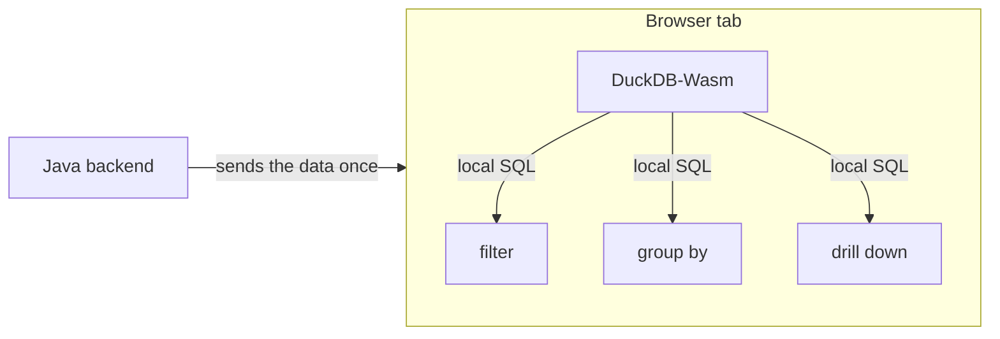

*DuckDB-Wasm runs the DuckDB analytical database inside the browser tab. The Java backend sends the dataset once, and from then on each filter and aggregation is a local SQL query rather than another request to the server. Below is a two-file example with no build tools, and a look at when the approach is a good fit and when it isn't.*

## Every click is a round-trip

Most Java web apps that show analytics follow the same pattern. The user picks a filter, the browser calls a REST endpoint, the Java service runs a `GROUP BY` against the database, serialises the result to JSON, and sends it back. Change the date range: another round-trip. Switch from "by region" to "by product": another one.

That works, and for many apps it makes sense. When the round-trips add up, there are several standard responses: cache the common responses, pre-aggregate into summary tables or materialized views, combine several queries into one endpoint, or move the data into a dedicated OLAP store such as ClickHouse or Druid. Each one helps, and each adds something to run, tune, or invalidate. None of them changes the basic arrangement: the server answers every question, and the user waits on the network for data they already downloaded once.

DuckDB-Wasm takes a different approach. DuckDB, the in-process analytical database, compiled to WebAssembly, runs entirely in the browser tab. Your Java backend sends the data once; from then on, every aggregation, filter and join is a local SQL query. In this post we'll build the smallest possible version of that: a single Java file and a single HTML file, no Maven, no npm, no framework.

## Why this is worth doing

Moving analytics into the browser changes two things about a data-heavy UI: what it costs to run and how quickly it responds. Five concrete points:

1. **Interactions become instant.** Once the data is in the tab, a re-aggregation over tens of thousands of rows is a local, in-memory columnar query. There's no network latency, no JSON serialisation, no connection pool. Filters and drill-downs respond immediately.
2. **Your server does far less work.** In the classic pattern, ten users each clicking twenty filters means two hundred analytical queries on your infrastructure. Here it's ten data downloads. The queries run on the user's machine instead of yours.
3. **Java stays the source of truth.** This isn't "replace the backend with JavaScript". Java still decides *what* data a user may see, applies security and business rules, and produces the dataset. The browser only gets to ask questions about what it was given.
4. **It's SQL, not a bespoke JavaScript API.** The front-end speaks the same language as your database and your data team. For SQL that both clients support, a query you prototype in the DuckDB CLI or in Java via JDBC runs unchanged in the browser. The browser build is not identical to the native one: it ships a smaller set of extensions and has its own HTTPFS implementation, so a query that leans on native file or network I/O is where the two can diverge.
5. **It works offline and shares well.** Once loaded, the page keeps working without the server. That makes it a good fit for reports you email, dashboards on flaky conference Wi-Fi, or exploratory tools you hand to someone outside your network.

This works best when the dataset per user is small enough to download (megabytes to low hundreds of megabytes) but the number of questions asked about it is large.

## The scenario

We'll build a tiny sales dashboard. A Java server generates 1,000 rows of sales data (region, product, amount) and exposes them as CSV. The browser downloads that CSV once, loads it into DuckDB-Wasm, and computes revenue per region with plain SQL.



Java answers exactly two requests: the page and the data. Everything after that is a conversation between the page and DuckDB inside the same tab.

## Building it, step by step

All you need is JDK 17 or newer (`java -version`). Nothing else gets installed: DuckDB-Wasm is loaded from the jsDelivr CDN.

### Step 1: Create a project folder

```bash
mkdir duckdb-wasm-java && cd duckdb-wasm-java
```

### Step 2: Write the Java backend

Create `Server.java`. It uses the JDK's built-in `HttpServer` to serve two things: the HTML page, and a `/api/sales.csv` endpoint that generates 1,000 sales rows.

```java
import com.sun.net.httpserver.HttpExchange;
import com.sun.net.httpserver.HttpServer;

import java.io.IOException;
import java.net.InetSocketAddress;
import java.nio.charset.StandardCharsets;
import java.nio.file.Files;
import java.nio.file.Path;
import java.util.Locale;
import java.util.Random;

public class Server {

    public static void main(String[] args) throws Exception {
        // Loopback only: this demo has no auth, so don't expose it to the network
        var server = HttpServer.create(new InetSocketAddress("127.0.0.1", 8080), 0);

        // Data endpoint: Java produces the data
        server.createContext("/api/sales.csv", ex -> {
            var rnd = new Random(42);
            String[] regions = {"North", "South", "East", "West"};
            String[] products = {"Coffee", "Tea", "Juice"};

            var sb = new StringBuilder("region,product,amount\n");
            for (int i = 0; i < 1000; i++) {
                sb.append(regions[rnd.nextInt(regions.length)]).append(',')
                  .append(products[rnd.nextInt(products.length)]).append(',')
                  .append(String.format(Locale.ROOT, "%.2f", 5 + rnd.nextDouble() * 95))
                  .append('\n');
            }
            send(ex, "text/csv", sb.toString().getBytes(StandardCharsets.UTF_8));
        });

        // Static page: the browser does the analytics
        server.createContext("/", ex ->
            send(ex, "text/html; charset=utf-8", Files.readAllBytes(Path.of("index.html"))));

        server.start();
        System.out.println("Open http://localhost:8080");
    }

    private static void send(HttpExchange ex, String type, byte[] body) throws IOException {
        ex.getResponseHeaders().add("Content-Type", type);
        ex.sendResponseHeaders(200, body.length);
        try (var os = ex.getResponseBody()) {
            os.write(body);
        }
    }
}
```

One detail to note: `Locale.ROOT`. On a machine with a Dutch or German locale, `%.2f` writes `12,34` instead of `12.34`, which breaks the CSV, and only on machines whose locale uses a decimal comma.

### Step 3: Write the browser side

Create `index.html` next to it. The script boots DuckDB-Wasm, fetches the CSV from the Java endpoint, registers it as a virtual file, and runs an aggregation.

```html
<!doctype html>
<html>
<head>
  <meta charset="utf-8">
  <title>Java + DuckDB-Wasm</title>
  <style>
    body { font-family: system-ui, sans-serif; margin: 2rem; }
    table { border-collapse: collapse; }
    th, td { border: 1px solid #ccc; padding: .4rem .8rem; text-align: right; }
    th:first-child, td:first-child { text-align: left; }
  </style>
</head>
<body>
  <h1>Revenue by region</h1>
  <p id="status">Loading DuckDB…</p>
  <table id="results"></table>

  <script type="module">
    const status = document.getElementById('status');

    try {
      // Dynamic import so a CDN failure lands in the catch below, not the console.
      // The version is pinned so a new release can't change the page under you.
      const duckdb = await import('https://cdn.jsdelivr.net/npm/@duckdb/duckdb-wasm@1.32.0/+esm');

      // 1. Boot DuckDB-Wasm
      const bundle = await duckdb.selectBundle(duckdb.getJsDelivrBundles());
      const workerUrl = URL.createObjectURL(
        new Blob([`importScripts("${bundle.mainWorker}");`], { type: 'text/javascript' })
      );
      const db = new duckdb.AsyncDuckDB(new duckdb.ConsoleLogger(), new Worker(workerUrl));
      await db.instantiate(bundle.mainModule, bundle.pthreadWorker);
      URL.revokeObjectURL(workerUrl);

      // 2. Fetch the data from the Java backend and register it as a file
      status.textContent = 'Fetching data from Java…';
      const response = await fetch('/api/sales.csv');
      if (!response.ok) throw new Error(`Data request failed: ${response.status}`);
      const csv = await response.text();
      await db.registerFileText('sales.csv', csv);

      // 3. Query it with SQL, in the browser
      const conn = await db.connect();
      await conn.query(`CREATE TABLE sales AS SELECT * FROM read_csv('sales.csv')`);
      const result = await conn.query(`
        SELECT region,
               count(*)               AS orders,
               round(sum(amount), 2)  AS revenue,
               round(avg(amount), 2)  AS avg_order
        FROM sales
        GROUP BY region
        ORDER BY revenue DESC
      `);

      // 4. Render the result
      const rows = result.toArray().map(r => r.toJSON());
      document.getElementById('results').innerHTML =
        `<tr><th>Region</th><th>Orders</th><th>Revenue</th><th>Avg order</th></tr>` +
        rows.map(r => `<tr><td>${r.region}</td><td>${r.orders}</td>
                           <td>${r.revenue}</td><td>${r.avg_order}</td></tr>`).join('');
      status.textContent = `Analysed ${csv.split('\n').length - 2} rows in the browser.`;

      await conn.close();
    } catch (err) {
      status.textContent = `Could not load the dashboard: ${err.message}`;
      throw err;
    }
  </script>
</body>
</html>
```

A few things are happening here:

- `selectBundle` picks the right WebAssembly build for the browser it's running in.
- DuckDB runs in a Web Worker, so heavy queries don't freeze the UI. The Blob wrapper lets that worker load from the CDN despite cross-origin rules.
- `registerFileText` puts the downloaded CSV into DuckDB's virtual file system, so `read_csv('sales.csv')` works as if the file were on disk.
- Results come back as Apache Arrow tables; `toArray()` and `toJSON()` turn them into plain JavaScript objects.

### Step 4: Run it

Java's single-file source launcher compiles and runs in one step:

```bash
java Server.java
```

### Step 5: Open the page

Go to `http://localhost:8080`. After a moment (the Wasm binary is a few megabytes on first load, cached after that), you'll see a table with orders, revenue and average order value per region.

Java only produced raw rows; the `GROUP BY` ran in your browser tab. Add a dropdown that re-runs the query filtered by product, and it will update without a single extra request to the server.

## How it compares to other stacks

Java plus DuckDB-Wasm is one option among several, and it's not the default answer. Here is how it compares with the stacks a Java team would typically consider.

| Stack | Where queries run | Server work per interaction | Best at | Main trade-off |
| --- | --- | --- | --- | --- |
| **Java + DuckDB-Wasm** (this post) | Browser | None after the first download | Fast, interactive exploration of a per-user dataset | Data must fit in the tab; the user can see everything you send |
| **Spring Boot REST + PostgreSQL** | Database server | A query + JSON round-trip per click | Large shared data, strict access control, transactional apps | Latency and server load grow with every filter |
| **Java + DuckDB via JDBC** (server-side) | Java process | An in-process query per click | Fast analytics over files and Parquet without a separate database | Still a network round-trip per interaction |
| **Vaadin or another server-driven UI** | Server | UI state and queries on the server | Pure-Java teams who want no JavaScript at all | Every interaction is a server event |
| **SQLite Wasm** | Browser | None after download | Small local stores, offline-first apps with transactional writes | Row-oriented; not built for heavy aggregations |
| **JS data libraries** (Arquero, Danfo.js) | Browser | None after download | Lightweight transforms with a JavaScript API | No SQL; your logic doesn't port to the backend |
| **FINOS Perspective** | Browser (Wasm) | None, or streamed updates | Pivot grids and streaming, real-time views | A component more than a general SQL engine |
| **ClickHouse, Druid, Pinot** | Dedicated OLAP cluster | A query per click, but very fast | Billions of rows, many concurrent users | Infrastructure to run and pay for |

Three comparisons matter most in practice.

* **Versus the classic Spring Boot + Postgres setup.** This is what you probably have today. Keep it for anything transactional, anything that's large, and anything where a user must never see rows beyond what a query returns. Add DuckDB-Wasm on top for the exploratory views, where users slice the same modest dataset many ways.

* **Versus DuckDB on the server via JDBC.** Same engine, same SQL, different location. Server-side DuckDB is the better choice when the data is large or sensitive. DuckDB-Wasm is the better choice when interactivity matters more than data volume. Because the SQL is identical, you can move a query between the two without rewriting it.

* **Versus other in-browser options.** SQLite Wasm is a solid embedded database, but it's built for row-by-row reads and writes, not scans and aggregations. JavaScript dataframe libraries are lighter but make you express analytics in a JavaScript API rather than SQL. DuckDB-Wasm's niche is a full analytical SQL engine, with Parquet, CSV, JSON and Arrow support, inside the tab.

## When not to do this

Know the limits before you move analytics client-side.

- **Security.** Anything you send to the browser, the user can read, whether or not your UI displays it. Filter by permissions in Java *before* sending. DuckDB-Wasm is a presentation-layer engine, not an access-control layer.
- **Data size.** The browser tab has a memory budget, and WebAssembly adds its own ceiling. Megabytes are comfortable; gigabytes are not. For big data, query server-side, or let DuckDB-Wasm read only the parts of a remote Parquet file it needs via HTTP range requests.
- **First load.** The engine is a multi-megabyte download. Browsers cache it, but for a page someone visits once to check a single number, a plain server-rendered value is faster.
- **Freshness.** Data in the tab is a snapshot. If users need second-by-second live numbers, you'll need a refresh strategy or a streaming-first tool.
- **Threads.** This sample runs single-threaded. `getJsDelivrBundles()` returns the `mvp` and `eh` builds, not the `coi` build that threading needs, so headers alone won't change it. Multi-threaded execution means serving the `coi` bundle *and* setting the cross-origin isolation headers (`Cross-Origin-Opener-Policy` and `Cross-Origin-Embedder-Policy`). Single-threaded is plenty for the scenario here, but know this before you benchmark.

A rule of thumb: if you'd happily email the dataset to the user as an attachment, you can probably send it to their browser.

## Next step: DuckDB on both the server and the browser

CSV keeps the example readable, but it's the least efficient format to download. The natural upgrade is to let Java write Parquet with the DuckDB JDBC driver (`org.duckdb:duckdb_jdbc` on Maven Central). Parquet is columnar and compressed, so the download shrinks and DuckDB-Wasm reads it without parsing text.

On the Java side, the endpoint becomes a `COPY` statement:

```java
try (var conn = DriverManager.getConnection("jdbc:duckdb:");
     var stmt = conn.createStatement()) {
    stmt.execute("""
        COPY (
          SELECT ['North','South','East','West'][1 + floor(random() * 4)::INT] AS region,
                 ['Coffee','Tea','Juice'][1 + floor(random() * 3)::INT]     AS product,
                 round(5 + random() * 95, 2)                                 AS amount
          FROM range(1000)
        ) TO 'sales.parquet' (FORMAT parquet)
        """);
}
```

Serve the file with `Content-Type: application/octet-stream`, and in the browser replace steps 2 and 3 with a binary fetch and a Parquet read:

```js
// 2. Fetch Parquet (binary) instead of CSV
const response = await fetch('/api/sales.parquet');
if (!response.ok) throw new Error(`Data request failed: ${response.status}`);
const buf = new Uint8Array(await response.arrayBuffer());
await db.registerFileBuffer('sales.parquet', buf);

// 3. Read it
const conn = await db.connect();
await conn.query(`CREATE TABLE sales AS SELECT * FROM read_parquet('sales.parquet')`);
```

The single-file launcher still works; just put the driver JAR on the classpath: `java -cp duckdb_jdbc.jar Server.java`.

Now the same engine and the same SQL run in two places: DuckDB in the JVM prepares and secures the data, and DuckDB in the browser explores it. A query you write once can live on whichever side makes sense.

## Wrapping up

You don't have to choose between a Java backend and a responsive analytical front-end. Let Java do what it's good at (owning the data, enforcing the rules, producing clean datasets) and let DuckDB-Wasm handle the SQL for everything the user wants to explore. Start with the two files above and add a filter dropdown, and the queries that used to reach your server stay in the browser instead.
