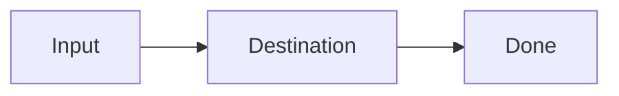
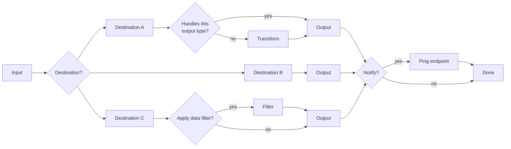

I was thinking about the least pleasant parts of a codebase I work on, and a truly sticky statement[^1] came to mind: "Accreted design is going to be the worst part of your system." If you'll pardon me, it really is a good statement... and it's actually wrong.


Accretion is from Steve McConnell's _Code Complete_,[^4] and he meant it as a neutral-to-positive description of an architecture: an oyster builds a pearl a layer at a time around something that's already there. Software grows the same way: a working core, then layers added as the system meets conditions nobody specified up front. That's how working software is supposed to grow in his model. The word picked up a sneer somewhere: it's understandable, but isn't quite fair.


Here's how accreted design happens: you build a system around expectations, like "A customer sends a file to this endpoint." Then it turns out the customers don't send the files the way you expected: they compress them... in multiple ways. And the format isn't CSV, but TOML, or JSON, or JSONL. A customer uses an internal name for a header. Laws change, and thus some fields gain validations they didn't have - or lose validations based on timestamps. Some records have more fields than expected based on other field values, and the customer didn't understand that exporting Excel wasn't the same as... Each layer is a requirement, delivered by reality instead of by a product owner. The accretion is the system learning what the world is like, its first contact with reality.

Every one of those encounters refines the original specification, and they tend to get accepted by fiat: the customer sent them that way, we need to handle them, we added the `switch` or the `if` or the strategy because the alternative is *failure*. A year later, the implementation is the only thing that remembers why any of it exists, unless some unfortunate soul remembers that specific customer who, well, just needed that *one specific feature*...

That ends up being a set of files nobody wants to touch[^2]. You know the ones: the wonky 800-line XML configuration, the orchestrator, the router with cyclomatic complexity[^5] in the sixties. People avoid them, and they say it's because the files are long, or ugly. Instead, they're avoided because it's hard to tell what any given branch is for; they're hard to test because they handle so many different conditions, so nobody can tell you what's safe to remove, and thus nothing gets removed. Deadwood is accretion that lost its _raison d’être_ somewhere, and it's safer to leave it alone.

## Deferred

Imagine an egress mechanism - a function of a system to write outputs to a destination. It gets an input - the thing to write - and writes it to the destination! That's easy enough.

But then you find out that there are multiple destinations... and destination types. And _this_ destination can't handle _that_ output type, and we might need to transform the output based on this condition, or perhaps we need to filter the data, and we might need to notify an endpoint that data is waiting... so we go from:



to...



In code, that's a nightmare - heck, even in a rules engine that gets dizzying very easily[^3]. Every aspect has its own private rules. There's no place to look at it to say "this is what this does" because everything about it is complex, with special cases, `if` blocks, error conditions, transaction boundaries... the maze comes from decisions that got deferred into the code, and once they're in the code, every new requirement lands as another conditional[^7].

## Decided

You can refine this, of course, by using common code patterns like strategies at specific points: you figure out what *can* happen and let a strategy delegate. In our example above, we have a set of permissions ("can we write this to there?") and operations like "transform" and "notify" - and our process gets a lot simpler:

```java
record Input(CustomerProfile customer, Payload payload) { }

interface EgressPolicy {
    boolean permits(Input input);

    // Each policy declares its own chain; the handler sees one operator.
    default List<UnaryOperator<Payload>> transformers() {
        return List.of();
    }

    default UnaryOperator<Payload> transform() {
        return transformers()
	        .stream()
            .reduce(
	            UnaryOperator.identity(), 
	            (a, b) -> p -> b.apply(a.apply(p))
	        );
    }

    default void notify(Receipt receipt) { }
}

final class AcmeCsvToS3Policy implements EgressPolicy {
    public boolean permits(Input input) {
        return input
	        .customer()
	        .contractAllows(Destination.S3);
    }

    public List<UnaryOperator<Payload>> transformers() {
        return List.of(
	        new PiiFilter(), // who needs personal information?!
			new CsvToXml()   // convert CSV to XML for ACME
	    );
    }

    public void notify(Receipt receipt) {
        acmeWebhook.post(receipt);
    }
}

/* And in our orchestrator... */
void handleEgress(Input input, Destination destination) {
    var policy = policies.resolve(
	    input.customer(), 
	    destination
	);

    if (!policy.permits(input)) {
        throw new EgressDeniedException(input, destination);
    }

    var payload = policy
	    .transform()
	    .apply(input.payload());
    var receipt = destination.write(payload);
    policy.notify(receipt);
}
```

In this case, the flow in `handleEgress()` is *constant*[^6]. We determine a policy that maps the input to the destination - and that encompasses the rules, permissions, transformations, even the notification mechanism. The permissions and transformations can be defaults and identities - things that do nothing - but if they need to do anything special, they can - and we have a system in place that can accrete new behavior in the *policies*, where such behavior belongs.


Note the `AcmeCsvToS3Policy` - it has both a *filter* - `PiiFilter` - and a *transformer*, `CsvToXml`. Here, they're both instantiated on the fly, and they're order-dependent; we could do some work to ensure that filters run *before* transformers, but golly, people, this is *made-up example code*. In a real living system we would probably separate transformations out from filters and enforce order, and in *my* real systems I do separate the components by type and priority like that. See, even article content accretes. It's inescapable.


And if we should discover more - the whole reason complexity accreted in the first place - well, the `EgressPolicy` is the natural place to put such operations. The handler doesn't increase in complexity, because those operations would be called just like the `transform()` method is, with potential no-ops.

The handler's cyclomatic complexity remains constant and low, because we have very few alternative code paths. You can, and should, ask questions about the specific `EgressPolicy` and perhaps how it's resolved - but the complexity is where it *belongs*.

The `EgressPolicy` becomes the expression of specific requirements. If the input is a CSV and the output is XML on an S3 bucket, well, that's a specific kind of `EgressPolicy` that reflects that requirement, *for* that requirement. A year from now, someone who asks why XML goes to S3 like it does would find a class named for that condition, hopefully with full tests and its own commit message, instead of a set of branches in the middle of a 300-line method that does twenty other things.

## Accreted *specifications* are the worst part of your system

I started off thinking how wise I was to think that accreted design was the worst part of a system. I was right, except for one word: instead of "design," I should have thought "specifications."

Accretion in your code is *natural*. It's what happens when code meets real life requirements, and we are rarely able to justify telling our clients that we didn't know, we're going back to the drawing board, see you in three months with a fixed product... that will be far more elegant, and that we hope will survive the *second* contact with real life.

But this adds up, as not just simple technical debt, but *specification* debt, because those specifications are rarely captured *except* in code. The code becomes the specification.

The distance between the accreted mess and a clean implementation is an *ontology*, and an ontology requires experience: you can't decide what the vocabulary is until reality has handed you the requirements, and by then they're already in the code. So the ideal version is something you build *toward*, and the first step toward it is recovery: you need to reconstruct a coherent description of what the implementation actually does. 

How you produce that description is up to you. A week of archaeology with the commit log, a model reading the code, a tool built for the purpose, a set of a hundred labyrinthine tests: any of them can get you a draft. What none of them can do for you is the second step, which is going through the draft and marking what was intended against what actually happens. 

That's Hyrum's law run backwards: with enough users, every observable behavior gets depended on whether you promised it or not, so the reconstructed spec contains the promises and the accidents together, and only a human who knows the business can tell them apart. 

That's real work, and it's *valuable* work for future maintenance - especially if the unfortunate soul who wrote the accretion was under a deadline and couldn't write full tests. It's also the only way to get the policies: every requirement you recover and keep becomes an `EgressPolicy` with a name, and every one you recover and discard becomes a branch you can finally delete. 

But if you ever want to move forward, you need it.

[^4]: Steve McConnell, _[Code Complete](https://www.amazon.com/Code-Complete-Developer-Best-Practices-ebook/dp/B00JDMPOSY)_, chapter on design metaphors. It's worth noting that I have the first edition on my bookshelf, with pride of place, and the analogy comes from that edition. 

[^5]: Cyclomatic complexity is a way to measure the number of independent execution paths in your program. Every branch adds to that number. If you don't know *your* code's numbers, your IDE can often give you one, and you won't like it. 

[^1]: What's a "sticky statement?" Glad you asked: as it says on the tin, it's a memorable phrase: one can only hope it's accurate. In this case, well, it really wasn't. And thus this article was born.

[^2]: Notably, those "one specific feature" files became the files that inspired my "Accreted design is going to be the worst part of your system" statement. I speak of things I encounter in the real world. Again, the statement is not correct.

[^3]: This sort of thing *is* what rules engines were built for, but if your ontology isn't carefully built, you end up with rules that look just as bad as the code for this flowchart might look. If your rules were accreted in the same way, of course.

[^6]: This code, for clarity's sake, has a cyclomatic complexity score of *2*, because it has the one `if` statement in it. This is probably a good thing; most programmers would be able to follow it easily, and the ones who can't probably need the experience of trying to follow it. They may be puzzled by the reduction in the transformers for a little while, but they'll get there!

[^7]: And what's truly scary about this little fake representation is that the real-world analog is far, far, far worse. In one project, the cyclomatic complexity being underrepresented here was *112*. Coding horrors, indeed.
