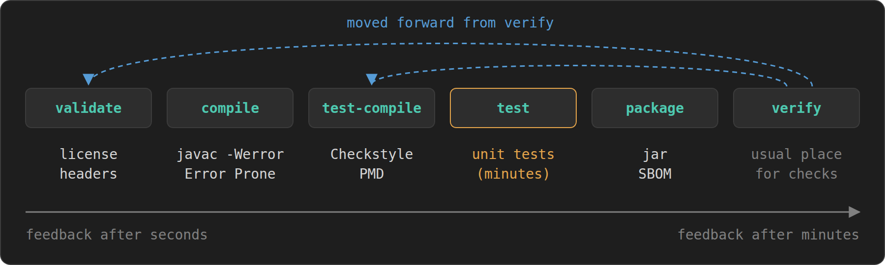
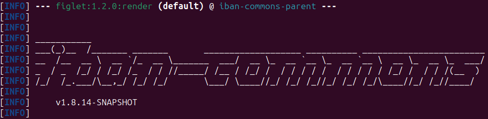

Most Maven builds start as a copy of a copy. Somebody's `pom.xml` from an older project gets pasted into a new one, a few versions get bumped, and from then on nobody touches the build until it breaks. That works, but it misses a lot. Maven has quite a few features that make a build faster to fail, easier to maintain and more pleasant to use, and most of them cost only a few lines of XML.

The examples in this article are not made up for the occasion. They come from open-source projects I maintain, mainly [Jackcess](https://github.com/spannm/jackcess), a pure Java library for Microsoft Access files, and [UCanAccess](https://github.com/spannm/ucanaccess), the JDBC driver built on top of it, plus my newer projects [IBAN Commons](https://github.com/SpeedBankingDe/iban-commons) and the [figlet Maven plugin](https://github.com/spannm/figlet). Each of them has earned its place by solving an actual problem. UCanAccess itself was the subject of an [earlier article here on foojay](https://foojay.io/today/ucanaccess-java-ms-access-jdbc-guide/).

All examples run on Maven 3.9. At the time of writing, [Maven 4](https://maven.apache.org/whatsnewinmaven4.html) is still in the release candidate phase, and the Jackcess build passes with it unchanged.

## Meet the Parents

Before we get to the individual techniques, a word on where most of the build comes from. Wiring up every plugin by hand is instructive, but it is not the only way. [basepom](https://github.com/basepom/basepom) is a family of parent POMs that brings a carefully curated build out of the box: the Enforcer, dependency analysis, a duplicate class finder, SpotBugs, code coverage and, in the `basepom-oss` flavor, license headers and everything needed to publish to Maven Central.

All plugin versions are pinned and kept up to date, and the defaults are sensible. Checkstyle and PMD are wired up as well and can be enabled with a property once you bring your own rule sets.

```xml
<parent>
    <groupId>org.basepom</groupId>
    <artifactId>basepom-oss</artifactId>
    <version>71</version>
</parent>
```

What I like most is how consistently it can be controlled through properties. Every check has its own switch, such as `basepom.check.skip-spotbugs`, and the switches are grouped, so `basepom.check.skip-basic`, `basepom.check.skip-extended` and `basepom.check.skip-all` turn off whole families at once. The [BasePOM Users Guide](https://basepom.org/) documents every one of these properties.

Jackcess and UCanAccess both use `basepom-oss` as their parent, and their POMs are noticeably shorter for it: they only contain what differs from basepom's defaults. That is why several examples below set a `basepom.` property instead of configuring a plugin. The techniques work just as well without basepom, you only have to spell out the plugin configuration yourself. IBAN Commons does exactly that and keeps its whole build in a multi-module parent POM. If you start a new project and do not want to assemble the build from scratch, basepom is really worth a close look.

## Everyday Comfort

### Let `mvn` Know What You Mean

Type `mvn` in a project directory without any arguments and Maven greets you with this error: "No goals have been specified for this build". Define the single `defaultGoal` element in the [`build` section](https://maven.apache.org/pom.html#Build) to instruct Maven what to do when it is called without arguments:

```xml
<build>
    <defaultGoal>clean verify</defaultGoal>
    ...
</build>
```

Every one of my projects carries this line, and it does more than save a few keystrokes. It documents the canonical build. A new contributor who clones the repository and runs `mvn` gets exactly the build the CI server runs, including tests, static analysis and whatever else is bound to the lifecycle up to `verify`.

The choice of `verify` over `install` is deliberate. `verify` runs every check there is, but it does not copy the artifacts into your local repository. Nothing in `~/.m2` changes behind your back, and no other project on your machine silently picks up a half-finished snapshot. In a multi-module build the reactor resolves the modules among themselves anyway, so `install` is only needed when a separate project has to consume the result. If that is the case, say so explicitly: `mvn install`.

### A Fast Lane

The flip side of a thorough default build is that it takes its time. Sometimes you just want a jar, right now, to try something in another project. Instead of remembering half a dozen `-D...skip` flags, bundle them in a profile:

```xml
<profile>
    <id>fast</id>
    <!-- profile to skip time-consuming steps -->
    <properties>
        <!-- skip _compiling_ the tests, not just running them -->
        <maven.test.skip>true</maven.test.skip>

        <basepom.javadoc.skip>true</basepom.javadoc.skip>
        <basepom.check.skip-extended>true</basepom.check.skip-extended>
        <basepom.check.skip-checkstyle>true</basepom.check.skip-checkstyle>
        <basepom.check.skip-pmd>true</basepom.check.skip-pmd>
        <basepom.check.skip-license>true</basepom.check.skip-license>
        <cyclonedx.skip>true</cyclonedx.skip>
    </properties>
</profile>
```

Note the difference between the two [test switches](https://maven.apache.org/surefire/maven-surefire-plugin/examples/skipping-tests.html). `skipTests` only skips running the tests, while `maven.test.skip` does not even compile them, which also saves the time spent on test sources and their dependencies. For a fast lane, the latter is what you want, and it makes `skipTests` redundant.

It is worth checking that such a profile really skips what it claims to. The first version of this profile in Jackcess set the standard `maven.javadoc.skip`, which basepom ignores in favor of its own `basepom.javadoc.skip`, and it relied on `skip-extended`, which does not cover Checkstyle and PMD. The build was faster, but Javadoc and both checks still ran. A quick look at the build log, where a skipped plugin says so, would have caught it.

`mvn -Pfast` now produces a jar in a fraction of the usual time. For Jackcess that means 27 seconds instead of almost two minutes. The full build stays the default, and the shortcut is something you have to ask for.

One thing the `fast` profile cannot do is switch off another profile. In Maven 3, and still in Maven 4, profile activation only looks at system properties, including those passed with `-D` on the command line, never at properties defined inside the POM, and that includes the properties of other profiles. If a profile is activated by the absence of a property, as the Error Prone profile further below is, setting that property in `fast` has no effect. You still have to pass it explicitly: `mvn -Pfast -Dcheck.skip-errorprone`. More on that kind of activation in the section on profiles.

## Properties as the Single Source of Truth

A version number that appears in more than one place will sooner or later appear in two different variants. The remedy is old and simple, yet many POMs still apply it only halfway: every version goes into a property, not just those of the dependencies, but those of the plugins as well.

```xml
<properties>
    <!-- The minimum JDK version required to build. -->
    <project.build.systemJdk>21</project.build.systemJdk>
    <!-- The default build target. -->
    <project.build.targetJdk>8</project.build.targetJdk>

    <dep.poi.version>5.5.1</dep.poi.version>
    <dep.slf4j.version>2.0.20</dep.slf4j.version>

    <!-- test dependencies -->
    <dep.junit.version>5.14.4</dep.junit.version>
    <dep.assertj.version>3.27.7</dep.assertj.version>

    <!-- surefire 3.6.0 runs no tests on the JDK 8 toolchain (profile jdk8-tests) -->
    <dep.plugin.surefire.version>3.5.6</dep.plugin.surefire.version>

    <!-- additional plugins not defined in parent -->
    <dep.plugin.sortpom.version>4.0.0</dep.plugin.sortpom.version>
    <dep.plugin.cyclonedx.version>2.9.3</dep.plugin.cyclonedx.version>
    <dep.plugin.versions.version>2.23.0</dep.plugin.versions.version>
    <dep.plugin.figlet.version>1.1.0</dep.plugin.figlet.version>
    <dep.plugin.error-prone.version>2.50.0</dep.plugin.error-prone.version>
</properties>
```

I use `dep.` and `dep.plugin.` prefixes as a convention to separate libraries from build tooling at a glance. basepom uses the same convention, and that has a pleasant side effect: it defines its own plugin versions as `dep.plugin.` properties, so overriding one of them is just a matter of setting the property.

That is what's being done with Surefire above, and it brings us to the most valuable part of the block, the comment on a version that is held back on purpose. Without it, the next person running an update (very likely yourself half a year later) bumps Surefire to 3.6.0, sees a green build with zero tests on the Java 8 runtime and spends half of Sunday finding out why.

The two Java properties at the top deserve a word of their own. `project.build.targetJdk` is what the library promises its users, and basepom feeds it into the compiler's `<release>` setting as well as the Javadoc plugin. `project.build.systemJdk` is what the build needs to run at all, and the Enforcer plugin checks it, as shown further below. Keeping the two apart makes it explicit that "runs on Java 8" and "builds on Java 8" are different statements, and that only the first one is part of the contract.

Properties are not limited to versions. Anything that appears in several places can be defined once, the GitHub account for example:

```xml
<developerId>spannm</developerId>
<githubBaseUrl>https://github.com/${developerId}/</githubBaseUrl>
```

Together with `${project.artifactId}`, these two end up in the project URL, the SCM URLs, the developer entry and the deployment target for GitHub Packages. Moving the repository becomes a one-line change.

### Keeping Versions Current

Once all versions live in properties, the [Versions Maven Plugin](https://www.mojohaus.org/versions/versions-maven-plugin/) can tell you which of them are outdated:

```
$ mvn -N versions:display-property-updates
...
[INFO]   ${dep.assertj.version} ....................................... 3.27.7
[INFO]   ${dep.plugin.cyclonedx.version} ............................... 2.9.3
...
[INFO]   ${dep.junit.version} ................................ 5.14.4 -> 6.1.3
[INFO]   ${dep.plugin.figlet.version} ......................... 1.1.0 -> 1.2.0
[INFO]   ${dep.poi.version} ................................... 5.5.1 -> 6.0.0
```

This is the actual output for Jackcess at the time of writing. One report covers dependencies and plugins alike, because both are expressed as properties. The updates for JUnit and POI are new major versions and deserve a closer look before anyone bumps them. JUnit 6, for example, requires Java 17. The figlet plugin is a minor update. For updates like that, `versions:update-properties` applies the updates directly to the POM (with `-DexcludeProperties=...` you can leave out the pinned ones).

Out of the box, the plugin happily suggests alphas, betas, release candidates and milestones. I like using a rule set in the plugin configuration to keep them out of the report:

```xml
<plugin>
    <groupId>org.codehaus.mojo</groupId>
    <artifactId>versions-maven-plugin</artifactId>
    <version>${dep.plugin.versions.version}</version>
    <configuration>
        <ruleSet>
            <ignoreVersions>
                <ignoreVersion>
                    <type>regex</type>
                    <version>.*(?i)(alpha|beta|rc|cr|preview|milestone|[mb][0-9]+).*</version>
                </ignoreVersion>
            </ignoreVersions>
        </ruleSet>
    </configuration>
</plugin>
```

The regular expression catches the usual naming schemes such as `2.0.0-beta3`, `5.0.0-RC1`, `6.0.0-M2` or `1.0-b4`, regardless of case. What is left in the report are real releases.

The property report has blind spots, though. Properties that are only used inside a profile do not show up, not even when the profile is activated with `-P`. In Jackcess that applies to the Error Prone version. Properties that only the parent POM uses, such as the Surefire override, are missing as well.

## Guard Rails

A build that accepts everything is not doing its job. The cheapest bugs are those that never get past `mvn verify`, and a few plugins are very good at catching them.

### Enforce the Ground Rules

The [Maven Enforcer plugin](https://maven.apache.org/enforcer/maven-enforcer-plugin/) checks the environment and the POM itself before any real work starts. basepom already configures it with `requireMavenVersion` and `requireJavaVersion`, fed from the properties shown above, so the minimum JDK is defined in exactly one place. Somebody who tries to build Jackcess with an older JDK gets a clear message in the very first phase, instead of an obscure compiler or plugin error later:

```
[ERROR] Rule 1: org.apache.maven.enforcer.rules.version.RequireJavaVersion failed with message:
[ERROR] JDK version 17.0.15 not supported as system JDK (requires 21)!
```

One rule is missing from basepom's set, and it is the one I would least like to do without. Jackcess appends it to the inherited rules:

```xml
<plugin>
    <groupId>org.apache.maven.plugins</groupId>
    <artifactId>maven-enforcer-plugin</artifactId>
    <configuration>
        <rules combine.children="append">
            <requirePluginVersions>
                <message>Best practice is to always define Maven plugin versions</message>
            </requirePluginVersions>
        </rules>
    </configuration>
</plugin>
```

[`requirePluginVersions`](https://maven.apache.org/enforcer/enforcer-rules/requirePluginVersions.html) is the least known of the Enforcer rules. Every plugin without an explicit version gets whatever version the running Maven happens to bring along, so the same POM builds differently depending on who runs it. The rule fails the build for each such plugin, and by default it also rejects snapshot and timestamped snapshot versions.

Pinned plugin versions are also a prerequisite for [reproducible builds](https://maven.apache.org/guides/mini/guide-reproducible-builds.html), more on that in the section on the manifest.

`combine.children="append"` matters here. Without it, Maven merges the `rules` of the parent and the child element by element, which rarely gives the intended result. With it, the new rule is simply added to the list.

Since basepom pins every plugin it uses, including those of the default lifecycle such as clean, install and deploy, the rule passes without any exceptions. Without such a parent you would either need to pin them yourself or list them in the rule's `unCheckedPluginList`. Pinning is the better choice if you plan to move to Maven 4, which warns about every plugin of the default lifecycle bindings without a version.

### Fail Fast

Plugins like [Checkstyle](https://maven.apache.org/plugins/maven-checkstyle-plugin/) and [PMD](https://maven.apache.org/plugins/maven-pmd-plugin/) have to be bound to some [lifecycle phase](https://maven.apache.org/guides/introduction/introduction-to-the-lifecycle.html), and that choice matters more than it seems. Bound to `verify`, which is common and also basepom's default, they report a misplaced brace only after the complete test suite has run. In a project with a few minutes of tests, that is a frustrating way to learn about a missing blank line or imports out of order.

The fix is to move the checks forward to the earliest phase in which they can do their work. basepom offers properties for Checkstyle and the license check:

```xml
<!-- fail before lengthy test execution -->
<basepom.check.phase-checkstyle>test-compile</basepom.check.phase-checkstyle>
<!-- checks only the text of the sources, so it can run first -->
<basepom.check.phase-license>validate</basepom.check.phase-license>
```

For PMD there is no such property, so Jackcess rebinds basepom's execution by its id:

```xml
<plugin>
    <groupId>org.apache.maven.plugins</groupId>
    <artifactId>maven-pmd-plugin</artifactId>
    <executions>
        <execution>
            <id>basepom.default</id>
            <!-- fail before lengthy test execution -->
            <phase>test-compile</phase>
        </execution>
    </executions>
</plugin>
```

Without a parent, the same `<phase>` element goes into your own execution of the plugin. `test-compile` is the right spot for both tools. By then the test sources are compiled, which matters because both tools check test code too and PMD needs the compiled classes for type resolution, yet not a single test has run. The [license header check](https://github.com/mathieucarbou/license-maven-plugin), which only looks at the text of the source files, goes even further forward into `validate`. A file without a header then fails the build before the compiler has even started.

The order of the phases becomes the order of the feedback: first the cheap checks on the text, then the compiler, then style and static analysis, and only then the expensive tests.



### Error Prone, Without Excuses

The Java compiler accepts a lot of code that is legal but almost certainly wrong. [Error Prone](https://errorprone.info/) (from Google) hooks into `javac` as a plugin and reports those patterns as compiler errors: `equals()` comparisons between unrelated types, ignored return values of methods that have no side effects, format strings that do not match their arguments, and several hundred more.

Setting it up takes more XML than most plugins, mainly because Error Prone needs access to compiler internals that the JDK no longer exposes by default:

```xml
<plugin>
    <groupId>org.apache.maven.plugins</groupId>
    <artifactId>maven-compiler-plugin</artifactId>
    <configuration>
        <fork>true</fork>
        <compilerArgs combine.children="append">
            <arg>-Werror</arg>
            <arg>-XDcompilePolicy=simple</arg>
            <arg>-XDaddTypeAnnotationsToSymbol=true</arg>
            <arg>--should-stop=ifError=FLOW</arg>
            <arg>-Xplugin:ErrorProne</arg>
            <arg>-J--add-exports=jdk.compiler/com.sun.tools.javac.api=ALL-UNNAMED</arg>
            <!-- ... more -J--add-exports and -J--add-opens, see the Error Prone installation guide -->
        </compilerArgs>
        <annotationProcessorPaths>
            <path>
                <groupId>com.google.errorprone</groupId>
                <artifactId>error_prone_core</artifactId>
                <version>${dep.plugin.error-prone.version}</version>
            </path>
        </annotationProcessorPaths>
    </configuration>
</plugin>
```

For the full list of `-J` options and the reasons behind them consult the [Error Prone installation guide](https://errorprone.info/docs/installation). A few details in there are easy to get wrong. `fork` runs the compiler in a separate JVM, which is what makes the `-J` options take effect at all. `combine.children="append"` once again adds the arguments to any `compilerArgs` inherited from the parent instead of merging the two lists.

`-Werror`, finally, turns every warning into an error, those from `-Xlint` as well as the Error Prone checks of severity WARNING. Downgrading a check with `-Xep:Name:WARN` therefore makes no difference, a check is either on and fatal or `OFF`. That sounds harsh, but it is the only setting that works in the long run. A warning that does not fail the build is a warning that nobody reads, and after a few months the build log is full of them.

The whole configuration lives in a profile named `errorprone-fatal`, described further down. It is active by default and can be switched off with `-Dcheck.skip-errorprone` when needed.

Not every check fits every code base, and switching one off is perfectly fine. What is not fine is switching it off without saying why. In Jackcess, every disabled check comes with a one-line reason right next to the flag. An excerpt, where the flags go into the `-Xplugin:ErrorProne` argument itself, because Error Prone expects all its options in a single argument:

```xml
<!-- JavaUtilDate: java.util.Date is part of the public API
     JavaTimeDefaultTimeZone: Access date/time values carry no time zone, the local one is intended
     EqualsGetClass: equals() of classes with subclasses must compare classes
     ReferenceEquality: identity checks against sentinel objects are intentional
     EnumOrdinal: ordered enums such as FileFormat are compared by ordinal on purpose -->
<arg>-Xplugin:ErrorProne -Xep:JavaUtilDate:OFF -Xep:JavaTimeDefaultTimeZone:OFF -Xep:EqualsGetClass:OFF -Xep:ReferenceEquality:OFF -Xep:EnumOrdinal:OFF</arg>
```

Every exclusion is a decision, and the comment preserves it. Whoever wonders a year later whether a check could be turned back on finds the answer right there, without digging through the commit history.

## Profiles That Switch Themselves

[Profiles](https://maven.apache.org/guides/introduction/introduction-to-profiles.html) are often used as named bundles of settings that you activate by hand with `-P`. That is fine, but their activation rules can do much more, and two patterns in particular have proven useful.

### On by Default, Off by Switch

Error Prone is part of the regular build in my projects, and any finding fails it. Still, there are moments when you want to compile without it, for example while bisecting a problem or trying out a new JDK that the current Error Prone release does not support yet. The obvious tool for this seems to be `activeByDefault`:

```xml
<activation>
    <activeByDefault>true</activeByDefault>
</activation>
```

It has a catch that bites sooner or later. An `activeByDefault` profile is only active as long as no other profile of the same POM gets activated. The moment someone runs `mvn -Pfast` or `mvn -Prelease`, the default profile quietly drops out, and in this case the build loses its Error Prone checks without anybody noticing.

A negated property condition does the job without that side effect:

```xml
<!-- profile to fail the build on Error Prone findings, active by default.
     To disable: mvn clean compile -Dcheck.skip-errorprone -->
<profile>
    <id>errorprone-fatal</id>
    <activation>
        <property>
            <name>!check.skip-errorprone</name>
        </property>
    </activation>
    <build>
        ...
    </build>
</profile>
```

The profile is active whenever the property `check.skip-errorprone` is not defined, regardless of what else happens on the command line. Passing `-Dcheck.skip-errorprone` turns it off, and since the condition only asks whether the property exists, any value does. The property name is free to choose, and naming it after what it does makes the command line read like a sentence.

Two commands help when you are unsure what is going on: `mvn help:active-profiles` lists the profiles that are active for each module, and `-P -name` deactivates a profile explicitly (as does `-P '!name'`, quoted so that bash leaves the exclamation mark alone). Maven 4 is stricter here: a profile named with `-P` that does not exist fails the build instead of producing a warning. `-P ?name` marks it as optional.

### One Property to Activate and Configure

UCanAccess targets Java 11 but needs JDK 21 to build, because the plugins and Error Prone have long left Java 11 behind. Compiling with `--release 11` guarantees that only Java 11 APIs are used, but it says nothing about how the bytecode behaves on an actual Java 11 runtime. The way out is to build on the modern JDK and fork only the test JVM onto an older one, using [Maven toolchains](https://maven.apache.org/guides/mini/guide-using-toolchains.html) and the [`jdkToolchain`](https://maven.apache.org/surefire/maven-surefire-plugin/examples/toolchains.html) setting of Surefire.

The profile for this is activated by the mere presence of a property, and the same property supplies the value:

```xml
<profile>
    <id>toolchain-tests</id>
    <!-- fork the test JVM onto the JDK toolchain given by test.jdk.
         Usage: mvn -Dtest.jdk=11 clean verify -->
    <activation>
        <property>
            <name>test.jdk</name>
        </property>
    </activation>
    <build>
        <plugins>
            <plugin>
                <groupId>org.apache.maven.plugins</groupId>
                <artifactId>maven-surefire-plugin</artifactId>
                <configuration>
                    <jdkToolchain>
                        <version>${test.jdk}</version>
                    </jdkToolchain>
                </configuration>
            </plugin>
        </plugins>
    </build>
</profile>
```

`mvn -Dtest.jdk=11 clean verify` runs the tests on Java 11, `-Dtest.jdk=17` on Java 17, and without the property nothing changes at all. There is no separate profile per JDK version and nothing to keep in sync. The only prerequisite is that the JDK in question is registered in `~/.m2/toolchains.xml`.

On GitHub Actions, [`actions/setup-java`](https://github.com/actions/setup-java) takes care of that. Installing several JDKs in one step registers all of them as toolchains, and the last one listed becomes the JDK that runs Maven itself. Combined with a build matrix over `java: ['11', '17', '21']`, this tests the same build on as many runtimes as you like:

```yaml
- name: Set up JDK 21 (build) and JDK ${{ matrix.java }} (test toolchain)
  uses: actions/setup-java@v6
  with:
    java-version: |
      ${{ matrix.java }}
      21
    distribution: temurin
    cache: maven

- name: Build with Maven/JDK 21, tests forked onto JDK ${{ matrix.java }}
  run: mvn --batch-mode "-Dtest.jdk=${{ matrix.java }}" clean verify
```

## Nice Touches

None of the following makes a build more correct, only more pleasant to work with.

### A Banner for Your Build

In a multi-module build, or in a CI log with several builds in a row, it is surprisingly hard to tell at a glance which project and version you are looking at. A banner at the start of the build solves that, and it adds a bit of personality to an otherwise monotonous log.

The [figlet Maven plugin](https://github.com/spannm/figlet) renders text as ASCII art using the classic [FIGlet](http://www.figlet.org/) fonts. Disclosure: I maintain it. This is the declaration from IBAN Commons:

```xml
<plugin>
    <groupId>io.github.spannm</groupId>
    <artifactId>figlet-maven-plugin</artifactId>
    <version>${dep.plugin.figlet.version}</version>
    <configuration>
        <content><![CDATA[
            <lineBreak/><lineBreak/>
            <figletFont name="speed">${project.dist.name}</figletFont>
            <preserveWhitespace>    v${project.version}</preserveWhitespace><lineBreak/>
        ]]></content>
    </configuration>
    <executions>
        <execution>
            <goals>
                <goal>render</goal>
            </goals>
        </execution>
    </executions>
</plugin>
```

Without any configuration, the plugin renders the project name in the standard font, followed by the version. The `content` element changes that with a small markup language that mixes rendered and literal text and supports Maven properties. Here it renders the property `project.dist.name`, which holds the short name `iban-commons`, in the speed font and indents the version a little. The result greets you at the top of every build:



Pick a different font per project and you will soon recognize your builds by their shape alone. The [font gallery](https://spannm.github.io/figlet/) shows all bundled fonts side by side, ready for you to choose your favorite.

### Make Your Jar Talk

Every jar carries a `META-INF/MANIFEST.MF`, and most of them contain little more than `Created-By`. That is a missed opportunity, because the manifest is the one place that reliably travels with the artifact. The [Maven JAR plugin](https://maven.apache.org/plugins/maven-jar-plugin/) can fill it with useful information. basepom already switches on the default implementation and specification entries and adds a section with the build time and the Git commit. Jackcess appends a few entries of its own:

```xml
<plugin>
    <groupId>org.apache.maven.plugins</groupId>
    <artifactId>maven-jar-plugin</artifactId>
    <configuration>
        <archive>
            <manifest>
                <mainClass>io.github.spannm.jackcess.about.ThisLib</mainClass>
            </manifest>
            <manifestEntries combine.children="append">
                <Automatic-Module-Name>${module.name}</Automatic-Module-Name>
                <Project-Description>${project.description}</Project-Description>
                <Project-Url>${project.url}</Project-Url>
                <Issue-Management-Url>${project.issueManagement.url}</Issue-Management-Url>
                <Scm-Url>${project.scm.url}</Scm-Url>
            </manifestEntries>
        </archive>
    </configuration>
</plugin>
```

The implementation entries are not only nice to read, they are also accessible at runtime through `Package.getImplementationVersion()`, so a library can report its own version without a hard-coded constant. The `Automatic-Module-Name` lets Java 9+ users `requires` the library even though it targets Java 8 and has no `module-info.java`.

The main class is a tiny class named `about.ThisLib` that reads the manifest and prints it in a readable form. A library is not meant to be executed, but people _do_ try, and it is much friendlier to tell them what they are holding than to answer with "no main manifest attribute":

```
$ java -jar jackcess-5.2.0.jar

Jackcess v5.2.0
A pure Java library for reading from and writing to Microsoft Access databases (MDB and ACCDB), without requiring a database engine, JDBC/ODBC driver, or an MS Access installation.

Vendor         : Jackcess
Build JDK      : 21
Build Time     : 2026-10-16T13:20:05Z
Git Commit     : 6159c680933625ffa952334b5e0e6b24f37bfdfe
...
Homepage       : https://github.com/spannm/jackcess
Issues         : https://github.com/spannm/jackcess/issues
Source Code    : https://github.com/spannm/jackcess/tree/master

Please note: This JAR is a software library and not intended for direct CLI execution.
```

It also answers the classic support question "which version are you actually using?" in a single command, without unzipping anything, and the commit id leads straight to the exact source.

All this information comes at a price, though. The build time differs from one build to the next, so two builds of the same commit never produce identical jars. If you aim for reproducible builds, set `project.build.outputTimestamp`, which the release plugin keeps up to date, and leave out such entries or use `${project.build.outputTimestamp}` instead of the build time. Jackcess currently goes for the informative manifest.

### Keep the POM Tidy

POMs grow over time, and everyone adds elements wherever it seems right at the moment. The [sortpom Maven plugin](https://github.com/Ekryd/sortpom) puts the elements of a POM in a fixed order and formats them consistently, so diffs show real changes instead of reordering noise:

```xml
<plugin>
    <groupId>com.github.ekryd.sortpom</groupId>
    <artifactId>sortpom-maven-plugin</artifactId>
    <version>${dep.plugin.sortpom.version}</version>
    <configuration>
        <createBackupFile>false</createBackupFile>
        <expandEmptyElements>false</expandEmptyElements>
        <nrOfIndentSpace>4</nrOfIndentSpace>
    </configuration>
</plugin>
```

The plugin is declared in `pluginManagement` only and runs on demand with `mvn sortpom:sort`. Its defaults are conservative: it fixes the order of the sections and the formatting, keeps blank lines, and leaves modules, dependencies and properties in the order I chose, because that order often means something, such as related properties grouped together. Not every choice it makes will match your taste, but consistency beats taste here.

The consistent order pays off once more when you compare the POMs of different projects. Sorted the same way, a plain diff between the Jackcess and the UCanAccess POM shows exactly where the two builds differ, and carrying an improvement from one project over to the other comes down to copying a hunk.

### An SBOM for Free

A software bill of materials (SBOM) lists every component that goes into an artifact, including transitive dependencies, and more and more users and regulations ask for one. With the [CycloneDX](https://cyclonedx.org/) [Maven plugin](https://github.com/CycloneDX/cyclonedx-maven-plugin), it is a by-product of the regular build:

```xml
<plugin>
    <groupId>org.cyclonedx</groupId>
    <artifactId>cyclonedx-maven-plugin</artifactId>
    <version>${dep.plugin.cyclonedx.version}</version>
    <configuration>
        <projectType>library</projectType>
        <outputFormat>xml</outputFormat>
        <outputName>sbom</outputName>
    </configuration>
    <executions>
        <execution>
            <id>cyclonedx-makebom</id>
            <goals>
                <goal>makeBom</goal>
            </goals>
            <phase>package</phase>
        </execution>
    </executions>
</plugin>
```

The plugin attaches the SBOM to the project, so it is installed and deployed together with the jar, signed like every other artifact. On Maven Central it shows up next to the jar as `jackcess-5.2.0-cyclonedx.xml`. Nobody has to remember to generate it, and it always matches the release it belongs to.

This is where [supply chain security](https://top10.owasp.org/2025/A03_2025-Software_Supply_Chain_Failures) starts. Most of the code in a typical Java application comes in through dependencies, and each of them can bring a vulnerability or, in the worst case, a tampered package. When [Log4Shell](https://logging.apache.org/log4j/2.x/security.html#CVE-2021-44228) hit in December 2021, many teams spent days just finding out whether and where `log4j-core` was in use.

With an SBOM for every release, that question becomes a lookup instead of an investigation, and since the SBOM is signed along with the jar, anyone can verify that it comes from the project and has not been altered.

On the receiving end, [OWASP Dependency-Track](https://dependencytrack.org/) imports SBOMs and keeps checking the listed components against vulnerability databases. If a CVE shows up in a transitive dependency months after a release, it tells you which releases are affected.

## Wrapping Up

None of the techniques in this article is new, and none of them takes more than a few lines of XML. Their value comes from the combination. A plain `mvn` runs the same build as the CI server. Every version lives in exactly one place, together with the reason why it is what it is. The build checks its own environment, fails at the earliest possible moment and treats warnings as errors. Profiles switch themselves on and off without surprises, and the artifacts that come out at the end can tell where they came from.

**The build is code, and it deserves the same care as the code it builds.**

If you want to start small, `defaultGoal` and the Enforcer plugin take five minutes and pay off from the very first day. Everything else can follow when the occasion arises, typically right after the next afternoon lost to a problem that one of these tricks would have caught.

All examples are taken from POMs that are in daily use. If you want to see them in context, have a look at [Jackcess](https://github.com/spannm/jackcess), [UCanAccess](https://github.com/spannm/ucanaccess), [IBAN Commons](https://github.com/SpeedBankingDe/iban-commons) and the [figlet plugin](https://github.com/spannm/figlet) on GitHub. The parent POMs that Jackcess and UCanAccess build on come from [basepom](https://github.com/basepom/basepom), which is documented at [basepom.org](https://basepom.org/).

Thanks for reading!
