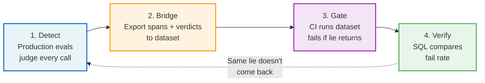

Your support agent calls a tool, gets a valid response with a 200 status, and reads the latency fine. Then it tells a customer they're within a 30-day refund window when the policy clearly says 14 days.

Nothing alerts. The service ran. The tool was called. Every standard check you'd put on a service comes back green. And the service lied to your customers.

The usual telemetry doesn't catch this because it measures whether the service works, not whether what it says is true. A unit test can confirm the tool got called, but it can't judge whether the answer makes sense.

What you actually need is an eval: something that scores the content of the answer itself. Some evals are straightforward—a regex that fails any answer mentioning "30-day" when it shouldn't. The useful ones use a second model as a judge, with a rubric: does this answer contradict the policy it just retrieved?

## Production evals and the loop

You need evals in two places. In production, they tell you something's broken with real traffic. In CI, they stop the same mistake from shipping.

The shape is a loop:



1. **Detect.** Production evals judge every model call as traces arrive in Dash0. The groundedness eval fails on refund answers while everything else looks fine.
2. **Bridge.** You export the failing spans and their verdicts into DuckDB, write the correct answer for each case, and those reviewed cases become a golden dataset in the repo.
3. **Gate.** On every pull request, the CI gate runs the dataset against your agent and fails if the lie comes back.
4. **Verify.** After the deploy, SQL compares the fail rate before and after on real traffic.

The production evals and the CI gate use the same rubric idea but answer different questions. Production asks "is something wrong right now?" across all traffic. CI asks "did we break a case we already know about?" on a fixed dataset.

## The Java parts

### The agent: Spring Boot and Spring AI

The agent is a Spring Boot application using Spring AI. ChatClient runs the tool loop: the first model call asks for a policy, the second answers with the policy text in its input.

```java
String answer = chatClient.prompt()
    .system(SYSTEM_PROMPTS.get(variant))
    .user(question.input())
    .tools(tools)
    .call()
    .content();
```

The tool is a plain method decorated with `@Tool`. Its description matters more than you might expect:

```java
@Tool(name = "lookup_policy", description = "Returns the current Acme Cloud policy text for a topic. "
    + "refunds: refunds, cancellations, stopping or changing a monthly or annual plan, and account credit. "
    + "shipping: hardware orders, delivery times and shipping costs. "
    + "account: users, sign-in, passwords and locked accounts.")
public String lookupPolicy(@ToolParam(description = "...") Topic topic) { ... }
```

A flag `--agent.variant=broken` swaps in a system prompt that promises "a generous 30 days on every plan" to reproduce the problem on demand.

### Getting the payload onto the span

Spring AI creates an OpenTelemetry span per model call with the model name, token counts, and finish reason. It doesn't put the prompt and answer on the span—those live only in logs. An eval that reads span attributes has nothing to judge.

The fix is an OpenTelemetry ObservationFilter registered as a bean. Just before the observation becomes a span, it adds `gen_ai.input.messages` and `gen_ai.output.messages` as JSON following the OpenTelemetry GenAI semantic conventions. About a hundred lines, and every chat span now carries what the judge needs.

### DuckDB over JDBC

The bridge between production and CI is data work: export the failing spans, join them with verdicts, pick the cases worth keeping, and write a dataset. All SQL, run on DuckDB through its JDBC driver. No DuckDB CLI to install. JSON parsing and `COPY ... TO 'file.jsonl'` handle most of it.

### harness-evals, from Java

The CI gate is harness-evals, an open-source eval runner that reads a YAML config, calls your agent over HTTP, and scores each case. It's a Python tool, but your repository has no Python: the CLI jar starts it with `uvx`, which downloads and runs a pinned version without a virtualenv.

```java
List<String> cmd = List.of("uvx", "--from", "harness-evals[llm,harness]==0.29.1",
    "harness-evals", "run", "evals/billing.eval.yaml", "--baseline", "--fail-under", "0.8");
```

### Temporal for orchestration

The loop has steps that take days: a person reviews failing cases, a PR waits for CI, a fix needs 24 hours of traffic before judgment. A Temporal workflow using the Java SDK runs the same steps as the CLI commands, with durable timers and signals for the human parts. If billing hasn't recovered after the fix, it restarts, up to three times.

### One jar

Everything except the agent lives in one shaded jar, `still-lies.jar`, with a subcommand per step: export, report, cases, dataset, eval, gate, verify, temporal. It also has a stand-in OpenAI endpoint on the JDK's built-in HTTP server so the whole demo can run without network access.

## Expect to debug the eval

A gate is a model of what "correct" means. When the first run goes red, you're testing the rubric as much as the agent. Expect to find bugs in both. The gate failed several times against the fixed agent before the rubric was right—and that matters. A bad eval that passes green is worse than no eval at all.

## Try it yourself

The working code is in the `geertjanw/still-lies` repository, built to demonstrate the full loop. It's also the sample repository that goes with the talk "When Your LLM Passes Every Check And Still Lies."

You need Java 21, Maven, uv, and an OpenAI API key on an account with credit.

```bash
git clone https://github.com/geertjanw/still-lies
cd still-lies
cp .env.example .env
mvn -q package -DskipTests
alias still-lies='java -jar cli/target/still-lies.jar'
still-lies check
```

The fastest way to see the point is the gate on its own. Start the broken agent in one terminal:

```bash
java -jar agent/target/support-agent.jar --agent.variant=broken
```

Then run the gate in another:

```bash
still-lies gate
```

It exits 1. Restart the agent without `--agent.variant=broken` and it exits 0. No Dash0 account needed for that part, and bundled samples let you run the DuckDB steps without one too. The repo README covers the full loop.

## The takeaway

You can't evaluate whether an LLM is telling the truth the way you evaluate whether your infrastructure is up. Status codes and latency don't tell you. Unit tests can't either, because the answer changes on every run.

What works is turning production into your test suite. When an eval catches a hallucination with real traffic, that case becomes a permanent gate in CI. The loop runs: detect in production, convert to a test case, prevent regression, verify the fix holds. Run it enough times and the same lie doesn't come back.

That loop is the difference between a feature that sometimes lies to customers and one you can ship.
