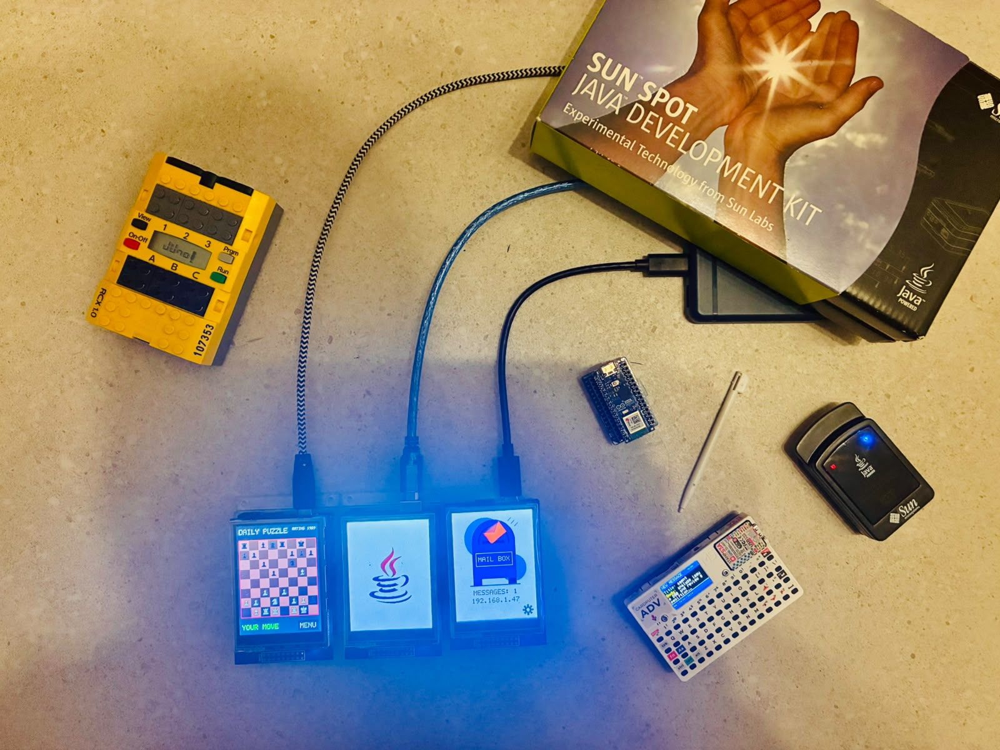
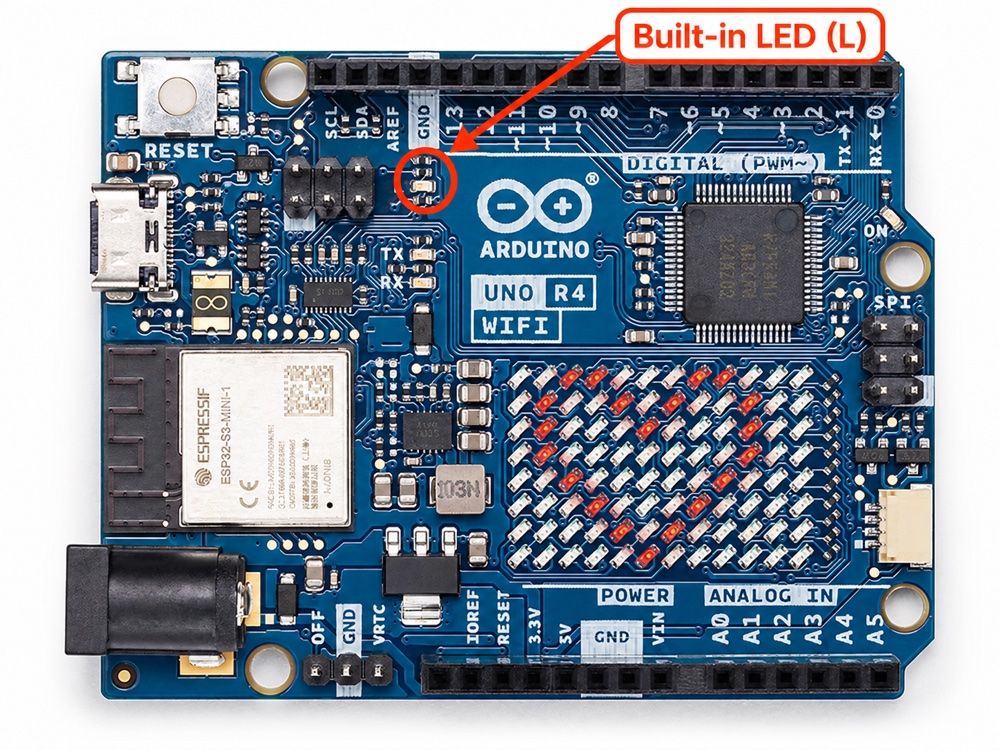

What if you could write a small Java program and run it directly on an Arduino board without putting a JVM on the device? This is the idea behind [Juno](https://github.com/jabrena/juno), an ahead-of-time compiler created by [Juan Antonio Brena Moral](https://foojay.io/today/author/jabrena/).

Juno uses `javac` as its Java front end, follows the code reachable from `main`, and translates it into native assembly plus a C++ shim. The Arduino toolchain then turns that output into firmware for the selected board.



In this tutorial, you will build the project, compile a simple blinking-LED program, and learn how to verify and upload it to an Arduino UNO R4 WiFi.

## What you need

Before you begin, install the following software and prepare the hardware:

- JDK 27 or newer.
- Maven 3.10 or newer. The repository includes a Maven wrapper, so you can use `./mvnw`.
- [Arduino CLI](https://docs.arduino.cc/arduino-cli/installation/).
- A supported Arduino board. This article uses an Arduino UNO R4 WiFi.

Install the Arduino core for your board by following the [Arduino CLI documentation](https://arduino.github.io/arduino-cli/latest/commands/arduino-cli_core_install/). For an UNO R4 WiFi, Juno uses the board identifier `arduino-uno-r4-wifi`.

## Get the project

Clone the repository and enter its directory:

```bash
git clone https://github.com/jabrena/juno.git
cd juno
```

Build the project with the Maven wrapper:

```bash
./mvnw clean install
```

This builds Juno's Java hardware API, compiler, Maven plugin, and example programs. Once the build completes, you can run the example from the `juno-examples` module.

## Your first steps with Juno

### Your first Java program

When you start learning Java, one of the first programs you usually write is the classic `HelloWorld` example. It is deliberately simple: the program starts at `main` and prints a message to the console.

```java
public class HelloWorld {

    public static void main(String[] args) {
        System.out.println("Hello World");
    }
}
```

This is ordinary Java: `javac` compiles it into a `.class` file, and a JVM runs that class. Juno follows the same initial compilation step, but replaces the JVM with a native compilation pipeline for the selected board.

### Your first Juno program

When you start learning about Arduino, the equivalent of Java's `HelloWorld` is usually a `Blink` program. Instead of printing a message, it makes the board's built-in LED turn on and off. The repository includes a `Blink` example that uses Juno's hardware API to do exactly that:

```java
package io.github.jabrena.juno.api.hardware.gpio;

import io.github.jabrena.juno.hardware.ArduinoUno;
import io.github.jabrena.juno.hardware.gpio.DigitalOutput;
import io.github.jabrena.juno.util.Delay;

public class Blink {

    public static void main(String[] args) {

        DigitalOutput led = DigitalOutput.of(ArduinoUno.getGpio().getBuiltinLed());

        while (true) {
            led.high();
            Delay.millis(500);

            led.low();
            Delay.millis(500);
        }
    }
}
```

`Blink` is ordinary Java source, but the Juno compiler recognizes its hardware calls and maps them to the target board. Because the class does not declare a board annotation, you select the target board with the `juno.board` Maven property.

### Verify the generated sketch

Before connecting a board, use `juno:verify` to generate the sketch and compile it with the Arduino CLI:

```bash
./mvnw -f juno-examples/pom.xml compile juno:verify \
  -Djuno.main=io.github.jabrena.juno.api.hardware.gpio.Blink \
  -Djuno.board=arduino-uno-r4-wifi
```

This command checks the complete path from the compiled Java class to the board-specific Arduino sketch. It does not upload anything to physical hardware.

### Upload the program

Once verification succeeds, connect the board and upload the program:

```bash
./mvnw -f juno-examples/pom.xml compile juno:upload \
  -Djuno.main=io.github.jabrena.juno.api.hardware.gpio.Blink \
  -Djuno.board=arduino-uno-r4-wifi
```

When exactly one matching board is connected, the plugin can detect its serial port automatically. If more than one board is attached, pass the port explicitly with `-Djuno.port=<PORT>`.

`juno:upload` generates, verifies, and uploads the sketch.

### What you should see on the board

After the upload finishes, the built-in LED marked `L` should turn on for 500 milliseconds and then turn off for 500 milliseconds, repeating continuously. One complete on-and-off cycle takes one second.

The blinking LED confirms that the Java program was compiled, uploaded, and is running on the board.

| Arduino UNO R4 WiFi | Built-in LED `L` |
| --- | --- |
|  |  |

## How Java becomes board code

Juno is an ahead-of-time compiler, not a JVM. At a high level, the build follows this path:

```text
Java source -> javac -> .class -> Juno linker and compiler -> assembly and C++ shim -> Arduino toolchain -> firmware
```

The compiler starts at `main`, follows the methods reachable from that entry point, resolves Juno hardware intrinsics, and rejects unsupported bytecode before generating the sketch. The generated assembly and runtime shim are then compiled for the selected Arduino board.

This closed-world approach makes it possible to use familiar Java language features and a Java-like programming model in a much smaller environment. It also means that valid Java is not automatically valid Juno input: code outside the supported subset is reported during compilation instead of being silently emitted as incomplete firmware.

### Preserving Java semantics on a microcontroller

Juno consumes the `.class` files produced by `javac`, so it preserves Java behavior for the features it supports. Integer arithmetic wraps at the same width as on the JVM; `byte`, `short`, and `char` conversions follow Java's sign extension and zero extension rules; and `long`, `float`, and `double` retain their Java widths. Floating-point comparisons also preserve Java's handling of `NaN`, and supported exceptions can be handled with `try`, `catch`, and `finally`.

The difference is the execution environment. An Arduino has no JVM, dynamic class loader, or desktop-sized heap. Juno resolves reachable calls ahead of time and uses fixed memory budgets for arrays and objects. Unsupported bytecode, APIs, or object models stop compilation with a diagnostic. Code that exhausts the board's arena or stack can still stop at runtime, so successful compilation does not remove the need to design for the target board's RAM and flash limits.

### Java language and library support

Juno supports a deliberately smaller Java language and library surface than a desktop JVM. The table below groups the supported types and features by category:

| Java type or feature |
|---|
| **Primitive types** |
| `boolean`, `byte`, `short`, `char`, `int` |
| `long` |
| `float`, `double` |
| **Data structures and objects** |
| Primitive arrays |
| Records and objects |
| **Language features** |
| Enums |
| Interfaces, lambdas, and method references |
| **Library classes** |
| `String` and `StringBuilder` |
| `BigInteger`, `BigDecimal`, `LocalDateTime`, `UUID` |
| `AtomicInteger`, `AtomicBoolean`, `AtomicLong` |

## What can you build with Juno's APIs?

Once `Blink` works, the next step is to combine Java logic with another hardware API. The
repository's examples cover more than LEDs: they read sensors, draw interfaces, accept input,
control motors, store data in files, and communicate over a network.

| Idea | APIs or ideas to explore |
|---|---|
| Read a sensor | `I2c`, `NineAxisMotionShield`, `GroveDht22`, `Gpio` |
| Visualize data | `LedMatrix`, `TftTouchShield` |
| Interact with users | `LcdKeypadShield`, `Keyboard`, `TftTouchShield` |
| Interact with servos | `Servo` |
| Store and retrieve data on the board | `SdCard`, `InputStream`, `StringBuilder`, `Properties` |
| Store and retrieve data using internet services | Review the `Supabase` example |
| Connect to the internet | `Wifi`, `HttpClient`, `Json`, `Clock` |
| Serve an HTTP or HTTPS endpoint | `Wifi`, `HttpClient`, `HttpServer` |
| Send and receive email | `Smtp`, `Pop3Client` |
| Build games | `TftTouchShield`, `Wifi` |
| Print values for diagnostics | `Serial`, `BaudRate`, `Delay` |

## Supported boards in Juno

The same Maven plugin commands can target other boards by changing `-Djuno.board`. The project currently includes board identifiers for the Arduino UNO Q, UNO R4 WiFi, UNO R3 WiFi Rev2, UNO R3, Arduino Nano ESP32, and M5Stack Cardputer.

The table below summarizes the hardware relevant to Juno. For the dual-processor UNO Q, the CPU, flash, and RAM columns describe the STM32U585 microcontroller targeted by Juno; its wireless connectivity is provided through the board's Linux side.

| Board | CPU | Flash | RAM | Wi-Fi | Bluetooth |
|---|---|---:|---:|---|---|
| [Arduino Nano ESP32](https://docs.arduino.cc/hardware/nano-esp32/) | ESP32-S3, dual-core 32-bit Xtensa LX7 at 240 MHz | 16 MB | 512 kB SRAM and 8 MB PSRAM | 2.4 GHz | Bluetooth 5 LE |
| [M5Stack Cardputer](https://docs.m5stack.com/en/core/Cardputer) | ESP32-S3FN8, dual-core 32-bit Xtensa LX7 at 240 MHz | 8 MB | 512 kB SRAM | 2.4 GHz | Bluetooth 5 LE |
| [Arduino UNO Q](https://docs.arduino.cc/hardware/uno-q/) | 32-bit Arm Cortex-M33 at 160 MHz | 2 MB | 786 kB | Wi-Fi 5, dual-band | Bluetooth 5.1 |
| [Arduino UNO R4 WiFi](https://docs.arduino.cc/hardware/uno-r4-wifi/) | Renesas RA4M1, 32-bit Arm Cortex-M4 at 48 MHz | 256 kB | 32 kB | 2.4 GHz through ESP32-S3 | Bluetooth 5 LE through ESP32-S3 |
| [Arduino UNO WiFi Rev2](https://docs.arduino.cc/hardware/uno-wifi-rev2/) | Microchip ATmega4809, 8-bit megaAVR at 16 MHz | 48 kB | 6 kB | 2.4 GHz through NINA-W102 | Bluetooth and BLE through NINA-W102 |
| [Arduino UNO R3](https://docs.arduino.cc/hardware/uno-rev3/) | Microchip ATmega328P, 8-bit AVR at 16 MHz | 32 kB | 2 kB | Available with the Arduino WiFi Shield supported by Juno | No onboard Bluetooth |

## Summary

- Juno compiles a practical subset of Java ahead of time; it does not run a JVM on the Arduino.
- The Juno Maven plugin connects Java compilation, native code generation, Arduino CLI verification, and upload.
- `juno:verify` is useful for checking a program without a physical board.
- The selected board must be supplied with `-Djuno.board` unless the entry point declares a specific board.
- Juno reports unsupported reachable bytecode at compile time.

Happy coding!

Juan Antonio
