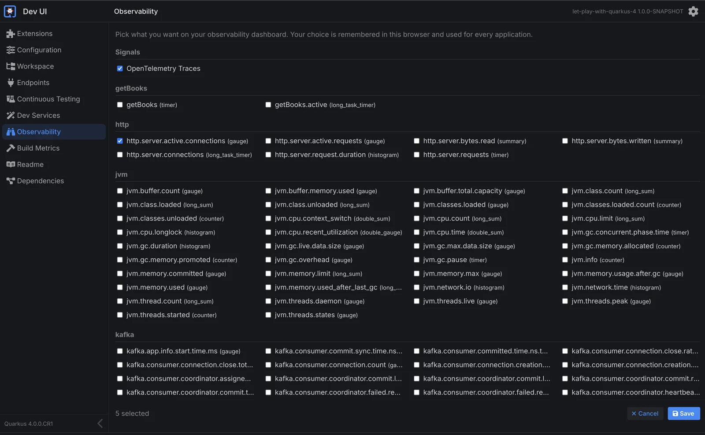
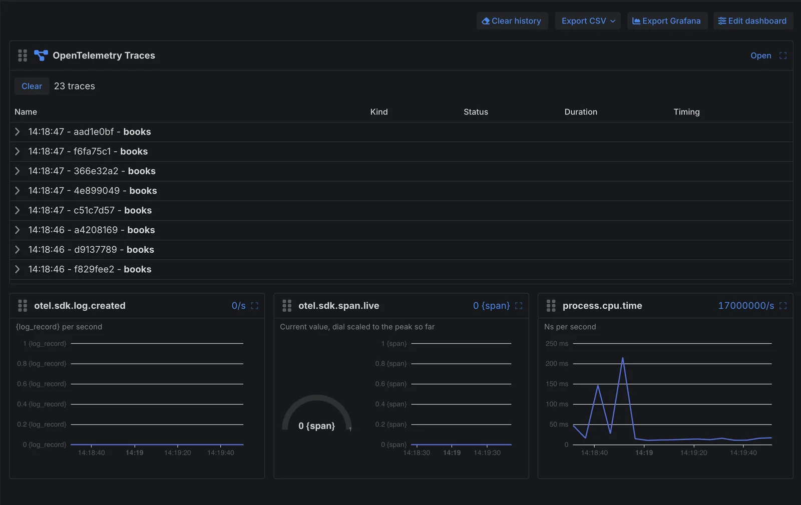

## A New Major, Finally

You probably know by now that I'm a Quarkus fan (this very blog runs on Quarkus and Roq), so take my enthusiasm as it may. I first heard Quarkus 4 was coming almost a year ago, in a Quarkus community call, before the roadmap was even published. I've been looking forward to it since, and on November 25th it was finally the day: [Quarkus 4.0 is released](https://quarkus.io/blog/quarkus-4-0-released/).

Quarkus 3 shipped in April 2023. Since then we got forty feature releases, a handful of LTS versions, and a framework that kept getting better without ever really breaking anything. That's great when you maintain an app. It's less great when you maintain the framework, because every "we'll clean this up later" piles up somewhere.

Quarkus 4 is that "later". The [roadmap](https://github.com/quarkusio/quarkus/discussions/52020), published back in January, sums it up: lean on what the Java platform now offers, make the architecture more modular and lightweight, and double down on AI integration. In practice, this release is mostly about foundations: new Java baseline, new networking layer, new Hibernate, new Jackson, new CDI. Some of those changes you'll feel the moment you bump the version. Others are there to unlock what comes next.

Rather than paraphrase the [release announcement](https://quarkus.io/blog/quarkus-4-0-released/), I spun up a project during the first beta, kept it alive through the release candidate, and tried things. Where something didn't behave the way I expected, I'll tell you. I'll also point out what changed between the pre-releases and the final 4.0.x.

I re-ran the demo project on the 4.0.1 platform BOM, and the code snippets below compile and run there, except where I say otherwise.

## The Timeline

Quick context if you've only been half-following:

- **Sept 30**: 3.40 LTS, the last feature release of the 3.x line.
- **Oct 1 – Nov 4**: three betas (4.0.0.Beta1 → Beta3).
- **Nov 11**: 4.0.0.CR1.
- **Nov 18**: Quarkus 4.0.0 Core final.
- **Nov 25**: 4.0.1 Core, and the full Platform release with the official announcement.
- **Jan & Feb 2027**: 4.1 and 4.2 (proposed).
- **March 2027**: the first Quarkus 4 LTS, currently proposed as **4.3 LTS**.

Those 2027 dates are still a proposal on the release planning page, so take them as a direction rather than a commitment.

If you're on an LTS and you're not in a hurry, you have until spring before the "LTS to LTS" upgrade becomes the natural move. 3.x keeps getting fixes for a while: 3.33 LTS until the end of March 2027, and 3.40 LTS until the end of September 2027. But there won't be feature releases on both lines.

## Java 21 Is the New Floor

Let's start with the one that'll affect the most people: **Java 17 is gone**. Java 21 is the minimum, and Java 25 is the recommended version.

Clément Escoffier [explained the reasoning](https://quarkus.io/blog/java21/) in a dedicated post, and the core argument is virtual threads. Java 21 is the first LTS that has them, and so far Quarkus had to support them "through reflection hacks" to keep running on 17. With 21 as the baseline: "No reflection, no conditional paths." For you, that means virtual thread support that no longer depends on tricks. For extension authors, it means a much simpler way to support them, so expect more extensions to play nicely with `@RunOnVirtualThread` over the 4.x releases.

If you're already on 21 or 25, nothing changes for you. If you're still on 17, you now have a very concrete reason to plan that upgrade. And my advice is to do it *before* touching Quarkus 4, on your current 3.x version. One migration at a time.

### Virtual Threads by Default, With One Property

The first payoff of the new baseline landed just before the final release. Until now, running your REST endpoints on virtual threads meant putting `@RunOnVirtualThread` on every one of them. Quarkus 4.0 adds a build-time property for that:

```properties
quarkus.rest.blocking.signatures.execution.mode=virtual-thread
```

Endpoints that would have run on a worker thread now run on a virtual thread. Endpoints with a reactive signature (returning `Uni`, `Multi`...) stay on the event loop, and explicit annotations still win, so a single endpoint can opt out with `@Blocking`. That makes it safer than putting `@RunOnVirtualThread` on your JAX-RS `Application` class, which also moves reactive and `@NonBlocking` endpoints to virtual threads. And if things go wrong, `quarkus.virtual-threads.enabled=false` sends everything back to worker threads without touching your code.

## A New Networking Foundation

### Vert.x 5 and Netty 4.2

You probably won't see this one in your code. Think of it as redoing the plumbing of your house: you don't see the pipes, but everything runs through them. Quarkus' whole I/O layer runs on Vert.x and Netty, and both got a major upgrade: Vert.x 5 and Netty 4.2. Unless you were using Vert.x APIs directly, you shouldn't need to touch anything. If you were, the Vert.x 5 migration guide is your friend: `Future` APIs, the end of callback-style methods... that part is on you.

You also get configurable native transports (`epoll`, `kqueue`, `io_uring`) for better concurrency, and `epoll` and `io_uring` now work in native executables too.

### HTTP/3, Experimentally

QUIC is becoming the transport for a lot of things: HTTP/3, MQTT over QUIC, WebTransport. Quarkus 4 ships experimental HTTP/3 support as a separate extension:

```xml
<dependency>
    <groupId>io.quarkus</groupId>
    <artifactId>quarkus-http3</artifactId>
</dependency>
```

That's it, no property needed. HTTP/3 requires TLS (1.3), which usually means fiddling with certificates. Not here: in dev and test mode, if you haven't configured any TLS, Quarkus generates a certificate for you. Here's what dev mode logged on CR1 when I added the extension:

```text
INFO  [io.smallrye.certs.CertificateGenerator] ⭐  PKCS12 keystore and truststore generated successfully!
INFO  [io.smallrye.certs.CertificateGenerator] 🔐  Key Store File: target/http3-dev-cert/http3-dev-keystore.p12
INFO  [io.smallrye.certs.CertificateGenerator] 🔓  Trust Store File: target/http3-dev-cert/http3-dev-truststore.p12
INFO  [io.quarkus.http3.deployment.Http3Processor] HTTP/3: insecure HTTP requests will be redirected to HTTPS (set quarkus.http.insecure-requests=enabled to allow plain HTTP)
```

The keystore and truststore land in `target/http3-dev-cert/`, so they're thrown away with your next `clean`. Look at the last line, though: once you add the extension, `http://localhost:8080` answers with a `301` to `https://localhost:8443`. That surprised me for a second. If you want to keep plain HTTP in dev, set `quarkus.http.insecure-requests=enabled`. By default the certificate is self-signed, so expect a warning in your browser. If you want your browser to trust it, run `quarkus tls generate-quarkus-ca --install` once: it creates a local Quarkus Dev CA, and the next generated certificates will be signed by it.

HTTP/1.1, HTTP/2 and HTTP/3 are all served on the same port, TCP for the first two, UDP for QUIC. If your `curl` was built with HTTP/3 support, you can check it with:

```bash
curl --http3 -k https://localhost:8443/hello
```

A few limitations to keep in mind: it relies on a native QUIC library (Maven picks the right one for your OS, Gradle needs you to add it), you need to expose the UDP port when running in a container, and there's no WebSocket over HTTP/3 yet.

One thing to know for your tests: as soon as `quarkus-http3` is on the classpath, your RestAssured tests start failing with `PKIX path building failed`. RestAssured never speaks HTTP/3 (it's HTTP/1.1), the plain HTTP request is redirected to HTTPS, and the JVM doesn't trust the auto-generated certificate. The simplest fix is to keep plain HTTP in dev and test:

```properties
%dev.quarkus.http.insecure-requests=enabled
%test.quarkus.http.insecure-requests=enabled
```

With that, all my tests passed again. If you'd rather test over TLS, the generated truststore (`target/http3-dev-cert/http3-dev-truststore.p12`) uses the password `http3-dev-password`, and `relaxedHTTPSValidation()` in RestAssured works too (that's how I checked the `Alt-Svc` header).

### gRPC Moves In With HTTP

One more change on the networking front, and this one *will* bite you if you use gRPC: **the separate gRPC server is gone**. gRPC now runs on the main HTTP server, so port 9000 no longer exists. Update your clients:

```properties
# Before: quarkus.grpc.server.port=9000
quarkus.grpc.clients.hello.port=$\{quarkus.http.port}
```

The server-side TLS properties move too (`quarkus.grpc.server.ssl.*` becomes the regular `quarkus.http.ssl.*`), and certificate files must now be filesystem paths, not classpath resources. Your ops team will probably thank you for having one port less to open.

Under the hood, gRPC now runs on the Vert.x gRPC stack, and the old Netty-based grpc-java integration is removed. If you only use the generated stubs and `@GrpcClient`, like my demo project, you won't notice. If you depended on grpc-java Netty internals, that's where you'll have work.

## The Data Layer: Hibernate ORM 8 and Quarkus Data

Quarkus 4 brings Hibernate ORM 8, which implements Jakarta Persistence 4.0, together with Jakarta Data 1.1, and Hibernate Reactive 5.1 on top of it. One thing to know: ORM 8 itself isn't final yet. Quarkus 4.0.0 ships 8.0.0.CR1 and 4.0.1 ships 8.0.0.CR2, so expect a few more Hibernate bumps in the 4.0.x micros. The APIs are still milestones too: 4.0.1 resolves `jakarta.persistence-api` 4.0.0-M8 and `jakarta.data-api` 1.1.0-M4.

A few ORM 8 changes can affect existing code: `StatelessSession.insert()` no longer returns the identifier, `Session.replicate()` is gone (use `StatelessSession.upsert()`), and the new graph-based flushing can change the order of your SQL statements. The [migration guide](https://github.com/quarkusio/quarkus/wiki/Migration-Guide-4.0) has the full list.

### Quarkus Data

What used to be called *Panache Next* is now Quarkus Data (`quarkus-data-hibernate`), aligned with Jakarta Data. It's still flagged experimental, and package names may still move, but it's where Panache is heading, so it's worth a look.

Here's an entity with its repository nested inside:

```java
@Entity
public class Book extends RecordEntity {
    public String title;
    public BigDecimal price;

    public interface Repo extends RecordRepository<Book> {
        @Find
        List<Book> findByTitle(String title);

        @Query("where price < :maxPrice order by title")
        List<Book> cheaperThan(BigDecimal maxPrice);
    }
}
```

You inject `Book.Repo` like any other bean. `@Find` and `@Query` come straight from Jakarta Data (`jakarta.data.repository`), and the implementation is generated at build time by an annotation processor you add to the compiler plugin:

```xml
<annotationProcessorPathsUseDepMgmt>true</annotationProcessorPathsUseDepMgmt>
<annotationProcessorPaths>
    <path>
        <groupId>io.quarkus</groupId>
        <artifactId>quarkus-data-processor</artifactId>
    </path>
</annotationProcessorPaths>
```

The `annotationProcessorPathsUseDepMgmt` flag lets Quarkus manage the processor version, so you don't have to set one.

The part I like here: queries are checked before your app serves a single request. I made a typo on purpose, `prcie` instead of `price`. The guide promises these queries are type-checked at build time, so I was hoping for a compile error. On CR1, `mvn package` went through without a word, and only dev mode refused to start. On 4.0.1 it's better: the annotation processor now fails the compilation.

```text
[ERROR] .../Book.java:[26,16] Could not interpret path expression 'prcie' [from Book where prcie < :maxPrice order by title]
```

So it really is compile time now: rename a field and forget a query, and the build tells you.

If you want to dig further, the [Quarkus Data with Hibernate guide](https://quarkus.io/guides/quarkus-data-hibernate/) covers the full API.

Notice `RecordEntity`. Quarkus Data offers two models:

- **Record** (`RecordEntity` / `RecordRepository`) uses Hibernate's `StatelessSession`: `insert()` runs an `INSERT` immediately, `update()` runs an `UPDATE`, no persistence context, no dirty checking. Simple and predictable.
- **Managed** (`ManagedEntity` / `ManagedRepository`) is the classic JPA model you know: `persist()`, dirty checking, lazy loading.

Both have reactive variants (`ManagedRepository.Reactive`, `RecordRepository.Reactive`). And if you don't want any Quarkus supertype at all, a plain Jakarta Data `@Repository` interface works too.

One rule to remember: **you can't mix classic Panache and Quarkus Data in the same application**. The build fails with an explicit error. Pick one per project.

One more thing I tripped over: my `RecordEntity` gets its id from a pooled sequence (`Book_SEQ` here), not from an identity column like my old Panache entity. My `data.sql` (the new `import.sql`, more on that below) inserted rows without an id, and the result was an empty table with only a `WARN` at startup. I seeded explicit ids and moved the sequence away from them (H2 syntax):

```sql
INSERT INTO Book(id, title, price) VALUES (1, 'Dune', 9.99);
ALTER SEQUENCE Book_SEQ RESTART WITH 1000;
```

### Schema and Data Scripts

First, a rename that will trip you up before anything else: **`quarkus.hibernate-orm.database.generation` is gone**. In 4.0.1 it's only reported as an unrecognized property (a `WARN` at startup, nothing more), so Hibernate never creates your schema and every query fails with `Table "BOOK" not found`. The new name is `quarkus.hibernate-orm.schema-management.strategy` (I used `drop-and-create`). `quarkus update` didn't rename it for me.

`import.sql` is out. Well, deprecated. It's replaced by two separate scripts:

- `schema.sql` runs only when Hibernate creates the schema.
- `data.sql` loads data when `quarkus.hibernate-orm.data-management.strategy` is `create`, which is the default in dev and test.

One thing to watch: `data.sql` runs however your schema is managed, including with Flyway or Liquibase. Having both `import.sql` and the new files is an error (even a stale `import.sql` left in `target/classes`, so run a `clean` after the rename). `import.sql` alone keeps working as before for now, but rename it when you migrate. And if you let Hibernate create the schema in production (bravely) and need `data.sql` to run there too, you have to opt in explicitly:

```properties
%prod.quarkus.hibernate-orm.data-management.strategy=create
```

The old `quarkus.hibernate-orm.sql-load-script` property is deprecated too. The startup warning points to `quarkus.hibernate-orm.data-management.init-script` (runs regardless of how the schema is managed) and `quarkus.hibernate-orm.schema-management.init-script` (runs only when Hibernate creates the schema), and says not to name those scripts `import.sql`.

### Newer Default Database Versions

Quarkus now assumes recent databases at build time: PostgreSQL 16, MySQL 8.4, MariaDB 11.4, SQL Server 2022, Oracle 23, Db2 12.1. If you're running something older in production, your app will fail at startup with a message along the lines of "configured to run with a database version of at least '16'". The fix is one property:

```properties
quarkus.datasource.db-version=15
```

### `java.time` Handling: Quarkus Keeps the Old Behavior

Hibernate ORM 8 can pass `java.time` types directly to the JDBC driver. The early ORM 8 betas did it by default, but Hibernate switched it back off before the CR, and Quarkus explicitly keeps it off too: in Quarkus the direct mode is experimental and has known issues, like Oracle `LocalTime` values shifting, or `quarkus.hibernate-orm.jdbc.timezone` and `quarkus.hibernate-orm.mapping.timezone.default-storage` being ignored for some types. So your dates keep being converted through `java.sql` types, exactly like in Quarkus 3. If you want to try the direct mode, it's a per-persistence-unit opt-in:

```properties
quarkus.hibernate-orm.mapping.java-time.use-direct-jdbc=true
```

### H2 Without Docker

Small one, but nice: Dev Services for H2 now run in-process. Set `quarkus.datasource.db-kind=h2`, leave out the URL, and you get a database without Docker or Podman. `H2DatabaseTestResource` is deprecated accordingly. Handy for demos and lightweight CI.

## Jackson 3: The One That Will Hurt a Bit

The Quarkus team sums it up best: Jackson 3 is a new major version where "everything has changed except for the annotations." In their July progress report they even called it a "severe breaking change". At least they're honest.

### New Packages

The most visible part is the package rename:

```java
// Jackson 2
import com.fasterxml.jackson.databind.ObjectMapper;

// Jackson 3
import tools.jackson.databind.ObjectMapper;
import tools.jackson.databind.json.JsonMapper;
```

`com.fasterxml.jackson.core` and `com.fasterxml.jackson.databind` become `tools.jackson.core` and `tools.jackson.databind`. Your `@JsonProperty` and friends stay in `com.fasterxml.jackson.annotation`, which is good news: your DTOs mostly survive. Custom serializers and anything touching the mapper directly are another story.

### Customizing the Mapper

Quarkus now produces a `JsonMapper` bean. Injecting `ObjectMapper` still works, but the customizer API changes. Jackson 3 mappers are immutable, so you customize the *builder* instead of the mapper:

```java
// Quarkus 3
@Singleton
public class MyCustomizer implements ObjectMapperCustomizer {
    public void customize(ObjectMapper mapper) {
        mapper.enable(SerializationFeature.INDENT_OUTPUT);
    }
}

// Quarkus 4
import io.quarkus.jackson.JsonMapperBuilderCustomizer;
import tools.jackson.databind.SerializationFeature;
import tools.jackson.databind.json.JsonMapper;

@Singleton
public class MyCustomizer implements JsonMapperBuilderCustomizer {
    public void customize(JsonMapper.Builder builder) {
        builder.enable(SerializationFeature.INDENT_OUTPUT);
    }
}
```

There's also a new `JsonFactoryBuilderCustomizer` if you need to go one level lower.

### Stricter Defaults

This is the sneaky part, because your code compiles and nothing looks different. Jackson 3 changed several defaults, and Quarkus follows most of them:

| Behavior | Jackson 2 | Quarkus 4 default | Property |
|---|---|---|---|
| Fail on trailing tokens | `false` | `true` | `quarkus.jackson.fail-on-trailing-tokens` |
| Fail on `null` for primitives | `false` | `true` | `quarkus.jackson.fail-on-null-for-primitives` |
| Include un-annotated props with `@JsonView` | `true` | `false` | `quarkus.jackson.default-view-inclusion` |
| Use Collection/Map getters as setters | `true` | `false` | `quarkus.jackson.use-getters-as-setters` |

I tried the first two with a simple `record Person(String name, int age)` endpoint. Both used to be accepted silently. Now both get a `400`:

```bash
# trailing garbage after the JSON document
curl -H 'Content-Type: application/json' -d '\{"name":"Duke","age":30} \{}' localhost:8080/echo
# → 400

# null for a primitive int
curl -H 'Content-Type: application/json' -d '\{"name":"Duke","age":null}' localhost:8080/echo
# → 400
```

Honestly, I think both are the right behavior. But if you have clients sending sloppy payloads, every one of these defaults can be switched back with its `quarkus.jackson.*` property while you fix things. For two other defaults (failing on empty beans, and writing durations as timestamps), Quarkus deliberately keeps the Jackson 2 behavior.

### JSON Merge Patch

Jakarta REST 4 adds a `MediaType.APPLICATION_MERGE_PATCH_JSON` constant. It's just the media type, not automatic patching. But combined with Jackson's `readerForUpdating`, a PATCH endpoint is only a few lines:

```java
@PATCH
@Path("/\{id}")
@Transactional
@Consumes(MediaType.APPLICATION_MERGE_PATCH_JSON)
public Book patch(@PathParam("id") long id, String mergePatch) {
    Book book = repo.findByIdOptional(id).orElseThrow(NotFoundException::new);
    Book updated = mapper.readerForUpdating(book).readValue(mergePatch);
    repo.update(updated);
    return updated;
}
```

Sending `\{"price": 7.5}` updates the price and leaves the title alone. (Beta2 had a bug where the unpatched fields were nulled; it's fixed in Beta3.)

## CDI 5: Quarkus Concepts Become Standard

ArC now implements CDI 5.0, and a few things Quarkus did its own way for years are now in the spec.

### `@Eager`: A Standard `@Startup`

```java
import jakarta.enterprise.context.ApplicationScoped;
import jakarta.enterprise.context.Eager;

@Eager
@ApplicationScoped
public class CacheWarmer {
    @PostConstruct
    void warm() {
        Log.info("Warming caches");
    }
}
```

The bean is created at startup instead of on first use. According to the spec, only `@ApplicationScoped` beans can be eager (Quarkus also allows `@Singleton`). Note that `@Startup` is **not** deprecated: it supports more cases than `@Eager` (startup methods, ordering with a priority...). For simple "create this bean at boot" cases, though, `@Eager` is the standard way now.

### `@Reserve` Replaces `@DefaultBean`, With a Catch

`@Reserve` is the opposite of `@Alternative`: a bean that's used only if nothing else provides the same type. That's exactly what `@DefaultBean` did, and `@DefaultBean` is now deprecated for removal.

Here's the catch, and it got me. I swapped `@DefaultBean` for `@Reserve` and the build failed with an `UnsatisfiedResolutionException`. The CDI 5 Javadoc explains why: a reserve "is not available for injection [...] unless the reserve is *selected* for the application (by adding the `@Priority` annotation)." So you need both:

```java
@ApplicationScoped
public class GreeterProducer {
    @Produces
    @Reserve
    @Priority(0)
    Greeter defaultGreeter() {
        return name -> "Hello " + name;
    }
}
```

With that, any other `Greeter` bean in the application wins, and this one is the fallback. The migration guide confirms it: replace `@DefaultBean` with `@Reserve` and, unless the bean already has a priority, add `@Priority(0)`. It's a mechanical change, but don't forget the second annotation. The good news: `quarkus update` does it for you, both annotations included. I hit the error because I did the swap by hand.

### `@AutoClose`

The third new annotation: put `@AutoClose` on a bean that implements `AutoCloseable`, and `close()` is called when the bean is destroyed. No more `@PreDestroy void cleanup() { resource.close(); }` boilerplate.

## Observability Out of the Box

This is probably my favorite part of the release, because it removes setup work.

### OpenTelemetry Metrics and Logs, On by Default

Until now, OpenTelemetry in Quarkus mostly meant traces. In Quarkus 4, OTel metrics and logs are stable and enabled by default. Add `quarkus-opentelemetry` and you get all three signals.

If you also have `quarkus-micrometer-registry-prometheus`, you'll now collect metrics twice, and Quarkus warns you about it at build time. Pick one, for example with `quarkus.otel.metrics.enabled=false`.

### `@Observed`: One Annotation, Metrics and Traces

The new `quarkus-observation` extension (still flagged as preview) brings the Micrometer Observation API. Add it to your project:

```xml
<dependency>
    <groupId>io.quarkus</groupId>
    <artifactId>quarkus-observation</artifactId>
</dependency>
```

Then you annotate a method once and get both a timer metric and a span:

```java
import io.micrometer.observation.annotation.Observed;

@ApplicationScoped
public class Things {

    @Observed(name = "things.compute", contextualName = "compute-things")
    public int compute() {
        return 42;
    }
}
```

`name` becomes the metric name, `contextualName` the span name. After one call, my `/q/metrics` endpoint had `things_compute_*` series next to the usual HTTP ones. It works with synchronous methods, `Uni`, `Multi` and `CompletionStage`, and there's a programmatic API (`Observation.createNotStarted(...).observe(...)`) for when an annotation doesn't fit. On its own, though, `quarkus-observation` doesn't export anything: no spans, and the metrics go nowhere. You choose the backends. Add `quarkus-opentelemetry` for spans and a registry like `quarkus-micrometer-registry-prometheus` for metrics, or use `quarkus-micrometer-opentelemetry` to send both over OTLP.

### Observability in the Dev UI

The Dev UI gets a built-in Observability page in dev mode. You pick the cards you want (metrics, OpenTelemetry traces...) from everything your app exposes, grouped by source:



Then you arrange them, and you get live charts without wiring anything:



There's even an Export Grafana button that downloads a dashboard you can import into Grafana, next to the CSV export.

### Defaults That Changed

A few default changes can surprise you in production:

- **The OTLP exporter switches from gRPC to `http/protobuf`**, and the default port goes from 4317 to 4318. If your collector only listens on gRPC, you'll see "Connection refused: localhost/127.0.0.1:4318" warnings and no data.
- **Trace sampling drops to 10%** in production. Dev and test modes stay at 100%, but `@QuarkusIntegrationTest` runs your app as built for production, so an integration test asserting on exported spans may suddenly become flaky.
- **`quarkus.otel.traces.enabled=false` now really disables tracing.** Before, spans were still created and just not exported, so trace IDs kept showing up in your logs. If you relied on that, use `quarkus.otel.traces.exporter=none` instead.
- **The Micrometer-to-OpenTelemetry bridge now reports durations in seconds**, not milliseconds.

To restore the old behavior:

```properties
# keep exporting over gRPC
quarkus.otel.exporter.otlp.protocol=grpc
quarkus.otel.exporter.otlp.endpoint=http://localhost:4317

# keep sampling 100% of traces
quarkus.otel.traces.sampler.arg=1.0d
```

Some metric names changed too: the Micrometer Prometheus registry now uses the Prometheus client v1.x, and the old simple client is gone. Check your dashboards and alerts after upgrading.

## Messaging

### Kafka `@ExactlyOnce`

Exactly-once processing with Kafka has always been possible in Quarkus, but it took some ceremony: a `KafkaTransactions` emitter, `withTransactionAndAck`, and a few config properties. Quarkus 4 boils it down to one annotation:

```java
import io.quarkus.smallrye.reactivemessaging.kafka.ExactlyOnce;
import io.smallrye.reactive.messaging.kafka.Record;

@ApplicationScoped
public class OrderProcessor {

    @Incoming("orders-in")
    @Outgoing("orders-out")
    @ExactlyOnce
    Record<String, Integer> process(Record<String, Integer> order) {
        return Record.of(order.key(), order.value() + 1);
    }
}
```

The result is sent within a Kafka transaction, and the offset of the incoming record is committed as part of the same transaction. Quarkus configures what's needed for you: a `transactional.id` derived from your application name and channel, idempotence, `acks=all`, and `read_committed` on the consumer side. You can even combine it with `@Transactional` to write to the database in the same method.

Current limitations: it works on methods that take and return payloads (not `Message`), and not yet with Kotlin suspend functions. For more advanced cases, `KafkaTransactions` is still there.

### Signals Is Now Stable

Quarkus Signals (`quarkus-signals`), the in-process messaging API, is stable as of 4.0. If you skipped it because of the experimental flag, now's a good time to look. It also plugs into the rest of the stack: OpenTelemetry traces, Micrometer counters and Security. You can turn the telemetry off with `quarkus.signals.telemetry.traces.enabled` and `quarkus.signals.telemetry.metrics.enabled`. And no, despite what some earlier progress updates suggested, it doesn't replace the Vert.x event bus: the team [clarified](https://quarkus.io/blog/quarkus-insights-261-quarkus-signals/) that CDI events and the event bus are not going away.

## Everything Else Worth Knowing

A lot more landed than I can cover in detail. Here's what I'd check when migrating, in no particular order:

- **SmallRye Config 4**: Spring Boot `@ConfigurationProperties` classes now bind like `@ConfigMapping`.
- **Stricter HTTP**: malformed JSON and multipart bodies now return `400` instead of a server error.
- **Jakarta REST 4 and RESTEasy 7**: `SseEventSink.close()` now throws `IOException`, and Quarkus REST endpoints can no longer return a REST Client `Response`.
- **WebSockets Next**: pending messages are now capped per connection (256 by default). Tune it with `quarkus.websockets-next.server.max-pending-messages` and its client counterpart.
- **Kubernetes Client 8** moves to Jackson 3 too: `KubernetesClientObjectMapperCustomizer` becomes `KubernetesClientJsonMapperBuilderCustomizer`.
- **Security**: `OidcTenantConfig` setters are gone in favor of `OidcTenantConfig.builder()`. With several Elytron realms enabled, the realm named `Quarkus` is now the default (`quarkus.security.elytron.default-realm-name` to change it).
- **Fault Tolerance 7**: `@Blocking` / `@NonBlocking` on guarded methods now fail the build.
- **Container images** are now based on UBI 10.
- **Artifact renames**: most of the old relocations are gone, so `quarkus-junit5-mockito` must become `quarkus-junit-mockito`, and so on. `quarkus-junit5` → `quarkus-junit` still has a relocation for now, but it will be dropped in a later 4.x, so rename it too. One more rename arrived in 4.0.1: `quarkus-test-spring` becomes `quarkus-spring-test` (with a relocation, for now). On the test side too, `smallrye-reactive-messaging-in-memory` is relocated to `smallrye-reactive-messaging-testing`, and its `InMemory*` classes are deprecated for removal.
- **Logging**: with JSON logging on, named log handlers that define their own `format` now use it instead of silently producing JSON. If you relied on the JSON output, remove the format or set `json.enabled=true` on the handler.
- **Native sources builds**: arguments in `native-image.args` are now quoted, so pass the file as `native-image @native-image.args` instead of `$(cat native-image.args)`.
- **Vert.x**: clustered event bus support is gone (Quarkus never really supported clustered Vert.x).
- **Removals**: the Scala 2 extension (a Scala 3 one lives in the Quarkiverse), and config properties deprecated before 3.33.
- **Tooling**: Gradle 9.6+ is required. And the CLI finally has remote dev mode: `quarkus dev --remote` runs `quarkus:remote-dev` (or the Gradle equivalent) for you, reading the URL and password from `quarkus.live-reload.url` and `quarkus.live-reload.password`.

And there's a lot of new stuff I didn't try: Quarkus JMS joining the Platform, the REST Client over Unix sockets and HTTP/3, post-quantum TLS, a SPIFFE client, Hibernate Search 9, new Hibernate Validator constraints (IBAN, passwords...), and more. The [release announcement](https://quarkus.io/blog/quarkus-4-0-released/) has the full tour.

## What About AI?

You might say, "Yeah, okay, but AI was one of the big themes of the roadmap, where is it?" In 4.0 it's on the developer-experience side: Quarkus Agent MCP is now the recommended way for AI coding agents to work with Quarkus. The agent can run `quarkus dev`, create and restart apps, call the Dev MCP tools (Dev Services included), search the docs for your exact Quarkus version, and load extension-specific skills from `quarkus-skill.md` files. So instead of guessing from a training set that mixes Quarkus 2, 3 and 4, your agent looks things up for the version you actually run. With this many breaking changes, that's what you want during a migration.

Of course, I had to try it on the demo project. With Claude Code, the setup is one line (you need JBang, and Docker or Podman for the doc search):

```bash
claude mcp add -s user quarkus-agent -- jbang quarkus-agent-mcp@quarkusio
```

Then I asked my agent, "Hey, start the app, show me what you can do with it, and run the tests." It started the project in dev mode, found 34 Dev MCP tools on the running app (Kafka topics and messages, SQL on the H2 datasource, config, log levels, adding extensions, testing...), and ran my 20 tests through `devui-testing_runTests`: all green, without the agent ever typing a Maven command. It's a standalone server that runs `quarkus dev` for the agent, so it's still there when your app fails to start, which is exactly when you need it.

The doc search is where it gets interesting, and also where I'd be careful. The first calls just answered "still warming up": on first use it downloads and indexes the docs for your Quarkus version, so give it a minute. After that, "run REST endpoints on virtual threads by default" came back with the 4.0.1 page and the exact `quarkus.rest.blocking.signatures.execution.mode=virtual-thread` property. Nice. But "replace `@DefaultBean`" returned the CDI guide section that still presents `@DefaultBean` as the way to go, with no word about `@Reserve`. The search only indexes the docs of the extensions your project uses, and the migration guide isn't part of it. The skills tell the same story: the ArC skill doesn't mention `@Reserve` either, and the list proposed the Panache skill while my project uses Quarkus Data.

One more thing to know: the first `quarkus_start` drops an `AGENTS.md` in your project, with rules for the agent ("search for an extension before writing code", "always write tests", "keep the README updated"...). It's a good file, but it's a file in your repo that you didn't write, so read it before you commit it.

My verdict: it's still flagged as experimental, but driving the dev mode, the Dev Services and the tests from the agent already works well, and I really like the idea of docs that match the version you run. For the migration itself, though, keep the migration guide open next to it, and please check what the agent tells you about the APIs that changed in 4.0.

## Migrating: My Checklist

Here's how I'd approach it:

1. **Get to Java 21 (ideally 25) first**, on your current 3.x version.
2. **Move to 3.40 LTS and clear your deprecation warnings.** Quarkus 4 removes properties deprecated before 3.33, so a clean 3.40 makes the jump smaller.
3. **Run `quarkus update`.** It handles most config renames and many of the mechanical changes for you (but not `database.generation`, see the takeaways below):

   ```bash
   quarkus update --stream=4.0
   # or with Maven
   ./mvnw io.quarkus.platform:quarkus-maven-plugin:4.0.1:update -N -Dstream=4.0
   # or with Gradle
   ./gradlew -PquarkusPluginVersion=4.0.1 quarkusUpdate --stream=4.0
   ```

4. **Read the [migration guide](https://github.com/quarkusio/quarkus/wiki/Migration-Guide-4.0)** for what can't be automated. Here's where I'd look first:

   | Area | What to check |
   |---|---|
   | Vert.x 5 | Direct Vert.x usage: `Future` only, no more callbacks |
   | Jackson 3 | Imports, custom serializers, `ObjectMapperCustomizer`, stricter defaults, `KubernetesClientObjectMapperCustomizer` |
   | Config | Spring Boot `@ConfigurationProperties` bind like `@ConfigMapping` |
   | Hibernate ORM 8 | `database.generation` → `schema-management.strategy`, `import.sql` → `schema.sql` / `data.sql`, database version, removed APIs (`Session.replicate()`, `QueryHints`...) |
   | CDI | `@DefaultBean` → `@Reserve` **+ `@Priority(0)`**, optionally `@Startup` → `@Eager` |
   | gRPC | Port 9000 is gone, TLS config moves to `quarkus.http.ssl.*`, Vert.x gRPC stack instead of grpc-java Netty |
   | OpenTelemetry | OTLP protocol and port, 10% sampling in prod (and `@QuarkusIntegrationTest`), `traces.enabled=false`, metric names |
   | HTTP | `400` on malformed bodies |
   | Logging | Custom formats on named handlers with JSON logging |
   | Build | `quarkus-junit5` → `quarkus-junit` (and `-mockito`), `quarkus-test-spring` → `quarkus-spring-test`, Gradle 9.6+, `native-image @native-image.args` |

5. **Test with real payloads, please.** The stricter Jackson and HTTP defaults are exactly the kind of change that passes your unit tests and breaks a client in production. If you have contract tests or recorded traffic, now is the time to use them.

Also, start from 4.0.1 rather than 4.0.0: it already fixes a handful of issues, like part of the HTTP/3 discovery and native executables answering HTTP/1.0 requests with a `501`.

And if you're on an LTS with no urgent need, waiting for the first 4.x LTS (proposed for March) is a perfectly reasonable plan. Just don't wait until then to *read* the migration guide.

## Wrap-Up

Most of Quarkus 4 is about the foundations: Java 21, Vert.x 5, Hibernate 8, Jackson 3, CDI 5, and a lot of 3.x baggage thrown away. There's still plenty to play with on top: virtual threads with one property, observability out of the box, Quarkus Data, `@ExactlyOnce`, HTTP/3, and an MCP server for your coding agent.

If you only keep three things from this post, keep these:

1. **Get to Java 21 first**, on 3.x. One migration at a time.
2. **Jackson 3 is where you'll spend your afternoon.** New packages, a new customizer, and stricter defaults that only show up with real payloads.
3. **Rename `quarkus.hibernate-orm.database.generation` to `schema-management.strategy` yourself.** `quarkus update` won't do it, and all you get is a `WARN` and a missing table. Trust me, I found out the hard way.

Some migrations will be smooth, others will fight Jackson for a while. Personally, I really like where 4.x is going, and I'm curious to see what lands in 4.1 and 4.2.

Have you tried 4.0 yet? Let me know what broke, and what you liked.
