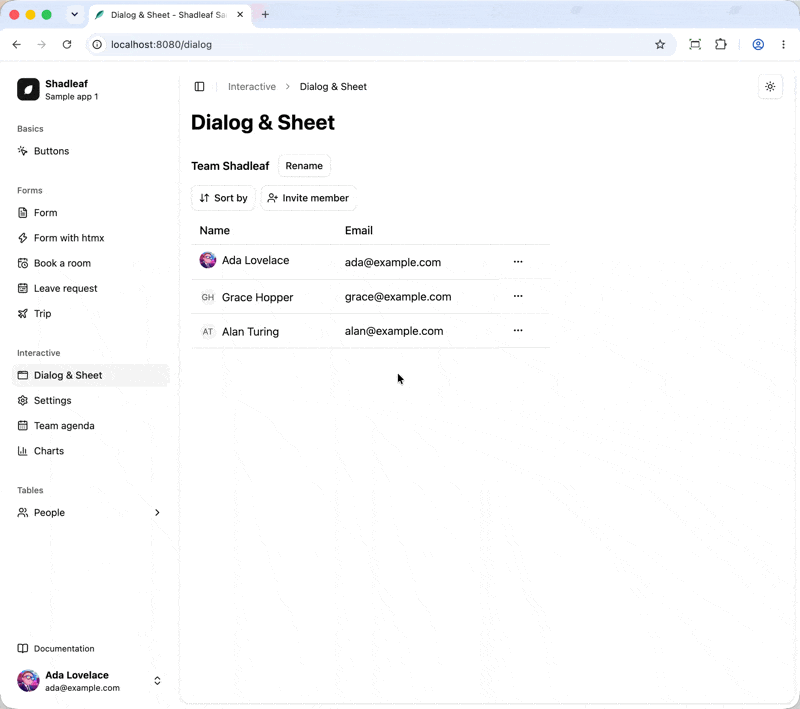
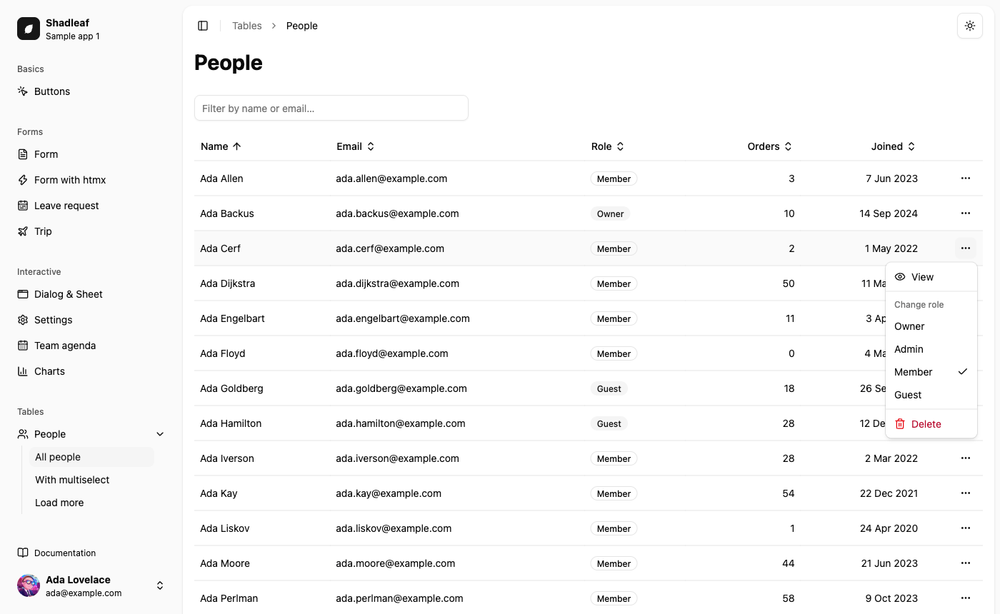
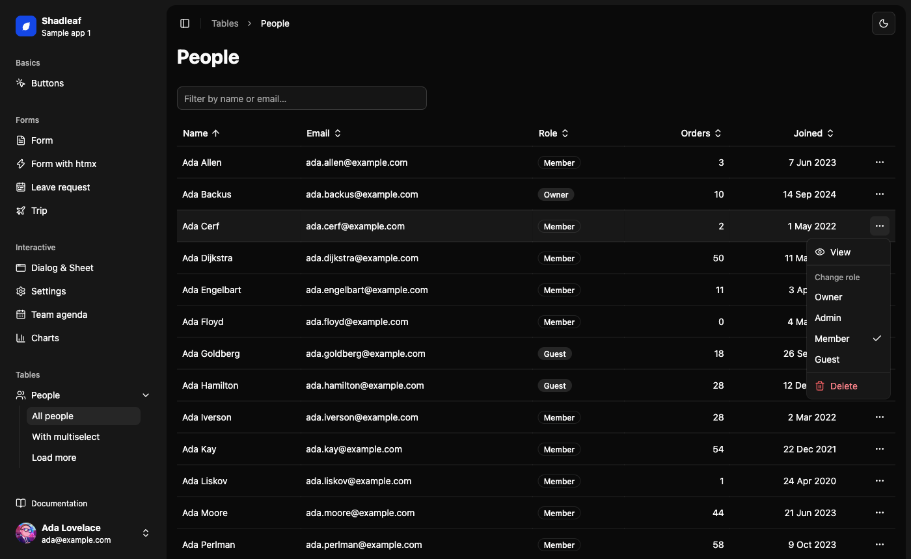

Ask a Spring Boot team why their new project has a React or Angular front end, and the answer is rarely "we need client-side state".
More often it is "we want it to look good, and React has component libraries".

That is a fair point.
With React, you pick shadcn/ui, MUI or one of many others, and you have buttons, dialogs, date pickers and tables on day one.
With Thymeleaf, you write all of that yourself, in every project, over and over again.

So the team takes on a second language, a second build, a JSON API between the two and duplicated validation, mostly to get a nice-looking dialog.

[Shadleaf](https://shadleaf.dev/) is my attempt to take that reason away.
It is an open-source library of accessible, themeable UI components for Thymeleaf, packaged as a Spring Boot starter.

## Where it comes from

I like server-side rendering a lot.
Thymeleaf with a sprinkle of [htmx](https://htmx.org/) and [Alpine.js](https://alpinejs.dev/) gets you very far, without the complexity of a single-page application.
What I always missed was the component library.

Shadleaf started as an internal library I wrote for a large European automotive company.
It worked well there, so I started over with an open-source version that every Thymeleaf developer can use.
It is inspired by [shadcn/ui](https://ui.shadcn.com/), and version 1.0 has about 50 components:
buttons and inputs, but also dialogs, sheets, comboboxes, date pickers, tables, charts, toasts and a complete application shell with a sidebar.

## Components as tags

Add the starter to your Spring Boot application that already uses Thymeleaf:

```xml
<dependency>
  <groupId>io.github.wimdeblauwe</groupId>
  <artifactId>shadleaf-spring-boot-starter</artifactId>
  <version>1.1.0</version>
</dependency>
```

Shadleaf needs Java 17 and Spring Boot 4.1.
The jar ships the compiled CSS and JavaScript, so there is no Node.js in your build.
Include them in the `<head>` of your layout:

```html
<head>
  <th:block th:replace="~{sl/layout :: theme-script}"></th:block>
  <th:block th:replace="~{sl/layout :: assets}"></th:block>
</head>
```

Now you can use the components as custom tags, with the `sl` namespace:

```html
<html xmlns:th="http://www.thymeleaf.org" xmlns:sl="https://shadleaf.dev/sl">
...
<sl:button variant="outline">Cancel</sl:button>
<sl:button type="submit">Save</sl:button>
```

Each component is an ordinary Thymeleaf template behind the scenes.
Your own `th:*` attributes work on it as you would expect.

## Deleting a row

A button on its own does not show much.
Take something every business application has.
A table of team members, where you delete a member after confirming in a dialog, and a toast tells you it worked.

If you want to build this with React, you need a component library, a fetch call, a JSON endpoint and some state.
With Shadleaf and htmx, all you need is a template and a controller.

### The table

`<sl:table>` styles the plain table elements you write inside it.
There is no special component per row, so a row is the `th:each` you already know:

```html
<sl:table>
  <thead>
    <tr>
      <th>Name</th>
      <th>Email</th>
      <sl:table-head align="end">Actions</sl:table-head>
    </tr>
  </thead>
  <tbody>
    <tr th:each="member : ${members}" th:id="|member-${member.id}|">
      <td th:text="${member.name}">Ada Lovelace</td>
      <td th:text="${member.email}">ada@example.com</td>
      <td data-align="end">
        <sl:button variant="ghost" size="icon" aria-label="Delete"
                   th:commandfor="|delete-${member.id}|" command="show-modal">
          <sl:icon name="trash-2"/>
        </sl:button>
      </td>
    </tr>
  </tbody>
</sl:table>
```

The delete button opens a dialog through the browser's own `commandfor` and `command` attributes.
No JavaScript of your own is involved.

### The confirmation

Building a nice alert dialog is just as easy.
The `<sl:alert-dialog>` component handles the little interactions that make it feel polished.
A click outside does not close it, and the focus starts on Cancel, so pressing Enter right away never deletes anything by accident:

```html
<sl:alert-dialog th:id="|delete-${member.id}|" size="sm">
  <sl:alert-dialog-header>
    <sl:alert-dialog-media variant="destructive"><sl:icon name="trash-2"/></sl:alert-dialog-media>
    <sl:alert-dialog-title th:text="|Delete ${member.name}?|">Delete Ada Lovelace?</sl:alert-dialog-title>
    <sl:alert-dialog-description>
      They lose access to the team at once. This cannot be undone.
    </sl:alert-dialog-description>
  </sl:alert-dialog-header>
  <sl:alert-dialog-footer>
    <sl:alert-dialog-cancel/>
    <sl:button variant="destructive"
               hx:delete="@{/members/{id}(id=${member.id})}"
               th:hx-target="|#member-${member.id}|"
               hx-swap="outerHTML swapEmpty:true">Delete</sl:button>
  </sl:alert-dialog-footer>
</sl:alert-dialog>
```

The Delete button is a normal `sl:button` with htmx attributes on it.
It sends a `DELETE` request and replaces the table row with whatever the server answers.

### The controller

The controller deletes the member, then uses [htmx-spring-boot](https://github.com/wimdeblauwe/htmx-spring-boot) to send two events back in the `HX-Trigger` response header:
one that closes the dialog, and one that shows a toast.

```java
@DeleteMapping("/members/{id}")
@ResponseBody
public String delete(@PathVariable long id, HtmxResponse htmxResponse) {
  Member member = memberService.delete(id);
  htmxResponse.addTrigger("sl-dialog-close");
  htmxResponse.addTrigger("sl-toast", Toast.success("%s was deleted".formatted(member.name())));
  return "";
}
```

The empty response removes the row.
`Toast` is a small Java class that ships with Shadleaf, so creating a toast takes one line.
The only thing the layout needs is one toaster at the end of the `<body>` to show the toasts:

```html
<sl:toaster/>
```

That is all there is to it.
The validation, the authorization and the data access all stay in Spring, in Java, where they already were.
There is no API to version and no front-end state to keep in sync with the server.

This is what it looks like in one of the sample applications, where Delete sits in a menu on each row:



## Mistakes fail early

Custom tags in a template are easy to get wrong, and a typo in an HTML attribute usually only shows up as a page that looks a bit off.
Shadleaf catches them earlier.
Each component declares its props, and Shadleaf checks them while rendering.

Write `<sl:button variant="destructve">` and the page does not render.
You get this instead:

```
Invalid value 'destructve' for prop 'variant' of <sl:button>. Must be one of: default, outline, ghost, destructive, secondary, link.
```

The same goes for accessibility.
Remove the `aria-label` from the icon-only delete button above, and rendering fails with a message that the button needs an accessible name.
A screen reader user would otherwise hear just "button", and nobody on the team would notice.

Together with the completion IntelliJ IDEA offers through web-types, this gets you surprisingly close to the experience of a typed component library.
Coding agents get the same help, because they see their mistake the moment they render the page.

## Make it look like your application

A component library is only useful if your application does not end up looking like everybody else's.

Shadleaf uses the same CSS variables as shadcn/ui: `--primary`, `--radius`, `--ring` and the others.
Redefine them and every component follows.
Because the variables are the same, a theme from a shadcn theme builder like [tweakcn](https://tweakcn.com/) drops in unchanged.

On top of that, there are nine skins that change the geometry, spacing and type size without touching your templates.
Switching one is a single property:

```properties
shadleaf.skin=maia
```

And if a component really doesn't fit, you can override its template in your own application.

All skins support light and dark mode as well.
This is the people table of one of the sample applications, in light mode:



And the same page in dark mode:



## When you still want a SPA

I'm not saying every application should render on the server.
A design tool or an editor that works offline keeps most of its state in the browser, and a single-page application is the right choice there.

But a lot of what you build is forms, tables, dialogs and dashboards on top of a database.
For those, the missing component library was often the only reason to leave server-side rendering.
That reason is gone now.

## Getting started

- The [documentation](https://shadleaf.dev/) has a page for every component, with live examples rendered by the library itself, and guides on htmx, Alpine.js, Spring Security, a strict Content-Security-Policy and Tailwind CSS.
- The [samples](https://github.com/wimdeblauwe/shadleaf/tree/main/samples) in the repository are three complete Spring Boot applications.
- The [Building an application with Shadleaf](https://www.wimdeblauwe.com/blog/2026/11/16/building-an-application-with-shadleaf/) series on my blog builds an expense tracker step by step, from an empty project to a finished application.

Try it out, and if you run into a problem or miss a component, open an issue on [GitHub](https://github.com/wimdeblauwe/shadleaf).
