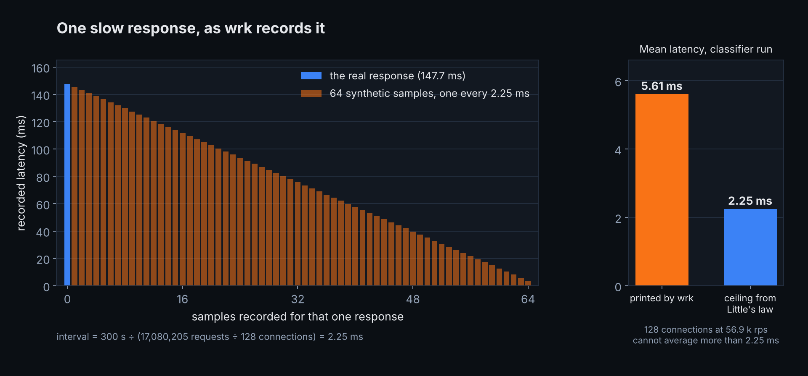

*Provenance: the gated open-loop curve (§7 of the triad report) is `comparison_eligible` (scenario `entity-read-by-id`, hardware profile `perf-box-amd64`, JDK 26, measured 2026-07-21, reproducibility `complete`). The 148 ms, the `wrk` arithmetic and the throttling counters come from exploratory runs and are marked as such below.*

In July, a set of single-row-read runs on my benchmark box kept reporting a worst request of 148 to 178 ms for the Exeris arm. It was a 125-byte response from one indexed lookup on a cached table, on dedicated bare metal, and it was several times the worst case of either Quarkus arm measured the same way, which stayed at or under 40 ms. If that number was real, it was a defect in the runtime I am building, and the worst kind: a tail that only shows up under load.

Requests did take that long, from the moment `wrk` sent them to the moment the response came back. They were waiting, not being served: the JVM never stopped for anything close to it. Measured at a rate the server could sustain, the slowest request I could find took about 26 ms. Where the other 120 ms went, I still cannot name, and the evidence I do have points into my own runtime rather than away from it. What I can tell you is that the closed-loop percentiles around that max were partly written by the load generator, and that the rest of this article is about what else in a benchmark run gets written by something other than the system under test. The second half is about the thing that happened after I fixed the measurement: a correctly configured open-loop run, with every gate in place, that still reported a 2.4-second p99 for a stack whose real tail at that rate was about 2 ms.

This series takes its name from a lightning talk I gave at [tJUG's 18th birthday](https://www.meetup.com/trojmiasto-java-user-group/events/316468542/), whose last slide said that every benchmark measures two systems: the one under test, and the one doing the testing. The talk's case was a poller vocabulary bug, told in full in [AI output is an exploratory claim](https://blog.arkstack.dev/en/blog/ai-output-is-an-exploratory-claim). This is a different case from a different dataset, and it showed me that the second system is bigger than the load generator.

**TL;DR**

- `wrk` corrects its closed-loop histogram for coordinated omission by inserting samples for requests it assumes were never sent. In the run behind the 148 ms, it reported a mean of 5.61 ms where Little's law caps the real mean at 2.25 ms.
- The max is the one figure that correction leaves alone. It is real, it is not a GC pause (the longest was 23 ms), and it happened thousands of times. The runs were CPU-throttled, but so was the Quarkus arm beside them, which has no such tail, so what evidence there is points at the server, not the harness. Measured open-loop at a declared rate in the same configuration, the arm's worst request was 25.6 ms; on the gated curve, in the triad's configuration, its p99.9 was 2.61 ms.
- That comparison changes at least two things at once, the driver and the load, and it cannot be done any other way: a closed loop has no offered rate to match. I say so below rather than present 148 ms → 25.6 ms as a like-for-like.
- Open loop fixed the driver and left the co-resident JVM where it was. In one pair, a resident neighbour JVM pushed a clean ~2 ms tail to 2.4–8.5 s at 12 k rps and to 22.6–27.5 s at 18 k. The rate-attainment gate caught three of those leaves. One passed with a 2.4 s p99.
- I excluded that pair wholesale, and afterwards I did not remove the neighbour from the harness. I made it observable. That is a trade-off with a real cost, and the article ends on what it still does not catch.

---

## What the 148 ms was measuring

Most of my July campaigns used `wrk` in a closed loop: 4 threads, 128 connections, each connection sending its next request only after the previous one returned, at whatever rate the server could sustain. That is the right instrument for throughput and CPU per request and the wrong one for percentiles, which is why the harness stamps every closed-loop leaf with `latency_percentile_eligibility.publishable=false`. I still looked at the percentiles, because they were in the output.

The 148 ms did not come from where my own report says it did. The gated triad ran the Exeris arm on the single-row read at 77.5 k rps, and its worst request there was 50 to 64 ms. The 148 to 178 ms came from the exploratory runs around it: the same endpoint under the constrained configuration, Parallel GC, a 256 MB heap, 54 to 57 k rps. The triad report later credited the 148 to its own fixed-contract run, and I repeated it until I started writing this article, without opening the gated leaves' `wrk-raw.txt`.

I chased the max in the right order, I think, which is the one thing about this episode I would repeat unchanged: classify the cause first, then re-measure the tail.

The classifier was a pair of 300-second runs with `-Xlog:gc,safepoint` on JDK 26 with Parallel GC, at 256 MB and 768 MB of heap. The longest GC pause was 23.1 ms (27.9 ms at 768 MB), with no full collections and no safepoint stop longer than about 28 ms. Tripling the heap cut the number of minor collections from 1,466 to 448 and left the tail where it was: 147.7 ms max at 256 MB, 127.4 ms at 768 MB. A tail that does not respond to a 3× change in GC frequency is not a GC tail, and nothing in the JVM had stopped for anything close to 148 ms.

The obvious explanation is a backlog: a 23 ms pause at saturation leaves requests queued, and a saturated server has no margin to drain them. That does not survive arithmetic. A closed loop cannot build an unbounded backlog. With 128 connections there are never more than 128 requests in flight, and at 57 k rps that is about 2.3 ms of work. A 23 ms pause followed by a first-in, first-out drain puts the worst request near 25 ms, not 148. The remaining ~120 ms needs requests that were passed over many times while others were served.

There are three places that could happen: the server, the load generator and the kernel. The kernel is a real candidate here, because these runs had a CPU quota, and the run script launched `wrk` inside the same cgroup as the server, so the two shared four CPUs' worth of time. The cgroup's own `cpu.stat` says what that did. In the connection-pool sweep that produced the 152–178 ms readings, in 98% of the 100 ms scheduling periods the cgroup ran out of quota and was stopped until the next one.

Throttling does not explain the difference between the arms. The Quarkus-tuned arm, under the same quota with the same `wrk` inside it, was throttled in 93–98% of its periods, and its worst request stayed between 25 and 40 ms. At a pool of four database connections, where the Exeris arm was throttled far less often, in fewer than one period in ten, its worst request was still 195 to 211 ms, at 40 k rps, a lighter load on `wrk` than the 48 k at which Quarkus-tuned kept its worst request under 40 ms.

As the pool shrank from 32 connections to 16 and then 8, the Exeris max rose from 152–178 ms to 269–296 ms to 316–412 ms, while Quarkus-tuned's did not move. At four it fell back to about 200 ms, at a rate where the server was no longer CPU-bound. The quota and the generator touched both arms alike; the tail did not. So throttling by itself does not produce it. Whether a tail this size needs throttling, I cannot say: the one saturated configuration without a quota, the gated triad, had a worst request of 50 to 64 ms, and it differs from these runs in more than the quota. Either way, whatever passes those requests over is most likely on the server side, in the runtime I am building, and the connection pool is where I would look first. I have not looked yet; [the open issue](https://github.com/exeris-systems/exeris-kernel/issues/834) holds the table and what would close it.

*Figure 1: The same quota, the same generator, and a tail only one arm has. Exploratory, n=3 per cell.*

### What `wrk` added to the histogram

What the arithmetic does explain is the rest of the closed-loop histogram. `wrk` 4.1 corrects its own histogram for [coordinated omission](https://github.com/giltene/wrk2): after the run it takes the average time between two requests on one connection, here 300 s divided by 133,439 requests per connection, 2.25 ms, and for every response slower than twice that it inserts a synthetic sample at each 2.25 ms step below it. A single 148 ms response becomes 65 recorded latencies, 64 of which no request experienced. The classifier run printed a mean of 5.61 ms. By Little's law, 128 connections completing 56.9 k requests per second cannot have averaged more than 2.25 ms per request (the same quantity `wrk` uses as its interval, which is why the two numbers match), so the correction has at least doubled the mean. The printed p99 of 37 ms includes the same insertions, and the summary `wrk` prints does not say how far below it the real one sits.

*Figure 2: One slow response, as `wrk` 4.1 records it. The max is the only one of these 65 samples a request experienced.*

The same mean also says the slow responses were not rare. The correction only adds samples underneath a response that really was slow, and lifting the mean of 17 million samples by more than 3 ms takes at least 13,000 real responses if every one of them had been as slow as the max, and several times that if they were shorter. The 148 ms is the top of a population of at least one response in 1,300, not one unlucky request.

My July report calls the 148 ms "coordinated-omission amplification". For the percentiles that is closer to right than I gave it credit for. For the max it is wrong: the max is the one figure the correction never touches, so it is a real wait whose cause I have not traced.

### The same arm, open loop

The re-measurement ran in the same constrained configuration, with one difference that matters for the paragraphs above: at 30 k rps the server needs roughly half the CPU it used at saturation, so the quota binds far less, though that run did not record `cpu.stat`. The generator is not a second difference: `wrk2` sat inside the same quota as `wrk` had. It used `wrk2` in an open loop, which sends at a fixed rate regardless of whether responses have come back and corrects its histogram for coordinated omission by timing each request from when it was scheduled to be sent, not from when it actually went out. At 30 k rps the same arm read **p99.9 2.36 ms, p99.99 5.03 ms, max 25.6 ms**, all from that corrected histogram. A 25.6 ms max is about what one ~23 ms pause plus a couple of milliseconds of service would produce, though I have not matched that request to a pause. That run was an [exploratory diagnostic](https://github.com/exeris-systems/exeris-benchmarks/blob/3d2b7003c990d3b321aec0ddf6cc7926c0111ae7/results/raw/20260724-entity-read-light-tail-diagnostic/SUMMARY.md), one run per rung. The gated open-loop curve from the triad, which is `comparison_eligible`, has the Exeris arm at **p99 2.16 ms and p99.9 2.61 ms at 30 k rps**, with p99.9 between 1.95 and 2.61 ms across the ladder.

So the honest pair is 148 ms (closed-loop max at saturation) against 25.6 ms (open-loop max at 30 k), with the gated p99.9 of 2.61 ms as the number I would put my name to. The heavier aggregate endpoint, measured the same week in a report scoped `descriptive_only`, shows the same gap: a closed-loop `wrk` p99 of 184 ms at 4 vCPU, with the same correction and the same shared quota inside it, against 2.9–3.0 ms open-loop at 10 k rps in seven of eight runs at both 256 MB and 768 MB of heap. The eighth read 4.43 ms.

### The arrow crosses more than one variable

I want to be explicit about the weakness in that comparison, because it is structural. The closed-loop max was taken at saturation, about 57 k rps in that configuration. The open-loop one was taken at 30 k rps, roughly half of that. Both the driver and the load changed, and comparing either with the gated 2.61 ms adds a third difference, the configuration. I cannot hold the load constant, because a closed loop does not have an offered rate to hold: it has whatever the server produced. And I cannot run the open loop at 57 k, because the gate would reject a rate the server cannot sustain, and should.

What I can say is narrower. A closed-loop response time is real, observed under a load model in which the generator slows down whenever the server does, at an operating point the experimenter did not choose; a closed-loop percentile from `wrk` is that plus the estimates described above. An open-loop percentile is a response time against an arrival rate the experimenter declared independently, rather than one that falls whenever the server's response time rises. Both are latency. Only the second answers the question a reader usually brings to a p99: how slow is this at the load I plan to run?

I still use the closed loop for what it measures: throughput, CPU per request and memory under load, and as the base for the open-loop ladder, whose rungs are fractions of a closed-loop saturation figure. Dropping it would cost me the number every rung is defined against. The cost of keeping it is that the closed-loop percentiles stay in the artefacts, under a `publishable=false` stamp, where a reader skimming `result.json` will find them anyway, as I did.

---

## Open loop, and the neighbour still in the room

The open-loop curve ran in pairs, the same harness shape as the closed-loop campaigns. Both JVMs of a pair are launched at the start of a leg and stay resident; only one is driven at a time, with AB and BA order to cancel position effects. Three pairs, two contracts, five rates on the light ladder from 6 k to 30 k rps. The top of the ladder was 68% of the lowest saturation among the three stacks, so no rung was a saturation reading.

Pair 1 was the Exeris arm with Quarkus-tuned. Pair 3 was Quarkus-tuned with Quarkus+Hibernate, the only pair with two heavyweight JVMs resident at once.

Quarkus-tuned, driven in pair 1 with the idle Exeris JVM beside it, held a light-contract p99 of 1.88–2.78 ms up to 24 k rps. The same target, same build, same rates, driven in pair 3:

| offered rate | Quarkus-tuned p99, pair 1 | Quarkus-tuned p99, pair 3 |
|---|---:|---:|
| 6 k | 1.88 ms | 1.87–1.88 ms |
| 12 k | 1.96 ms | **2.4–8.5 s** |
| 18 k | 2.29 ms | **22.6–27.5 s** |
| 24 k | 2.78 ms | 2.65–3.18 ms |
| 30 k | 5.21 ms | 3.54–3.60 ms |

Three to four orders of magnitude, and not monotonic in load: clean at the bottom, broken in the middle, clean again near the top. That shape is inconsistent with the target simply running out of capacity, which would get worse with rate, not better. The reading in the report is a transient on the resident Hibernate JVM, JIT or GC warm-up taking CPU on the shared slice, and I want to be careful with it: that is the explanation that fits the shape, and nothing in the campaign traced it.

One thing in that table cuts against my own curve. At 30 k the excluded pair read Quarkus-tuned at 3.54–3.60 ms, and the published curve, which takes it from pair 1 with the Exeris JVM beside it, has 5.21 ms. With two readings per cell I cannot call that a neighbour effect, and I cannot rule it out.

What changed my mind about the cause along the way was pinning. The first run of this curve was unpinned, showed the same blow-up, and I attributed the blow-up to the missing pinning. The re-run pinned the target pair, the database and the load generator each to its own disjoint cpuset: both target JVMs on CPUs `0-1,8-9`, two physical cores and their SMT siblings, Postgres on four other cores, the generator on two more. It showed the same shape. The diagnosis had been wrong. Two JVMs sharing four logical CPUs do not stop interfering because neither of them can leave those CPUs, and pinning does nothing for what they share beyond them: the L3, memory bandwidth, the kernel.

*Figure 3: Pinning separates who runs where. It does not separate what the processes share beyond their CPUs, and in the constrained runs the quota put the server and its load generator in one budget.*

### What the gate caught

The open-loop leaves carry a gate that the closed-loop ones do not need: `latency_percentile_eligibility.publishable` is set false when the achieved rate falls below 99% of the offered one, because when the server cannot sustain the offered rate, the distribution no longer describes a sustainable operating point at that rate: it includes a queue that keeps growing for the rest of the window. That gate quarantined three of the sixty light-contract leaves, all of them pair-3 Quarkus-tuned, with reason `open_loop_rate_not_sustained`.

It did not catch a fourth. One pair-3 leaf sustained its rate at 99% or above and carried a 2.4-second p99. A server can keep up with its offered rate on average while a fraction of its requests sit behind something else for seconds. The rate gate tests the first property. Nothing tested the second. Sustaining the offered rate is the condition under which an open-loop percentile means what it says; it is not evidence that the percentile is clean.

That is why pair 3 is excluded from the report as a whole, rather than filtered leaf by leaf. Filtering would have kept the leaf the gate could not see, and the gate's pass on that leaf would have made it look more trustworthy than its neighbours. Excluding the pair costs the curve its only Quarkus-tuned × Hibernate comparison, and leaves each Quarkus curve resting on a single pair, the one where its neighbour was the lighter Exeris arm.

The harness's fairness index has the same blind spot. It is an outcome-symmetry composite that flags pairs whose results look too far apart to compare, and the report describes it as a triage flag, not a certification, with this leaf as its documented false negative.

### The same thing, smaller, on the arm I was building

Co-residence was not only a Quarkus problem in this dataset. On the heavy aggregate at 10 k rps, the Exeris arm's p99 read 12.7 and 13.7 ms when the resident neighbour was an idle Quarkus-tuned JVM, and 11.4 and 27.4 ms when the neighbour was an idle Hibernate one. The only isolated measurement at that rate, single-target with nothing else resident, read about 2.9 ms. That is one arm, from a different campaign in which 10 k sat further below the database's ceiling, so it separates neither cause and supports no ranking. The report marks the whole 10 k row as non-comparable for all three stacks, for both reasons.

---

## What I changed, and what I didn't

The obvious fix is to stop launching the neighbour. The profiling runs that came after the triad do exactly that: each starts by killing any resident JVM and measures one target at a time. The comparative harness, `run-comparative.sh`, still does not. Both targets of a pair are still launched and still stay resident while only one is driven.

I kept the pairing because it is what gives a single campaign its AB/BA symmetry: the same two JVM lifetimes, the same warm-up, the same host state, measured in both orders. Splitting each pair into two single-target runs replaces that with two launches whose differences I would then have to bound separately. That is the trade-off, and it is deliberate.

What changed instead, merged in [`10cab491`](https://github.com/exeris-systems/exeris-benchmarks/blob/10cab491e71a4b16ed2eebd54bc42f7a464e9aff/scripts/run-comparative.sh#L3071-L3078) on 12 August, is that the neighbour went into the artefacts. Every leaf now samples the idle co-resident JVM over the same window as the measured one (`neighbour-resource-samples.csv`, role `resident-idle`), and records a JFR profile of it (`neighbour-idle.jfr`). A sampler on the load generator's cpuset landed in the same stretch of work, so a leaf now carries all four consumers of the host: the measured arm, the neighbour, the database and the generator. The comment beside that code names the reason: the cost of the idle JVM beside the measured one had never been recorded, and the heavy 10 k contamination above had no evidence behind it.

In the talk's terms, the second system went into the notes and stayed in the room. A neighbour that is measured can still interfere; what the sampler buys is that the interference is attributable when it happens, instead of being read as a property of the stack being driven.

---

## What I trust about this, and what I don't

- **The gated open-loop curve** is the strongest claim here: `comparison_eligible`, publishable leaves only, pair 3 excluded, and a flat Exeris p99.9 of 1.95–2.61 ms from 6 k to 30 k rps. `comparison_eligible` means the leaf met the harness's admission criteria for a comparison: same contract, pins and windows, every gate passed. It is not a statement that the result is stable or representative beyond those criteria, and most of this article is about the distance between the two.
- **The 148 → 25.6 ms pair** I trust as an illustration and not as a measurement of anything. Both sides are exploratory, the open-loop one a single run, and they differ in load as well as driver.
- **The pointer at the connection pool** rests on maxima, the noisiest figure a histogram has, from an exploratory sweep with three runs per cell. The ranges do not overlap between pool sizes, which is why I take the trend seriously, and the comparison with Quarkus-tuned under the same quota is why I take it as mine. It is still a correlation with one knob, read off one statistic.
- **The arithmetic about `wrk`'s correction** I trust more than anything else in the first section, because it needs no new measurement: the correction is in `wrk`'s source, the interval and the mean are in the run's own output, and Little's law does the rest.
- **The open-loop ranges are a lower bound on uncertainty, not an envelope.** The curve's n per cell is two directions, AB and BA, inside one JVM lifetime. They share one JIT history, one heap and one host state; they reduce order effects and are not independent repeats. Neither covers a restart. Every conclusion above is read off the shape across rungs; none rests on a single cell.
- **The pair-3 mechanism is not traced.** The non-monotonic shape fits a warm-up transient on the neighbour. Nothing measured the neighbour's CPU at the time, which is precisely the gap the sampler was added to close, after the fact. Pair 3 has no neighbour data.
- **An idle neighbour is cheap; pair 3's was not idle.** The sampler has since recorded [264 idle windows across seven campaigns](https://github.com/exeris-systems/exeris-benchmarks/blob/3d2b7003c990d3b321aec0ddf6cc7926c0111ae7/results/reports/2026-08-11-entity-read-by-id-spring-hosting-and-orm-axis.md#6b-footprint--and-why-idle-rss-is-not-one-number-per-arm), and a settled idle JVM costs between 0.0009 and 0.028 cores of a 4-core pin. That is consistent with pair 3's neighbour not being settled yet, and it is the most I can say about it.

## What this doesn't solve

- **A measured neighbour is still a neighbour.** The sampler makes contamination attributable. It does not remove it, and it does not gate on it: a leaf can still pass with a noisy neighbour beside it, and a reader has to look at the neighbour's file to know. The obvious next step is to flag a leaf when the neighbour compiles or collects during the window, and to quarantine it only when that coincides with a degradation in the target: a minor GC next door is an event, not yet interference. I have not built either yet. It is less of a one-liner than it sounds, because the idle baseline above spans a factor of thirty across stacks and campaigns, so a single threshold would be too loose for one and too strict for another.
- **A percentile over a whole window hides a short event inside it.** Every figure here is one histogram per leaf. At a constant arrival rate, a stall shorter than about 1.2 seconds in a 120-second window catches less than 1% of the requests and barely moves the p99; a longer one moves it. Neither leaves a trace of when it happened, and nothing in this article looks inside the window.
- **The host is a resident too.** In October, a different campaign on a different machine found that the Docker daemon, once it had run in a boot, left connection tracking and NAT rules loaded after it stopped. Every loopback packet then passed netfilter, which took about 7% of the carriers' samples and moved a floating-scheduler arm's p99 from 2.46 to 9.81 ms while a pinned one did not move. Exempting loopback from tracking in the same boot brought it from 8.59 back to 2.70 ms. The [report](https://github.com/exeris-systems/exeris-benchmarks/blob/cfa36a5e9b68fed1500587532ad5c06ec78b94ea/results/reports/2026-10-16-loom-carrier-scheduler-capacity-at-a-fixed-tail.md) has the detail; since `0868577a` a trial with `nf_conntrack` loaded fails a `host_untracked` gate. None of the July campaigns recorded that state, and since their database ran in a Docker container, it was most likely present for every arm, which the October result says is not the same as costing every arm equally.
- **Loopback on one box.** No NIC, no network path, the database on the same host. Nothing here transfers to a deployment's tail; it transfers to how a benchmark's tail should be read.
- **The ceiling has no clean three-way comparison.** At the heavy contract's 10 k rung only one arm was ever measured in isolation. The pairwise harness cannot produce the other two.
- **The 148 ms has no mechanism.** What would name it is a per-request trace from the server, with the pool's acquire order, over the same window. None exists for those runs.

The questions I now ask of any p99 in a benchmark, mine included, are what rate it was measured at, what else was running, and how much of it the load generator wrote itself. A passing gate answers none of them: the 2.4-second leaf passed.

---

*The reports behind every figure, at commit `3d2b700` (the October report at `cfa36a5`, on the research branch it was published from):*
*🔗 [2026-07-21 triad, §7 open-loop curve and co-residence](https://github.com/exeris-systems/exeris-benchmarks/blob/3d2b7003c990d3b321aec0ddf6cc7926c0111ae7/results/reports/2026-07-21-entity-read-by-id-tuned-pg-triad-comparison-eligible.md)* · *🔗 [2026-07-22 budget matrix, heavy heap counterfactual](https://github.com/exeris-systems/exeris-benchmarks/blob/3d2b7003c990d3b321aec0ddf6cc7926c0111ae7/results/reports/2026-07-22-entity-read-by-id-memory-cpu-sweep.md)* · *🔗 [2026-10-16 capacity at a fixed tail, §6 connection tracking](https://github.com/exeris-systems/exeris-benchmarks/blob/cfa36a5e9b68fed1500587532ad5c06ec78b94ea/results/reports/2026-10-16-loom-carrier-scheduler-capacity-at-a-fixed-tail.md)*

*🔗 [2026-08-11 Spring hosting ladder, §6b idle co-resident JVMs](https://github.com/exeris-systems/exeris-benchmarks/blob/3d2b7003c990d3b321aec0ddf6cc7926c0111ae7/results/reports/2026-08-11-entity-read-by-id-spring-hosting-and-orm-axis.md)* · *🔗 [`wrk` 4.1.0, the interval](https://github.com/wg/wrk/blob/4.1.0/src/wrk.c)* · *🔗 [and `stats_correct`](https://github.com/wg/wrk/blob/4.1.0/src/stats.c)* · *🔗 [the constrained connection-pool sweep, `cpu.stat` per run](https://github.com/exeris-systems/exeris-benchmarks/tree/3d2b7003c990d3b321aec0ddf6cc7926c0111ae7/results/constrained/entity-read-by-id/20260722T094104Z-connpool-sweep)*

*Related, from before this series had a name:*
*🔗 [AI output is an exploratory claim until something checks it](https://blog.arkstack.dev/en/blog/ai-output-is-an-exploratory-claim)* · *🔗 [What you measure depends on where you draw the boundary](https://blog.arkstack.dev/en/blog/compensation-correctness-saga-benchmark) (retracted 2026-08-27)*
