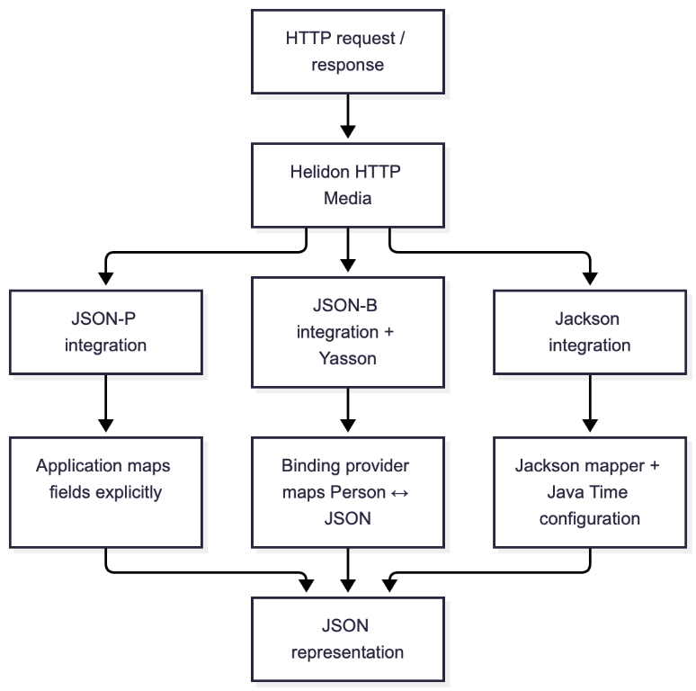
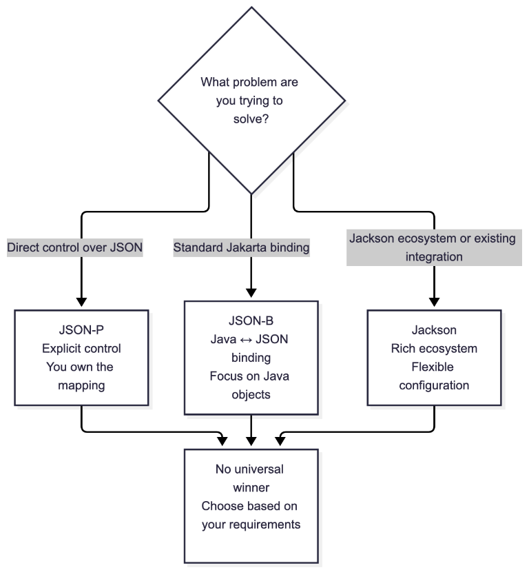
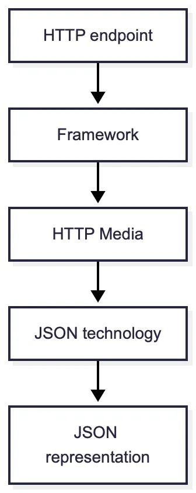

A personal note before we start: I had been working on this post for a few days, but the recent [earthquake in Panama](https://www.reuters.com/business/environment/panama-suffers-over-200-aftershocks-after-fridays-77-magnitude-earthquake-2026-10-11/) made it harder than expected to sit down and finish it. I’m glad to finally share it with you, and my thoughts are with everyone affected.

After some time away from the keyboard, I’m returning to a topic that is easy to take for granted in everyday Java development: JSON.

When building a Java backend, JSON is rarely something we stop to think about.

We create a Java object.

Return it from an endpoint.

And somehow, the client receives JSON.

```json
{
  "id": 42,
  "name": "Jesus"
}
```

It feels almost invisible.

But something had to transform that Java object into JSON.

**What did it?**

And perhaps a more interesting question: **_Did you actually choose it?_**

## The JSON layer hiding inside your backend

Most modern Java frameworks make JSON handling feel like a solved problem.

You add a dependency, create your DTOs, return them from an endpoint, and serialization happens somewhere underneath.

That convenience is exactly why we rarely ask what is happening.

Depending on the framework, stack and configuration, you may encounter technologies such as:

* [Jackson](https://github.com/FasterXML/jackson)
* [JSON-B](https://github.com/jakartaee/jsonb-api)
* [JSON-P](https://github.com/jakartaee/jsonp-api)

At first glance, they can look like three alternatives for the same job.

**They aren’t.**

They operate at different abstraction levels and belong to different ecosystems.

So instead of comparing them only in theory, I put them through the same small experiment.

## Three technologies. One experiment.

I created three small **Helidon SE 27.0.0** applications.

Same model.

Same endpoints.

Same request payload.

The HTTP API and application behavior remain the same. Each project uses a different JSON media integration, allowing us to observe how the serialization and deserialization behavior changes.

The experiment exposes:

```text
GET /person
POST /person
```

And all three projects use:

```java
import java.time.LocalDate;

public record Person(
        String name,
        int age,
        LocalDate birthDate
) {
}
```

The payload is:

```json
{
  "name": "Jesus",
  "age": 31,
  "birthDate": "1995-12-08"
}
```

The complete source code is available in the accompanying [GitHub repository](https://github.com/aguirre-jes/java-json-approaches/tree/main).

The goal is not to benchmark the libraries.

It is much simpler: **_What changes when the JSON technology changes?_**

## First: the abstraction level

Before looking at the results, there is one distinction worth making.

### JSON-P

JSON-P stands for **JSON Processing**.

It gives you APIs for working directly with JSON structures.

For example:

```java
JsonObject json = Json.createObjectBuilder()
                .add("name", person.name())
                .add("age", person.age())
                .add("birthDate", person.birthDate().toString())
                .build();
```

You are explicitly building JSON.

The mental model is: **_Java values → JSON structure_**

### JSON-B

JSON-B stands for **JSON Binding**.

It defines a standard Jakarta way to bind Java objects to and from JSON.

The mental model becomes: **_Java object ↔ JSON_**

In the Helidon experiment, JSON-B is backed by Eclipse Yasson.

### Jackson

Jackson is a separate JSON ecosystem.

It also provides object mapping: **_Java object ↔ JSON_**, but with its own API, modules and configuration model.

This distinction matters because **JSON-B and Jackson may look similar in application code while behaving differently underneath.**

And we can actually see that.

## The same endpoint, different code

Let’s start with JSON-P.

To return a `Person`, we explicitly construct the JSON:

```java
private void getPerson(ServerRequest request, ServerResponse response) {
    Person person = new Person("Jesus", 31, LocalDate.of(1995, 5, 10));

    JsonObject json = Json.createObjectBuilder()
            .add("name", person.name())
            .add("age", person.age())
            .add("birthDate", person.birthDate().toString())
            .build();

    response.send(json);
}
```

When receiving JSON, we map the fields ourselves:

```java
private void createPerson(ServerRequest request, ServerResponse response) {
    JsonObject json = request.content().as(JsonObject.class);

    String name = json.getString("name");
    int age = json.getInt("age");
    LocalDate birthDate = LocalDate.parse(json.getString("birthDate"));

    Person person = new Person(name, age, birthDate);

    JsonObject responseJson = Json.createObjectBuilder()
            .add("name", person.name())
            .add("age", person.age())
            .add("birthDate", person.birthDate().toString())
            .build();

    response.send(responseJson);
}
```

JSON-P gives us direct control.

But we also own the mapping logic.

Now look at JSON-B:

```java
private void createPerson(ServerRequest request, ServerResponse response) {
    Person person = request.content().as(Person.class);

    response.send(person);
}
```

That’s it.

And Jackson looks almost identical:

```java
private void createPerson(ServerRequest request, ServerResponse response) {
    Person person = request.content().as(Person.class);

    response.send(person);
}
```

At this point, you could easily conclude: **_JSON-B and Jackson are basically the same._**

But then we added one field `LocalDate`.

## The `LocalDate` test

Our original model was intentionally simple:

```java
public record Person(String name, int age) {
}
```

All three technologies produced practically the same result.

I started with a simpler record and then added `LocalDate birthDate` to see whether the binding layer would make a different serialization choice.

Now the response tells a different story.

### JSON-P

```json
{
  "name": "Jesus",
  "age": 31,
  "birthDate": "1995-12-08"
}
```

That result was explicitly created by our code.

### JSON-B

```json
{
  "age": 31,
  "birthDate": "1995-12-08",
  "name": "Jesus"
}
```

The property order is different, but the important part is the representation of `LocalDate`.

### Jackson

```json
{
  "name": "Jesus",
  "age": 31,
  "birthDate": [1995, 12, 8]
}
```

This result is configuration-dependent. With Jackson’s Java Time support, enabling `WRITE_DATES_AS_TIMESTAMPS` can serialize a `LocalDate` as an array. Disabling it produces an ISO-8601 string instead. The important point is not that Jackson always uses arrays, but that serialization behavior depends on the configuration of the binding layer.

Same Java type.

Same endpoint.

Same test.

Different JSON representation.

**_This was the most interesting result of the experiment._**

## What actually changed?

The interesting part isn’t that all three technologies handled `LocalDate`.

They did.

The interesting part is **where the conversion logic lives**.

With JSON-P, we explicitly read the JSON field, convert it to `LocalDate`, and later convert the `LocalDate` back to a JSON value.

With JSON-B and Jackson, that work is handled by the binding layer. Our application only deals with the `Person` object.

That makes the code simpler, but it also means that some serialization decisions are no longer visible in the service itself.

Our code can simply say:

```java
response.send(person);
```

Yet the resulting JSON can still differ.

That’s exactly what we saw with `LocalDate`.

JSON-B produced:

```json
"birthDate": "1995-12-08"
```

while Jackson produced:

```json
"birthDate": [1995, 12, 8]
```

So the abstraction removed code from our application, but it did **not** remove the underlying decisions.

It moved them somewhere else.

## This is where the framework matters

In Helidon, these technologies are connected to the HTTP layer through different integrations:

```text
helidon-http-media-jsonp
helidon-http-media-jsonb
helidon-http-media-jackson
```

Each project uses one media integration. The alternatives are separate; the three providers do not run together.



This is why our service code can stay so small.

The framework handles the connection between HTTP and the JSON technology.

And this is also why the JSON library is not really an isolated implementation detail.

### Look at the dependencies

The JSON-P project includes:

```text
helidon-http-media-jsonp
    └── Parsson
```

The JSON-B project includes:

```text
helidon-http-media-jsonb
    ├── Jakarta JSON-B API
    ├── Jakarta JSON-P API
    └── Yasson
          └── Parsson
```

And the Jackson project includes:

```text
helidon-http-media-jackson
    ├── Jackson Databind
    ├── jackson-module-parameter-names
    ├── jackson-datatype-jdk8
    └── jackson-datatype-jsr310
```

Most of the Helidon infrastructure remains the same.

The JSON-specific part changes.

That’s exactly what we wanted to isolate.

## So which one should you use?

This is probably the wrong question.

A better question is: **_What problem are you trying to solve?_**

Choose the JSON approach that fits your needs: direct control with JSON-P, standards-based binding with JSON-B, or the Jackson ecosystem and its configuration capabilities.



## The architectural lesson behind JSON

Suppose your application already works.

Your framework handles JSON. Your DTOs serialize correctly. Your clients are happy.

Should you replace the JSON technology?

Maybe. But changing it is rarely just changing one dependency.

The JSON layer can affect DTO annotations, configuration, tests, serialization and deserialization behavior, and ultimately API compatibility.

Our `LocalDate` experiment shows why. The Java code can look almost identical while the resulting JSON changes. And once that JSON crosses a public API boundary, it becomes part of your contract.

When we choose a backend framework, we also inherit its defaults and integrations:

This diagram illustrates how a Java object becomes a JSON representation. The HTTP endpoint interacts with the framework, which connects the HTTP media layer to the configured JSON technology.



Usually, that’s a good thing. Frameworks exist partly to remove decisions we don’t need to make every day.

But when something unexpected happens — a date is serialized differently, an enum changes representation, a field disappears, or a client breaks after an upgrade — it helps to understand which layer is responsible.

That’s what stood out when I put JSON-P, JSON-B and Jackson side by side.

JSON-P made the mapping explicit. JSON-B handled it through a standard binding abstraction. Jackson handled it through its own databinding ecosystem.

All three worked. They just didn’t work at exactly the same level.

The broader lesson isn’t really about JSON. It’s about the abstractions and defaults we inherit from our frameworks, sometimes without consciously choosing them.

The next time a Java object magically becomes JSON, maybe ask who is actually doing the work.

## References

* [Helidon documentation](https://helidon.io/docs/)
* [Jakarta JSON Processing (JSON-P)](https://jakarta.ee/specifications/jsonp/)
* [Jakarta JSON Binding (JSON-B)](https://jakarta.ee/specifications/jsonb/)
* [Jackson Java 8 Date/Time support](https://github.com/FasterXML/jackson-modules-java8/tree/2.x/datetime)
