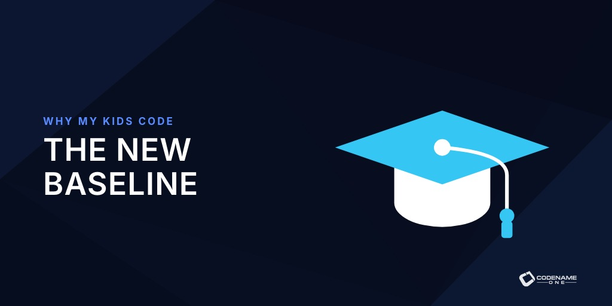

Type one paragraph into Claude Code or Codex and an agent builds a Codename One app, taps through every screen, draws the icon, signs it, and submits it to TestFlight and Google Play. This week we wired our build cloud straight into that loop, so the whole trip from prompt to store is one conversation. You approve screenshots. You never see a line of Java. You don't need a Mac.

<aside style="border-left: 4px solid #007aff; padding: 14px 18px; margin: 24px 0; border-radius: 4px; font-size: 0.95em;"><strong>What is Codename One?</strong> Codename One is an open-source framework for building native iOS, Android, desktop, and web apps from a single Java or Kotlin codebase. Learn more at <a href="https://www.codenameone.com/">codenameone.com</a>.</aside>


I'm teaching my kids to program anyway. Java, specifically.

Agents moved the baseline so far up that the people who understand what's under it just became the most valuable people in the room.

## TL;DR

- **[Your first app is now a complete app.](#hello-world-is-now-a-complete-app)** An Uber clone used to be the final exam. Now it's what one prompt hands you before lunch.
- **[An agent can take it all the way to the App Store.](#an-agent-can-ship-your-app)** It builds in our cloud, reads the log, fixes the error and submits. You tick three boxes.
- **[I'm still teaching my kids Java.](#so-why-am-i-teaching-my-kids-java)** An agent is brilliant at sounding right. Only someone who reads code can tell when it isn't.
- **[Apps are about to be a thousand times bigger.](#from-millions-of-lines-to-billions)** Billions of lines, and the people who understand them run the show.
- **[Don't own code you didn't need to write.](#a-framework-should-take-you-past-the-os)** We maintain 4.5 million lines and paid $21,512.95 last month to test them on every platform. That bill stays ours.
- **[Your enterprise features, behind your firewall.](#enterprises-have-to-move-like-startups)** Corporate Server is back.
- **[A spreadsheet engine, PDFs, flowcharts, a SaaS backend and a game studio.](#more-this-week)** All in this week's release, all free.

## Coming This Week

- **Saturday, November 21:** [A Million Rows and Live Excel Formulas, Inside Your Own App](https://www.codenameone.com/blog/a-million-rows-and-live-excel-formulas/). DataGrid, and spreadsheets with XLSX files and 402 live functions.
- **Sunday, November 22:** [Build a Multi-Tenant SaaS Backend That Can't Leak One Customer Into Another](https://www.codenameone.com/blog/multi-tenant-saas-backend-in-java/). Tenant isolation, GraphQL, SAML and LDAP, object storage on four clouds, MongoDB, DynamoDB and search.
- **Monday, November 23:** [Invoices, Tickets and Reports: Generate, View and Print PDFs From One Java Codebase](https://www.codenameone.com/blog/generate-and-view-pdfs-in-java/). On the phone and on the server.
- **Tuesday, November 24:** [Fieldline: Launch Your Own Field Service App, With a Scheduler That Plans the Week](https://www.codenameone.com/blog/field-service-scheduling-template/). Dispatch, routes, signatures and a heuristic optimizer.
- **Wednesday, November 25:** [Flowcharts, Node Editors and Kanban Boards Are Now Standard Components](https://www.codenameone.com/blog/diagrams-flowcharts-and-kanban-boards/).
- **Thursday, November 26:** [Brickyard: Launch Your Own Game Platform, With the Studio Inside the App](https://www.codenameone.com/blog/build-a-game-platform-with-luau-scripting/). Plus portable shaders and 3D audio.


<div class="release-screenshots" style="display:grid;grid-template-columns:repeat(auto-fit,minmax(min(100%,180px),1fr));gap:16px;align-items:start;margin:24px 0">
<figure style="margin:0"><a href="https://www.codenameone.com/blog/a-million-rows-and-live-excel-formulas/">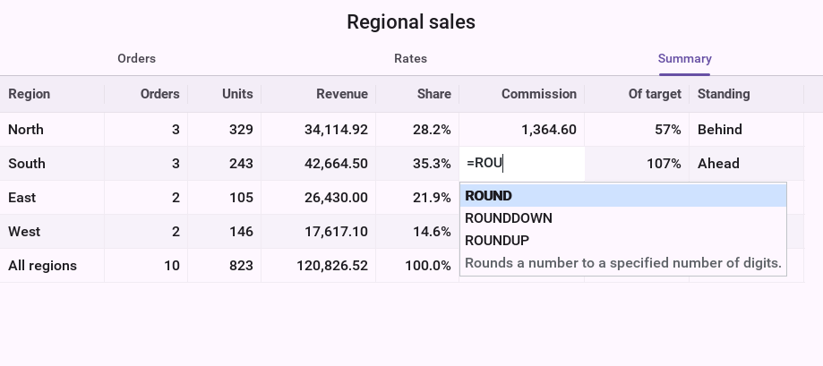</a><figcaption>Live formulas.</figcaption></figure>
<figure style="margin:0"><a href="https://www.codenameone.com/blog/field-service-scheduling-template/">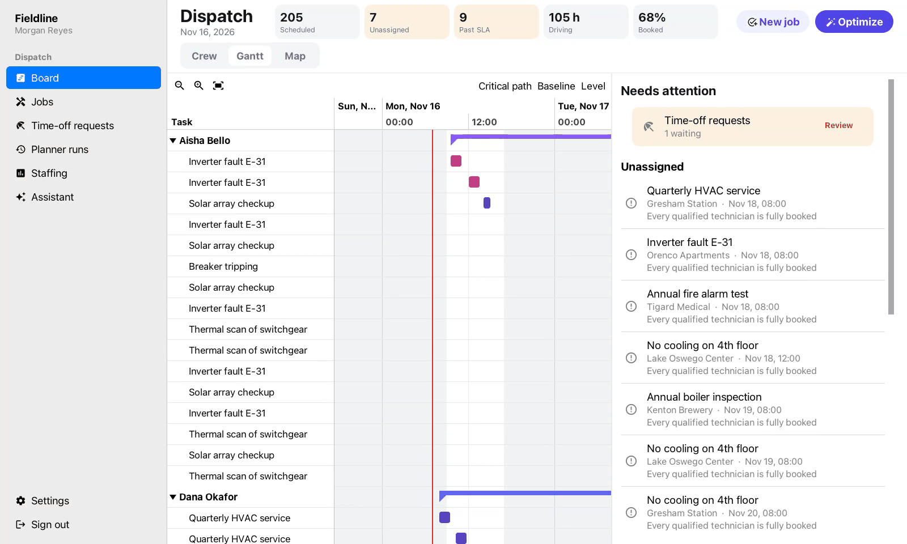</a><figcaption>Fieldline dispatch.</figcaption></figure>
<figure style="margin:0"><a href="https://www.codenameone.com/blog/diagrams-flowcharts-and-kanban-boards/">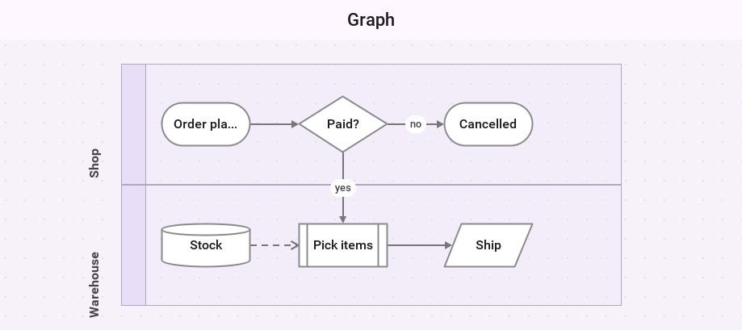</a><figcaption>Flowcharts.</figcaption></figure>
<figure style="margin:0"><a href="https://www.codenameone.com/blog/build-a-game-platform-with-luau-scripting/">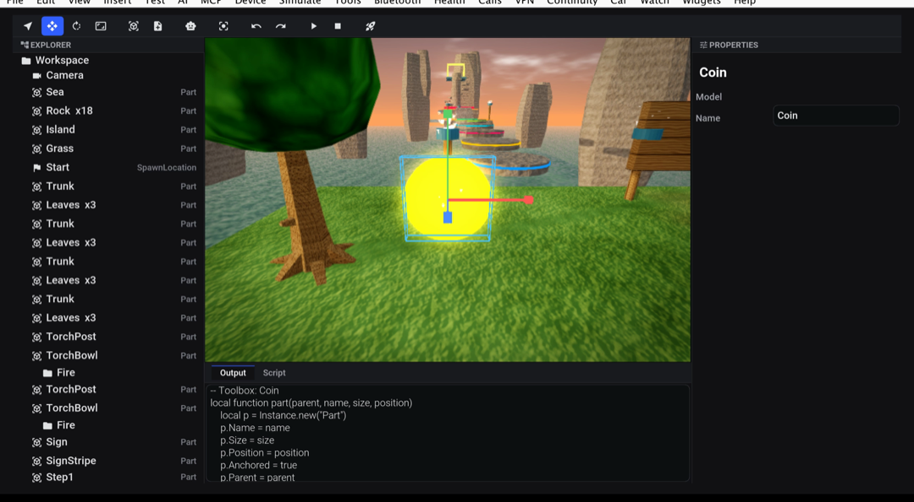</a><figcaption>Brickyard's studio.</figcaption></figure>
</div>


## Hello world is now a complete app

For forty years the first program anyone wrote printed one line. Then it was a screen with a button. Then a to-do list.

Today the first program an agent writes for you is a complete app. It has sign-in, a database, push notifications, dark mode, and builds for iOS, Android, the desktop and the web. That's what one prompt produces today, and it gets bigger every quarter.

When the floor rises, everything above it rises too. A few years ago "build an Uber clone" was the hardest assignment in a mobile course. We made one you can [generate in a minute](https://www.codenameone.com/blog/create-an-uber-clone-in-1-minute/). Cloning Uber is now where a modern app starts, not where it ends.

So what does the ceiling look like? Embedded systems on a factory floor talking to the cloud and to the phone in a technician's pocket. Every spreadsheet in a company pulled into one app, with each formula wired to live data. Business processes as diagrams that people edit and the server executes. Games where players build the games. Each of those used to need a department. Now it needs three people and an agent.

## An agent can ship your app

We spent the last few weeks making sure agents can drive all of Codename One, not only write code for it. The front door is [codenameone.com/agents](https://www.codenameone.com/agents/). Point any agent at our [llms.txt](https://www.codenameone.com/llms.txt) with a prompt like this:

```text
Use Codename One (read https://www.codenameone.com/llms.txt) to build me an
iPhone and Android app that tracks daily habits with streaks and reminders.
Show me screenshots before you submit it to TestFlight and Google Play testing.
```

The agent installs our skill, interviews you once, and creates the project with a script that downloads its own JDK. It runs the app, taps through it and screenshots every screen, then makes the icon. Before anything ships, it reviews the app against the App Store and Google Play rules that get apps rejected.

Then it talks to our build cloud directly. Every new project carries the Codename One cloud MCP server in its `.mcp.json`, so the agent can start builds, read the build log, fix what broke and build again. You sign in once in the browser and choose what it's allowed to do. Three checkboxes grant Apple signing, push setup and store submission. Anything outside them, like revoking a certificate or touching billing, stops and sends you a link to approve that one request. You decide what the agent may touch.


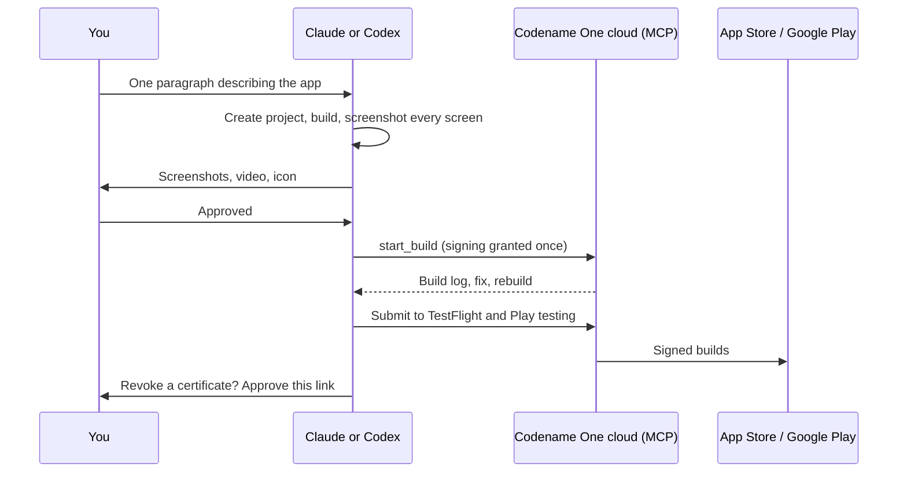


Somebody who has never heard of Java can now publish a real app, and plenty of good ones will come from people who know their problem better than any programmer.

## So why am I teaching my kids Java?

For the same reason the best Java developers know assembly language and what the CPU does with their code.

Almost none of us write assembly. But knowing what a cache line is, why a branch costs something, what the JIT is doing with your loop, makes you write better Java. Fundamentals are what let you work one level up without being a passenger.

I learned that from the other direction. I'm a terrible graphic artist. Out of necessity I learned GIMP, Photoshop and Sketch well enough to get by. I never became good at it. What I got instead was a much better sense of style, and something I value more: I can talk to people who actually have talent. I understand what they do, so I can give feedback they take seriously instead of "make it pop."

Working with a coding agent is the same relationship. It explains what it did. If you can't read the code, you can't judge the explanation, and you can't steer it to where you need to go. An agent is very good at sounding right. Its answers are often not right, and the only way to tell is to look at the code. Java is a good language to learn that in: it's explicit, it's typed, and what it does is what it says.

A couple of weeks ago I wrote that [you should rewrite everything in Java, not Rust](https://www.codenameone.com/blog/rewrite-everything-in-java-not-rust/). Same idea from the other side. A developer who knows the language can push an agent much further, because they catch the confident wrong answer on the second line instead of in production. That's how you build software that's both more sophisticated and more reliable than what came before, instead of more of the same, faster.

## From millions of lines to billions

Will you read every line an agent writes? No. Nobody reads every line now either.

But understanding is what keeps a system in check as it grows. It's how you know whether your tests cover the code or only run it. It's how you notice that the agent's fix for one bug added a second code path that nothing tests. It's how you see complexity piling up layer by layer before it falls over.

We used to call a million lines a big system. Agents write code faster than any team that ever wrote one of those, they never get bored, and they never say no to a feature. The apps of the next decade will reach billions of lines. A codebase that size isn't navigated by prompting harder. It's navigated by engineers who understand architecture, testing and failure modes, and can tell an agent precisely what to do. That's the job my kids are training for.

## A framework should take you past the OS

This is what this week's release is about.

An agent can write a spreadsheet engine for you, on top of any framework. It can write a PDF renderer, a diagramming library, tenant filtering for your ORM, a heuristic scheduler. Each one will look fine in the first demo. Then it's yours. It's more code in your repository, more context the agent has to hold, more tests in your CI, more platforms to verify, forever. Code is cheap to generate and expensive to own, and the complexity binds you. A homegrown PDF renderer is a tax you pay every release.

So a framework's job is no longer to wrap what the operating system offers. Agents do that easily. The job is to take you far beyond it. Neither iOS nor Android ships a spreadsheet with live formulas, a flowchart editor, a Gantt chart or a multi-tenant backend. A complete spreadsheet is now the starting point. A flowchart of a business process is the bare minimum for a business app.

Codename One is 4.5 million lines of code you don't have to write. We test it on every commit across iOS, Android, macOS, Windows, Linux and the web, with screenshot comparisons on each one. That costs us about $20,000 a month in CI ($21,512.95 last month, to be exact). Generate the same coverage yourself and that bill is yours.

## Enterprises have to move like startups

Large companies are now expected to ship at the speed a three-person startup ships with agents. But they can't take the risks an indie developer takes. Their source code, signing keys and user data can't leave the network, and no compliance team will approve a build pipeline they don't control.

Codename One itself is free and open source, and that includes building offline on your own machine. Every developer, in every company, can build for every platform without sending a byte to anyone. That never changes.

What a large company wants on top of that are our commercial, enterprise grade services, and until now those lived in our cloud. So we're bringing back [Corporate Server](https://www.codenameone.com/corporate-server/). It's an optional product that runs those services on premises at your site, or in a dedicated private cloud isolated from every other customer:

- **The build cloud**, so developers keep sending a build and getting a signed app back, without a Mac on every desk.
- **The push server** for your backend.
- **App Shield attestation**, so your API serves only genuine, untampered copies of your app.
- **App Hardening**, obfuscation at the level of DexGuard: renamed classes, encrypted strings and scrambled control flow, on every port.
- **Crash Protection**, with symbolicated crashes filed into your own issue tracker.
- **Analytics** and the rest of the enterprise services.

All of it inside your network, under your compliance rules.

## More This Week

### A million rows, and spreadsheets with live formulas

`DataGrid` doesn't replace `Table`. It's the extreme version, in the spirit of SwingX's `JXTable` and `JXTreeTable`: a painted grid that scrolls a million rows, with frozen columns, grouping with aggregates, in-place editing and a lazy tree mode. On top of it, `Workbook` reads and writes XLSX, ODS and CSV and evaluates 402 Excel functions live, with completion and syntax highlighting while you type a formula.

```java
Sheet sheet = new Workbook().addSheet("Orders");
sheet.addRow("Item", "Units", "Price", "Total");
sheet.addRow("Bolt", 40.0, 0.25);
sheet.setCellFormula("D2", "=B2*C2");
DataGrid grid = new DataGrid(sheet);
```


<div class="release-screenshots" style="display:grid;grid-template-columns:repeat(auto-fit,minmax(min(100%,240px),1fr));gap:16px;align-items:start;margin:24px 0">
<figure style="margin:0">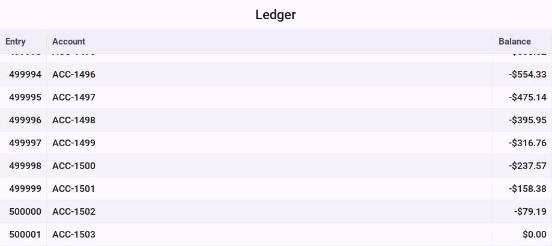<figcaption>A million rows.</figcaption></figure>
<figure style="margin:0">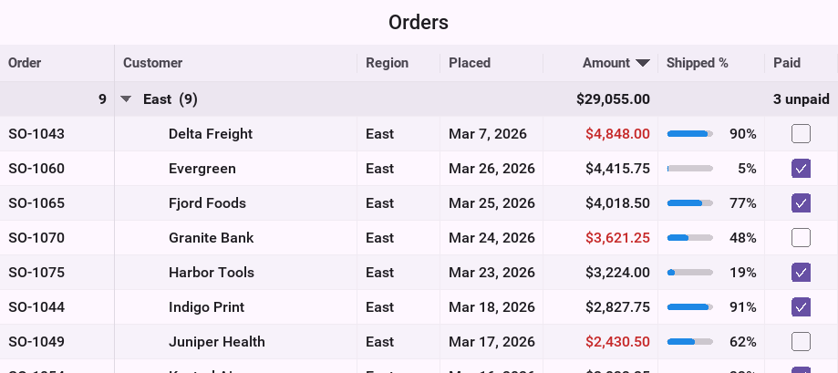<figcaption>Grouping and aggregates.</figcaption></figure>
<figure style="margin:0">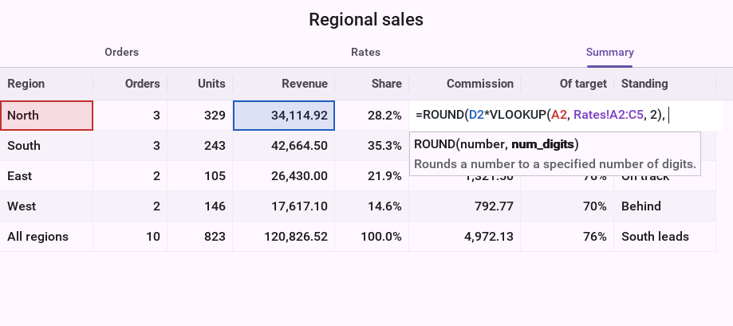<figcaption>Formulas that feel like Excel.</figcaption></figure>
</div>


My high school finishing exams included a test in Lotus 1-2-3. Lotus didn't invent the spreadsheet, VisiCalc did. Lotus put charts next to the numbers, and two great ideas combined made one of the first iconic software startups. That's my theme for this week: here are the components, remix them into something wonderful. Saturday's [article](https://www.codenameone.com/blog/a-million-rows-and-live-excel-formulas/) has the details.

### A backend that can't leak one customer into another

`@TenantId` on an entity filters every ORM query, count and bulk update by the current tenant. Native SQL in a multi-tenant session is blocked by default, because the forgotten `WHERE tenant_id = ?` in a hand-written query is the most common data leak in SaaS. You opt in explicitly, and `allowNativeSql` becomes the one thing a security review has to search for.

```java
@Entity
public class Invoice {
    @Id @GeneratedValue long id;
    @TenantId String tenant;
    String customer;
}
```

The backend also gained a Spring-style GraphQL server, SAML 2.0 single sign-on, LDAP and Active Directory, object storage on S3, R2, Google Cloud Storage and Azure Blob with no SDKs, and MongoDB, DynamoDB and Elasticsearch through the same entity classes. Sunday's [backend article](https://www.codenameone.com/blog/multi-tenant-saas-backend-in-java/) covers all of it.

### PDFs on the client and the server

`com.codename1.pdf` writes documents with a canvas or a flowing layout of paragraphs and tables, and the same classes run in the app and on the backend. `PdfViewer` renders in pure Java, so a file looks identical on every platform. It opens encrypted documents and prints them.

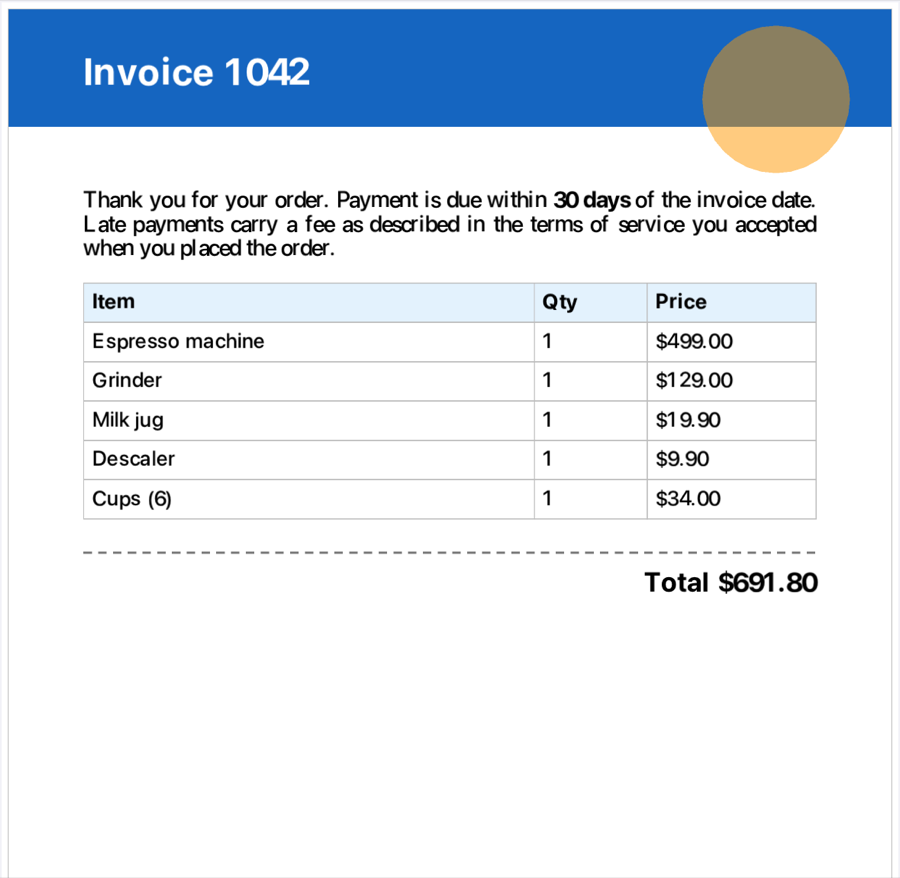

Monday's [PDF article](https://www.codenameone.com/blog/generate-and-view-pdfs-in-java/) walks through invoices, tickets, and printing.

### Fieldline, a field service company in a template

One of my first jobs was at a scheduling company, writing heuristic scheduling algorithms that planners watched as Gantt charts full of constraints. It's a hard field. Fieldline makes it a template: technicians follow their day as a route on a map, fill checklists, photograph problems for an AI diagnosis and collect signatures. Dispatchers drag work on a Gantt chart, ask the assistant to re-plan in plain words, and let a solver plan the week around skills, hours, and travel. Maps, location, an AI expert on call and heuristic optimization, connected in one app.


<video controls playsinline preload="metadata" poster="https://www.codenameone.com/fieldline/fieldline-dispatcher-mobile-poster.jpg" style="width:100%;max-width:420px;height:auto;display:block;margin:16px auto" aria-label="Dispatching jobs in Fieldline on a phone"><source src="https://www.codenameone.com/fieldline/fieldline-dispatcher-mobile.mp4" type="video/mp4"><a href="https://www.codenameone.com/fieldline/fieldline-dispatcher-mobile.mp4">Download the Fieldline video</a>.</video>


Tuesday's [Fieldline article](https://www.codenameone.com/blog/field-service-scheduling-template/) opens up the optimizer.

### Diagrams, node editors and Kanban boards

`NodeGraph` draws diagrams with automatic layered, tree, radial and force layouts, flowchart shapes and swim lanes, and doubles as a port-based node editor. `KanbanBoard` adds draggable cards, swim lanes and WIP limits. In most frameworks these are commercial add-ons. The baseline for a business app moved, so they're in the core.

```java
DefaultGraphModel model = new DefaultGraphModel();
model.addNode(new GraphNode("web", "Web app"));
model.addNode(new GraphNode("api", "API gateway"));
model.addEdge("web", "api");
NodeGraph graph = new NodeGraph(model);
graph.arrange(new LayeredArrangement(), false);
```


<div class="release-screenshots" style="display:grid;grid-template-columns:repeat(auto-fit,minmax(min(100%,240px),1fr));gap:16px;align-items:start;margin:24px 0">
<figure style="margin:0"><figcaption>Flowcharts with swim lanes.</figcaption></figure>
<figure style="margin:0">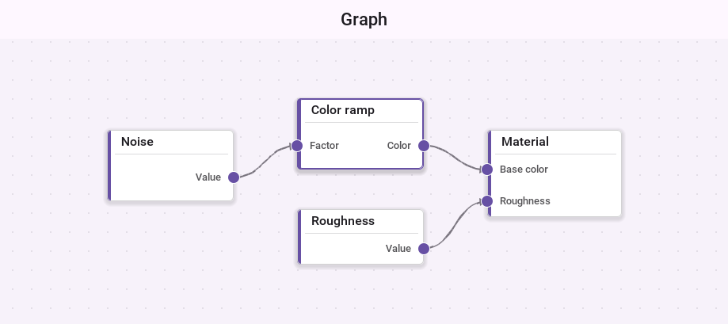<figcaption>Node editors.</figcaption></figure>
<figure style="margin:0">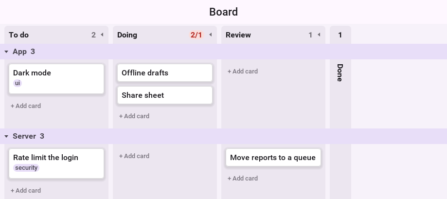<figcaption>Kanban with WIP limits.</figcaption></figure>
</div>


Wednesday's [article](https://www.codenameone.com/blog/diagrams-flowcharts-and-kanban-boards/) shows flowcharts, editors, and boards.

### Brickyard, shaders and 3D audio

Brickyard is a real game development studio, and it ships as a template. Games are Luau scripts in a 3D world of parts, and the interpreter runs the full Luau language with its standard libraries. Bring a Roblox place file, `.rbxlx` or binary `.rbxl`, and it opens and runs, with a compatibility report listing any API the engine doesn't cover yet. Export it back out when you're done.

The studio has an explorer, a properties panel, a Luau editor with syntax checking and completion, lighting, models, undo, play test with several players, and publish, on a phone, a tablet or a desktop. Multiplayer runs on an authoritative server. An AI agent can drive the whole studio through MCP and play test its own game to see what broke.


<div class="release-screenshots" style="display:grid;grid-template-columns:repeat(auto-fit,minmax(min(100%,240px),1fr));gap:16px;align-items:start;margin:24px 0">
<figure style="margin:0">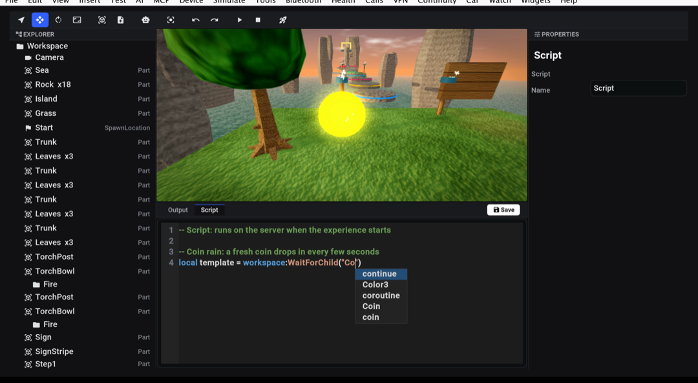<figcaption>Luau, with completion and syntax checks.</figcaption></figure>
<figure style="margin:0"><figcaption>The studio on the desktop.</figcaption></figure>
<figure style="margin:0">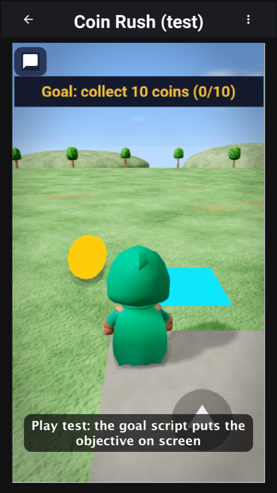<figcaption>Play test before you publish.</figcaption></figure>
</div>


<video controls playsinline preload="metadata" poster="https://www.codenameone.com/brickyard/brickyard-game-types-poster.jpg" style="width:100%;height:auto;display:block;margin:16px auto" aria-label="Game types in Brickyard"><source src="https://www.codenameone.com/brickyard/brickyard-game-types.mp4" type="video/mp4"><a href="https://www.codenameone.com/brickyard/brickyard-game-types.mp4">Download the Brickyard video</a>.</video>


Under it, the GPU package gained portable shader nodes that compile to Metal, Direct3D, GLSL and WebGL from one Java definition, a library of water, terrain, surface and effect shaders, image-based lighting, GPU skinning, instancing and a full post-processing stack. The new audio graph, modeled on Web Audio, adds spatial sound with HRTF for headphones. Thursday's [article](https://www.codenameone.com/blog/build-a-game-platform-with-luau-scripting/) covers all three.

### Foldable skins you can record

The simulator now draws foldable skins in 3D and animates them between flat, half open and closed, moving your app to the cover display when the device closes. Posture events fire at the same angles Android uses, so your fold handling runs in the simulator exactly as it will on the device. *Simulate, Record Device Tour* records the device folding and rotating to an MP4 at a smooth 60 frames per second, staged and ready for your store listing. Here's a raw recording, straight out of the simulator:


<video controls playsinline preload="metadata" poster="https://www.codenameone.com/blog/release-2026-11-20/foldable-device-tour-poster.jpg" width="1920" height="1080" style="width:100%;height:auto;display:block;margin:16px auto" aria-label="A foldable skin closing, half folding and opening in the simulator"><source src="https://www.codenameone.com/blog/release-2026-11-20/foldable-device-tour.mp4" type="video/mp4"><a href="https://www.codenameone.com/blog/release-2026-11-20/foldable-device-tour.mp4">Download the foldable tour video</a>.</video>


The skin designer has a new Fold tab for building your own foldables, and agents can fold the device too, through the `sim_fold` MCP tool.

### Xcode 27.1, Gradle 9 and goodbye to Mac Catalyst

With next week's update, iOS builds move to Xcode 27.1 by default and the iOS 27 styling becomes the default theme. [Liquid Glass stays your choice](https://www.codenameone.com/blog/ios-27-glass-you-can-test/), on your schedule. The same update turns on Gradle 9 by default for Android builds, part of keeping the Android toolchain current. Try it today with the `android.gradleVersion=9` build hint, so next week is a non-event for you.

We're dropping Mac Catalyst support. The [native Mac port](https://www.codenameone.com/blog/native-appkit-mac-port/) is better in every way: a real AppKit app with real menus and windows, not an iPad app on a Mac. Keeping Catalyst in CI was eating resources that serve you better elsewhere. If you still build for Catalyst, switch to the native Mac target.

## Everything, for everyone

Look at the size of this one week. A spreadsheet engine with 402 functions. A PDF writer and viewer. A diagram editor and a Kanban board. Tenant isolation, GraphQL, SAML and four object stores for the server. A field service product with an optimizer. A game studio that runs Roblox places. Shaders, spatial audio, foldables. Any one of those is a product somebody sells on its own.

That's the scope I mean when I call Codename One a [universal platform](https://www.codenameone.com/blog/flutter-better-in-java/). Instead of coding to an operating system, you code to Codename One, and it runs your app on iOS, Android, the desktop, the web and the watch, with your backend in the same language. Bring Java, Kotlin, Swing, JavaFX, Android or Flutter code. Build a bank, a game, a SaaS product or a homework app. It's free and open source, for a solo developer and for a company with ten thousand of them.

Every week it grows, and it has to. When an agent can generate the boring parts of any app in a minute, the framework underneath has to cover everything else: every platform, every component a business expects, every service a company has to run. The bar moved for everyone, so the platform has to give everything to everyone.

That's also why I'm comfortable teaching my kids Java. They won't spend their careers wrapping an OS or rebuilding a PDF renderer. They'll start where all of this ends, and the ones who can read the code will take it further than we can picture today.

Start with Saturday's [spreadsheets](https://www.codenameone.com/blog/a-million-rows-and-live-excel-formulas/), or point your agent at [llms.txt](https://www.codenameone.com/llms.txt) and see what it ships.
